# HY-Sandbox 运行时函数图

    这些图根据当前源码和调用者整理，用于寻找功能入口，不是采样得到的实际执行轨迹。实线表示直接调用（标注“经”时包含明确中间函数）；虚线标出协程、事件或注入动作。Unity Update/FixedUpdate 的独立入口不代表脚本执行顺序。

    每个图节点可点击对应源码；渲染器禁用 click 时使用图下链接。导航由 Roslyn 校验文件与方法存在，语义顺序由修改者审查。过载函数链接到第一个声明，完整过载见 CodeIndex。

    维护：业务变化更新受影响图和 DEVELOPMENT；纯格式变化重新生成行号。`dotnet run --project Tools/CodeReadability -- --check .` 会拒绝失效符号。

    ## CSV 方块配置与质量

源码推导：CSV 是数值源；Editor 导入后延迟校验、备份并同步 Prefab。OnValidate 只排队，不在导入线程写资产；Awake 提前应用配置，随后各组件初始化。空 mass 为体积质量，存档恢复保留实例尺寸再刷新派生数据；运行时不执行制作期组件创建和连接重建，尺寸变化时才重建连接。

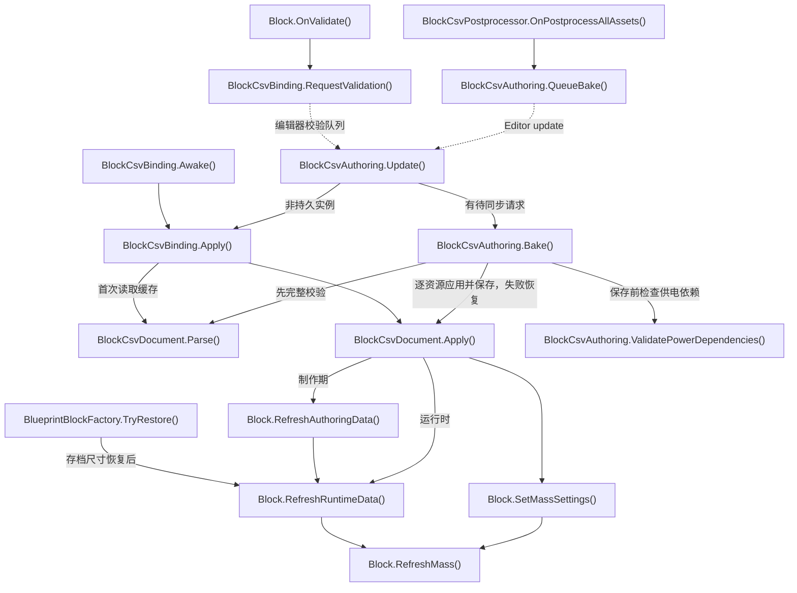

- [BlockCsvPostprocessor.OnPostprocessAllAssets](../Assets/Editor/Building/BlockCsvPostprocessor.cs#L8)
<!-- source: Assets/Editor/Building/BlockCsvPostprocessor.cs|OnPostprocessAllAssets -->
- [BlockCsvAuthoring.QueueBake](../Assets/Editor/Building/BlockCsvAuthoring.cs#L239)
<!-- source: Assets/Editor/Building/BlockCsvAuthoring.cs|QueueBake -->
- [BlockCsvAuthoring.Update](../Assets/Editor/Building/BlockCsvAuthoring.cs#L287)
<!-- source: Assets/Editor/Building/BlockCsvAuthoring.cs|Update -->
- [BlockCsvAuthoring.Bake](../Assets/Editor/Building/BlockCsvAuthoring.cs#L128)
<!-- source: Assets/Editor/Building/BlockCsvAuthoring.cs|Bake -->
- [BlockCsvDocument.Parse](../Assets/Scripts/Features/Building/BlockDataTables/BlockCsvDocument.cs#L33)
<!-- source: Assets/Scripts/Features/Building/BlockDataTables/BlockCsvDocument.cs|Parse -->
- [BlockCsvDocument.Apply](../Assets/Scripts/Features/Building/BlockDataTables/BlockCsvDocument.cs#L73)
<!-- source: Assets/Scripts/Features/Building/BlockDataTables/BlockCsvDocument.cs|Apply -->
- [Block.OnValidate](../Assets/Scripts/Features/Simulation/Block.cs#L77)
<!-- source: Assets/Scripts/Features/Simulation/Block.cs|OnValidate -->
- [BlockCsvBinding.RequestValidation](../Assets/Scripts/Features/Building/BlockDataTables/BlockCsvBinding.cs#L33)
<!-- source: Assets/Scripts/Features/Building/BlockDataTables/BlockCsvBinding.cs|RequestValidation -->
- [BlockCsvBinding.Awake](../Assets/Scripts/Features/Building/BlockDataTables/BlockCsvBinding.cs#L23)
<!-- source: Assets/Scripts/Features/Building/BlockDataTables/BlockCsvBinding.cs|Awake -->
- [BlockCsvBinding.Apply](../Assets/Scripts/Features/Building/BlockDataTables/BlockCsvBinding.cs#L41)
<!-- source: Assets/Scripts/Features/Building/BlockDataTables/BlockCsvBinding.cs|Apply -->
- [Block.SetMassSettings](../Assets/Scripts/Features/Simulation/Block.cs#L170)
<!-- source: Assets/Scripts/Features/Simulation/Block.cs|SetMassSettings -->
- [Block.RefreshMass](../Assets/Scripts/Features/Simulation/Block.cs#L157)
<!-- source: Assets/Scripts/Features/Simulation/Block.cs|RefreshMass -->
- [Block.RefreshAuthoringData](../Assets/Scripts/Features/Simulation/Block.cs#L94)
<!-- source: Assets/Scripts/Features/Simulation/Block.cs|RefreshAuthoringData -->
- [BlueprintBlockFactory.TryRestore](../Assets/Scripts/Features/Building/BlueprintLoading/BlueprintBlockFactory.cs#L7)
<!-- source: Assets/Scripts/Features/Building/BlueprintLoading/BlueprintBlockFactory.cs|TryRestore -->
- [Block.RefreshRuntimeData](../Assets/Scripts/Features/Simulation/Block.cs#L123)
<!-- source: Assets/Scripts/Features/Simulation/Block.cs|RefreshRuntimeData -->
- [BlockCsvAuthoring.ValidatePowerDependencies](../Assets/Editor/Building/BlockCsvAuthoring.cs#L246)
<!-- source: Assets/Editor/Building/BlockCsvAuthoring.cs|ValidatePowerDependencies -->

## 启动与建造/游玩会话

引擎自动调用入口独立；按按钮进入业务主链。返回建造前先保存货仓。选择方块资源进入 BuildType.Build；InputManager 切换 lockView 仅取消拖拽/预览并隐藏操作轴，保留选中方块、高亮、BuildType 与资源，重锁恢复操作轴。工具按钮按BuildType着色，Build高亮当前资源条目；焦点不改变模式色。

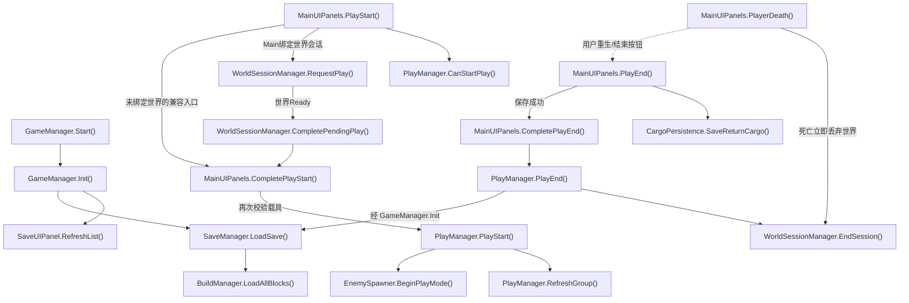

- [GameManager.Start](../Assets/Scripts/Features/Bootstrap/GameManager.cs#L15)
<!-- source: Assets/Scripts/Features/Bootstrap/GameManager.cs|Start -->
- [GameManager.Init](../Assets/Scripts/Features/Bootstrap/GameManager.cs#L20)
<!-- source: Assets/Scripts/Features/Bootstrap/GameManager.cs|Init -->
- [SaveUIPanel.RefreshList](../Assets/Scripts/Features/Building/SaveUIPanel.cs#L17)
<!-- source: Assets/Scripts/Features/Building/SaveUIPanel.cs|RefreshList -->
- [SaveManager.LoadSave](../Assets/Scripts/Features/Building/SaveManager.cs#L187)
<!-- source: Assets/Scripts/Features/Building/SaveManager.cs|LoadSave -->
- [BuildManager.LoadAllBlocks](../Assets/Scripts/Features/Building/BuildManager.cs#L562)
<!-- source: Assets/Scripts/Features/Building/BuildManager.cs|LoadAllBlocks -->
- [MainUIPanels.PlayStart](../Assets/Scripts/Features/Presentation/MainUIPanels.cs#L226)
<!-- source: Assets/Scripts/Features/Presentation/MainUIPanels.cs|PlayStart -->
- [PlayManager.CanStartPlay](../Assets/Scripts/Features/Simulation/PlayManager.cs#L133)
<!-- source: Assets/Scripts/Features/Simulation/PlayManager.cs|CanStartPlay -->
- [PlayManager.PlayStart](../Assets/Scripts/Features/Simulation/PlayManager.cs#L88)
<!-- source: Assets/Scripts/Features/Simulation/PlayManager.cs|PlayStart -->
- [PlayManager.RefreshGroup](../Assets/Scripts/Features/Simulation/PlayManager.cs#L168)
<!-- source: Assets/Scripts/Features/Simulation/PlayManager.cs|RefreshGroup -->
- [EnemySpawner.BeginPlayMode](../Assets/Scripts/Features/Combat/EnemySpawner.cs#L43)
<!-- source: Assets/Scripts/Features/Combat/EnemySpawner.cs|BeginPlayMode -->
- [MainUIPanels.PlayEnd](../Assets/Scripts/Features/Presentation/MainUIPanels.cs#L263)
<!-- source: Assets/Scripts/Features/Presentation/MainUIPanels.cs|PlayEnd -->
- [CargoPersistence.SaveReturnCargo](../Assets/Scripts/Features/Salvage/CargoPersistence.cs#L11)
<!-- source: Assets/Scripts/Features/Salvage/CargoPersistence.cs|SaveReturnCargo -->
- [PlayManager.PlayEnd](../Assets/Scripts/Features/Simulation/PlayManager.cs#L266)
<!-- source: Assets/Scripts/Features/Simulation/PlayManager.cs|PlayEnd -->
- [MainUIPanels.PlayerDeath](../Assets/Scripts/Features/Presentation/MainUIPanels.cs#L282)
<!-- source: Assets/Scripts/Features/Presentation/MainUIPanels.cs|PlayerDeath -->
- [WorldSessionManager.RequestPlay](../Assets/Scripts/Features/World/WorldSessionManager.cs#L125)
<!-- source: Assets/Scripts/Features/World/WorldSessionManager.cs|RequestPlay -->
- [WorldSessionManager.CompletePendingPlay](../Assets/Scripts/Features/World/WorldSessionManager.cs#L148)
<!-- source: Assets/Scripts/Features/World/WorldSessionManager.cs|CompletePendingPlay -->
- [MainUIPanels.CompletePlayStart](../Assets/Scripts/Features/Presentation/MainUIPanels.cs#L243)
<!-- source: Assets/Scripts/Features/Presentation/MainUIPanels.cs|CompletePlayStart -->
- [MainUIPanels.CompletePlayEnd](../Assets/Scripts/Features/Presentation/MainUIPanels.cs#L273)
<!-- source: Assets/Scripts/Features/Presentation/MainUIPanels.cs|CompletePlayEnd -->
- [WorldSessionManager.EndSession](../Assets/Scripts/Features/World/WorldSessionManager.cs#L210)
<!-- source: Assets/Scripts/Features/World/WorldSessionManager.cs|EndSession -->

## 开发者建筑蓝图编辑

源码推导：Ctrl+Alt+F 进入/退出建筑，Ctrl+Alt+E 切换敌人。建筑使用独立目录，加载父对象后由注入回调创建底座；底座不参与方块存档和操作栈。尺寸 UI 先保存元数据，再生成向上连接点并刷新已有连接，块坐标不变。

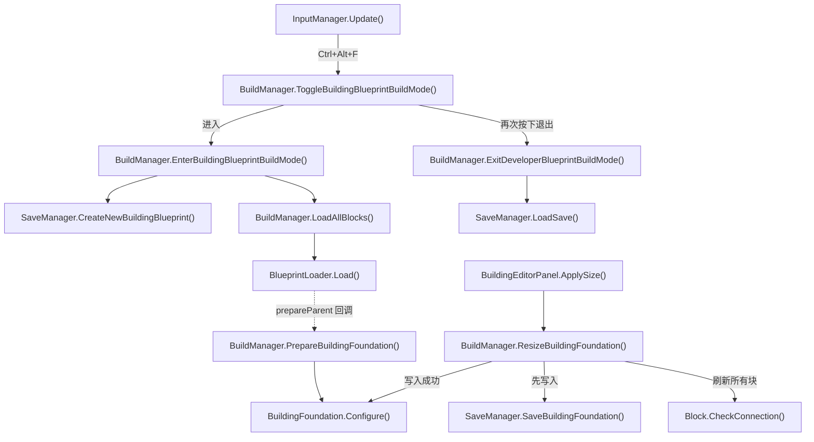

- [InputManager.Update](../Assets/Scripts/Features/Player/InputManager.cs#L40)
<!-- source: Assets/Scripts/Features/Player/InputManager.cs|Update -->
- [BuildManager.ToggleBuildingBlueprintBuildMode](../Assets/Scripts/Features/Building/BuildManager.cs#L246)
<!-- source: Assets/Scripts/Features/Building/BuildManager.cs|ToggleBuildingBlueprintBuildMode -->
- [BuildManager.EnterBuildingBlueprintBuildMode](../Assets/Scripts/Features/Building/BuildManager.cs#L258)
<!-- source: Assets/Scripts/Features/Building/BuildManager.cs|EnterBuildingBlueprintBuildMode -->
- [SaveManager.CreateNewBuildingBlueprint](../Assets/Scripts/Features/Building/SaveManager.cs#L80)
<!-- source: Assets/Scripts/Features/Building/SaveManager.cs|CreateNewBuildingBlueprint -->
- [BuildManager.LoadAllBlocks](../Assets/Scripts/Features/Building/BuildManager.cs#L562)
<!-- source: Assets/Scripts/Features/Building/BuildManager.cs|LoadAllBlocks -->
- [BlueprintLoader.Load](../Assets/Scripts/Features/Building/BlueprintLoading/BlueprintLoader.cs#L39)
<!-- source: Assets/Scripts/Features/Building/BlueprintLoading/BlueprintLoader.cs|Load -->
- [BuildManager.PrepareBuildingFoundation](../Assets/Scripts/Features/Building/BuildManager.cs#L279)
<!-- source: Assets/Scripts/Features/Building/BuildManager.cs|PrepareBuildingFoundation -->
- [BuildingFoundation.Configure](../Assets/Scripts/Features/Building/BuildingFoundation.cs#L15)
<!-- source: Assets/Scripts/Features/Building/BuildingFoundation.cs|Configure -->
- [BuildingEditorPanel.ApplySize](../Assets/Scripts/Features/Building/BuildingEditorPanel.cs#L24)
<!-- source: Assets/Scripts/Features/Building/BuildingEditorPanel.cs|ApplySize -->
- [BuildManager.ResizeBuildingFoundation](../Assets/Scripts/Features/Building/BuildManager.cs#L302)
<!-- source: Assets/Scripts/Features/Building/BuildManager.cs|ResizeBuildingFoundation -->
- [SaveManager.SaveBuildingFoundation](../Assets/Scripts/Features/Building/SaveManager.cs#L122)
<!-- source: Assets/Scripts/Features/Building/SaveManager.cs|SaveBuildingFoundation -->
- [Block.CheckConnection](../Assets/Scripts/Features/Simulation/Block.cs#L333)
<!-- source: Assets/Scripts/Features/Simulation/Block.cs|CheckConnection -->
- [BuildManager.ExitDeveloperBlueprintBuildMode](../Assets/Scripts/Features/Building/BuildManager.cs#L227)
<!-- source: Assets/Scripts/Features/Building/BuildManager.cs|ExitDeveloperBlueprintBuildMode -->
- [SaveManager.LoadSave](../Assets/Scripts/Features/Building/SaveManager.cs#L187)
<!-- source: Assets/Scripts/Features/Building/SaveManager.cs|LoadSave -->

## 蓝图恢复、统计和取消

Load 先验证文件，再替换父对象；协程按请求版本检查所有权。统计事件指向显示。取消使旧版本失效；缺资源移出缓存和JSON。

```mermaid
flowchart TD
    A["BuildManager.LoadAllBlocks()"]
    click A "../Assets/Scripts/Features/Building/BuildManager.cs#L427" "打开源码"
    B["BlueprintLoader.Load()"]
    click B "../Assets/Scripts/Features/Building/BlueprintLoading/BlueprintLoader.cs#L39" "打开源码"
    C["BlueprintLoader.TryRead()"]
    click C "../Assets/Scripts/Features/Building/BlueprintLoading/BlueprintLoader.cs#L167" "打开源码"
    D["BlueprintLoader.ReplaceParent()"]
    click D "../Assets/Scripts/Features/Building/BlueprintLoading/BlueprintLoader.cs#L206" "打开源码"
    E["BlueprintLoadCamera.Begin()"]
    click E "../Assets/Scripts/Features/Building/BlueprintLoading/BlueprintLoadCamera.cs#L15" "打开源码"
    F["BlueprintLoader.LoadRoutine()"]
    click F "../Assets/Scripts/Features/Building/BlueprintLoading/BlueprintLoader.cs#L100" "打开源码"
    G["BlueprintLoader.OwnsParent()"]
    click G "../Assets/Scripts/Features/Building/BlueprintLoading/BlueprintLoader.cs#L222" "打开源码"
    H["BlueprintBlockFactory.TryRestore()"]
    click H "../Assets/Scripts/Features/Building/BlueprintLoading/BlueprintBlockFactory.cs#L7" "打开源码"
    I["BlueprintStatistics.Accumulate()"]
    click I "../Assets/Scripts/Features/Building/BlueprintLoading/BlueprintStatistics.cs#L26" "打开源码"
    J["BlueprintUIPanel.DisplayStatistics()"]
    click J "../Assets/Scripts/Features/Building/BlueprintUIPanel.cs#L44" "打开源码"
    K["BlueprintLoader.RemoveMissingData()"]
    click K "../Assets/Scripts/Features/Building/BlueprintLoading/BlueprintLoader.cs#L227" "打开源码"
    L["BlueprintLoader.RebuildConnections()"]
    click L "../Assets/Scripts/Features/Building/BlueprintLoading/BlueprintLoader.cs#L238" "打开源码"
    M["BlueprintLoader.FinishSession()"]
    click M "../Assets/Scripts/Features/Building/BlueprintLoading/BlueprintLoader.cs#L270" "打开源码"
    N["BlueprintLoader.Cancel()"]
    click N "../Assets/Scripts/Features/Building/BlueprintLoading/BlueprintLoader.cs#L87" "打开源码"
    O["BlueprintLoadCamera.Stop()"]
    click O "../Assets/Scripts/Features/Building/BlueprintLoading/BlueprintLoadCamera.cs#L26" "打开源码"
    A --> B
    B --> C
    B -->|文件有效| D
    B --> E
    B -.->|StartCoroutine| F
    F --> G
    F --> H
    F -->|恢复成功| I
    F -.->|StatisticsChanged| J
    F -->|完成| K
    F --> L
    F -->|finally| M
    N -->|版本递增 / 停协程| M
    M --> O
```

- [BuildManager.LoadAllBlocks](../Assets/Scripts/Features/Building/BuildManager.cs#L562)
<!-- source: Assets/Scripts/Features/Building/BuildManager.cs|LoadAllBlocks -->
- [BlueprintLoader.Load](../Assets/Scripts/Features/Building/BlueprintLoading/BlueprintLoader.cs#L39)
<!-- source: Assets/Scripts/Features/Building/BlueprintLoading/BlueprintLoader.cs|Load -->
- [BlueprintLoader.TryRead](../Assets/Scripts/Features/Building/BlueprintLoading/BlueprintLoader.cs#L169)
<!-- source: Assets/Scripts/Features/Building/BlueprintLoading/BlueprintLoader.cs|TryRead -->
- [BlueprintLoader.ReplaceParent](../Assets/Scripts/Features/Building/BlueprintLoading/BlueprintLoader.cs#L208)
<!-- source: Assets/Scripts/Features/Building/BlueprintLoading/BlueprintLoader.cs|ReplaceParent -->
- [BlueprintLoadCamera.Begin](../Assets/Scripts/Features/Building/BlueprintLoading/BlueprintLoadCamera.cs#L15)
<!-- source: Assets/Scripts/Features/Building/BlueprintLoading/BlueprintLoadCamera.cs|Begin -->
- [BlueprintLoader.LoadRoutine](../Assets/Scripts/Features/Building/BlueprintLoading/BlueprintLoader.cs#L102)
<!-- source: Assets/Scripts/Features/Building/BlueprintLoading/BlueprintLoader.cs|LoadRoutine -->
- [BlueprintLoader.OwnsParent](../Assets/Scripts/Features/Building/BlueprintLoading/BlueprintLoader.cs#L226)
<!-- source: Assets/Scripts/Features/Building/BlueprintLoading/BlueprintLoader.cs|OwnsParent -->
- [BlueprintBlockFactory.TryRestore](../Assets/Scripts/Features/Building/BlueprintLoading/BlueprintBlockFactory.cs#L7)
<!-- source: Assets/Scripts/Features/Building/BlueprintLoading/BlueprintBlockFactory.cs|TryRestore -->
- [BlueprintStatistics.Accumulate](../Assets/Scripts/Features/Building/BlueprintLoading/BlueprintStatistics.cs#L26)
<!-- source: Assets/Scripts/Features/Building/BlueprintLoading/BlueprintStatistics.cs|Accumulate -->
- [BlueprintUIPanel.DisplayStatistics](../Assets/Scripts/Features/Building/BlueprintUIPanel.cs#L44)
<!-- source: Assets/Scripts/Features/Building/BlueprintUIPanel.cs|DisplayStatistics -->
- [BlueprintLoader.RemoveMissingData](../Assets/Scripts/Features/Building/BlueprintLoading/BlueprintLoader.cs#L231)
<!-- source: Assets/Scripts/Features/Building/BlueprintLoading/BlueprintLoader.cs|RemoveMissingData -->
- [BlueprintLoader.RebuildConnections](../Assets/Scripts/Features/Building/BlueprintLoading/BlueprintLoader.cs#L242)
<!-- source: Assets/Scripts/Features/Building/BlueprintLoading/BlueprintLoader.cs|RebuildConnections -->
- [BlueprintLoader.FinishSession](../Assets/Scripts/Features/Building/BlueprintLoading/BlueprintLoader.cs#L274)
<!-- source: Assets/Scripts/Features/Building/BlueprintLoading/BlueprintLoader.cs|FinishSession -->
- [BlueprintLoader.Cancel](../Assets/Scripts/Features/Building/BlueprintLoading/BlueprintLoader.cs#L89)
<!-- source: Assets/Scripts/Features/Building/BlueprintLoading/BlueprintLoader.cs|Cancel -->
- [BlueprintLoadCamera.Stop](../Assets/Scripts/Features/Building/BlueprintLoading/BlueprintLoadCamera.cs#L26)
<!-- source: Assets/Scripts/Features/Building/BlueprintLoading/BlueprintLoadCamera.cs|Stop -->

## 放置、选中、操作和持久化

Update 按输入模式调用预览或选择；预览确认放置调用显式注入的创建动作。输入/Undo、几何规则和JSON各有审查位置。

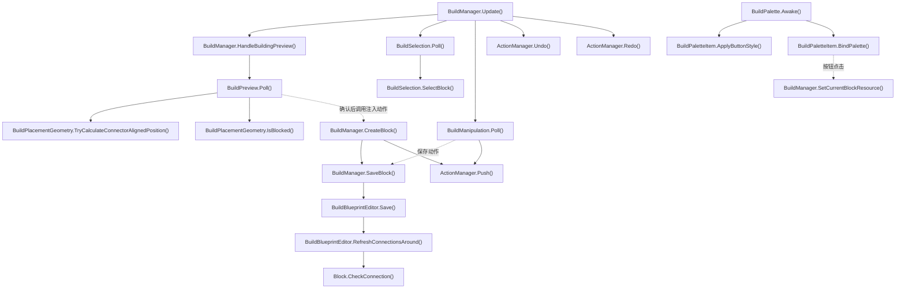

- [BuildManager.Update](../Assets/Scripts/Features/Building/BuildManager.cs#L107)
<!-- source: Assets/Scripts/Features/Building/BuildManager.cs|Update -->
- [BuildManager.HandleBuildingPreview](../Assets/Scripts/Features/Building/BuildManager.cs#L438)
<!-- source: Assets/Scripts/Features/Building/BuildManager.cs|HandleBuildingPreview -->
- [BuildPreview.Poll](../Assets/Scripts/Features/Building/Interaction/BuildPreview.cs#L41)
<!-- source: Assets/Scripts/Features/Building/Interaction/BuildPreview.cs|Poll -->
- [BuildPlacementGeometry.TryCalculateConnectorAlignedPosition](../Assets/Scripts/Features/Building/Interaction/BuildPlacementGeometry.cs#L31)
<!-- source: Assets/Scripts/Features/Building/Interaction/BuildPlacementGeometry.cs|TryCalculateConnectorAlignedPosition -->
- [BuildPlacementGeometry.IsBlocked](../Assets/Scripts/Features/Building/Interaction/BuildPlacementGeometry.cs#L121)
<!-- source: Assets/Scripts/Features/Building/Interaction/BuildPlacementGeometry.cs|IsBlocked -->
- [BuildManager.CreateBlock](../Assets/Scripts/Features/Building/BuildManager.cs#L472)
<!-- source: Assets/Scripts/Features/Building/BuildManager.cs|CreateBlock -->
- [BuildManager.SaveBlock](../Assets/Scripts/Features/Building/BuildManager.cs#L536)
<!-- source: Assets/Scripts/Features/Building/BuildManager.cs|SaveBlock -->
- [BuildBlueprintEditor.Save](../Assets/Scripts/Features/Building/Interaction/BuildBlueprintEditor.cs#L17)
<!-- source: Assets/Scripts/Features/Building/Interaction/BuildBlueprintEditor.cs|Save -->
- [BuildBlueprintEditor.RefreshConnectionsAround](../Assets/Scripts/Features/Building/Interaction/BuildBlueprintEditor.cs#L68)
<!-- source: Assets/Scripts/Features/Building/Interaction/BuildBlueprintEditor.cs|RefreshConnectionsAround -->
- [BuildSelection.Poll](../Assets/Scripts/Features/Building/Interaction/BuildSelection.cs#L42)
<!-- source: Assets/Scripts/Features/Building/Interaction/BuildSelection.cs|Poll -->
- [BuildSelection.SelectBlock](../Assets/Scripts/Features/Building/Interaction/BuildSelection.cs#L80)
<!-- source: Assets/Scripts/Features/Building/Interaction/BuildSelection.cs|SelectBlock -->
- [BuildManipulation.Poll](../Assets/Scripts/Features/Building/Interaction/BuildManipulation.cs#L59)
<!-- source: Assets/Scripts/Features/Building/Interaction/BuildManipulation.cs|Poll -->
- [ActionManager.Push](../Assets/Scripts/Features/Building/ActionManager.cs#L26)
<!-- source: Assets/Scripts/Features/Building/ActionManager.cs|Push -->
- [ActionManager.Undo](../Assets/Scripts/Features/Building/ActionManager.cs#L37)
<!-- source: Assets/Scripts/Features/Building/ActionManager.cs|Undo -->
- [ActionManager.Redo](../Assets/Scripts/Features/Building/ActionManager.cs#L50)
<!-- source: Assets/Scripts/Features/Building/ActionManager.cs|Redo -->
- [Block.CheckConnection](../Assets/Scripts/Features/Simulation/Block.cs#L333)
<!-- source: Assets/Scripts/Features/Simulation/Block.cs|CheckConnection -->
- [BuildPalette.Awake](../Assets/Scripts/Features/Building/BuildPalette.cs#L27)
<!-- source: Assets/Scripts/Features/Building/BuildPalette.cs|Awake -->
- [BuildPaletteItem.ApplyButtonStyle](../Assets/Scripts/Features/Building/BuildPaletteItem.cs#L45)
<!-- source: Assets/Scripts/Features/Building/BuildPaletteItem.cs|ApplyButtonStyle -->
- [BuildPaletteItem.BindPalette](../Assets/Scripts/Features/Building/BuildPaletteItem.cs#L35)
<!-- source: Assets/Scripts/Features/Building/BuildPaletteItem.cs|BindPalette -->
- [BuildManager.SetCurrentBlockResource](../Assets/Scripts/Features/Building/BuildManager.cs#L359)
<!-- source: Assets/Scripts/Features/Building/BuildManager.cs|SetCurrentBlockResource -->

## 供电网络与可视范围

消费者先申报工作意图，空闲不分配；每帧仅一个中继刷新功率，拓扑仅在设备或发电机位置/连接参数变化时重建。CommitPowerStatus确认SupplyEfficiency供推进器字体读取，瞬时清零不提交缺电；无中继时LateUpdate补充确认。

```mermaid
flowchart TD
    A["PowerTransmissionDevice.Update()"]
    click A "../Assets/Scripts/Features/Power/PowerTransmissionDevice.cs#L61" "打开源码"
    B["PowerNetwork.Rebuild()"]
    click B "../Assets/Scripts/Features/Power/PowerNetwork.cs#L50" "打开源码"
    C["PowerNetwork.ResetConnections()"]
    click C "../Assets/Scripts/Features/Power/PowerNetwork.cs#L134" "打开源码"
    D["PowerNetwork.BuildConnections()"]
    click D "../Assets/Scripts/Features/Power/PowerNetwork.cs#L206" "打开源码"
    E["PowerNetwork.DistributeNetworkPower()"]
    click E "../Assets/Scripts/Features/Power/PowerNetwork.cs#L308" "打开源码"
    F["PowerNetwork.CollectConnectedComponent()"]
    click F "../Assets/Scripts/Features/Power/PowerNetwork.cs#L331" "打开源码"
    G["PowerNetwork.SupplyConnectedComponent()"]
    click G "../Assets/Scripts/Features/Power/PowerNetwork.cs#L382" "打开源码"
    H["PowerNetwork.CommitPowerStatuses()"]
    click H "../Assets/Scripts/Features/Power/PowerNetwork.cs#L419" "打开源码"
    I["Power.CommitPowerStatus()"]
    click I "../Assets/Scripts/Features/Power/Power.cs#L111" "打开源码"
    J["PowerConnectionVisuals.Refresh()"]
    click J "../Assets/Scripts/Features/Power/PowerConnectionVisuals.cs#L19" "打开源码"
    K["PowerTransmissionDevice.OnDisable()"]
    click K "../Assets/Scripts/Features/Power/PowerTransmissionDevice.cs#L74" "打开源码"
    L["PowerNetwork.Clear()"]
    click L "../Assets/Scripts/Features/Power/PowerNetwork.cs#L71" "打开源码"
    M["DebugManager.RefreshPowerRangeMesh()"]
    click M "../Assets/Scripts/Features/Diagnostics/DebugManager.cs#L132" "打开源码"
    N["PowerRangeUnionView.Refresh()"]
    click N "../Assets/Scripts/Features/Power/PowerRangeUnionView.cs#L36" "打开源码"
    O["DebugManager.TogglePowerRange()"]
    click O "../Assets/Scripts/Features/Diagnostics/DebugManager.cs#L74" "打开源码"
    P["PowerRangeUnionView.Hide()"]
    click P "../Assets/Scripts/Features/Power/PowerRangeUnionView.cs#L66" "打开源码"
    Q["DebugManager.OnDestroy()"]
    click Q "../Assets/Scripts/Features/Diagnostics/DebugManager.cs#L50" "打开源码"
    R["PowerRangeUnionView.Dispose()"]
    click R "../Assets/Scripts/Features/Power/PowerRangeUnionView.cs#L79" "打开源码"
    S["Power.SetWorkRequested()"]
    click S "../Assets/Scripts/Features/Power/Power.cs#L74" "打开源码"
    T["Power.ReceivePower()"]
    click T "../Assets/Scripts/Features/Power/Power.cs#L106" "打开源码"
    U["Power.LateUpdate()"]
    click U "../Assets/Scripts/Features/Power/Power.cs#L64" "打开源码"
    V["PowerNetwork.CaptureTopology()"]
    click V "../Assets/Scripts/Features/Power/PowerNetwork.cs#L149" "打开源码"
    W["PowerNetwork.CacheConnectedComponents()"]
    click W "../Assets/Scripts/Features/Power/PowerNetwork.cs#L261" "打开源码"
    X["PowerNetwork.PrepareLoads()"]
    click X "../Assets/Scripts/Features/Power/PowerNetwork.cs#L291" "打开源码"
    Y["PowerNetwork.CollectDeviceLoads()"]
    click Y "../Assets/Scripts/Features/Power/PowerNetwork.cs#L366" "打开源码"
    Z["PowerPositionIndex.Query()"]
    click Z "../Assets/Scripts/Features/Power/PowerPositionIndex.cs#L37" "打开源码"
    A -->|首个本帧中继| B
    B --> V
    V -.->|身份、位置或连接范围变化| C
    B -->|拓扑变化| D
    B -->|拓扑变化| W
    D --> Z
    W --> F
    B -->|每帧| X
    B --> E
    E --> Y
    Y --> Z
    E --> G
    S -.->|下轮网络读取需求| G
    G --> T
    B --> H
    H --> I
    U -->|本帧尚未提交| I
    A --> J
    K -->|最后中继| L
    A -->|完成网络后| M
    M --> N
    O -->|关闭范围显示| P
    Q --> R
```

- [PowerTransmissionDevice.Update](../Assets/Scripts/Features/Power/PowerTransmissionDevice.cs#L61)
<!-- source: Assets/Scripts/Features/Power/PowerTransmissionDevice.cs|Update -->
- [PowerNetwork.Rebuild](../Assets/Scripts/Features/Power/PowerNetwork.cs#L50)
<!-- source: Assets/Scripts/Features/Power/PowerNetwork.cs|Rebuild -->
- [PowerNetwork.ResetConnections](../Assets/Scripts/Features/Power/PowerNetwork.cs#L134)
<!-- source: Assets/Scripts/Features/Power/PowerNetwork.cs|ResetConnections -->
- [PowerNetwork.BuildConnections](../Assets/Scripts/Features/Power/PowerNetwork.cs#L206)
<!-- source: Assets/Scripts/Features/Power/PowerNetwork.cs|BuildConnections -->
- [PowerNetwork.DistributeNetworkPower](../Assets/Scripts/Features/Power/PowerNetwork.cs#L308)
<!-- source: Assets/Scripts/Features/Power/PowerNetwork.cs|DistributeNetworkPower -->
- [PowerNetwork.CollectConnectedComponent](../Assets/Scripts/Features/Power/PowerNetwork.cs#L331)
<!-- source: Assets/Scripts/Features/Power/PowerNetwork.cs|CollectConnectedComponent -->
- [PowerNetwork.SupplyConnectedComponent](../Assets/Scripts/Features/Power/PowerNetwork.cs#L382)
<!-- source: Assets/Scripts/Features/Power/PowerNetwork.cs|SupplyConnectedComponent -->
- [PowerNetwork.CommitPowerStatuses](../Assets/Scripts/Features/Power/PowerNetwork.cs#L419)
<!-- source: Assets/Scripts/Features/Power/PowerNetwork.cs|CommitPowerStatuses -->
- [Power.CommitPowerStatus](../Assets/Scripts/Features/Power/Power.cs#L111)
<!-- source: Assets/Scripts/Features/Power/Power.cs|CommitPowerStatus -->
- [PowerConnectionVisuals.Refresh](../Assets/Scripts/Features/Power/PowerConnectionVisuals.cs#L19)
<!-- source: Assets/Scripts/Features/Power/PowerConnectionVisuals.cs|Refresh -->
- [PowerTransmissionDevice.OnDisable](../Assets/Scripts/Features/Power/PowerTransmissionDevice.cs#L74)
<!-- source: Assets/Scripts/Features/Power/PowerTransmissionDevice.cs|OnDisable -->
- [PowerNetwork.Clear](../Assets/Scripts/Features/Power/PowerNetwork.cs#L71)
<!-- source: Assets/Scripts/Features/Power/PowerNetwork.cs|Clear -->
- [DebugManager.RefreshPowerRangeMesh](../Assets/Scripts/Features/Diagnostics/DebugManager.cs#L132)
<!-- source: Assets/Scripts/Features/Diagnostics/DebugManager.cs|RefreshPowerRangeMesh -->
- [PowerRangeUnionView.Refresh](../Assets/Scripts/Features/Power/PowerRangeUnionView.cs#L36)
<!-- source: Assets/Scripts/Features/Power/PowerRangeUnionView.cs|Refresh -->
- [DebugManager.TogglePowerRange](../Assets/Scripts/Features/Diagnostics/DebugManager.cs#L74)
<!-- source: Assets/Scripts/Features/Diagnostics/DebugManager.cs|TogglePowerRange -->
- [PowerRangeUnionView.Hide](../Assets/Scripts/Features/Power/PowerRangeUnionView.cs#L66)
<!-- source: Assets/Scripts/Features/Power/PowerRangeUnionView.cs|Hide -->
- [DebugManager.OnDestroy](../Assets/Scripts/Features/Diagnostics/DebugManager.cs#L50)
<!-- source: Assets/Scripts/Features/Diagnostics/DebugManager.cs|OnDestroy -->
- [PowerRangeUnionView.Dispose](../Assets/Scripts/Features/Power/PowerRangeUnionView.cs#L79)
<!-- source: Assets/Scripts/Features/Power/PowerRangeUnionView.cs|Dispose -->
- [Power.SetWorkRequested](../Assets/Scripts/Features/Power/Power.cs#L74)
<!-- source: Assets/Scripts/Features/Power/Power.cs|SetWorkRequested -->
- [Power.ReceivePower](../Assets/Scripts/Features/Power/Power.cs#L106)
<!-- source: Assets/Scripts/Features/Power/Power.cs|ReceivePower -->
- [Power.LateUpdate](../Assets/Scripts/Features/Power/Power.cs#L64)
<!-- source: Assets/Scripts/Features/Power/Power.cs|LateUpdate -->
- [PowerNetwork.CaptureTopology](../Assets/Scripts/Features/Power/PowerNetwork.cs#L149)
<!-- source: Assets/Scripts/Features/Power/PowerNetwork.cs|CaptureTopology -->
- [PowerNetwork.CacheConnectedComponents](../Assets/Scripts/Features/Power/PowerNetwork.cs#L261)
<!-- source: Assets/Scripts/Features/Power/PowerNetwork.cs|CacheConnectedComponents -->
- [PowerNetwork.PrepareLoads](../Assets/Scripts/Features/Power/PowerNetwork.cs#L291)
<!-- source: Assets/Scripts/Features/Power/PowerNetwork.cs|PrepareLoads -->
- [PowerNetwork.CollectDeviceLoads](../Assets/Scripts/Features/Power/PowerNetwork.cs#L366)
<!-- source: Assets/Scripts/Features/Power/PowerNetwork.cs|CollectDeviceLoads -->
- [PowerPositionIndex.Query](../Assets/Scripts/Features/Power/PowerPositionIndex.cs#L37)
<!-- source: Assets/Scripts/Features/Power/PowerPositionIndex.cs|Query -->

## 物理分组、连接与推进

连接图是组重建输入；重组先捕获刚体速度，再转移方块与运行归属。FixedUpdate由引擎调度；悬浮控制器只提交目标，推进器每个物理帧限速一次。关机撤销功率请求但残余推力按maxThrustChangeRate衰减；退出游玩或组件禁用清零。

```mermaid
flowchart TD
    A["PlayManager.RefreshGroup()"]
    click A "../Assets/Scripts/Features/Simulation/PlayManager.cs#L168" "打开源码"
    B["PlayManager.AssignBlocksToParentGroups()"]
    click B "../Assets/Scripts/Features/Simulation/PlayManager.cs#L296" "打开源码"
    C["RuntimeGroupBuilder.Rebuild()"]
    click C "../Assets/Scripts/Features/Simulation/RuntimeGroupBuilder.cs#L15" "打开源码"
    D["BlockGroupManager.GroupBlocks()"]
    click D "../Assets/Scripts/Features/Simulation/BlockGroupManager.cs#L9" "打开源码"
    E["BlockConnections.CollectNeighbors()"]
    click E "../Assets/Scripts/Features/Simulation/BlockConnections.cs#L235" "打开源码"
    F["RuntimeGroupBuilder.RestoreGroupPhysics()"]
    click F "../Assets/Scripts/Features/Simulation/RuntimeGroupBuilder.cs#L84" "打开源码"
    G["ControlUnit.RefreshChildren()"]
    click G "../Assets/Scripts/Features/Simulation/ControlUnit.cs#L159" "打开源码"
    H["PlayManager.FixedUpdate()"]
    click H "../Assets/Scripts/Features/Simulation/PlayManager.cs#L60" "打开源码"
    I["RuntimeGroupCleanup.EnforceDistance()"]
    click I "../Assets/Scripts/Features/Simulation/RuntimeGroupCleanup.cs#L51" "打开源码"
    J["HoverFlightController.FixedUpdate()"]
    click J "../Assets/Scripts/Features/Flight/HoverFlightController.cs#L103" "打开源码"
    K["HoverFlightController.DistributeThrust()"]
    click K "../Assets/Scripts/Features/Flight/HoverFlightController.cs#L348" "打开源码"
    L["MainThruster.FixedUpdate()"]
    click L "../Assets/Scripts/Features/Flight/MainThruster.cs#L10" "打开源码"
    M["Thruster.ApplyThrustChangeRateLimit()"]
    click M "../Assets/Scripts/Features/Flight/Thruster.cs#L126" "打开源码"
    N["HoverControlSolver.StepHeight()"]
    click N "../Assets/Scripts/Features/Flight/HoverControlSolver.cs#L29" "打开源码"
    O["HoverControlSolver.CalculateTilt()"]
    click O "../Assets/Scripts/Features/Flight/HoverControlSolver.cs#L55" "打开源码"
    P["HoverFlightController.StopControlOutput()"]
    click P "../Assets/Scripts/Features/Flight/HoverFlightController.cs#L170" "打开源码"
    Q["HoverControlSolver.Reset()"]
    click Q "../Assets/Scripts/Features/Flight/HoverControlSolver.cs#L23" "打开源码"
    R["HoverFlightController.ClearHoverThrust()"]
    click R "../Assets/Scripts/Features/Flight/HoverFlightController.cs#L177" "打开源码"
    S["HoverFlightController.OnDisable()"]
    click S "../Assets/Scripts/Features/Flight/HoverFlightController.cs#L91" "打开源码"
    T["HoverThruster.SetControlledThrust()"]
    click T "../Assets/Scripts/Features/Flight/HoverThruster.cs#L11" "打开源码"
    U["HoverThruster.FixedUpdate()"]
    click U "../Assets/Scripts/Features/Flight/HoverThruster.cs#L16" "打开源码"
    V["UniversalThruster.FixedUpdate()"]
    click V "../Assets/Scripts/Features/Flight/UniversalThruster.cs#L10" "打开源码"
    A --> B
    B --> C
    C --> D
    D -->|BFS 经 Block.CollectNeighbors| E
    C --> F
    C --> G
    H --> I
    J -->|有效游玩/供电/归属| N
    J --> O
    J --> K
    K --> T
    R --> T
    U --> M
    V --> M
    L --> M
    J -->|停止或失效| P
    S --> P
    P --> Q
    P --> R
```

- [PlayManager.RefreshGroup](../Assets/Scripts/Features/Simulation/PlayManager.cs#L168)
<!-- source: Assets/Scripts/Features/Simulation/PlayManager.cs|RefreshGroup -->
- [PlayManager.AssignBlocksToParentGroups](../Assets/Scripts/Features/Simulation/PlayManager.cs#L296)
<!-- source: Assets/Scripts/Features/Simulation/PlayManager.cs|AssignBlocksToParentGroups -->
- [RuntimeGroupBuilder.Rebuild](../Assets/Scripts/Features/Simulation/RuntimeGroupBuilder.cs#L15)
<!-- source: Assets/Scripts/Features/Simulation/RuntimeGroupBuilder.cs|Rebuild -->
- [BlockGroupManager.GroupBlocks](../Assets/Scripts/Features/Simulation/BlockGroupManager.cs#L9)
<!-- source: Assets/Scripts/Features/Simulation/BlockGroupManager.cs|GroupBlocks -->
- [BlockConnections.CollectNeighbors](../Assets/Scripts/Features/Simulation/BlockConnections.cs#L235)
<!-- source: Assets/Scripts/Features/Simulation/BlockConnections.cs|CollectNeighbors -->
- [RuntimeGroupBuilder.RestoreGroupPhysics](../Assets/Scripts/Features/Simulation/RuntimeGroupBuilder.cs#L84)
<!-- source: Assets/Scripts/Features/Simulation/RuntimeGroupBuilder.cs|RestoreGroupPhysics -->
- [ControlUnit.RefreshChildren](../Assets/Scripts/Features/Simulation/ControlUnit.cs#L159)
<!-- source: Assets/Scripts/Features/Simulation/ControlUnit.cs|RefreshChildren -->
- [PlayManager.FixedUpdate](../Assets/Scripts/Features/Simulation/PlayManager.cs#L60)
<!-- source: Assets/Scripts/Features/Simulation/PlayManager.cs|FixedUpdate -->
- [RuntimeGroupCleanup.EnforceDistance](../Assets/Scripts/Features/Simulation/RuntimeGroupCleanup.cs#L51)
<!-- source: Assets/Scripts/Features/Simulation/RuntimeGroupCleanup.cs|EnforceDistance -->
- [HoverFlightController.FixedUpdate](../Assets/Scripts/Features/Flight/HoverFlightController.cs#L103)
<!-- source: Assets/Scripts/Features/Flight/HoverFlightController.cs|FixedUpdate -->
- [HoverFlightController.DistributeThrust](../Assets/Scripts/Features/Flight/HoverFlightController.cs#L348)
<!-- source: Assets/Scripts/Features/Flight/HoverFlightController.cs|DistributeThrust -->
- [MainThruster.FixedUpdate](../Assets/Scripts/Features/Flight/MainThruster.cs#L10)
<!-- source: Assets/Scripts/Features/Flight/MainThruster.cs|FixedUpdate -->
- [Thruster.ApplyThrustChangeRateLimit](../Assets/Scripts/Features/Flight/Thruster.cs#L126)
<!-- source: Assets/Scripts/Features/Flight/Thruster.cs|ApplyThrustChangeRateLimit -->
- [HoverControlSolver.StepHeight](../Assets/Scripts/Features/Flight/HoverControlSolver.cs#L29)
<!-- source: Assets/Scripts/Features/Flight/HoverControlSolver.cs|StepHeight -->
- [HoverControlSolver.CalculateTilt](../Assets/Scripts/Features/Flight/HoverControlSolver.cs#L55)
<!-- source: Assets/Scripts/Features/Flight/HoverControlSolver.cs|CalculateTilt -->
- [HoverFlightController.StopControlOutput](../Assets/Scripts/Features/Flight/HoverFlightController.cs#L170)
<!-- source: Assets/Scripts/Features/Flight/HoverFlightController.cs|StopControlOutput -->
- [HoverControlSolver.Reset](../Assets/Scripts/Features/Flight/HoverControlSolver.cs#L23)
<!-- source: Assets/Scripts/Features/Flight/HoverControlSolver.cs|Reset -->
- [HoverFlightController.ClearHoverThrust](../Assets/Scripts/Features/Flight/HoverFlightController.cs#L177)
<!-- source: Assets/Scripts/Features/Flight/HoverFlightController.cs|ClearHoverThrust -->
- [HoverFlightController.OnDisable](../Assets/Scripts/Features/Flight/HoverFlightController.cs#L91)
<!-- source: Assets/Scripts/Features/Flight/HoverFlightController.cs|OnDisable -->
- [HoverThruster.SetControlledThrust](../Assets/Scripts/Features/Flight/HoverThruster.cs#L11)
<!-- source: Assets/Scripts/Features/Flight/HoverThruster.cs|SetControlledThrust -->
- [HoverThruster.FixedUpdate](../Assets/Scripts/Features/Flight/HoverThruster.cs#L16)
<!-- source: Assets/Scripts/Features/Flight/HoverThruster.cs|FixedUpdate -->
- [UniversalThruster.FixedUpdate](../Assets/Scripts/Features/Flight/UniversalThruster.cs#L10)
<!-- source: Assets/Scripts/Features/Flight/UniversalThruster.cs|FixedUpdate -->

## 战斗、损伤、爆炸与残骸清理

Turret独立索敌后申报功率；激光即时命中且无冲量，实体炮塔每炮口生成一发并由物理扫掠命中。爆炸与延迟清理保留原生命周期。

```mermaid
flowchart TD
    A["Turret.FixedUpdate()"]
    click A "../Assets/Scripts/Features/Combat/Turret.cs#L71" "打开源码"
    B["TurretTargetSelector.FindNearestTarget()"]
    click B "../Assets/Scripts/Features/Combat/TurretTargetSelector.cs#L17" "打开源码"
    C["TurretHitscan.Fire()"]
    click C "../Assets/Scripts/Features/Combat/TurretHitscan.cs#L10" "打开源码"
    D["Durability.ApplyDamage()"]
    click D "../Assets/Scripts/Features/Combat/Durability.cs#L63" "打开源码"
    E["ControlUnit.OnCollisionEnter()"]
    click E "../Assets/Scripts/Features/Simulation/ControlUnit.cs#L296" "打开源码"
    F["CollisionDamageResolver.ApplyContactDamage()"]
    click F "../Assets/Scripts/Features/Combat/CollisionDamageResolver.cs#L10" "打开源码"
    G["Durability.ApplyCollisionEnergy()"]
    click G "../Assets/Scripts/Features/Combat/Durability.cs#L74" "打开源码"
    H["DestroyManager.DestroyGameObject()"]
    click H "../Assets/Scripts/Features/Combat/DestroyManager.cs#L30" "打开源码"
    I["DestroyManager.ExplodeBlock()"]
    click I "../Assets/Scripts/Features/Combat/DestroyManager.cs#L131" "打开源码"
    J["ExplosionPropagation.DisconnectBlocksInExplosionRange()"]
    click J "../Assets/Scripts/Features/Combat/ExplosionPropagation.cs#L9" "打开源码"
    K["PlayManager.RefreshGroup()"]
    click K "../Assets/Scripts/Features/Simulation/PlayManager.cs#L168" "打开源码"
    L["ExplosionPropagation.ApplyExplosionForce()"]
    click L "../Assets/Scripts/Features/Combat/ExplosionPropagation.cs#L53" "打开源码"
    M["SalvageCleanupSession.ScheduleUnit()"]
    click M "../Assets/Scripts/Features/Combat/SalvageCleanupSession.cs#L17" "打开源码"
    N["SalvageCleanupSession.CleanupUnitAfterDelay()"]
    click N "../Assets/Scripts/Features/Combat/SalvageCleanupSession.cs#L106" "打开源码"
    O["CargoHold.ReleaseContents()"]
    click O "../Assets/Scripts/Features/Salvage/CargoHold.cs#L206" "打开源码"
    P["LaserTurret.Fire()"]
    click P "../Assets/Scripts/Features/Combat/LaserTurret.cs#L33" "打开源码"
    Q["ProjectileTurret.Fire()"]
    click Q "../Assets/Scripts/Features/Combat/ProjectileTurret.cs#L113" "打开源码"
    R["TurretProjectile.Launch()"]
    click R "../Assets/Scripts/Features/Combat/TurretProjectile.cs#L63" "打开源码"
    S["TurretProjectile.FixedUpdate()"]
    click S "../Assets/Scripts/Features/Combat/TurretProjectile.cs#L96" "打开源码"
    T["TurretHitResolver.Apply()"]
    click T "../Assets/Scripts/Features/Combat/TurretHitResolver.cs#L7" "打开源码"
    U["Power.SetWorkRequested()"]
    click U "../Assets/Scripts/Features/Power/Power.cs#L74" "打开源码"
    V["ProjectileTurret.LateUpdate()"]
    click V "../Assets/Scripts/Features/Combat/ProjectileTurret.cs#L57" "打开源码"
    W["ProjectileTurret.UpdateRecoil()"]
    click W "../Assets/Scripts/Features/Combat/ProjectileTurret.cs#L66" "打开源码"
    X["ProjectileTurret.ApplyRecoilPose()"]
    click X "../Assets/Scripts/Features/Combat/ProjectileTurret.cs#L84" "打开源码"
    Y["ProjectileTurret.OnDisable()"]
    click Y "../Assets/Scripts/Features/Combat/ProjectileTurret.cs#L105" "打开源码"
    Z["TurretProjectilePool.Rent()"]
    click Z "../Assets/Scripts/Features/Combat/TurretProjectilePool.cs#L11" "打开源码"
    AA["TurretProjectile.Retire()"]
    click AA "../Assets/Scripts/Features/Combat/TurretProjectile.cs#L223" "打开源码"
    AB["TurretProjectilePool.Return()"]
    click AB "../Assets/Scripts/Features/Combat/TurretProjectilePool.cs#L44" "打开源码"
    AC["TurretProjectile.OnDisable()"]
    click AC "../Assets/Scripts/Features/Combat/TurretProjectile.cs#L31" "打开源码"
    AD["TurretProjectilePool.Update()"]
    click AD "../Assets/Scripts/Features/Combat/TurretProjectilePool.cs#L57" "打开源码"
    AE["TurretProjectilePool.OnDestroy()"]
    click AE "../Assets/Scripts/Features/Combat/TurretProjectilePool.cs#L65" "打开源码"
    AF["BuildingRuntime.DestroyBlock()"]
    click AF "../Assets/Scripts/Features/World/BuildingRuntime.cs#L151" "打开源码"
    A --> B
    A --> U
    A -->|供电、瞄准且冷却满足| P
    P --> C
    A -->|供电、瞄准且冷却满足| Q
    Q -->|每炮口一发| R
    Q --> Z
    S -->|命中或到期| AA
    AA -->|池实例| AB
    AB -.->|SetActive false| AC
    AD -.->|模拟结束销毁池根| AE
    Q -.->|发射触发后座| V
    V --> W
    W --> X
    Y -->|禁用恢复初始炮管位置| X
    R -.->|后续物理步| S
    S -->|首次实体命中| T
    C -->|零冲量| T
    T --> D
    E --> F
    F --> G
    D -->|载具耐久为0| H
    G -->|载具耐久为0| H
    D -->|建筑耐久为0| AF
    G -->|建筑耐久为0| AF
    H -->|可爆炸且非碰撞致死| I
    I --> J
    I --> K
    I --> L
    H --> O
    H -->|敌方驾驶舱| M
    M -.->|协程等待并复核| N
```

- [Turret.FixedUpdate](../Assets/Scripts/Features/Combat/Turret.cs#L71)
<!-- source: Assets/Scripts/Features/Combat/Turret.cs|FixedUpdate -->
- [TurretTargetSelector.FindNearestTarget](../Assets/Scripts/Features/Combat/TurretTargetSelector.cs#L17)
<!-- source: Assets/Scripts/Features/Combat/TurretTargetSelector.cs|FindNearestTarget -->
- [TurretHitscan.Fire](../Assets/Scripts/Features/Combat/TurretHitscan.cs#L10)
<!-- source: Assets/Scripts/Features/Combat/TurretHitscan.cs|Fire -->
- [Durability.ApplyDamage](../Assets/Scripts/Features/Combat/Durability.cs#L63)
<!-- source: Assets/Scripts/Features/Combat/Durability.cs|ApplyDamage -->
- [ControlUnit.OnCollisionEnter](../Assets/Scripts/Features/Simulation/ControlUnit.cs#L296)
<!-- source: Assets/Scripts/Features/Simulation/ControlUnit.cs|OnCollisionEnter -->
- [CollisionDamageResolver.ApplyContactDamage](../Assets/Scripts/Features/Combat/CollisionDamageResolver.cs#L10)
<!-- source: Assets/Scripts/Features/Combat/CollisionDamageResolver.cs|ApplyContactDamage -->
- [Durability.ApplyCollisionEnergy](../Assets/Scripts/Features/Combat/Durability.cs#L74)
<!-- source: Assets/Scripts/Features/Combat/Durability.cs|ApplyCollisionEnergy -->
- [DestroyManager.DestroyGameObject](../Assets/Scripts/Features/Combat/DestroyManager.cs#L30)
<!-- source: Assets/Scripts/Features/Combat/DestroyManager.cs|DestroyGameObject -->
- [DestroyManager.ExplodeBlock](../Assets/Scripts/Features/Combat/DestroyManager.cs#L131)
<!-- source: Assets/Scripts/Features/Combat/DestroyManager.cs|ExplodeBlock -->
- [ExplosionPropagation.DisconnectBlocksInExplosionRange](../Assets/Scripts/Features/Combat/ExplosionPropagation.cs#L9)
<!-- source: Assets/Scripts/Features/Combat/ExplosionPropagation.cs|DisconnectBlocksInExplosionRange -->
- [PlayManager.RefreshGroup](../Assets/Scripts/Features/Simulation/PlayManager.cs#L168)
<!-- source: Assets/Scripts/Features/Simulation/PlayManager.cs|RefreshGroup -->
- [ExplosionPropagation.ApplyExplosionForce](../Assets/Scripts/Features/Combat/ExplosionPropagation.cs#L53)
<!-- source: Assets/Scripts/Features/Combat/ExplosionPropagation.cs|ApplyExplosionForce -->
- [SalvageCleanupSession.ScheduleUnit](../Assets/Scripts/Features/Combat/SalvageCleanupSession.cs#L17)
<!-- source: Assets/Scripts/Features/Combat/SalvageCleanupSession.cs|ScheduleUnit -->
- [SalvageCleanupSession.CleanupUnitAfterDelay](../Assets/Scripts/Features/Combat/SalvageCleanupSession.cs#L106)
<!-- source: Assets/Scripts/Features/Combat/SalvageCleanupSession.cs|CleanupUnitAfterDelay -->
- [CargoHold.ReleaseContents](../Assets/Scripts/Features/Salvage/CargoHold.cs#L206)
<!-- source: Assets/Scripts/Features/Salvage/CargoHold.cs|ReleaseContents -->
- [LaserTurret.Fire](../Assets/Scripts/Features/Combat/LaserTurret.cs#L33)
<!-- source: Assets/Scripts/Features/Combat/LaserTurret.cs|Fire -->
- [ProjectileTurret.Fire](../Assets/Scripts/Features/Combat/ProjectileTurret.cs#L113)
<!-- source: Assets/Scripts/Features/Combat/ProjectileTurret.cs|Fire -->
- [TurretProjectile.Launch](../Assets/Scripts/Features/Combat/TurretProjectile.cs#L63)
<!-- source: Assets/Scripts/Features/Combat/TurretProjectile.cs|Launch -->
- [TurretProjectile.FixedUpdate](../Assets/Scripts/Features/Combat/TurretProjectile.cs#L96)
<!-- source: Assets/Scripts/Features/Combat/TurretProjectile.cs|FixedUpdate -->
- [TurretHitResolver.Apply](../Assets/Scripts/Features/Combat/TurretHitResolver.cs#L7)
<!-- source: Assets/Scripts/Features/Combat/TurretHitResolver.cs|Apply -->
- [Power.SetWorkRequested](../Assets/Scripts/Features/Power/Power.cs#L74)
<!-- source: Assets/Scripts/Features/Power/Power.cs|SetWorkRequested -->
- [ProjectileTurret.LateUpdate](../Assets/Scripts/Features/Combat/ProjectileTurret.cs#L57)
<!-- source: Assets/Scripts/Features/Combat/ProjectileTurret.cs|LateUpdate -->
- [ProjectileTurret.UpdateRecoil](../Assets/Scripts/Features/Combat/ProjectileTurret.cs#L66)
<!-- source: Assets/Scripts/Features/Combat/ProjectileTurret.cs|UpdateRecoil -->
- [ProjectileTurret.ApplyRecoilPose](../Assets/Scripts/Features/Combat/ProjectileTurret.cs#L84)
<!-- source: Assets/Scripts/Features/Combat/ProjectileTurret.cs|ApplyRecoilPose -->
- [ProjectileTurret.OnDisable](../Assets/Scripts/Features/Combat/ProjectileTurret.cs#L105)
<!-- source: Assets/Scripts/Features/Combat/ProjectileTurret.cs|OnDisable -->
- [TurretProjectilePool.Rent](../Assets/Scripts/Features/Combat/TurretProjectilePool.cs#L11)
<!-- source: Assets/Scripts/Features/Combat/TurretProjectilePool.cs|Rent -->
- [TurretProjectile.Retire](../Assets/Scripts/Features/Combat/TurretProjectile.cs#L223)
<!-- source: Assets/Scripts/Features/Combat/TurretProjectile.cs|Retire -->
- [TurretProjectilePool.Return](../Assets/Scripts/Features/Combat/TurretProjectilePool.cs#L44)
<!-- source: Assets/Scripts/Features/Combat/TurretProjectilePool.cs|Return -->
- [TurretProjectile.OnDisable](../Assets/Scripts/Features/Combat/TurretProjectile.cs#L31)
<!-- source: Assets/Scripts/Features/Combat/TurretProjectile.cs|OnDisable -->
- [TurretProjectilePool.Update](../Assets/Scripts/Features/Combat/TurretProjectilePool.cs#L57)
<!-- source: Assets/Scripts/Features/Combat/TurretProjectilePool.cs|Update -->
- [TurretProjectilePool.OnDestroy](../Assets/Scripts/Features/Combat/TurretProjectilePool.cs#L65)
<!-- source: Assets/Scripts/Features/Combat/TurretProjectilePool.cs|OnDestroy -->
- [BuildingRuntime.DestroyBlock](../Assets/Scripts/Features/World/BuildingRuntime.cs#L151)
<!-- source: Assets/Scripts/Features/World/BuildingRuntime.cs|DestroyBlock -->

## 维修、回收和移动 Home 返航

机器人使用 Home 实时停靠点与刚体点速度；任务与返航均从机体做净空检测，持续绕障并在停滞后脱困。取消任务释放认领。

```mermaid
flowchart TD
    A["RepairBot.FixedUpdate()"]
    click A "../Assets/Scripts/Features/Bots/RepairBot.cs#L34" "打开源码"
    B["Bot.TickNavigation()"]
    click B "../Assets/Scripts/Features/Bots/Bot.cs#L157" "打开源码"
    C["RepairTargetSearch.Scan()"]
    click C "../Assets/Scripts/Features/Bots/RepairTargetSearch.cs#L15" "打开源码"
    D["Bot.NavigateToTarget()"]
    click D "../Assets/Scripts/Features/Bots/Bot.cs#L229" "打开源码"
    E["BotFlightMotion.NavigateToTarget()"]
    click E "../Assets/Scripts/Features/Bots/BotFlightMotion.cs#L58" "打开源码"
    F["BotObstacleAvoidance.Evaluate()"]
    click F "../Assets/Scripts/Features/Bots/BotObstacleAvoidance.cs#L63" "打开源码"
    G["RepairBot.CheckAndRepair()"]
    click G "../Assets/Scripts/Features/Bots/RepairBot.cs#L85" "打开源码"
    H["RepairBeamView.Update()"]
    click H "../Assets/Scripts/Features/Bots/RepairBeamView.cs#L49" "打开源码"
    I["CollectionBot.FixedUpdate()"]
    click I "../Assets/Scripts/Features/Bots/CollectionBot.cs#L31" "打开源码"
    J["CollectionBot.FindTarget()"]
    click J "../Assets/Scripts/Features/Bots/CollectionBot.cs#L94" "打开源码"
    K["LootDrop.Claim()"]
    click K "../Assets/Scripts/Features/Salvage/LootDrop.cs#L188" "打开源码"
    L["CollectionBot.CollectTarget()"]
    click L "../Assets/Scripts/Features/Bots/CollectionBot.cs#L73" "打开源码"
    M["LootDrop.Carry()"]
    click M "../Assets/Scripts/Features/Salvage/LootDrop.cs#L200" "打开源码"
    N["CollectionBot.ReturnCargo()"]
    click N "../Assets/Scripts/Features/Bots/CollectionBot.cs#L82" "打开源码"
    O["Bot.NavigateHomeSmoothly()"]
    click O "../Assets/Scripts/Features/Bots/Bot.cs#L249" "打开源码"
    P["BotFlightMotion.NavigateHome()"]
    click P "../Assets/Scripts/Features/Bots/BotFlightMotion.cs#L69" "打开源码"
    Q["BotObstacleAvoidance.ConstrainVelocity()"]
    click Q "../Assets/Scripts/Features/Bots/BotObstacleAvoidance.cs#L223" "打开源码"
    R["Bot.ReturnHome()"]
    click R "../Assets/Scripts/Features/Bots/Bot.cs#L292" "打开源码"
    S["LootDrop.Deliver()"]
    click S "../Assets/Scripts/Features/Salvage/LootDrop.cs#L231" "打开源码"
    T["CollectionBot.Abandon()"]
    click T "../Assets/Scripts/Features/Bots/CollectionBot.cs#L131" "打开源码"
    A --> B
    A -->|扫描目标时| C
    A --> D
    D --> E
    E -->|经 SampleGuidance| F
    E -->|每物理帧经 ApplyMovement| Q
    A --> G
    A --> H
    I --> B
    I --> J
    J --> K
    I --> L
    L --> D
    L --> M
    I --> N
    N --> O
    O --> P
    P -->|每物理帧经 ApplyReturnHomeMovement| Q
    P -->|机体净空与脱困| F
    O -->|可停靠| R
    N -->|完成停靠| S
    N --> T
```

- [RepairBot.FixedUpdate](../Assets/Scripts/Features/Bots/RepairBot.cs#L36)
<!-- source: Assets/Scripts/Features/Bots/RepairBot.cs|FixedUpdate -->
- [Bot.TickNavigation](../Assets/Scripts/Features/Bots/Bot.cs#L158)
<!-- source: Assets/Scripts/Features/Bots/Bot.cs|TickNavigation -->
- [RepairTargetSearch.Scan](../Assets/Scripts/Features/Bots/RepairTargetSearch.cs#L15)
<!-- source: Assets/Scripts/Features/Bots/RepairTargetSearch.cs|Scan -->
- [Bot.NavigateToTarget](../Assets/Scripts/Features/Bots/Bot.cs#L247)
<!-- source: Assets/Scripts/Features/Bots/Bot.cs|NavigateToTarget -->
- [BotFlightMotion.NavigateToTarget](../Assets/Scripts/Features/Bots/BotFlightMotion.cs#L58)
<!-- source: Assets/Scripts/Features/Bots/BotFlightMotion.cs|NavigateToTarget -->
- [BotObstacleAvoidance.Evaluate](../Assets/Scripts/Features/Bots/BotObstacleAvoidance.cs#L63)
<!-- source: Assets/Scripts/Features/Bots/BotObstacleAvoidance.cs|Evaluate -->
- [RepairBot.CheckAndRepair](../Assets/Scripts/Features/Bots/RepairBot.cs#L108)
<!-- source: Assets/Scripts/Features/Bots/RepairBot.cs|CheckAndRepair -->
- [RepairBeamView.Update](../Assets/Scripts/Features/Bots/RepairBeamView.cs#L49)
<!-- source: Assets/Scripts/Features/Bots/RepairBeamView.cs|Update -->
- [CollectionBot.FixedUpdate](../Assets/Scripts/Features/Bots/CollectionBot.cs#L31)
<!-- source: Assets/Scripts/Features/Bots/CollectionBot.cs|FixedUpdate -->
- [CollectionBot.FindTarget](../Assets/Scripts/Features/Bots/CollectionBot.cs#L104)
<!-- source: Assets/Scripts/Features/Bots/CollectionBot.cs|FindTarget -->
- [LootDrop.Claim](../Assets/Scripts/Features/Salvage/LootDrop.cs#L188)
<!-- source: Assets/Scripts/Features/Salvage/LootDrop.cs|Claim -->
- [CollectionBot.CollectTarget](../Assets/Scripts/Features/Bots/CollectionBot.cs#L80)
<!-- source: Assets/Scripts/Features/Bots/CollectionBot.cs|CollectTarget -->
- [LootDrop.Carry](../Assets/Scripts/Features/Salvage/LootDrop.cs#L200)
<!-- source: Assets/Scripts/Features/Salvage/LootDrop.cs|Carry -->
- [CollectionBot.ReturnCargo](../Assets/Scripts/Features/Bots/CollectionBot.cs#L89)
<!-- source: Assets/Scripts/Features/Bots/CollectionBot.cs|ReturnCargo -->
- [Bot.NavigateHomeSmoothly](../Assets/Scripts/Features/Bots/Bot.cs#L267)
<!-- source: Assets/Scripts/Features/Bots/Bot.cs|NavigateHomeSmoothly -->
- [BotFlightMotion.NavigateHome](../Assets/Scripts/Features/Bots/BotFlightMotion.cs#L69)
<!-- source: Assets/Scripts/Features/Bots/BotFlightMotion.cs|NavigateHome -->
- [BotObstacleAvoidance.ConstrainVelocity](../Assets/Scripts/Features/Bots/BotObstacleAvoidance.cs#L223)
<!-- source: Assets/Scripts/Features/Bots/BotObstacleAvoidance.cs|ConstrainVelocity -->
- [Bot.ReturnHome](../Assets/Scripts/Features/Bots/Bot.cs#L310)
<!-- source: Assets/Scripts/Features/Bots/Bot.cs|ReturnHome -->
- [LootDrop.Deliver](../Assets/Scripts/Features/Salvage/LootDrop.cs#L231)
<!-- source: Assets/Scripts/Features/Salvage/LootDrop.cs|Deliver -->
- [CollectionBot.Abandon](../Assets/Scripts/Features/Bots/CollectionBot.cs#L141)
<!-- source: Assets/Scripts/Features/Bots/CollectionBot.cs|Abandon -->

## 掉落概率、表现与文字遮挡

敌方残骸先抽稀有部件，再抽金币；货仓存量不受爆率影响。Update散落/吸附，LateUpdate更新表现和与Icon共用的遮挡查询；Carry停止散落并还原显示姿态。

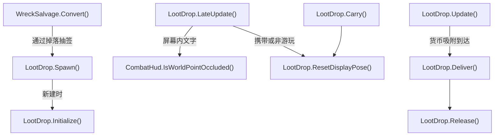

- [WreckSalvage.Convert](../Assets/Scripts/Features/Salvage/WreckSalvage.cs#L10)
<!-- source: Assets/Scripts/Features/Salvage/WreckSalvage.cs|Convert -->
- [LootDrop.Spawn](../Assets/Scripts/Features/Salvage/LootDrop.cs#L83)
<!-- source: Assets/Scripts/Features/Salvage/LootDrop.cs|Spawn -->
- [LootDrop.Initialize](../Assets/Scripts/Features/Salvage/LootDrop.cs#L132)
<!-- source: Assets/Scripts/Features/Salvage/LootDrop.cs|Initialize -->
- [LootDrop.Update](../Assets/Scripts/Features/Salvage/LootDrop.cs#L261)
<!-- source: Assets/Scripts/Features/Salvage/LootDrop.cs|Update -->
- [LootDrop.LateUpdate](../Assets/Scripts/Features/Salvage/LootDrop.cs#L320)
<!-- source: Assets/Scripts/Features/Salvage/LootDrop.cs|LateUpdate -->
- [CombatHud.IsWorldPointOccluded](../Assets/Scripts/Features/Combat/CombatHud.cs#L154)
<!-- source: Assets/Scripts/Features/Combat/CombatHud.cs|IsWorldPointOccluded -->
- [LootDrop.Carry](../Assets/Scripts/Features/Salvage/LootDrop.cs#L200)
<!-- source: Assets/Scripts/Features/Salvage/LootDrop.cs|Carry -->
- [LootDrop.ResetDisplayPose](../Assets/Scripts/Features/Salvage/LootDrop.cs#L364)
<!-- source: Assets/Scripts/Features/Salvage/LootDrop.cs|ResetDisplayPose -->
- [LootDrop.Deliver](../Assets/Scripts/Features/Salvage/LootDrop.cs#L231)
<!-- source: Assets/Scripts/Features/Salvage/LootDrop.cs|Deliver -->
- [LootDrop.Release](../Assets/Scripts/Features/Salvage/LootDrop.cs#L214)
<!-- source: Assets/Scripts/Features/Salvage/LootDrop.cs|Release -->

## 表现、镜头与 UI 生命周期

游戏事件选择效果；临时表现自行按寿命释放。镜头取景是计算，输入及协程由 CameraController 持有。

```mermaid
flowchart TD
    A["VisualEffectsManager.TryPlayBlockExplosion()"]
    click A "../Assets/Scripts/Features/Presentation/VisualEffectsManager.cs#L66" "打开源码"
    B["VisualEffectsManager.PlayBlockExplosion()"]
    click B "../Assets/Scripts/Features/Presentation/VisualEffectsManager.cs#L274" "打开源码"
    C["BlockVfxLibrary.Play()"]
    click C "../Assets/Scripts/Features/Presentation/BlockVfxLibrary.cs#L54" "打开源码"
    D["TransientEffects.CreateLightFlash()"]
    click D "../Assets/Scripts/Features/Presentation/TransientEffects.cs#L47" "打开源码"
    E["LightFade.Update()"]
    click E "../Assets/Scripts/Features/Presentation/LightFade.cs#L17" "打开源码"
    F["CameraShake.Play()"]
    click F "../Assets/Scripts/Features/Presentation/CameraShake.cs#L29" "打开源码"
    G["CameraShake.CameraShakeRoutine()"]
    click G "../Assets/Scripts/Features/Presentation/CameraShake.cs#L57" "打开源码"
    H["VisualEffectsManager.OnDisable()"]
    click H "../Assets/Scripts/Features/Presentation/VisualEffectsManager.cs#L194" "打开源码"
    I["CameraShake.Cancel()"]
    click I "../Assets/Scripts/Features/Presentation/CameraShake.cs#L17" "打开源码"
    J["CameraController.SmoothFocusCameraOnBlock()"]
    click J "../Assets/Scripts/Features/Presentation/CameraController.cs#L225" "打开源码"
    K["CameraFraming.TryGetFocusPose()"]
    click K "../Assets/Scripts/Features/Presentation/CameraFraming.cs#L26" "打开源码"
    L["CameraController.SmoothFocusRoutine()"]
    click L "../Assets/Scripts/Features/Presentation/CameraController.cs#L402" "打开源码"
    M["MainUIPanels.ShowCreatePanel()"]
    click M "../Assets/Scripts/Features/Presentation/MainUIPanels.cs#L86" "打开源码"
    N["PanelTransitions.Show()"]
    click N "../Assets/Scripts/Features/Presentation/PanelTransitions.cs#L29" "打开源码"
    O["PanelTransitions.Fade()"]
    click O "../Assets/Scripts/Features/Presentation/PanelTransitions.cs#L53" "打开源码"
    P["MainUIPanels.OnDisable()"]
    click P "../Assets/Scripts/Features/Presentation/MainUIPanels.cs#L72" "打开源码"
    Q["PanelTransitions.CancelAll()"]
    click Q "../Assets/Scripts/Features/Presentation/PanelTransitions.cs#L16" "打开源码"
    R["CameraController.LateUpdate()"]
    click R "../Assets/Scripts/Features/Presentation/CameraController.cs#L63" "打开源码"
    S["CameraController.ResolveThirdPersonCollision()"]
    click S "../Assets/Scripts/Features/Presentation/CameraController.cs#L126" "打开源码"
    T["StatusIcon.UpdateIconScreenPosition()"]
    click T "../Assets/Scripts/Features/Presentation/StatusIcon.cs#L313" "打开源码"
    A --> B
    B --> C
    B -->|成功生成| D
    D -.->|引擎Update| E
    B --> F
    F -.->|协程| G
    H --> I
    J --> K
    J -.->|协程| L
    M --> N
    N -.->|协程| O
    P --> Q
    R -->|第三人称期望与平滑位置| S
```

- [VisualEffectsManager.TryPlayBlockExplosion](../Assets/Scripts/Features/Presentation/VisualEffectsManager.cs#L66)
<!-- source: Assets/Scripts/Features/Presentation/VisualEffectsManager.cs|TryPlayBlockExplosion -->
- [VisualEffectsManager.PlayBlockExplosion](../Assets/Scripts/Features/Presentation/VisualEffectsManager.cs#L274)
<!-- source: Assets/Scripts/Features/Presentation/VisualEffectsManager.cs|PlayBlockExplosion -->
- [BlockVfxLibrary.Play](../Assets/Scripts/Features/Presentation/BlockVfxLibrary.cs#L54)
<!-- source: Assets/Scripts/Features/Presentation/BlockVfxLibrary.cs|Play -->
- [TransientEffects.CreateLightFlash](../Assets/Scripts/Features/Presentation/TransientEffects.cs#L47)
<!-- source: Assets/Scripts/Features/Presentation/TransientEffects.cs|CreateLightFlash -->
- [LightFade.Update](../Assets/Scripts/Features/Presentation/LightFade.cs#L17)
<!-- source: Assets/Scripts/Features/Presentation/LightFade.cs|Update -->
- [CameraShake.Play](../Assets/Scripts/Features/Presentation/CameraShake.cs#L29)
<!-- source: Assets/Scripts/Features/Presentation/CameraShake.cs|Play -->
- [CameraShake.CameraShakeRoutine](../Assets/Scripts/Features/Presentation/CameraShake.cs#L57)
<!-- source: Assets/Scripts/Features/Presentation/CameraShake.cs|CameraShakeRoutine -->
- [VisualEffectsManager.OnDisable](../Assets/Scripts/Features/Presentation/VisualEffectsManager.cs#L194)
<!-- source: Assets/Scripts/Features/Presentation/VisualEffectsManager.cs|OnDisable -->
- [CameraShake.Cancel](../Assets/Scripts/Features/Presentation/CameraShake.cs#L17)
<!-- source: Assets/Scripts/Features/Presentation/CameraShake.cs|Cancel -->
- [CameraController.SmoothFocusCameraOnBlock](../Assets/Scripts/Features/Presentation/CameraController.cs#L225)
<!-- source: Assets/Scripts/Features/Presentation/CameraController.cs|SmoothFocusCameraOnBlock -->
- [CameraFraming.TryGetFocusPose](../Assets/Scripts/Features/Presentation/CameraFraming.cs#L26)
<!-- source: Assets/Scripts/Features/Presentation/CameraFraming.cs|TryGetFocusPose -->
- [CameraController.SmoothFocusRoutine](../Assets/Scripts/Features/Presentation/CameraController.cs#L402)
<!-- source: Assets/Scripts/Features/Presentation/CameraController.cs|SmoothFocusRoutine -->
- [MainUIPanels.ShowCreatePanel](../Assets/Scripts/Features/Presentation/MainUIPanels.cs#L86)
<!-- source: Assets/Scripts/Features/Presentation/MainUIPanels.cs|ShowCreatePanel -->
- [PanelTransitions.Show](../Assets/Scripts/Features/Presentation/PanelTransitions.cs#L29)
<!-- source: Assets/Scripts/Features/Presentation/PanelTransitions.cs|Show -->
- [PanelTransitions.Fade](../Assets/Scripts/Features/Presentation/PanelTransitions.cs#L53)
<!-- source: Assets/Scripts/Features/Presentation/PanelTransitions.cs|Fade -->
- [MainUIPanels.OnDisable](../Assets/Scripts/Features/Presentation/MainUIPanels.cs#L72)
<!-- source: Assets/Scripts/Features/Presentation/MainUIPanels.cs|OnDisable -->
- [PanelTransitions.CancelAll](../Assets/Scripts/Features/Presentation/PanelTransitions.cs#L16)
<!-- source: Assets/Scripts/Features/Presentation/PanelTransitions.cs|CancelAll -->
- [CameraController.LateUpdate](../Assets/Scripts/Features/Presentation/CameraController.cs#L63)
<!-- source: Assets/Scripts/Features/Presentation/CameraController.cs|LateUpdate -->
- [CameraController.ResolveThirdPersonCollision](../Assets/Scripts/Features/Presentation/CameraController.cs#L126)
<!-- source: Assets/Scripts/Features/Presentation/CameraController.cs|ResolveThirdPersonCollision -->
- [StatusIcon.UpdateIconScreenPosition](../Assets/Scripts/Features/Presentation/StatusIcon.cs#L313)
<!-- source: Assets/Scripts/Features/Presentation/StatusIcon.cs|UpdateIconScreenPosition -->

## Main 大世界会话

源码推导：Main启动后在隐藏根下分帧预热；请求游玩可取消，Ready后才完成UI和物理切换。进入时启用真实地形/建筑并隐藏旧建造地面。退出和死亡丢弃地形差量、建筑与休眠状态，重新预热；失败下一Update回到统一退出链，避免在生成枚举中重入取消。

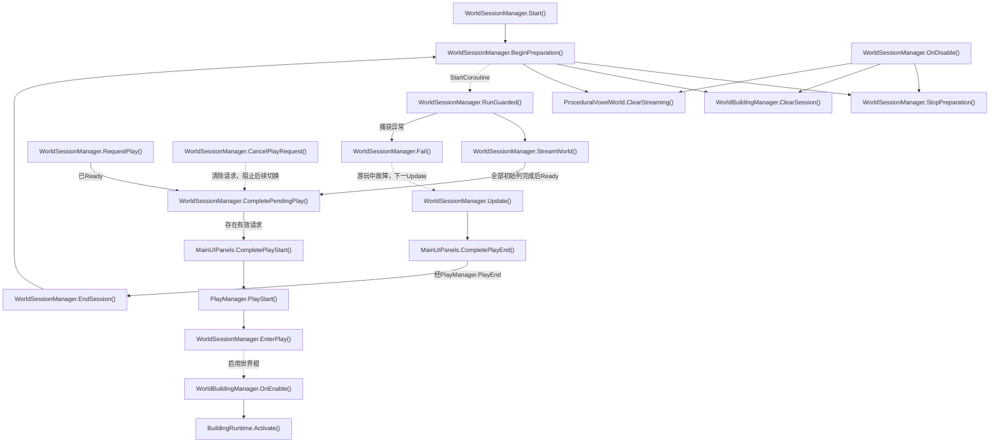

- [WorldSessionManager.Start](../Assets/Scripts/Features/World/WorldSessionManager.cs#L61)
<!-- source: Assets/Scripts/Features/World/WorldSessionManager.cs|Start -->
- [WorldSessionManager.BeginPreparation](../Assets/Scripts/Features/World/WorldSessionManager.cs#L77)
<!-- source: Assets/Scripts/Features/World/WorldSessionManager.cs|BeginPreparation -->
- [WorldSessionManager.StopPreparation](../Assets/Scripts/Features/World/WorldSessionManager.cs#L371)
<!-- source: Assets/Scripts/Features/World/WorldSessionManager.cs|StopPreparation -->
- [WorldSessionManager.RunGuarded](../Assets/Scripts/Features/World/WorldSessionManager.cs#L215)
<!-- source: Assets/Scripts/Features/World/WorldSessionManager.cs|RunGuarded -->
- [WorldSessionManager.StreamWorld](../Assets/Scripts/Features/World/WorldSessionManager.cs#L246)
<!-- source: Assets/Scripts/Features/World/WorldSessionManager.cs|StreamWorld -->
- [WorldSessionManager.CompletePendingPlay](../Assets/Scripts/Features/World/WorldSessionManager.cs#L148)
<!-- source: Assets/Scripts/Features/World/WorldSessionManager.cs|CompletePendingPlay -->
- [WorldSessionManager.RequestPlay](../Assets/Scripts/Features/World/WorldSessionManager.cs#L125)
<!-- source: Assets/Scripts/Features/World/WorldSessionManager.cs|RequestPlay -->
- [WorldSessionManager.CancelPlayRequest](../Assets/Scripts/Features/World/WorldSessionManager.cs#L142)
<!-- source: Assets/Scripts/Features/World/WorldSessionManager.cs|CancelPlayRequest -->
- [MainUIPanels.CompletePlayStart](../Assets/Scripts/Features/Presentation/MainUIPanels.cs#L243)
<!-- source: Assets/Scripts/Features/Presentation/MainUIPanels.cs|CompletePlayStart -->
- [PlayManager.PlayStart](../Assets/Scripts/Features/Simulation/PlayManager.cs#L88)
<!-- source: Assets/Scripts/Features/Simulation/PlayManager.cs|PlayStart -->
- [WorldSessionManager.EnterPlay](../Assets/Scripts/Features/World/WorldSessionManager.cs#L182)
<!-- source: Assets/Scripts/Features/World/WorldSessionManager.cs|EnterPlay -->
- [WorldBuildingManager.OnEnable](../Assets/Scripts/Features/World/WorldBuildingManager.cs#L36)
<!-- source: Assets/Scripts/Features/World/WorldBuildingManager.cs|OnEnable -->
- [BuildingRuntime.Activate](../Assets/Scripts/Features/World/BuildingRuntime.cs#L67)
<!-- source: Assets/Scripts/Features/World/BuildingRuntime.cs|Activate -->
- [WorldSessionManager.EndSession](../Assets/Scripts/Features/World/WorldSessionManager.cs#L210)
<!-- source: Assets/Scripts/Features/World/WorldSessionManager.cs|EndSession -->
- [WorldSessionManager.Fail](../Assets/Scripts/Features/World/WorldSessionManager.cs#L396)
<!-- source: Assets/Scripts/Features/World/WorldSessionManager.cs|Fail -->
- [WorldSessionManager.Update](../Assets/Scripts/Features/World/WorldSessionManager.cs#L306)
<!-- source: Assets/Scripts/Features/World/WorldSessionManager.cs|Update -->
- [MainUIPanels.CompletePlayEnd](../Assets/Scripts/Features/Presentation/MainUIPanels.cs#L273)
<!-- source: Assets/Scripts/Features/Presentation/MainUIPanels.cs|CompletePlayEnd -->
- [WorldSessionManager.OnDisable](../Assets/Scripts/Features/World/WorldSessionManager.cs#L407)
<!-- source: Assets/Scripts/Features/World/WorldSessionManager.cs|OnDisable -->
- [WorldBuildingManager.ClearSession](../Assets/Scripts/Features/World/WorldBuildingManager.cs#L163)
<!-- source: Assets/Scripts/Features/World/WorldBuildingManager.cs|ClearSession -->
- [ProceduralVoxelWorld.ClearStreaming](../Assets/Scripts/Features/World/ProceduralVoxelWorld.cs#L309)
<!-- source: Assets/Scripts/Features/World/ProceduralVoxelWorld.cs|ClearStreaming -->

## 用户建筑库、自然出生和远景

源码推导：每次会话读取persistentDataPath/BuildingBlueprints全部有效JSON，单独报告坏文件并按模块/底座范围扩大平台。自然出生地不再压低；进入时按载具覆盖范围最高地面加净空抬升。远景是独立无碰撞网格，分帧采样并避开已加载列，外边缘由距离雾过渡到同色背景；退出恢复原相机/雾并销毁自有网格。

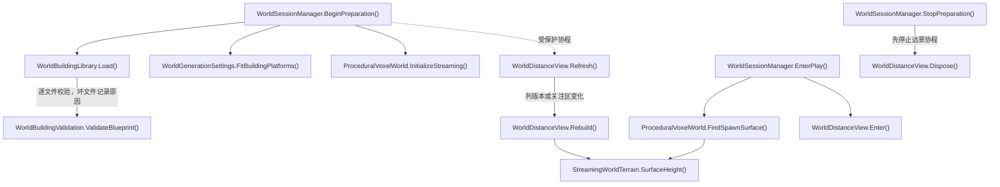

- [WorldSessionManager.BeginPreparation](../Assets/Scripts/Features/World/WorldSessionManager.cs#L77)
<!-- source: Assets/Scripts/Features/World/WorldSessionManager.cs|BeginPreparation -->
- [WorldBuildingLibrary.Load](../Assets/Scripts/Features/World/WorldBuildingLibrary.cs#L19)
<!-- source: Assets/Scripts/Features/World/WorldBuildingLibrary.cs|Load -->
- [WorldBuildingValidation.ValidateBlueprint](../Assets/Scripts/Features/World/WorldBuildingValidation.cs#L11)
<!-- source: Assets/Scripts/Features/World/WorldBuildingValidation.cs|ValidateBlueprint -->
- [WorldGenerationSettings.FitBuildingPlatforms](../Assets/Scripts/Features/World/WorldGenerationSettings.cs#L51)
<!-- source: Assets/Scripts/Features/World/WorldGenerationSettings.cs|FitBuildingPlatforms -->
- [ProceduralVoxelWorld.InitializeStreaming](../Assets/Scripts/Features/World/ProceduralVoxelWorld.cs#L175)
<!-- source: Assets/Scripts/Features/World/ProceduralVoxelWorld.cs|InitializeStreaming -->
- [WorldDistanceView.Refresh](../Assets/Scripts/Features/World/WorldDistanceView.cs#L49)
<!-- source: Assets/Scripts/Features/World/WorldDistanceView.cs|Refresh -->
- [WorldDistanceView.Rebuild](../Assets/Scripts/Features/World/WorldDistanceView.cs#L73)
<!-- source: Assets/Scripts/Features/World/WorldDistanceView.cs|Rebuild -->
- [StreamingWorldTerrain.SurfaceHeight](../Assets/Scripts/Features/World/StreamingWorldTerrain.cs#L23)
<!-- source: Assets/Scripts/Features/World/StreamingWorldTerrain.cs|SurfaceHeight -->
- [WorldSessionManager.EnterPlay](../Assets/Scripts/Features/World/WorldSessionManager.cs#L182)
<!-- source: Assets/Scripts/Features/World/WorldSessionManager.cs|EnterPlay -->
- [ProceduralVoxelWorld.FindSpawnSurface](../Assets/Scripts/Features/World/ProceduralVoxelWorld.cs#L49)
<!-- source: Assets/Scripts/Features/World/ProceduralVoxelWorld.cs|FindSpawnSurface -->
- [WorldDistanceView.Enter](../Assets/Scripts/Features/World/WorldDistanceView.cs#L180)
<!-- source: Assets/Scripts/Features/World/WorldDistanceView.cs|Enter -->
- [WorldSessionManager.StopPreparation](../Assets/Scripts/Features/World/WorldSessionManager.cs#L371)
<!-- source: Assets/Scripts/Features/World/WorldSessionManager.cs|StopPreparation -->
- [WorldDistanceView.Dispose](../Assets/Scripts/Features/World/WorldDistanceView.cs#L207)
<!-- source: Assets/Scripts/Features/World/WorldDistanceView.cs|Dispose -->

## 区块流式与建筑休眠

源码推导：纯种子采样和稀疏体素差量不分配全图。加载按列、每个立方区块让出一帧，完整列才发布；先休眠建筑再卸载远处地形。建筑实例受预算限制，超限快照延期；当前地基覆盖列完整后恢复。物理帧按载具尺寸与预测路径冻结等待，保留速度直到完整路径有地形碰撞。

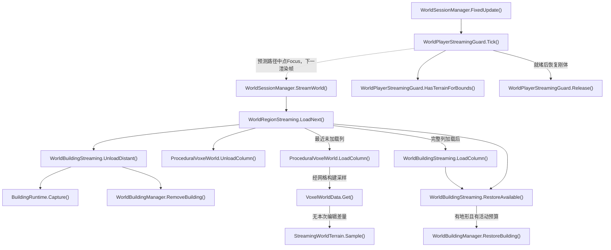

- [WorldSessionManager.StreamWorld](../Assets/Scripts/Features/World/WorldSessionManager.cs#L246)
<!-- source: Assets/Scripts/Features/World/WorldSessionManager.cs|StreamWorld -->
- [WorldRegionStreaming.LoadNext](../Assets/Scripts/Features/World/WorldRegionStreaming.cs#L29)
<!-- source: Assets/Scripts/Features/World/WorldRegionStreaming.cs|LoadNext -->
- [WorldBuildingStreaming.UnloadDistant](../Assets/Scripts/Features/World/WorldBuildingStreaming.cs#L92)
<!-- source: Assets/Scripts/Features/World/WorldBuildingStreaming.cs|UnloadDistant -->
- [BuildingRuntime.Capture](../Assets/Scripts/Features/World/BuildingRuntime.cs#L99)
<!-- source: Assets/Scripts/Features/World/BuildingRuntime.cs|Capture -->
- [WorldBuildingManager.RemoveBuilding](../Assets/Scripts/Features/World/WorldBuildingManager.cs#L151)
<!-- source: Assets/Scripts/Features/World/WorldBuildingManager.cs|RemoveBuilding -->
- [ProceduralVoxelWorld.UnloadColumn](../Assets/Scripts/Features/World/ProceduralVoxelWorld.cs#L289)
<!-- source: Assets/Scripts/Features/World/ProceduralVoxelWorld.cs|UnloadColumn -->
- [ProceduralVoxelWorld.LoadColumn](../Assets/Scripts/Features/World/ProceduralVoxelWorld.cs#L228)
<!-- source: Assets/Scripts/Features/World/ProceduralVoxelWorld.cs|LoadColumn -->
- [VoxelWorldData.Get](../Assets/Scripts/Features/World/VoxelWorldData.cs#L28)
<!-- source: Assets/Scripts/Features/World/VoxelWorldData.cs|Get -->
- [StreamingWorldTerrain.Sample](../Assets/Scripts/Features/World/StreamingWorldTerrain.cs#L45)
<!-- source: Assets/Scripts/Features/World/StreamingWorldTerrain.cs|Sample -->
- [WorldBuildingStreaming.LoadColumn](../Assets/Scripts/Features/World/WorldBuildingStreaming.cs#L33)
<!-- source: Assets/Scripts/Features/World/WorldBuildingStreaming.cs|LoadColumn -->
- [WorldBuildingStreaming.RestoreAvailable](../Assets/Scripts/Features/World/WorldBuildingStreaming.cs#L63)
<!-- source: Assets/Scripts/Features/World/WorldBuildingStreaming.cs|RestoreAvailable -->
- [WorldBuildingManager.RestoreBuilding](../Assets/Scripts/Features/World/WorldBuildingManager.cs#L122)
<!-- source: Assets/Scripts/Features/World/WorldBuildingManager.cs|RestoreBuilding -->
- [WorldSessionManager.FixedUpdate](../Assets/Scripts/Features/World/WorldSessionManager.cs#L282)
<!-- source: Assets/Scripts/Features/World/WorldSessionManager.cs|FixedUpdate -->
- [WorldPlayerStreamingGuard.Tick](../Assets/Scripts/Features/World/WorldPlayerStreamingGuard.cs#L30)
<!-- source: Assets/Scripts/Features/World/WorldPlayerStreamingGuard.cs|Tick -->
- [WorldPlayerStreamingGuard.HasTerrainForBounds](../Assets/Scripts/Features/World/WorldPlayerStreamingGuard.cs#L98)
<!-- source: Assets/Scripts/Features/World/WorldPlayerStreamingGuard.cs|HasTerrainForBounds -->
- [WorldPlayerStreamingGuard.Release](../Assets/Scripts/Features/World/WorldPlayerStreamingGuard.cs#L154)
<!-- source: Assets/Scripts/Features/World/WorldPlayerStreamingGuard.cs|Release -->

## WorldLab 程序化世界与破坏

源码推导：独立场景不初始化Main存档；固定种子和序列化单元是数据源。采掘/炮塔命中积累伤害，破坏只标记相邻受影响分块；LateUpdate按预算更新渲染和真实MeshCollider。装配建筑组件后F5/F9走下一图的完整快照；纯地形配置仍可保存旧差量。Inspector显式Bake保存网格资产。无无限流式加载。

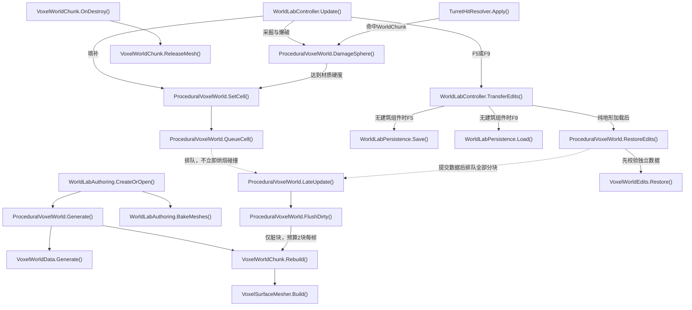

- [WorldLabAuthoring.CreateOrOpen](../Assets/Editor/World/WorldLabAuthoring.cs#L13)
<!-- source: Assets/Editor/World/WorldLabAuthoring.cs|CreateOrOpen -->
- [ProceduralVoxelWorld.Generate](../Assets/Scripts/Features/World/ProceduralVoxelWorld.cs#L96)
<!-- source: Assets/Scripts/Features/World/ProceduralVoxelWorld.cs|Generate -->
- [VoxelWorldData.Generate](../Assets/Scripts/Features/World/VoxelWorldData.cs#L114)
<!-- source: Assets/Scripts/Features/World/VoxelWorldData.cs|Generate -->
- [VoxelWorldChunk.Rebuild](../Assets/Scripts/Features/World/VoxelWorldChunk.cs#L18)
<!-- source: Assets/Scripts/Features/World/VoxelWorldChunk.cs|Rebuild -->
- [VoxelSurfaceMesher.Build](../Assets/Scripts/Features/World/VoxelSurfaceMesher.cs#L63)
<!-- source: Assets/Scripts/Features/World/VoxelSurfaceMesher.cs|Build -->
- [WorldLabAuthoring.BakeMeshes](../Assets/Editor/World/WorldLabAuthoring.cs#L99)
<!-- source: Assets/Editor/World/WorldLabAuthoring.cs|BakeMeshes -->
- [WorldLabController.Update](../Assets/Scripts/Features/World/WorldLabController.cs#L57)
<!-- source: Assets/Scripts/Features/World/WorldLabController.cs|Update -->
- [ProceduralVoxelWorld.DamageSphere](../Assets/Scripts/Features/World/ProceduralVoxelWorld.cs#L420)
<!-- source: Assets/Scripts/Features/World/ProceduralVoxelWorld.cs|DamageSphere -->
- [ProceduralVoxelWorld.SetCell](../Assets/Scripts/Features/World/ProceduralVoxelWorld.cs#L369)
<!-- source: Assets/Scripts/Features/World/ProceduralVoxelWorld.cs|SetCell -->
- [ProceduralVoxelWorld.QueueCell](../Assets/Scripts/Features/World/ProceduralVoxelWorld.cs#L479)
<!-- source: Assets/Scripts/Features/World/ProceduralVoxelWorld.cs|QueueCell -->
- [ProceduralVoxelWorld.LateUpdate](../Assets/Scripts/Features/World/ProceduralVoxelWorld.cs#L507)
<!-- source: Assets/Scripts/Features/World/ProceduralVoxelWorld.cs|LateUpdate -->
- [ProceduralVoxelWorld.FlushDirty](../Assets/Scripts/Features/World/ProceduralVoxelWorld.cs#L512)
<!-- source: Assets/Scripts/Features/World/ProceduralVoxelWorld.cs|FlushDirty -->
- [TurretHitResolver.Apply](../Assets/Scripts/Features/Combat/TurretHitResolver.cs#L7)
<!-- source: Assets/Scripts/Features/Combat/TurretHitResolver.cs|Apply -->
- [VoxelWorldChunk.OnDestroy](../Assets/Scripts/Features/World/VoxelWorldChunk.cs#L41)
<!-- source: Assets/Scripts/Features/World/VoxelWorldChunk.cs|OnDestroy -->
- [VoxelWorldChunk.ReleaseMesh](../Assets/Scripts/Features/World/VoxelWorldChunk.cs#L61)
<!-- source: Assets/Scripts/Features/World/VoxelWorldChunk.cs|ReleaseMesh -->
- [WorldLabController.TransferEdits](../Assets/Scripts/Features/World/WorldLabController.cs#L183)
<!-- source: Assets/Scripts/Features/World/WorldLabController.cs|TransferEdits -->
- [WorldLabPersistence.Save](../Assets/Scripts/Features/World/WorldLabPersistence.cs#L10)
<!-- source: Assets/Scripts/Features/World/WorldLabPersistence.cs|Save -->
- [WorldLabPersistence.Load](../Assets/Scripts/Features/World/WorldLabPersistence.cs#L57)
<!-- source: Assets/Scripts/Features/World/WorldLabPersistence.cs|Load -->
- [ProceduralVoxelWorld.RestoreEdits](../Assets/Scripts/Features/World/ProceduralVoxelWorld.cs#L392)
<!-- source: Assets/Scripts/Features/World/ProceduralVoxelWorld.cs|RestoreEdits -->
- [VoxelWorldEdits.Restore](../Assets/Scripts/Features/World/VoxelWorldEdits.cs#L52)
<!-- source: Assets/Scripts/Features/World/VoxelWorldEdits.cs|Restore -->

## WorldLab 建筑放置与快照

源码推导：可编辑目录和BuildingBlueprints用户文件只提供模板。预览只复制Mesh，B/Q/T/左键触发放置，所有实例使用底座局部坐标、独立身份和ControlUnit战斗注册。F5保存体素差量与当前建筑快照；F9校验资源、身份、耐久和地形后暂存禁用层级，成功才替换活动世界。旧差量迁移为空建筑列表。

```mermaid
flowchart TD
    A["WorldBuildingAuthoring.Install()"]
    click A "../Assets/Editor/World/WorldBuildingAuthoring.cs#L12" "打开源码"
    B["WorldBuildingPalette.RefreshCatalog()"]
    click B "../Assets/Scripts/Features/World/WorldBuildingPalette.cs#L43" "打开源码"
    C["WorldBuildingPalette.Update()"]
    click C "../Assets/Scripts/Features/World/WorldBuildingPalette.cs#L99" "打开源码"
    D["WorldBuildingPalette.BeginPlacement()"]
    click D "../Assets/Scripts/Features/World/WorldBuildingPalette.cs#L174" "打开源码"
    E["WorldBuildingManager.CanPlace()"]
    click E "../Assets/Scripts/Features/World/WorldBuildingManager.cs#L72" "打开源码"
    F["WorldBuildingPlacement.Check()"]
    click F "../Assets/Scripts/Features/World/WorldBuildingPlacement.cs#L15" "打开源码"
    G["WorldBuildingManager.Place()"]
    click G "../Assets/Scripts/Features/World/WorldBuildingManager.cs#L92" "打开源码"
    H["WorldBuildingManager.Stage()"]
    click H "../Assets/Scripts/Features/World/WorldBuildingManager.cs#L169" "打开源码"
    I["BuildingRuntime.Initialize()"]
    click I "../Assets/Scripts/Features/World/BuildingRuntime.cs#L28" "打开源码"
    J["BuildingRuntime.Activate()"]
    click J "../Assets/Scripts/Features/World/BuildingRuntime.cs#L67" "打开源码"
    K["WorldLabController.TransferEdits()"]
    click K "../Assets/Scripts/Features/World/WorldLabController.cs#L183" "打开源码"
    L["WorldBuildingManager.Capture()"]
    click L "../Assets/Scripts/Features/World/WorldBuildingManager.cs#L187" "打开源码"
    M["BuildingRuntime.Capture()"]
    click M "../Assets/Scripts/Features/World/BuildingRuntime.cs#L99" "打开源码"
    N["WorldLabPersistence.SaveSnapshot()"]
    click N "../Assets/Scripts/Features/World/WorldLabPersistence.cs#L15" "打开源码"
    O["WorldLabPersistence.LoadSnapshot()"]
    click O "../Assets/Scripts/Features/World/WorldLabPersistence.cs#L68" "打开源码"
    P["WorldBuildingManager.Restore()"]
    click P "../Assets/Scripts/Features/World/WorldBuildingManager.cs#L207" "打开源码"
    Q["WorldBuildingValidation.ValidateState()"]
    click Q "../Assets/Scripts/Features/World/WorldBuildingValidation.cs#L66" "打开源码"
    R["VoxelWorldEdits.Restore()"]
    click R "../Assets/Scripts/Features/World/VoxelWorldEdits.cs#L52" "打开源码"
    S["ProceduralVoxelWorld.RestoreEdits()"]
    click S "../Assets/Scripts/Features/World/ProceduralVoxelWorld.cs#L392" "打开源码"
    T["WorldBuildingManager.ClearBuildings()"]
    click T "../Assets/Scripts/Features/World/WorldBuildingManager.cs#L294" "打开源码"
    U["WorldBuildingManager.RestoreBuilding()"]
    click U "../Assets/Scripts/Features/World/WorldBuildingManager.cs#L122" "打开源码"
    A -.->|保存场景/目录供Start读取| B
    C -->|B键| D
    C --> E
    E --> F
    C -->|有效预览左键| G
    G --> U
    U --> H
    H --> I
    U -->|活动根下| J
    K -->|F5| L
    L --> M
    K -->|原子写盘| N
    K -->|F9| O
    K -->|完整快照| P
    P --> R
    P -->|全部实例| Q
    P -->|校验后暂存禁用层级，失败销毁暂存| H
    P -->|暂存全部成功| S
    P --> T
    P -->|启用后恢复尺寸与耐久| J
```

- [WorldBuildingAuthoring.Install](../Assets/Editor/World/WorldBuildingAuthoring.cs#L12)
<!-- source: Assets/Editor/World/WorldBuildingAuthoring.cs|Install -->
- [WorldBuildingPalette.RefreshCatalog](../Assets/Scripts/Features/World/WorldBuildingPalette.cs#L43)
<!-- source: Assets/Scripts/Features/World/WorldBuildingPalette.cs|RefreshCatalog -->
- [WorldBuildingPalette.Update](../Assets/Scripts/Features/World/WorldBuildingPalette.cs#L99)
<!-- source: Assets/Scripts/Features/World/WorldBuildingPalette.cs|Update -->
- [WorldBuildingPalette.BeginPlacement](../Assets/Scripts/Features/World/WorldBuildingPalette.cs#L174)
<!-- source: Assets/Scripts/Features/World/WorldBuildingPalette.cs|BeginPlacement -->
- [WorldBuildingManager.CanPlace](../Assets/Scripts/Features/World/WorldBuildingManager.cs#L72)
<!-- source: Assets/Scripts/Features/World/WorldBuildingManager.cs|CanPlace -->
- [WorldBuildingPlacement.Check](../Assets/Scripts/Features/World/WorldBuildingPlacement.cs#L15)
<!-- source: Assets/Scripts/Features/World/WorldBuildingPlacement.cs|Check -->
- [WorldBuildingManager.Place](../Assets/Scripts/Features/World/WorldBuildingManager.cs#L92)
<!-- source: Assets/Scripts/Features/World/WorldBuildingManager.cs|Place -->
- [WorldBuildingManager.Stage](../Assets/Scripts/Features/World/WorldBuildingManager.cs#L169)
<!-- source: Assets/Scripts/Features/World/WorldBuildingManager.cs|Stage -->
- [BuildingRuntime.Initialize](../Assets/Scripts/Features/World/BuildingRuntime.cs#L28)
<!-- source: Assets/Scripts/Features/World/BuildingRuntime.cs|Initialize -->
- [BuildingRuntime.Activate](../Assets/Scripts/Features/World/BuildingRuntime.cs#L67)
<!-- source: Assets/Scripts/Features/World/BuildingRuntime.cs|Activate -->
- [WorldLabController.TransferEdits](../Assets/Scripts/Features/World/WorldLabController.cs#L183)
<!-- source: Assets/Scripts/Features/World/WorldLabController.cs|TransferEdits -->
- [WorldBuildingManager.Capture](../Assets/Scripts/Features/World/WorldBuildingManager.cs#L187)
<!-- source: Assets/Scripts/Features/World/WorldBuildingManager.cs|Capture -->
- [BuildingRuntime.Capture](../Assets/Scripts/Features/World/BuildingRuntime.cs#L99)
<!-- source: Assets/Scripts/Features/World/BuildingRuntime.cs|Capture -->
- [WorldLabPersistence.SaveSnapshot](../Assets/Scripts/Features/World/WorldLabPersistence.cs#L15)
<!-- source: Assets/Scripts/Features/World/WorldLabPersistence.cs|SaveSnapshot -->
- [WorldLabPersistence.LoadSnapshot](../Assets/Scripts/Features/World/WorldLabPersistence.cs#L68)
<!-- source: Assets/Scripts/Features/World/WorldLabPersistence.cs|LoadSnapshot -->
- [WorldBuildingManager.Restore](../Assets/Scripts/Features/World/WorldBuildingManager.cs#L207)
<!-- source: Assets/Scripts/Features/World/WorldBuildingManager.cs|Restore -->
- [WorldBuildingValidation.ValidateState](../Assets/Scripts/Features/World/WorldBuildingValidation.cs#L66)
<!-- source: Assets/Scripts/Features/World/WorldBuildingValidation.cs|ValidateState -->
- [VoxelWorldEdits.Restore](../Assets/Scripts/Features/World/VoxelWorldEdits.cs#L52)
<!-- source: Assets/Scripts/Features/World/VoxelWorldEdits.cs|Restore -->
- [ProceduralVoxelWorld.RestoreEdits](../Assets/Scripts/Features/World/ProceduralVoxelWorld.cs#L392)
<!-- source: Assets/Scripts/Features/World/ProceduralVoxelWorld.cs|RestoreEdits -->
- [WorldBuildingManager.ClearBuildings](../Assets/Scripts/Features/World/WorldBuildingManager.cs#L294)
<!-- source: Assets/Scripts/Features/World/WorldBuildingManager.cs|ClearBuildings -->
- [WorldBuildingManager.RestoreBuilding](../Assets/Scripts/Features/World/WorldBuildingManager.cs#L122)
<!-- source: Assets/Scripts/Features/World/WorldBuildingManager.cs|RestoreBuilding -->

## WorldLab 建筑支撑与损坏

源码推导：地形修改通知只标记附近固定建筑，FixedUpdate读取体素数据计算虚拟范围的地形支撑比例（不生成地基实体）；默认低于50%脱锚，先刷新源碰撞再启用刚体。方块死亡从虚拟地面连接点开始，用Connector真实几何检查模块连通；断裂组最多32块、12片、12秒寿命，超预算移除。爆炸连锁排队结算，残骸不写快照，R重生成恢复初始布局。

```mermaid
flowchart TD
    A["ProceduralVoxelWorld.SetCell()"]
    click A "../Assets/Scripts/Features/World/ProceduralVoxelWorld.cs#L369" "打开源码"
    B["WorldBuildingManager.TerrainChanged()"]
    click B "../Assets/Scripts/Features/World/WorldBuildingManager.cs#L309" "打开源码"
    C["WorldBuildingManager.FixedUpdate()"]
    click C "../Assets/Scripts/Features/World/WorldBuildingManager.cs#L320" "打开源码"
    D["WorldBuildingPlacement.Support()"]
    click D "../Assets/Scripts/Features/World/WorldBuildingPlacement.cs#L111" "打开源码"
    E["BuildingRuntime.ReleaseAnchor()"]
    click E "../Assets/Scripts/Features/World/BuildingRuntime.cs#L280" "打开源码"
    F["ProceduralVoxelWorld.FlushDirty()"]
    click F "../Assets/Scripts/Features/World/ProceduralVoxelWorld.cs#L512" "打开源码"
    G["Durability.ApplyDamage()"]
    click G "../Assets/Scripts/Features/Combat/Durability.cs#L63" "打开源码"
    H["BuildingRuntime.DestroyBlock()"]
    click H "../Assets/Scripts/Features/World/BuildingRuntime.cs#L151" "打开源码"
    I["BuildingRuntime.SplitDisconnected()"]
    click I "../Assets/Scripts/Features/World/BuildingRuntime.cs#L189" "打开源码"
    J["Block.CollectNeighbors()"]
    click J "../Assets/Scripts/Features/Simulation/Block.cs#L346" "打开源码"
    K["WorldBuildingManager.CreateDebris()"]
    click K "../Assets/Scripts/Features/World/WorldBuildingManager.cs#L342" "打开源码"
    L["WorldBuildingManager.DamageSphere()"]
    click L "../Assets/Scripts/Features/World/WorldBuildingManager.cs#L337" "打开源码"
    M["WorldBuildingDamage.Apply()"]
    click M "../Assets/Scripts/Features/World/WorldBuildingDamage.cs#L17" "打开源码"
    N["ProceduralVoxelWorld.Generate()"]
    click N "../Assets/Scripts/Features/World/ProceduralVoxelWorld.cs#L96" "打开源码"
    O["WorldBuildingManager.ResetBuildings()"]
    click O "../Assets/Scripts/Features/World/WorldBuildingManager.cs#L260" "打开源码"
    P["WorldBuildingManager.ClearDebris()"]
    click P "../Assets/Scripts/Features/World/WorldBuildingManager.cs#L378" "打开源码"
    Q["WorldBuildingManager.Place()"]
    click Q "../Assets/Scripts/Features/World/WorldBuildingManager.cs#L92" "打开源码"
    R["BuildingRuntime.HasGroundConnector()"]
    click R "../Assets/Scripts/Features/World/BuildingRuntime.cs#L259" "打开源码"
    A -.->|TerrainChanged事件| B
    B -.->|待检查集合| C
    C --> D
    C -->|支撑低于阈值| E
    E --> F
    G -->|建筑耐久为0| H
    H --> I
    I -->|虚拟地面连接点| R
    I -->|BFS连接几何| J
    I -->|断裂组| K
    H -->|爆炸方块| L
    L --> M
    M -->|顺序结算，连锁入队| G
    N -.->|Regenerated事件| O
    O --> P
    O -->|有效初始布局| Q
```

- [ProceduralVoxelWorld.SetCell](../Assets/Scripts/Features/World/ProceduralVoxelWorld.cs#L369)
<!-- source: Assets/Scripts/Features/World/ProceduralVoxelWorld.cs|SetCell -->
- [WorldBuildingManager.TerrainChanged](../Assets/Scripts/Features/World/WorldBuildingManager.cs#L309)
<!-- source: Assets/Scripts/Features/World/WorldBuildingManager.cs|TerrainChanged -->
- [WorldBuildingManager.FixedUpdate](../Assets/Scripts/Features/World/WorldBuildingManager.cs#L320)
<!-- source: Assets/Scripts/Features/World/WorldBuildingManager.cs|FixedUpdate -->
- [WorldBuildingPlacement.Support](../Assets/Scripts/Features/World/WorldBuildingPlacement.cs#L111)
<!-- source: Assets/Scripts/Features/World/WorldBuildingPlacement.cs|Support -->
- [BuildingRuntime.ReleaseAnchor](../Assets/Scripts/Features/World/BuildingRuntime.cs#L280)
<!-- source: Assets/Scripts/Features/World/BuildingRuntime.cs|ReleaseAnchor -->
- [ProceduralVoxelWorld.FlushDirty](../Assets/Scripts/Features/World/ProceduralVoxelWorld.cs#L512)
<!-- source: Assets/Scripts/Features/World/ProceduralVoxelWorld.cs|FlushDirty -->
- [Durability.ApplyDamage](../Assets/Scripts/Features/Combat/Durability.cs#L63)
<!-- source: Assets/Scripts/Features/Combat/Durability.cs|ApplyDamage -->
- [BuildingRuntime.DestroyBlock](../Assets/Scripts/Features/World/BuildingRuntime.cs#L151)
<!-- source: Assets/Scripts/Features/World/BuildingRuntime.cs|DestroyBlock -->
- [BuildingRuntime.SplitDisconnected](../Assets/Scripts/Features/World/BuildingRuntime.cs#L189)
<!-- source: Assets/Scripts/Features/World/BuildingRuntime.cs|SplitDisconnected -->
- [Block.CollectNeighbors](../Assets/Scripts/Features/Simulation/Block.cs#L346)
<!-- source: Assets/Scripts/Features/Simulation/Block.cs|CollectNeighbors -->
- [WorldBuildingManager.CreateDebris](../Assets/Scripts/Features/World/WorldBuildingManager.cs#L342)
<!-- source: Assets/Scripts/Features/World/WorldBuildingManager.cs|CreateDebris -->
- [WorldBuildingManager.DamageSphere](../Assets/Scripts/Features/World/WorldBuildingManager.cs#L337)
<!-- source: Assets/Scripts/Features/World/WorldBuildingManager.cs|DamageSphere -->
- [WorldBuildingDamage.Apply](../Assets/Scripts/Features/World/WorldBuildingDamage.cs#L17)
<!-- source: Assets/Scripts/Features/World/WorldBuildingDamage.cs|Apply -->
- [ProceduralVoxelWorld.Generate](../Assets/Scripts/Features/World/ProceduralVoxelWorld.cs#L96)
<!-- source: Assets/Scripts/Features/World/ProceduralVoxelWorld.cs|Generate -->
- [WorldBuildingManager.ResetBuildings](../Assets/Scripts/Features/World/WorldBuildingManager.cs#L260)
<!-- source: Assets/Scripts/Features/World/WorldBuildingManager.cs|ResetBuildings -->
- [WorldBuildingManager.ClearDebris](../Assets/Scripts/Features/World/WorldBuildingManager.cs#L378)
<!-- source: Assets/Scripts/Features/World/WorldBuildingManager.cs|ClearDebris -->
- [WorldBuildingManager.Place](../Assets/Scripts/Features/World/WorldBuildingManager.cs#L92)
<!-- source: Assets/Scripts/Features/World/WorldBuildingManager.cs|Place -->
- [BuildingRuntime.HasGroundConnector](../Assets/Scripts/Features/World/BuildingRuntime.cs#L259)
<!-- source: Assets/Scripts/Features/World/BuildingRuntime.cs|HasGroundConnector -->

## WorldLab 金属支撑与碎片

源码推导：成功破坏后请求六邻接支撑检查，等待脏块刷新。土/岩邻接或世界底层视为支撑；仅32格以内金属孤岛变为刚体，最多12个、12秒寿命。大结构保留静态。分离后立即刷新源碰撞；重生成/恢复清除碎片。不是全地形结构力学。

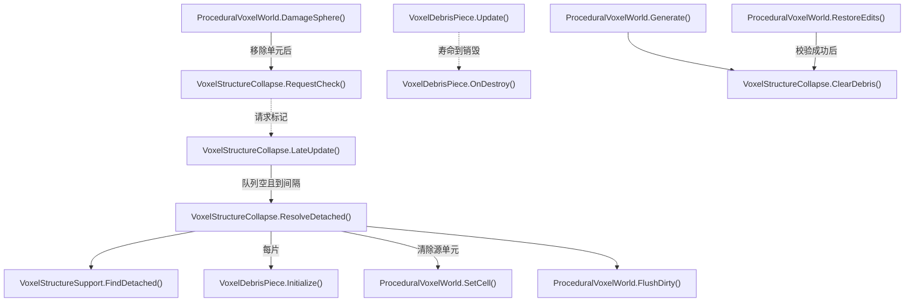

- [ProceduralVoxelWorld.DamageSphere](../Assets/Scripts/Features/World/ProceduralVoxelWorld.cs#L420)
<!-- source: Assets/Scripts/Features/World/ProceduralVoxelWorld.cs|DamageSphere -->
- [VoxelStructureCollapse.RequestCheck](../Assets/Scripts/Features/World/VoxelStructureCollapse.cs#L33)
<!-- source: Assets/Scripts/Features/World/VoxelStructureCollapse.cs|RequestCheck -->
- [VoxelStructureCollapse.LateUpdate](../Assets/Scripts/Features/World/VoxelStructureCollapse.cs#L38)
<!-- source: Assets/Scripts/Features/World/VoxelStructureCollapse.cs|LateUpdate -->
- [VoxelStructureCollapse.ResolveDetached](../Assets/Scripts/Features/World/VoxelStructureCollapse.cs#L51)
<!-- source: Assets/Scripts/Features/World/VoxelStructureCollapse.cs|ResolveDetached -->
- [VoxelStructureSupport.FindDetached](../Assets/Scripts/Features/World/VoxelStructureSupport.cs#L17)
<!-- source: Assets/Scripts/Features/World/VoxelStructureSupport.cs|FindDetached -->
- [VoxelDebrisPiece.Initialize](../Assets/Scripts/Features/World/VoxelDebrisPiece.cs#L11)
<!-- source: Assets/Scripts/Features/World/VoxelDebrisPiece.cs|Initialize -->
- [ProceduralVoxelWorld.SetCell](../Assets/Scripts/Features/World/ProceduralVoxelWorld.cs#L369)
<!-- source: Assets/Scripts/Features/World/ProceduralVoxelWorld.cs|SetCell -->
- [ProceduralVoxelWorld.FlushDirty](../Assets/Scripts/Features/World/ProceduralVoxelWorld.cs#L512)
<!-- source: Assets/Scripts/Features/World/ProceduralVoxelWorld.cs|FlushDirty -->
- [VoxelDebrisPiece.Update](../Assets/Scripts/Features/World/VoxelDebrisPiece.cs#L49)
<!-- source: Assets/Scripts/Features/World/VoxelDebrisPiece.cs|Update -->
- [VoxelDebrisPiece.OnDestroy](../Assets/Scripts/Features/World/VoxelDebrisPiece.cs#L57)
<!-- source: Assets/Scripts/Features/World/VoxelDebrisPiece.cs|OnDestroy -->
- [ProceduralVoxelWorld.Generate](../Assets/Scripts/Features/World/ProceduralVoxelWorld.cs#L96)
<!-- source: Assets/Scripts/Features/World/ProceduralVoxelWorld.cs|Generate -->
- [VoxelStructureCollapse.ClearDebris](../Assets/Scripts/Features/World/VoxelStructureCollapse.cs#L85)
<!-- source: Assets/Scripts/Features/World/VoxelStructureCollapse.cs|ClearDebris -->
- [ProceduralVoxelWorld.RestoreEdits](../Assets/Scripts/Features/World/ProceduralVoxelWorld.cs#L392)
<!-- source: Assets/Scripts/Features/World/ProceduralVoxelWorld.cs|RestoreEdits -->
