# HY-Sandbox 运行时函数图

    这些图根据当前源码和调用者整理，用于寻找功能入口，不是采样得到的实际执行轨迹。实线表示直接调用（标注“经”时包含明确中间函数）；虚线标出协程、事件或注入动作。Unity Update/FixedUpdate 的独立入口不代表脚本执行顺序。

    每个图节点可点击对应源码；渲染器禁用 click 时使用图下链接。导航由 Roslyn 校验文件与方法存在，语义顺序由修改者审查。过载函数链接到第一个声明，完整过载见 CodeIndex。

    维护：业务变化更新受影响图和 DEVELOPMENT；纯格式变化重新生成行号。`dotnet run --project Tools/CodeReadability -- --check .` 会拒绝失效符号。

    ## CSV 方块配置与质量

源码推导：CSV 仅管理 25 个常用参数（另有 4 个身份列），高级参数由 Prefab Inspector 管理；Editor 导入后延迟校验、备份并同步 Prefab。旧 density 列已移除，Block 字段保留兼容；BotContainer 要求最低功率等于额定功率，供电只作为起飞门槛，离仓 Bot 继续任务/返航。OnValidate 只排队，不在导入线程写资产；Awake 提前应用配置，随后各组件初始化。空 mass 为体积质量，存档恢复保留实例尺寸再刷新派生数据；运行时不执行制作期组件创建和连接重建，尺寸变化时才重建连接。

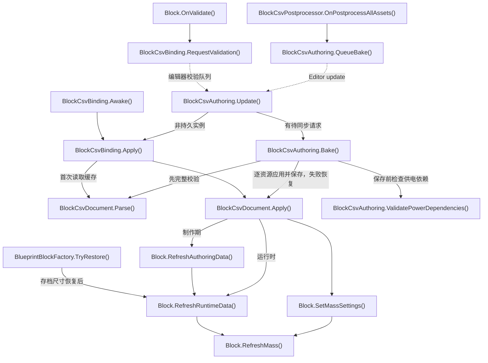

- [BlockCsvPostprocessor.OnPostprocessAllAssets](../Assets/Editor/Building/BlockCsvPostprocessor.cs#L8)
<!-- source: Assets/Editor/Building/BlockCsvPostprocessor.cs|OnPostprocessAllAssets -->
- [BlockCsvAuthoring.QueueBake](../Assets/Editor/Building/BlockCsvAuthoring.cs#L239)
<!-- source: Assets/Editor/Building/BlockCsvAuthoring.cs|QueueBake -->
- [BlockCsvAuthoring.Update](../Assets/Editor/Building/BlockCsvAuthoring.cs#L287)
<!-- source: Assets/Editor/Building/BlockCsvAuthoring.cs|Update -->
- [BlockCsvAuthoring.Bake](../Assets/Editor/Building/BlockCsvAuthoring.cs#L128)
<!-- source: Assets/Editor/Building/BlockCsvAuthoring.cs|Bake -->
- [BlockCsvDocument.Parse](../Assets/Scripts/Features/Building/BlockDataTables/BlockCsvDocument.cs#L33)
<!-- source: Assets/Scripts/Features/Building/BlockDataTables/BlockCsvDocument.cs|Parse -->
- [BlockCsvDocument.Apply](../Assets/Scripts/Features/Building/BlockDataTables/BlockCsvDocument.cs#L73)
<!-- source: Assets/Scripts/Features/Building/BlockDataTables/BlockCsvDocument.cs|Apply -->
- [Block.OnValidate](../Assets/Scripts/Features/Simulation/Block.cs#L104)
<!-- source: Assets/Scripts/Features/Simulation/Block.cs|OnValidate -->
- [BlockCsvBinding.RequestValidation](../Assets/Scripts/Features/Building/BlockDataTables/BlockCsvBinding.cs#L33)
<!-- source: Assets/Scripts/Features/Building/BlockDataTables/BlockCsvBinding.cs|RequestValidation -->
- [BlockCsvBinding.Awake](../Assets/Scripts/Features/Building/BlockDataTables/BlockCsvBinding.cs#L23)
<!-- source: Assets/Scripts/Features/Building/BlockDataTables/BlockCsvBinding.cs|Awake -->
- [BlockCsvBinding.Apply](../Assets/Scripts/Features/Building/BlockDataTables/BlockCsvBinding.cs#L41)
<!-- source: Assets/Scripts/Features/Building/BlockDataTables/BlockCsvBinding.cs|Apply -->
- [Block.SetMassSettings](../Assets/Scripts/Features/Simulation/Block.cs#L197)
<!-- source: Assets/Scripts/Features/Simulation/Block.cs|SetMassSettings -->
- [Block.RefreshMass](../Assets/Scripts/Features/Simulation/Block.cs#L184)
<!-- source: Assets/Scripts/Features/Simulation/Block.cs|RefreshMass -->
- [Block.RefreshAuthoringData](../Assets/Scripts/Features/Simulation/Block.cs#L121)
<!-- source: Assets/Scripts/Features/Simulation/Block.cs|RefreshAuthoringData -->
- [BlueprintBlockFactory.TryRestore](../Assets/Scripts/Features/Building/BlueprintLoading/BlueprintBlockFactory.cs#L7)
<!-- source: Assets/Scripts/Features/Building/BlueprintLoading/BlueprintBlockFactory.cs|TryRestore -->
- [Block.RefreshRuntimeData](../Assets/Scripts/Features/Simulation/Block.cs#L150)
<!-- source: Assets/Scripts/Features/Simulation/Block.cs|RefreshRuntimeData -->
- [BlockCsvAuthoring.ValidatePowerDependencies](../Assets/Editor/Building/BlockCsvAuthoring.cs#L246)
<!-- source: Assets/Editor/Building/BlockCsvAuthoring.cs|ValidatePowerDependencies -->

## 启动与建造/游玩会话

引擎自动调用入口独立；按按钮进入业务主链。返回建造前先保存货仓；命名存档丢失、路径解析/读取/替换失败均拒绝退出并保留当前会话，失败原因由可编辑ReturnStatusPanel持续显示，不挡操作；成功后清除提示再清理。选择方块资源进入 BuildType.Build；InputManager 切换 lockView 仅取消拖拽/预览并隐藏操作轴，保留选中方块、高亮、BuildType 与资源，重锁恢复操作轴。工具按钮按BuildType着色，Build高亮当前资源条目；焦点不改变模式色。

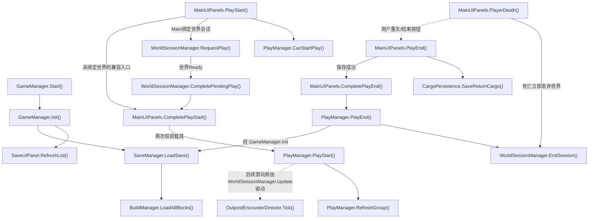

- [GameManager.Start](../Assets/Scripts/Features/Bootstrap/GameManager.cs#L15)
<!-- source: Assets/Scripts/Features/Bootstrap/GameManager.cs|Start -->
- [GameManager.Init](../Assets/Scripts/Features/Bootstrap/GameManager.cs#L20)
<!-- source: Assets/Scripts/Features/Bootstrap/GameManager.cs|Init -->
- [SaveUIPanel.RefreshList](../Assets/Scripts/Features/Building/SaveUIPanel.cs#L17)
<!-- source: Assets/Scripts/Features/Building/SaveUIPanel.cs|RefreshList -->
- [SaveManager.LoadSave](../Assets/Scripts/Features/Building/SaveManager.cs#L256)
<!-- source: Assets/Scripts/Features/Building/SaveManager.cs|LoadSave -->
- [BuildManager.LoadAllBlocks](../Assets/Scripts/Features/Building/BuildManager.cs#L563)
<!-- source: Assets/Scripts/Features/Building/BuildManager.cs|LoadAllBlocks -->
- [MainUIPanels.PlayStart](../Assets/Scripts/Features/Presentation/MainUIPanels.cs#L230)
<!-- source: Assets/Scripts/Features/Presentation/MainUIPanels.cs|PlayStart -->
- [PlayManager.CanStartPlay](../Assets/Scripts/Features/Simulation/PlayManager.cs#L148)
<!-- source: Assets/Scripts/Features/Simulation/PlayManager.cs|CanStartPlay -->
- [PlayManager.PlayStart](../Assets/Scripts/Features/Simulation/PlayManager.cs#L100)
<!-- source: Assets/Scripts/Features/Simulation/PlayManager.cs|PlayStart -->
- [PlayManager.RefreshGroup](../Assets/Scripts/Features/Simulation/PlayManager.cs#L183)
<!-- source: Assets/Scripts/Features/Simulation/PlayManager.cs|RefreshGroup -->
- [OutpostEncounterDirector.Tick](../Assets/Scripts/Features/World/OutpostEncounterDirector.cs#L51)
<!-- source: Assets/Scripts/Features/World/OutpostEncounterDirector.cs|Tick -->
- [MainUIPanels.PlayEnd](../Assets/Scripts/Features/Presentation/MainUIPanels.cs#L278)
<!-- source: Assets/Scripts/Features/Presentation/MainUIPanels.cs|PlayEnd -->
- [CargoPersistence.SaveReturnCargo](../Assets/Scripts/Features/Salvage/CargoPersistence.cs#L11)
<!-- source: Assets/Scripts/Features/Salvage/CargoPersistence.cs|SaveReturnCargo -->
- [PlayManager.PlayEnd](../Assets/Scripts/Features/Simulation/PlayManager.cs#L285)
<!-- source: Assets/Scripts/Features/Simulation/PlayManager.cs|PlayEnd -->
- [MainUIPanels.PlayerDeath](../Assets/Scripts/Features/Presentation/MainUIPanels.cs#L304)
<!-- source: Assets/Scripts/Features/Presentation/MainUIPanels.cs|PlayerDeath -->
- [WorldSessionManager.RequestPlay](../Assets/Scripts/Features/World/WorldSessionManager.cs#L174)
<!-- source: Assets/Scripts/Features/World/WorldSessionManager.cs|RequestPlay -->
- [WorldSessionManager.CompletePendingPlay](../Assets/Scripts/Features/World/WorldSessionManager.cs#L197)
<!-- source: Assets/Scripts/Features/World/WorldSessionManager.cs|CompletePendingPlay -->
- [MainUIPanels.CompletePlayStart](../Assets/Scripts/Features/Presentation/MainUIPanels.cs#L258)
<!-- source: Assets/Scripts/Features/Presentation/MainUIPanels.cs|CompletePlayStart -->
- [MainUIPanels.CompletePlayEnd](../Assets/Scripts/Features/Presentation/MainUIPanels.cs#L294)
<!-- source: Assets/Scripts/Features/Presentation/MainUIPanels.cs|CompletePlayEnd -->
- [WorldSessionManager.EndSession](../Assets/Scripts/Features/World/WorldSessionManager.cs#L306)
<!-- source: Assets/Scripts/Features/World/WorldSessionManager.cs|EndSession -->

## 开发者建筑蓝图编辑

源码推导：Ctrl+Alt+F 进入/退出建筑，Ctrl+Alt+E 切换敌人。建筑使用独立目录，加载父对象后由注入回调创建底座；底座不参与方块存档和操作栈。尺寸 UI 先保存元数据，再生成向上连接点并刷新已有连接，块坐标不变。

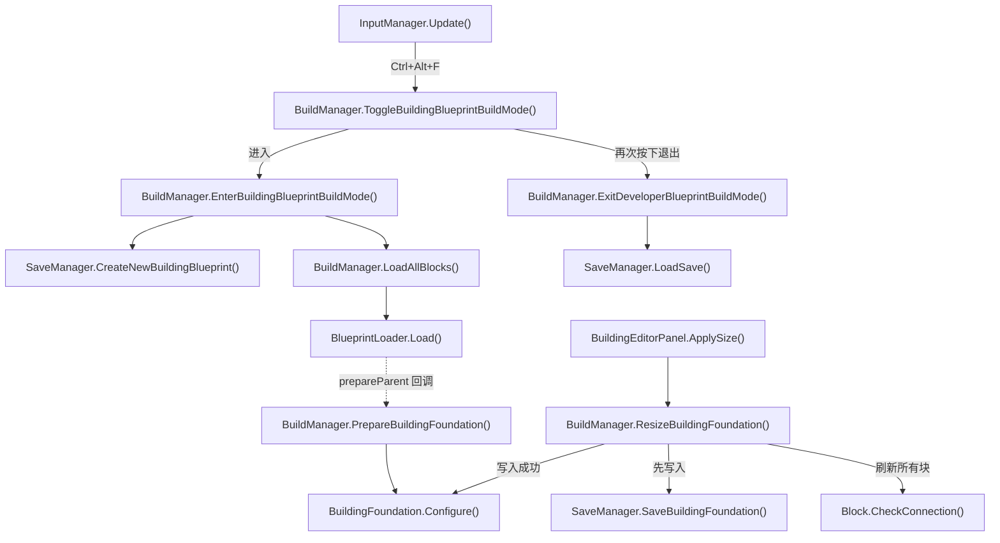

- [InputManager.Update](../Assets/Scripts/Features/Player/InputManager.cs#L40)
<!-- source: Assets/Scripts/Features/Player/InputManager.cs|Update -->
- [BuildManager.ToggleBuildingBlueprintBuildMode](../Assets/Scripts/Features/Building/BuildManager.cs#L247)
<!-- source: Assets/Scripts/Features/Building/BuildManager.cs|ToggleBuildingBlueprintBuildMode -->
- [BuildManager.EnterBuildingBlueprintBuildMode](../Assets/Scripts/Features/Building/BuildManager.cs#L259)
<!-- source: Assets/Scripts/Features/Building/BuildManager.cs|EnterBuildingBlueprintBuildMode -->
- [SaveManager.CreateNewBuildingBlueprint](../Assets/Scripts/Features/Building/SaveManager.cs#L80)
<!-- source: Assets/Scripts/Features/Building/SaveManager.cs|CreateNewBuildingBlueprint -->
- [BuildManager.LoadAllBlocks](../Assets/Scripts/Features/Building/BuildManager.cs#L563)
<!-- source: Assets/Scripts/Features/Building/BuildManager.cs|LoadAllBlocks -->
- [BlueprintLoader.Load](../Assets/Scripts/Features/Building/BlueprintLoading/BlueprintLoader.cs#L43)
<!-- source: Assets/Scripts/Features/Building/BlueprintLoading/BlueprintLoader.cs|Load -->
- [BuildManager.PrepareBuildingFoundation](../Assets/Scripts/Features/Building/BuildManager.cs#L280)
<!-- source: Assets/Scripts/Features/Building/BuildManager.cs|PrepareBuildingFoundation -->
- [BuildingFoundation.Configure](../Assets/Scripts/Features/Building/BuildingFoundation.cs#L15)
<!-- source: Assets/Scripts/Features/Building/BuildingFoundation.cs|Configure -->
- [BuildingEditorPanel.ApplySize](../Assets/Scripts/Features/Building/BuildingEditorPanel.cs#L25)
<!-- source: Assets/Scripts/Features/Building/BuildingEditorPanel.cs|ApplySize -->
- [BuildManager.ResizeBuildingFoundation](../Assets/Scripts/Features/Building/BuildManager.cs#L303)
<!-- source: Assets/Scripts/Features/Building/BuildManager.cs|ResizeBuildingFoundation -->
- [SaveManager.SaveBuildingFoundation](../Assets/Scripts/Features/Building/SaveManager.cs#L122)
<!-- source: Assets/Scripts/Features/Building/SaveManager.cs|SaveBuildingFoundation -->
- [Block.CheckConnection](../Assets/Scripts/Features/Simulation/Block.cs#L360)
<!-- source: Assets/Scripts/Features/Simulation/Block.cs|CheckConnection -->
- [BuildManager.ExitDeveloperBlueprintBuildMode](../Assets/Scripts/Features/Building/BuildManager.cs#L228)
<!-- source: Assets/Scripts/Features/Building/BuildManager.cs|ExitDeveloperBlueprintBuildMode -->
- [SaveManager.LoadSave](../Assets/Scripts/Features/Building/SaveManager.cs#L256)
<!-- source: Assets/Scripts/Features/Building/SaveManager.cs|LoadSave -->

## 蓝图恢复、统计和取消

Load 先验证文件，再以单位变换创建建造父对象，使Inspector局部坐标与BlockData世界坐标一致；逐块保留原世界姿态，协程按请求版本检查所有权。统计事件指向显示。取消使旧版本失效；缺资源移出缓存和JSON。

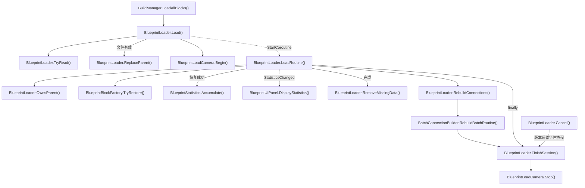

- [BuildManager.LoadAllBlocks](../Assets/Scripts/Features/Building/BuildManager.cs#L563)
<!-- source: Assets/Scripts/Features/Building/BuildManager.cs|LoadAllBlocks -->
- [BlueprintLoader.Load](../Assets/Scripts/Features/Building/BlueprintLoading/BlueprintLoader.cs#L43)
<!-- source: Assets/Scripts/Features/Building/BlueprintLoading/BlueprintLoader.cs|Load -->
- [BlueprintLoader.TryRead](../Assets/Scripts/Features/Building/BlueprintLoading/BlueprintLoader.cs#L189)
<!-- source: Assets/Scripts/Features/Building/BlueprintLoading/BlueprintLoader.cs|TryRead -->
- [BlueprintLoader.ReplaceParent](../Assets/Scripts/Features/Building/BlueprintLoading/BlueprintLoader.cs#L228)
<!-- source: Assets/Scripts/Features/Building/BlueprintLoading/BlueprintLoader.cs|ReplaceParent -->
- [BlueprintLoadCamera.Begin](../Assets/Scripts/Features/Building/BlueprintLoading/BlueprintLoadCamera.cs#L15)
<!-- source: Assets/Scripts/Features/Building/BlueprintLoading/BlueprintLoadCamera.cs|Begin -->
- [BlueprintLoader.LoadRoutine](../Assets/Scripts/Features/Building/BlueprintLoading/BlueprintLoader.cs#L107)
<!-- source: Assets/Scripts/Features/Building/BlueprintLoading/BlueprintLoader.cs|LoadRoutine -->
- [BlueprintLoader.OwnsParent](../Assets/Scripts/Features/Building/BlueprintLoading/BlueprintLoader.cs#L249)
<!-- source: Assets/Scripts/Features/Building/BlueprintLoading/BlueprintLoader.cs|OwnsParent -->
- [BlueprintBlockFactory.TryRestore](../Assets/Scripts/Features/Building/BlueprintLoading/BlueprintBlockFactory.cs#L7)
<!-- source: Assets/Scripts/Features/Building/BlueprintLoading/BlueprintBlockFactory.cs|TryRestore -->
- [BlueprintStatistics.Accumulate](../Assets/Scripts/Features/Building/BlueprintLoading/BlueprintStatistics.cs#L26)
<!-- source: Assets/Scripts/Features/Building/BlueprintLoading/BlueprintStatistics.cs|Accumulate -->
- [BlueprintUIPanel.DisplayStatistics](../Assets/Scripts/Features/Building/BlueprintUIPanel.cs#L44)
<!-- source: Assets/Scripts/Features/Building/BlueprintUIPanel.cs|DisplayStatistics -->
- [BlueprintLoader.RemoveMissingData](../Assets/Scripts/Features/Building/BlueprintLoading/BlueprintLoader.cs#L254)
<!-- source: Assets/Scripts/Features/Building/BlueprintLoading/BlueprintLoader.cs|RemoveMissingData -->
- [BlueprintLoader.RebuildConnections](../Assets/Scripts/Features/Building/BlueprintLoading/BlueprintLoader.cs#L265)
<!-- source: Assets/Scripts/Features/Building/BlueprintLoading/BlueprintLoader.cs|RebuildConnections -->
- [BatchConnectionBuilder.RebuildBatchRoutine](../Assets/Scripts/Features/Simulation/BatchConnectionBuilder.cs#L18)
<!-- source: Assets/Scripts/Features/Simulation/BatchConnectionBuilder.cs|RebuildBatchRoutine -->
- [BlueprintLoader.FinishSession](../Assets/Scripts/Features/Building/BlueprintLoading/BlueprintLoader.cs#L303)
<!-- source: Assets/Scripts/Features/Building/BlueprintLoading/BlueprintLoader.cs|FinishSession -->
- [BlueprintLoader.Cancel](../Assets/Scripts/Features/Building/BlueprintLoading/BlueprintLoader.cs#L94)
<!-- source: Assets/Scripts/Features/Building/BlueprintLoading/BlueprintLoader.cs|Cancel -->
- [BlueprintLoadCamera.Stop](../Assets/Scripts/Features/Building/BlueprintLoading/BlueprintLoadCamera.cs#L26)
<!-- source: Assets/Scripts/Features/Building/BlueprintLoading/BlueprintLoadCamera.cs|Stop -->

## 蓝图资源缓存与连接批处理

源码推导：玩家/建筑恢复和敌机校验/创建共享预制体缓存；SubsystemRegistration 清理缓存。连接批处理保留逐块邻接及连接检测，同步版本只在入口同步物理，分帧版本每次恢复重新同步。2ms仅为单块完成后的让出阈值，不保证帧耗时上限。

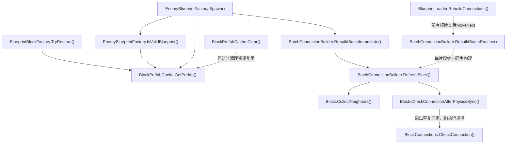

- [BlueprintBlockFactory.TryRestore](../Assets/Scripts/Features/Building/BlueprintLoading/BlueprintBlockFactory.cs#L7)
<!-- source: Assets/Scripts/Features/Building/BlueprintLoading/BlueprintBlockFactory.cs|TryRestore -->
- [EnemyBlueprintFactory.IsValidBlueprint](../Assets/Scripts/Features/Combat/EnemyBlueprintFactory.cs#L7)
<!-- source: Assets/Scripts/Features/Combat/EnemyBlueprintFactory.cs|IsValidBlueprint -->
- [EnemyBlueprintFactory.Spawn](../Assets/Scripts/Features/Combat/EnemyBlueprintFactory.cs#L12)
<!-- source: Assets/Scripts/Features/Combat/EnemyBlueprintFactory.cs|Spawn -->
- [BlockPrefabCache.GetPrefab](../Assets/Scripts/Features/Building/BlueprintLoading/BlockPrefabCache.cs#L13)
<!-- source: Assets/Scripts/Features/Building/BlueprintLoading/BlockPrefabCache.cs|GetPrefab -->
- [BlockPrefabCache.Clear](../Assets/Scripts/Features/Building/BlueprintLoading/BlockPrefabCache.cs#L37)
<!-- source: Assets/Scripts/Features/Building/BlueprintLoading/BlockPrefabCache.cs|Clear -->
- [BatchConnectionBuilder.RebuildBatchImmediate](../Assets/Scripts/Features/Simulation/BatchConnectionBuilder.cs#L40)
<!-- source: Assets/Scripts/Features/Simulation/BatchConnectionBuilder.cs|RebuildBatchImmediate -->
- [BlueprintLoader.RebuildConnections](../Assets/Scripts/Features/Building/BlueprintLoading/BlueprintLoader.cs#L265)
<!-- source: Assets/Scripts/Features/Building/BlueprintLoading/BlueprintLoader.cs|RebuildConnections -->
- [BatchConnectionBuilder.RebuildBatchRoutine](../Assets/Scripts/Features/Simulation/BatchConnectionBuilder.cs#L18)
<!-- source: Assets/Scripts/Features/Simulation/BatchConnectionBuilder.cs|RebuildBatchRoutine -->
- [BatchConnectionBuilder.RefreshBlock](../Assets/Scripts/Features/Simulation/BatchConnectionBuilder.cs#L54)
<!-- source: Assets/Scripts/Features/Simulation/BatchConnectionBuilder.cs|RefreshBlock -->
- [Block.CollectNeighbors](../Assets/Scripts/Features/Simulation/Block.cs#L378)
<!-- source: Assets/Scripts/Features/Simulation/Block.cs|CollectNeighbors -->
- [Block.CheckConnectionAfterPhysicsSync](../Assets/Scripts/Features/Simulation/Block.cs#L365)
<!-- source: Assets/Scripts/Features/Simulation/Block.cs|CheckConnectionAfterPhysicsSync -->
- [BlockConnections.CheckConnection](../Assets/Scripts/Features/Simulation/BlockConnections.cs#L53)
<!-- source: Assets/Scripts/Features/Simulation/BlockConnections.cs|CheckConnection -->

## 放置、选中、操作和持久化

预览按真实连接点确定中心并清理尾差。以驾驶舱整数边界为准：奇数尺寸轴中心半整数、偶数轴中心整数。相机轴正交选取，拖拽捕获世界轴；90°旋转锁定整数锚点并换轴半格偏移；阻挡拒绝保护姿态与位置，Undo/Redo记录两者。

```mermaid
flowchart TD
    A["BuildManager.Update()"]
    click A "../Assets/Scripts/Features/Building/BuildManager.cs#L108" "打开源码"
    B["BuildManager.HandleBuildingPreview()"]
    click B "../Assets/Scripts/Features/Building/BuildManager.cs#L439" "打开源码"
    C["BuildPreview.Poll()"]
    click C "../Assets/Scripts/Features/Building/Interaction/BuildPreview.cs#L41" "打开源码"
    D["BuildPlacementGeometry.TryCalculateConnectorAlignedPosition()"]
    click D "../Assets/Scripts/Features/Building/Interaction/BuildPlacementGeometry.cs#L64" "打开源码"
    E["BuildPlacementGeometry.IsBlocked()"]
    click E "../Assets/Scripts/Features/Building/Interaction/BuildPlacementGeometry.cs#L171" "打开源码"
    F["BuildManager.CreateBlock()"]
    click F "../Assets/Scripts/Features/Building/BuildManager.cs#L473" "打开源码"
    G["BuildManager.SaveBlock()"]
    click G "../Assets/Scripts/Features/Building/BuildManager.cs#L537" "打开源码"
    H["BuildBlueprintEditor.Save()"]
    click H "../Assets/Scripts/Features/Building/Interaction/BuildBlueprintEditor.cs#L17" "打开源码"
    I["BuildBlueprintEditor.RefreshConnectionsAround()"]
    click I "../Assets/Scripts/Features/Building/Interaction/BuildBlueprintEditor.cs#L68" "打开源码"
    J["BuildSelection.Poll()"]
    click J "../Assets/Scripts/Features/Building/Interaction/BuildSelection.cs#L42" "打开源码"
    K["BuildSelection.SelectBlock()"]
    click K "../Assets/Scripts/Features/Building/Interaction/BuildSelection.cs#L80" "打开源码"
    L["BuildManipulation.Poll()"]
    click L "../Assets/Scripts/Features/Building/Interaction/BuildManipulation.cs#L60" "打开源码"
    M["ActionManager.Push()"]
    click M "../Assets/Scripts/Features/Building/ActionManager.cs#L26" "打开源码"
    N["ActionManager.Undo()"]
    click N "../Assets/Scripts/Features/Building/ActionManager.cs#L37" "打开源码"
    O["ActionManager.Redo()"]
    click O "../Assets/Scripts/Features/Building/ActionManager.cs#L50" "打开源码"
    P["Block.CheckConnection()"]
    click P "../Assets/Scripts/Features/Simulation/Block.cs#L360" "打开源码"
    Q["BuildPalette.Awake()"]
    click Q "../Assets/Scripts/Features/Building/BuildPalette.cs#L27" "打开源码"
    R["BuildPaletteItem.ApplyButtonStyle()"]
    click R "../Assets/Scripts/Features/Building/BuildPaletteItem.cs#L45" "打开源码"
    S["BuildPaletteItem.BindPalette()"]
    click S "../Assets/Scripts/Features/Building/BuildPaletteItem.cs#L35" "打开源码"
    T["BuildManager.SetCurrentBlockResource()"]
    click T "../Assets/Scripts/Features/Building/BuildManager.cs#L360" "打开源码"
    U["BuildManipulation.HandleRotation()"]
    click U "../Assets/Scripts/Features/Building/Interaction/BuildManipulation.cs#L241" "打开源码"
    V["BuildManipulation.HandleRotateAxisDrag()"]
    click V "../Assets/Scripts/Features/Building/Interaction/BuildManipulation.cs#L364" "打开源码"
    W["BuildPlacementGeometry.CalculateRotationPosition()"]
    click W "../Assets/Scripts/Features/Building/Interaction/BuildPlacementGeometry.cs#L19" "打开源码"
    X["BuildPlacementGeometry.SnapRotationToGrid()"]
    click X "../Assets/Scripts/Features/Building/Interaction/BuildPlacementGeometry.cs#L10" "打开源码"
    Y["BuildPlacementGeometry.RemoveGridNoise()"]
    click Y "../Assets/Scripts/Features/Building/Interaction/BuildPlacementGeometry.cs#L109" "打开源码"
    Z["BuildManipulation.AlignAxisToNearestWorldDir()"]
    click Z "../Assets/Scripts/Features/Building/Interaction/BuildManipulation.cs#L126" "打开源码"
    AA["BuildManipulation.TryBeginDrag()"]
    click AA "../Assets/Scripts/Features/Building/Interaction/BuildManipulation.cs#L81" "打开源码"
    A --> B
    B --> C
    C --> D
    D --> Y
    C --> E
    C -.->|确认后调用注入动作| F
    F --> G
    G --> H
    H --> I
    I --> P
    F --> M
    A --> J
    J --> K
    J --> AA
    A --> L
    L --> Z
    AA -.->|捕获起始世界轴及姿态供后续帧使用| V
    L --> U
    L --> V
    U --> X
    V --> X
    U --> W
    V --> W
    W --> X
    U --> E
    V --> E
    U -.->|有效旋转保存| G
    V -.->|释放拖拽后保存| G
    U --> M
    V --> M
    A --> N
    A --> O
    Q --> R
    Q --> S
    S -.->|按钮点击| T
```

- [BuildManager.Update](../Assets/Scripts/Features/Building/BuildManager.cs#L108)
<!-- source: Assets/Scripts/Features/Building/BuildManager.cs|Update -->
- [BuildManager.HandleBuildingPreview](../Assets/Scripts/Features/Building/BuildManager.cs#L439)
<!-- source: Assets/Scripts/Features/Building/BuildManager.cs|HandleBuildingPreview -->
- [BuildPreview.Poll](../Assets/Scripts/Features/Building/Interaction/BuildPreview.cs#L41)
<!-- source: Assets/Scripts/Features/Building/Interaction/BuildPreview.cs|Poll -->
- [BuildPlacementGeometry.TryCalculateConnectorAlignedPosition](../Assets/Scripts/Features/Building/Interaction/BuildPlacementGeometry.cs#L64)
<!-- source: Assets/Scripts/Features/Building/Interaction/BuildPlacementGeometry.cs|TryCalculateConnectorAlignedPosition -->
- [BuildPlacementGeometry.IsBlocked](../Assets/Scripts/Features/Building/Interaction/BuildPlacementGeometry.cs#L171)
<!-- source: Assets/Scripts/Features/Building/Interaction/BuildPlacementGeometry.cs|IsBlocked -->
- [BuildManager.CreateBlock](../Assets/Scripts/Features/Building/BuildManager.cs#L473)
<!-- source: Assets/Scripts/Features/Building/BuildManager.cs|CreateBlock -->
- [BuildManager.SaveBlock](../Assets/Scripts/Features/Building/BuildManager.cs#L537)
<!-- source: Assets/Scripts/Features/Building/BuildManager.cs|SaveBlock -->
- [BuildBlueprintEditor.Save](../Assets/Scripts/Features/Building/Interaction/BuildBlueprintEditor.cs#L17)
<!-- source: Assets/Scripts/Features/Building/Interaction/BuildBlueprintEditor.cs|Save -->
- [BuildBlueprintEditor.RefreshConnectionsAround](../Assets/Scripts/Features/Building/Interaction/BuildBlueprintEditor.cs#L68)
<!-- source: Assets/Scripts/Features/Building/Interaction/BuildBlueprintEditor.cs|RefreshConnectionsAround -->
- [BuildSelection.Poll](../Assets/Scripts/Features/Building/Interaction/BuildSelection.cs#L42)
<!-- source: Assets/Scripts/Features/Building/Interaction/BuildSelection.cs|Poll -->
- [BuildSelection.SelectBlock](../Assets/Scripts/Features/Building/Interaction/BuildSelection.cs#L80)
<!-- source: Assets/Scripts/Features/Building/Interaction/BuildSelection.cs|SelectBlock -->
- [BuildManipulation.Poll](../Assets/Scripts/Features/Building/Interaction/BuildManipulation.cs#L60)
<!-- source: Assets/Scripts/Features/Building/Interaction/BuildManipulation.cs|Poll -->
- [ActionManager.Push](../Assets/Scripts/Features/Building/ActionManager.cs#L26)
<!-- source: Assets/Scripts/Features/Building/ActionManager.cs|Push -->
- [ActionManager.Undo](../Assets/Scripts/Features/Building/ActionManager.cs#L37)
<!-- source: Assets/Scripts/Features/Building/ActionManager.cs|Undo -->
- [ActionManager.Redo](../Assets/Scripts/Features/Building/ActionManager.cs#L50)
<!-- source: Assets/Scripts/Features/Building/ActionManager.cs|Redo -->
- [Block.CheckConnection](../Assets/Scripts/Features/Simulation/Block.cs#L360)
<!-- source: Assets/Scripts/Features/Simulation/Block.cs|CheckConnection -->
- [BuildPalette.Awake](../Assets/Scripts/Features/Building/BuildPalette.cs#L27)
<!-- source: Assets/Scripts/Features/Building/BuildPalette.cs|Awake -->
- [BuildPaletteItem.ApplyButtonStyle](../Assets/Scripts/Features/Building/BuildPaletteItem.cs#L45)
<!-- source: Assets/Scripts/Features/Building/BuildPaletteItem.cs|ApplyButtonStyle -->
- [BuildPaletteItem.BindPalette](../Assets/Scripts/Features/Building/BuildPaletteItem.cs#L35)
<!-- source: Assets/Scripts/Features/Building/BuildPaletteItem.cs|BindPalette -->
- [BuildManager.SetCurrentBlockResource](../Assets/Scripts/Features/Building/BuildManager.cs#L360)
<!-- source: Assets/Scripts/Features/Building/BuildManager.cs|SetCurrentBlockResource -->
- [BuildManipulation.HandleRotation](../Assets/Scripts/Features/Building/Interaction/BuildManipulation.cs#L241)
<!-- source: Assets/Scripts/Features/Building/Interaction/BuildManipulation.cs|HandleRotation -->
- [BuildManipulation.HandleRotateAxisDrag](../Assets/Scripts/Features/Building/Interaction/BuildManipulation.cs#L364)
<!-- source: Assets/Scripts/Features/Building/Interaction/BuildManipulation.cs|HandleRotateAxisDrag -->
- [BuildPlacementGeometry.CalculateRotationPosition](../Assets/Scripts/Features/Building/Interaction/BuildPlacementGeometry.cs#L19)
<!-- source: Assets/Scripts/Features/Building/Interaction/BuildPlacementGeometry.cs|CalculateRotationPosition -->
- [BuildPlacementGeometry.SnapRotationToGrid](../Assets/Scripts/Features/Building/Interaction/BuildPlacementGeometry.cs#L10)
<!-- source: Assets/Scripts/Features/Building/Interaction/BuildPlacementGeometry.cs|SnapRotationToGrid -->
- [BuildPlacementGeometry.RemoveGridNoise](../Assets/Scripts/Features/Building/Interaction/BuildPlacementGeometry.cs#L109)
<!-- source: Assets/Scripts/Features/Building/Interaction/BuildPlacementGeometry.cs|RemoveGridNoise -->
- [BuildManipulation.AlignAxisToNearestWorldDir](../Assets/Scripts/Features/Building/Interaction/BuildManipulation.cs#L126)
<!-- source: Assets/Scripts/Features/Building/Interaction/BuildManipulation.cs|AlignAxisToNearestWorldDir -->
- [BuildManipulation.TryBeginDrag](../Assets/Scripts/Features/Building/Interaction/BuildManipulation.cs#L81)
<!-- source: Assets/Scripts/Features/Building/Interaction/BuildManipulation.cs|TryBeginDrag -->

## 供电网络与可视范围

消费者先申报工作意图，空闲不分配；每帧仅一个中继刷新功率，拓扑仅在设备或发电机位置/连接参数变化时重建。CommitPowerStatus确认SupplyEfficiency供推进器字体读取，瞬时清零不提交缺电；无中继时LateUpdate补充确认。

```mermaid
flowchart TD
    A["PowerTransmissionDevice.Update()"]
    click A "../Assets/Scripts/Features/Power/PowerTransmissionDevice.cs#L61" "打开源码"
    B["PowerNetwork.Rebuild()"]
    click B "../Assets/Scripts/Features/Power/PowerNetwork.cs#L50" "打开源码"
    C["PowerNetwork.ResetConnections()"]
    click C "../Assets/Scripts/Features/Power/PowerNetwork.cs#L134" "打开源码"
    D["PowerNetwork.BuildConnections()"]
    click D "../Assets/Scripts/Features/Power/PowerNetwork.cs#L206" "打开源码"
    E["PowerNetwork.DistributeNetworkPower()"]
    click E "../Assets/Scripts/Features/Power/PowerNetwork.cs#L308" "打开源码"
    F["PowerNetwork.CollectConnectedComponent()"]
    click F "../Assets/Scripts/Features/Power/PowerNetwork.cs#L331" "打开源码"
    G["PowerNetwork.SupplyConnectedComponent()"]
    click G "../Assets/Scripts/Features/Power/PowerNetwork.cs#L382" "打开源码"
    H["PowerNetwork.CommitPowerStatuses()"]
    click H "../Assets/Scripts/Features/Power/PowerNetwork.cs#L419" "打开源码"
    I["Power.CommitPowerStatus()"]
    click I "../Assets/Scripts/Features/Power/Power.cs#L111" "打开源码"
    J["PowerConnectionVisuals.Refresh()"]
    click J "../Assets/Scripts/Features/Power/PowerConnectionVisuals.cs#L19" "打开源码"
    K["PowerTransmissionDevice.OnDisable()"]
    click K "../Assets/Scripts/Features/Power/PowerTransmissionDevice.cs#L74" "打开源码"
    L["PowerNetwork.Clear()"]
    click L "../Assets/Scripts/Features/Power/PowerNetwork.cs#L71" "打开源码"
    M["DebugManager.RefreshPowerRangeMesh()"]
    click M "../Assets/Scripts/Features/Diagnostics/DebugManager.cs#L132" "打开源码"
    N["PowerRangeUnionView.Refresh()"]
    click N "../Assets/Scripts/Features/Power/PowerRangeUnionView.cs#L36" "打开源码"
    O["DebugManager.TogglePowerRange()"]
    click O "../Assets/Scripts/Features/Diagnostics/DebugManager.cs#L74" "打开源码"
    P["PowerRangeUnionView.Hide()"]
    click P "../Assets/Scripts/Features/Power/PowerRangeUnionView.cs#L66" "打开源码"
    Q["DebugManager.OnDestroy()"]
    click Q "../Assets/Scripts/Features/Diagnostics/DebugManager.cs#L50" "打开源码"
    R["PowerRangeUnionView.Dispose()"]
    click R "../Assets/Scripts/Features/Power/PowerRangeUnionView.cs#L79" "打开源码"
    S["Power.SetWorkRequested()"]
    click S "../Assets/Scripts/Features/Power/Power.cs#L74" "打开源码"
    T["Power.ReceivePower()"]
    click T "../Assets/Scripts/Features/Power/Power.cs#L106" "打开源码"
    U["Power.LateUpdate()"]
    click U "../Assets/Scripts/Features/Power/Power.cs#L64" "打开源码"
    V["PowerNetwork.CaptureTopology()"]
    click V "../Assets/Scripts/Features/Power/PowerNetwork.cs#L149" "打开源码"
    W["PowerNetwork.CacheConnectedComponents()"]
    click W "../Assets/Scripts/Features/Power/PowerNetwork.cs#L261" "打开源码"
    X["PowerNetwork.PrepareLoads()"]
    click X "../Assets/Scripts/Features/Power/PowerNetwork.cs#L291" "打开源码"
    Y["PowerNetwork.CollectDeviceLoads()"]
    click Y "../Assets/Scripts/Features/Power/PowerNetwork.cs#L366" "打开源码"
    Z["PowerPositionIndex.Query()"]
    click Z "../Assets/Scripts/Features/Power/PowerPositionIndex.cs#L37" "打开源码"
    A -->|首个本帧中继| B
    B --> V
    V -.->|身份、位置或连接范围变化| C
    B -->|拓扑变化| D
    B -->|拓扑变化| W
    D --> Z
    W --> F
    B -->|每帧| X
    B --> E
    E --> Y
    Y --> Z
    E --> G
    S -.->|下轮网络读取需求| G
    G --> T
    B --> H
    H --> I
    U -->|本帧尚未提交| I
    A --> J
    K -->|最后中继| L
    A -->|完成网络后| M
    M --> N
    O -->|关闭范围显示| P
    Q --> R
```

- [PowerTransmissionDevice.Update](../Assets/Scripts/Features/Power/PowerTransmissionDevice.cs#L61)
<!-- source: Assets/Scripts/Features/Power/PowerTransmissionDevice.cs|Update -->
- [PowerNetwork.Rebuild](../Assets/Scripts/Features/Power/PowerNetwork.cs#L50)
<!-- source: Assets/Scripts/Features/Power/PowerNetwork.cs|Rebuild -->
- [PowerNetwork.ResetConnections](../Assets/Scripts/Features/Power/PowerNetwork.cs#L134)
<!-- source: Assets/Scripts/Features/Power/PowerNetwork.cs|ResetConnections -->
- [PowerNetwork.BuildConnections](../Assets/Scripts/Features/Power/PowerNetwork.cs#L206)
<!-- source: Assets/Scripts/Features/Power/PowerNetwork.cs|BuildConnections -->
- [PowerNetwork.DistributeNetworkPower](../Assets/Scripts/Features/Power/PowerNetwork.cs#L308)
<!-- source: Assets/Scripts/Features/Power/PowerNetwork.cs|DistributeNetworkPower -->
- [PowerNetwork.CollectConnectedComponent](../Assets/Scripts/Features/Power/PowerNetwork.cs#L331)
<!-- source: Assets/Scripts/Features/Power/PowerNetwork.cs|CollectConnectedComponent -->
- [PowerNetwork.SupplyConnectedComponent](../Assets/Scripts/Features/Power/PowerNetwork.cs#L382)
<!-- source: Assets/Scripts/Features/Power/PowerNetwork.cs|SupplyConnectedComponent -->
- [PowerNetwork.CommitPowerStatuses](../Assets/Scripts/Features/Power/PowerNetwork.cs#L419)
<!-- source: Assets/Scripts/Features/Power/PowerNetwork.cs|CommitPowerStatuses -->
- [Power.CommitPowerStatus](../Assets/Scripts/Features/Power/Power.cs#L111)
<!-- source: Assets/Scripts/Features/Power/Power.cs|CommitPowerStatus -->
- [PowerConnectionVisuals.Refresh](../Assets/Scripts/Features/Power/PowerConnectionVisuals.cs#L19)
<!-- source: Assets/Scripts/Features/Power/PowerConnectionVisuals.cs|Refresh -->
- [PowerTransmissionDevice.OnDisable](../Assets/Scripts/Features/Power/PowerTransmissionDevice.cs#L74)
<!-- source: Assets/Scripts/Features/Power/PowerTransmissionDevice.cs|OnDisable -->
- [PowerNetwork.Clear](../Assets/Scripts/Features/Power/PowerNetwork.cs#L71)
<!-- source: Assets/Scripts/Features/Power/PowerNetwork.cs|Clear -->
- [DebugManager.RefreshPowerRangeMesh](../Assets/Scripts/Features/Diagnostics/DebugManager.cs#L137)
<!-- source: Assets/Scripts/Features/Diagnostics/DebugManager.cs|RefreshPowerRangeMesh -->
- [PowerRangeUnionView.Refresh](../Assets/Scripts/Features/Power/PowerRangeUnionView.cs#L36)
<!-- source: Assets/Scripts/Features/Power/PowerRangeUnionView.cs|Refresh -->
- [DebugManager.TogglePowerRange](../Assets/Scripts/Features/Diagnostics/DebugManager.cs#L79)
<!-- source: Assets/Scripts/Features/Diagnostics/DebugManager.cs|TogglePowerRange -->
- [PowerRangeUnionView.Hide](../Assets/Scripts/Features/Power/PowerRangeUnionView.cs#L66)
<!-- source: Assets/Scripts/Features/Power/PowerRangeUnionView.cs|Hide -->
- [DebugManager.OnDestroy](../Assets/Scripts/Features/Diagnostics/DebugManager.cs#L55)
<!-- source: Assets/Scripts/Features/Diagnostics/DebugManager.cs|OnDestroy -->
- [PowerRangeUnionView.Dispose](../Assets/Scripts/Features/Power/PowerRangeUnionView.cs#L79)
<!-- source: Assets/Scripts/Features/Power/PowerRangeUnionView.cs|Dispose -->
- [Power.SetWorkRequested](../Assets/Scripts/Features/Power/Power.cs#L74)
<!-- source: Assets/Scripts/Features/Power/Power.cs|SetWorkRequested -->
- [Power.ReceivePower](../Assets/Scripts/Features/Power/Power.cs#L106)
<!-- source: Assets/Scripts/Features/Power/Power.cs|ReceivePower -->
- [Power.LateUpdate](../Assets/Scripts/Features/Power/Power.cs#L64)
<!-- source: Assets/Scripts/Features/Power/Power.cs|LateUpdate -->
- [PowerNetwork.CaptureTopology](../Assets/Scripts/Features/Power/PowerNetwork.cs#L149)
<!-- source: Assets/Scripts/Features/Power/PowerNetwork.cs|CaptureTopology -->
- [PowerNetwork.CacheConnectedComponents](../Assets/Scripts/Features/Power/PowerNetwork.cs#L261)
<!-- source: Assets/Scripts/Features/Power/PowerNetwork.cs|CacheConnectedComponents -->
- [PowerNetwork.PrepareLoads](../Assets/Scripts/Features/Power/PowerNetwork.cs#L291)
<!-- source: Assets/Scripts/Features/Power/PowerNetwork.cs|PrepareLoads -->
- [PowerNetwork.CollectDeviceLoads](../Assets/Scripts/Features/Power/PowerNetwork.cs#L366)
<!-- source: Assets/Scripts/Features/Power/PowerNetwork.cs|CollectDeviceLoads -->
- [PowerPositionIndex.Query](../Assets/Scripts/Features/Power/PowerPositionIndex.cs#L37)
<!-- source: Assets/Scripts/Features/Power/PowerPositionIndex.cs|Query -->

## 物理分组、连接与推进

连接图是组重建输入；先捕获不可变源速度/质心，优先保留含驾驶舱分量的刚体，无驾驶舱时保留最大分量。只迁移分离模块，所有迁移完成后恢复点速度并局部刷新；不重扫无关单位。几何连接要求两侧规范碰撞体都参与Block层查询，断链不能单向向外连接；修缮/底座重建显式恢复原层。FixedUpdate由引擎调度；悬浮控制器提交目标，推进器每物理帧限速一次。关机撤销功率请求但残余推力按maxThrustChangeRate衰减；退出游玩或组件禁用清零。

```mermaid
flowchart TD
    A["PlayManager.RefreshGroup()"]
    click A "../Assets/Scripts/Features/Simulation/PlayManager.cs#L183" "打开源码"
    B["PlayManager.AssignBlocksToParentGroups()"]
    click B "../Assets/Scripts/Features/Simulation/PlayManager.cs#L316" "打开源码"
    C["RuntimeGroupBuilder.Rebuild()"]
    click C "../Assets/Scripts/Features/Simulation/RuntimeGroupBuilder.cs#L15" "打开源码"
    D["BlockGroupManager.GroupRuntimeBlocks()"]
    click D "../Assets/Scripts/Features/Simulation/BlockGroupManager.cs#L15" "打开源码"
    E["BlockConnections.CollectRuntimeNeighbors()"]
    click E "../Assets/Scripts/Features/Simulation/BlockConnections.cs#L430" "打开源码"
    F["RuntimeGroupBuilder.RestoreGroupPhysics()"]
    click F "../Assets/Scripts/Features/Simulation/RuntimeGroupBuilder.cs#L211" "打开源码"
    G["ControlUnit.RefreshChildren()"]
    click G "../Assets/Scripts/Features/Simulation/ControlUnit.cs#L160" "打开源码"
    H["PlayManager.FixedUpdate()"]
    click H "../Assets/Scripts/Features/Simulation/PlayManager.cs#L68" "打开源码"
    I["RuntimeGroupCleanup.EnforceDistance()"]
    click I "../Assets/Scripts/Features/Simulation/RuntimeGroupCleanup.cs#L51" "打开源码"
    J["HoverFlightController.FixedUpdate()"]
    click J "../Assets/Scripts/Features/Flight/HoverFlightController.cs#L103" "打开源码"
    K["HoverFlightController.DistributeThrust()"]
    click K "../Assets/Scripts/Features/Flight/HoverFlightController.cs#L348" "打开源码"
    L["MainThruster.FixedUpdate()"]
    click L "../Assets/Scripts/Features/Flight/MainThruster.cs#L10" "打开源码"
    M["Thruster.ApplyThrustChangeRateLimit()"]
    click M "../Assets/Scripts/Features/Flight/Thruster.cs#L126" "打开源码"
    N["HoverControlSolver.StepHeight()"]
    click N "../Assets/Scripts/Features/Flight/HoverControlSolver.cs#L29" "打开源码"
    O["HoverControlSolver.CalculateTilt()"]
    click O "../Assets/Scripts/Features/Flight/HoverControlSolver.cs#L55" "打开源码"
    P["HoverFlightController.StopControlOutput()"]
    click P "../Assets/Scripts/Features/Flight/HoverFlightController.cs#L170" "打开源码"
    Q["HoverControlSolver.Reset()"]
    click Q "../Assets/Scripts/Features/Flight/HoverControlSolver.cs#L23" "打开源码"
    R["HoverFlightController.ClearHoverThrust()"]
    click R "../Assets/Scripts/Features/Flight/HoverFlightController.cs#L177" "打开源码"
    S["HoverFlightController.OnDisable()"]
    click S "../Assets/Scripts/Features/Flight/HoverFlightController.cs#L91" "打开源码"
    T["HoverThruster.SetControlledThrust()"]
    click T "../Assets/Scripts/Features/Flight/HoverThruster.cs#L11" "打开源码"
    U["HoverThruster.FixedUpdate()"]
    click U "../Assets/Scripts/Features/Flight/HoverThruster.cs#L16" "打开源码"
    V["UniversalThruster.FixedUpdate()"]
    click V "../Assets/Scripts/Features/Flight/UniversalThruster.cs#L10" "打开源码"
    W["BlockConnections.DisConnectAllConnectors()"]
    click W "../Assets/Scripts/Features/Simulation/BlockConnections.cs#L339" "打开源码"
    X["Block.RestoreConnectionParticipation()"]
    click X "../Assets/Scripts/Features/Simulation/Block.cs#L389" "打开源码"
    Y["BlockConnections.RestoreParticipation()"]
    click Y "../Assets/Scripts/Features/Simulation/BlockConnections.cs#L385" "打开源码"
    Z["RuntimeGroupBuilder.CaptureSourceBodies()"]
    click Z "../Assets/Scripts/Features/Simulation/RuntimeGroupBuilder.cs#L112" "打开源码"
    AA["RuntimeGroupBuilder.SelectRetainedGroups()"]
    click AA "../Assets/Scripts/Features/Simulation/RuntimeGroupBuilder.cs#L172" "打开源码"
    AB["PlayManager.RegisterControlUnitWithoutCleanup()"]
    click AB "../Assets/Scripts/Features/Simulation/PlayManager.cs#L342" "打开源码"
    AC["BlockConnectionSnapshot.Capture()"]
    click AC "../Assets/Scripts/Features/Simulation/BlockConnectionSnapshot.cs#L54" "打开源码"
    AD["BlockConnections.ReleaseRuntimePair()"]
    click AD "../Assets/Scripts/Features/Simulation/BlockConnections.cs#L404" "打开源码"
    AE["BatchConnectionBuilder.RebuildBatchImmediate()"]
    click AE "../Assets/Scripts/Features/Simulation/BatchConnectionBuilder.cs#L40" "打开源码"
    AF["BuildingRuntime.RefreshStructure()"]
    click AF "../Assets/Scripts/Features/World/BuildingRuntime.cs#L51" "打开源码"
    A -->|建筑按底座支撑分裂| AF
    A -->|舰船| B
    B --> C
    C --> D
    C --> Z
    C --> AA
    C -->|新分量即时登记，外层统一清理| AB
    D -->|有效缓存BFS，经 Block 入口| E
    D -->|任一快照失效才物理重建| AE
    AE -.->|每块连接检查后保存| AC
    W -->|直接清理双侧引用| AD
    W -.->|两侧排除断开块| E
    X --> Y
    C --> F
    C --> G
    H --> I
    J -->|有效游玩/供电/归属| N
    J --> O
    J --> K
    K --> T
    R --> T
    U --> M
    V --> M
    L --> M
    J -->|停止或失效| P
    S --> P
    P --> Q
    P --> R
```

- [PlayManager.RefreshGroup](../Assets/Scripts/Features/Simulation/PlayManager.cs#L183)
<!-- source: Assets/Scripts/Features/Simulation/PlayManager.cs|RefreshGroup -->
- [PlayManager.AssignBlocksToParentGroups](../Assets/Scripts/Features/Simulation/PlayManager.cs#L316)
<!-- source: Assets/Scripts/Features/Simulation/PlayManager.cs|AssignBlocksToParentGroups -->
- [RuntimeGroupBuilder.Rebuild](../Assets/Scripts/Features/Simulation/RuntimeGroupBuilder.cs#L15)
<!-- source: Assets/Scripts/Features/Simulation/RuntimeGroupBuilder.cs|Rebuild -->
- [BlockGroupManager.GroupRuntimeBlocks](../Assets/Scripts/Features/Simulation/BlockGroupManager.cs#L15)
<!-- source: Assets/Scripts/Features/Simulation/BlockGroupManager.cs|GroupRuntimeBlocks -->
- [BlockConnections.CollectRuntimeNeighbors](../Assets/Scripts/Features/Simulation/BlockConnections.cs#L430)
<!-- source: Assets/Scripts/Features/Simulation/BlockConnections.cs|CollectRuntimeNeighbors -->
- [RuntimeGroupBuilder.RestoreGroupPhysics](../Assets/Scripts/Features/Simulation/RuntimeGroupBuilder.cs#L211)
<!-- source: Assets/Scripts/Features/Simulation/RuntimeGroupBuilder.cs|RestoreGroupPhysics -->
- [ControlUnit.RefreshChildren](../Assets/Scripts/Features/Simulation/ControlUnit.cs#L160)
<!-- source: Assets/Scripts/Features/Simulation/ControlUnit.cs|RefreshChildren -->
- [PlayManager.FixedUpdate](../Assets/Scripts/Features/Simulation/PlayManager.cs#L68)
<!-- source: Assets/Scripts/Features/Simulation/PlayManager.cs|FixedUpdate -->
- [RuntimeGroupCleanup.EnforceDistance](../Assets/Scripts/Features/Simulation/RuntimeGroupCleanup.cs#L51)
<!-- source: Assets/Scripts/Features/Simulation/RuntimeGroupCleanup.cs|EnforceDistance -->
- [HoverFlightController.FixedUpdate](../Assets/Scripts/Features/Flight/HoverFlightController.cs#L103)
<!-- source: Assets/Scripts/Features/Flight/HoverFlightController.cs|FixedUpdate -->
- [HoverFlightController.DistributeThrust](../Assets/Scripts/Features/Flight/HoverFlightController.cs#L348)
<!-- source: Assets/Scripts/Features/Flight/HoverFlightController.cs|DistributeThrust -->
- [MainThruster.FixedUpdate](../Assets/Scripts/Features/Flight/MainThruster.cs#L10)
<!-- source: Assets/Scripts/Features/Flight/MainThruster.cs|FixedUpdate -->
- [Thruster.ApplyThrustChangeRateLimit](../Assets/Scripts/Features/Flight/Thruster.cs#L126)
<!-- source: Assets/Scripts/Features/Flight/Thruster.cs|ApplyThrustChangeRateLimit -->
- [HoverControlSolver.StepHeight](../Assets/Scripts/Features/Flight/HoverControlSolver.cs#L29)
<!-- source: Assets/Scripts/Features/Flight/HoverControlSolver.cs|StepHeight -->
- [HoverControlSolver.CalculateTilt](../Assets/Scripts/Features/Flight/HoverControlSolver.cs#L55)
<!-- source: Assets/Scripts/Features/Flight/HoverControlSolver.cs|CalculateTilt -->
- [HoverFlightController.StopControlOutput](../Assets/Scripts/Features/Flight/HoverFlightController.cs#L170)
<!-- source: Assets/Scripts/Features/Flight/HoverFlightController.cs|StopControlOutput -->
- [HoverControlSolver.Reset](../Assets/Scripts/Features/Flight/HoverControlSolver.cs#L23)
<!-- source: Assets/Scripts/Features/Flight/HoverControlSolver.cs|Reset -->
- [HoverFlightController.ClearHoverThrust](../Assets/Scripts/Features/Flight/HoverFlightController.cs#L177)
<!-- source: Assets/Scripts/Features/Flight/HoverFlightController.cs|ClearHoverThrust -->
- [HoverFlightController.OnDisable](../Assets/Scripts/Features/Flight/HoverFlightController.cs#L91)
<!-- source: Assets/Scripts/Features/Flight/HoverFlightController.cs|OnDisable -->
- [HoverThruster.SetControlledThrust](../Assets/Scripts/Features/Flight/HoverThruster.cs#L11)
<!-- source: Assets/Scripts/Features/Flight/HoverThruster.cs|SetControlledThrust -->
- [HoverThruster.FixedUpdate](../Assets/Scripts/Features/Flight/HoverThruster.cs#L16)
<!-- source: Assets/Scripts/Features/Flight/HoverThruster.cs|FixedUpdate -->
- [UniversalThruster.FixedUpdate](../Assets/Scripts/Features/Flight/UniversalThruster.cs#L10)
<!-- source: Assets/Scripts/Features/Flight/UniversalThruster.cs|FixedUpdate -->
- [BlockConnections.DisConnectAllConnectors](../Assets/Scripts/Features/Simulation/BlockConnections.cs#L339)
<!-- source: Assets/Scripts/Features/Simulation/BlockConnections.cs|DisConnectAllConnectors -->
- [Block.RestoreConnectionParticipation](../Assets/Scripts/Features/Simulation/Block.cs#L389)
<!-- source: Assets/Scripts/Features/Simulation/Block.cs|RestoreConnectionParticipation -->
- [BlockConnections.RestoreParticipation](../Assets/Scripts/Features/Simulation/BlockConnections.cs#L385)
<!-- source: Assets/Scripts/Features/Simulation/BlockConnections.cs|RestoreParticipation -->
- [RuntimeGroupBuilder.CaptureSourceBodies](../Assets/Scripts/Features/Simulation/RuntimeGroupBuilder.cs#L112)
<!-- source: Assets/Scripts/Features/Simulation/RuntimeGroupBuilder.cs|CaptureSourceBodies -->
- [RuntimeGroupBuilder.SelectRetainedGroups](../Assets/Scripts/Features/Simulation/RuntimeGroupBuilder.cs#L172)
<!-- source: Assets/Scripts/Features/Simulation/RuntimeGroupBuilder.cs|SelectRetainedGroups -->
- [PlayManager.RegisterControlUnitWithoutCleanup](../Assets/Scripts/Features/Simulation/PlayManager.cs#L342)
<!-- source: Assets/Scripts/Features/Simulation/PlayManager.cs|RegisterControlUnitWithoutCleanup -->
- [BlockConnectionSnapshot.Capture](../Assets/Scripts/Features/Simulation/BlockConnectionSnapshot.cs#L54)
<!-- source: Assets/Scripts/Features/Simulation/BlockConnectionSnapshot.cs|Capture -->
- [BlockConnections.ReleaseRuntimePair](../Assets/Scripts/Features/Simulation/BlockConnections.cs#L404)
<!-- source: Assets/Scripts/Features/Simulation/BlockConnections.cs|ReleaseRuntimePair -->
- [BatchConnectionBuilder.RebuildBatchImmediate](../Assets/Scripts/Features/Simulation/BatchConnectionBuilder.cs#L40)
<!-- source: Assets/Scripts/Features/Simulation/BatchConnectionBuilder.cs|RebuildBatchImmediate -->
- [BuildingRuntime.RefreshStructure](../Assets/Scripts/Features/World/BuildingRuntime.cs#L51)
<!-- source: Assets/Scripts/Features/World/BuildingRuntime.cs|RefreshStructure -->

## 战斗、损伤、爆炸与残骸清理

Turret独立索敌后申报功率；激光即时命中且无冲量，实体炮塔每炮口生成一发并由物理扫掠命中。碰撞以法向冲量限制质量，按恢复系数扣除反弹能量，动态双方按质心能量份额分摊；CSV默认无半血限幅或碰撞冷却。爆炸与延迟清理保留原生命周期。

```mermaid
flowchart TD
    A["Turret.FixedUpdate()"]
    click A "../Assets/Scripts/Features/Combat/Turret.cs#L71" "打开源码"
    B["TurretTargetSelector.FindNearestTarget()"]
    click B "../Assets/Scripts/Features/Combat/TurretTargetSelector.cs#L17" "打开源码"
    C["TurretHitscan.Fire()"]
    click C "../Assets/Scripts/Features/Combat/TurretHitscan.cs#L10" "打开源码"
    D["Durability.ApplyDamage()"]
    click D "../Assets/Scripts/Features/Combat/Durability.cs#L63" "打开源码"
    E["ControlUnit.OnCollisionEnter()"]
    click E "../Assets/Scripts/Features/Simulation/ControlUnit.cs#L296" "打开源码"
    F["CollisionDamageResolver.ApplyContactDamage()"]
    click F "../Assets/Scripts/Features/Combat/CollisionDamageResolver.cs#L10" "打开源码"
    G["Durability.ApplyCollisionEnergy()"]
    click G "../Assets/Scripts/Features/Combat/Durability.cs#L74" "打开源码"
    H["DestroyManager.DestroyGameObject()"]
    click H "../Assets/Scripts/Features/Combat/DestroyManager.cs#L30" "打开源码"
    I["DestroyManager.ExplodeBlock()"]
    click I "../Assets/Scripts/Features/Combat/DestroyManager.cs#L131" "打开源码"
    J["ExplosionPropagation.DisconnectBlocksInExplosionRange()"]
    click J "../Assets/Scripts/Features/Combat/ExplosionPropagation.cs#L9" "打开源码"
    K["PlayManager.RefreshGroup()"]
    click K "../Assets/Scripts/Features/Simulation/PlayManager.cs#L168" "打开源码"
    L["ExplosionPropagation.ApplyExplosionForce()"]
    click L "../Assets/Scripts/Features/Combat/ExplosionPropagation.cs#L53" "打开源码"
    M["SalvageCleanupSession.ScheduleUnit()"]
    click M "../Assets/Scripts/Features/Combat/SalvageCleanupSession.cs#L17" "打开源码"
    N["SalvageCleanupSession.CleanupUnitAfterDelay()"]
    click N "../Assets/Scripts/Features/Combat/SalvageCleanupSession.cs#L106" "打开源码"
    O["CargoHold.ReleaseContents()"]
    click O "../Assets/Scripts/Features/Salvage/CargoHold.cs#L206" "打开源码"
    P["LaserTurret.Fire()"]
    click P "../Assets/Scripts/Features/Combat/LaserTurret.cs#L33" "打开源码"
    Q["ProjectileTurret.Fire()"]
    click Q "../Assets/Scripts/Features/Combat/ProjectileTurret.cs#L113" "打开源码"
    R["TurretProjectile.Launch()"]
    click R "../Assets/Scripts/Features/Combat/TurretProjectile.cs#L63" "打开源码"
    S["TurretProjectile.FixedUpdate()"]
    click S "../Assets/Scripts/Features/Combat/TurretProjectile.cs#L96" "打开源码"
    T["TurretHitResolver.Apply()"]
    click T "../Assets/Scripts/Features/Combat/TurretHitResolver.cs#L7" "打开源码"
    U["Power.SetWorkRequested()"]
    click U "../Assets/Scripts/Features/Power/Power.cs#L74" "打开源码"
    V["ProjectileTurret.LateUpdate()"]
    click V "../Assets/Scripts/Features/Combat/ProjectileTurret.cs#L57" "打开源码"
    W["ProjectileTurret.UpdateRecoil()"]
    click W "../Assets/Scripts/Features/Combat/ProjectileTurret.cs#L66" "打开源码"
    X["ProjectileTurret.ApplyRecoilPose()"]
    click X "../Assets/Scripts/Features/Combat/ProjectileTurret.cs#L84" "打开源码"
    Y["ProjectileTurret.OnDisable()"]
    click Y "../Assets/Scripts/Features/Combat/ProjectileTurret.cs#L105" "打开源码"
    Z["TurretProjectilePool.Rent()"]
    click Z "../Assets/Scripts/Features/Combat/TurretProjectilePool.cs#L11" "打开源码"
    AA["TurretProjectile.Retire()"]
    click AA "../Assets/Scripts/Features/Combat/TurretProjectile.cs#L223" "打开源码"
    AB["TurretProjectilePool.Return()"]
    click AB "../Assets/Scripts/Features/Combat/TurretProjectilePool.cs#L44" "打开源码"
    AC["TurretProjectile.OnDisable()"]
    click AC "../Assets/Scripts/Features/Combat/TurretProjectile.cs#L31" "打开源码"
    AD["TurretProjectilePool.Update()"]
    click AD "../Assets/Scripts/Features/Combat/TurretProjectilePool.cs#L57" "打开源码"
    AE["TurretProjectilePool.OnDestroy()"]
    click AE "../Assets/Scripts/Features/Combat/TurretProjectilePool.cs#L65" "打开源码"
    AF["BuildingRuntime.DestroyBlock()"]
    click AF "../Assets/Scripts/Features/World/BuildingRuntime.cs#L151" "打开源码"
    A --> B
    A --> U
    A -->|供电、瞄准且冷却满足| P
    P --> C
    A -->|供电、瞄准且冷却满足| Q
    Q -->|每炮口一发| R
    Q --> Z
    S -->|命中或到期| AA
    AA -->|池实例| AB
    AB -.->|SetActive false| AC
    AD -.->|模拟结束销毁池根| AE
    Q -.->|发射触发后座| V
    V --> W
    W --> X
    Y -->|禁用恢复初始炮管位置| X
    R -.->|后续物理步| S
    S -->|首次实体命中| T
    C -->|零冲量| T
    T --> D
    E --> F
    F --> G
    D -->|载具耐久为0| H
    G -->|载具耐久为0| H
    D -->|建筑耐久为0| AF
    G -->|建筑耐久为0| AF
    H -->|可爆炸且非碰撞致死| I
    I --> J
    I --> K
    I --> L
    H --> O
    H -->|敌方驾驶舱| M
    M -.->|协程等待并复核| N
```

- [Turret.FixedUpdate](../Assets/Scripts/Features/Combat/Turret.cs#L71)
<!-- source: Assets/Scripts/Features/Combat/Turret.cs|FixedUpdate -->
- [TurretTargetSelector.FindNearestTarget](../Assets/Scripts/Features/Combat/TurretTargetSelector.cs#L17)
<!-- source: Assets/Scripts/Features/Combat/TurretTargetSelector.cs|FindNearestTarget -->
- [TurretHitscan.Fire](../Assets/Scripts/Features/Combat/TurretHitscan.cs#L10)
<!-- source: Assets/Scripts/Features/Combat/TurretHitscan.cs|Fire -->
- [Durability.ApplyDamage](../Assets/Scripts/Features/Combat/Durability.cs#L68)
<!-- source: Assets/Scripts/Features/Combat/Durability.cs|ApplyDamage -->
- [ControlUnit.OnCollisionEnter](../Assets/Scripts/Features/Simulation/ControlUnit.cs#L302)
<!-- source: Assets/Scripts/Features/Simulation/ControlUnit.cs|OnCollisionEnter -->
- [CollisionDamageResolver.ApplyContactDamage](../Assets/Scripts/Features/Combat/CollisionDamageResolver.cs#L10)
<!-- source: Assets/Scripts/Features/Combat/CollisionDamageResolver.cs|ApplyContactDamage -->
- [Durability.ApplyCollisionEnergy](../Assets/Scripts/Features/Combat/Durability.cs#L79)
<!-- source: Assets/Scripts/Features/Combat/Durability.cs|ApplyCollisionEnergy -->
- [DestroyManager.DestroyGameObject](../Assets/Scripts/Features/Combat/DestroyManager.cs#L32)
<!-- source: Assets/Scripts/Features/Combat/DestroyManager.cs|DestroyGameObject -->
- [DestroyManager.ExplodeBlock](../Assets/Scripts/Features/Combat/DestroyManager.cs#L148)
<!-- source: Assets/Scripts/Features/Combat/DestroyManager.cs|ExplodeBlock -->
- [ExplosionPropagation.DisconnectBlocksInExplosionRange](../Assets/Scripts/Features/Combat/ExplosionPropagation.cs#L9)
<!-- source: Assets/Scripts/Features/Combat/ExplosionPropagation.cs|DisconnectBlocksInExplosionRange -->
- [PlayManager.RefreshGroup](../Assets/Scripts/Features/Simulation/PlayManager.cs#L183)
<!-- source: Assets/Scripts/Features/Simulation/PlayManager.cs|RefreshGroup -->
- [ExplosionPropagation.ApplyExplosionForce](../Assets/Scripts/Features/Combat/ExplosionPropagation.cs#L53)
<!-- source: Assets/Scripts/Features/Combat/ExplosionPropagation.cs|ApplyExplosionForce -->
- [SalvageCleanupSession.ScheduleUnit](../Assets/Scripts/Features/Combat/SalvageCleanupSession.cs#L17)
<!-- source: Assets/Scripts/Features/Combat/SalvageCleanupSession.cs|ScheduleUnit -->
- [SalvageCleanupSession.CleanupUnitAfterDelay](../Assets/Scripts/Features/Combat/SalvageCleanupSession.cs#L106)
<!-- source: Assets/Scripts/Features/Combat/SalvageCleanupSession.cs|CleanupUnitAfterDelay -->
- [CargoHold.ReleaseContents](../Assets/Scripts/Features/Salvage/CargoHold.cs#L206)
<!-- source: Assets/Scripts/Features/Salvage/CargoHold.cs|ReleaseContents -->
- [LaserTurret.Fire](../Assets/Scripts/Features/Combat/LaserTurret.cs#L33)
<!-- source: Assets/Scripts/Features/Combat/LaserTurret.cs|Fire -->
- [ProjectileTurret.Fire](../Assets/Scripts/Features/Combat/ProjectileTurret.cs#L131)
<!-- source: Assets/Scripts/Features/Combat/ProjectileTurret.cs|Fire -->
- [TurretProjectile.Launch](../Assets/Scripts/Features/Combat/TurretProjectile.cs#L63)
<!-- source: Assets/Scripts/Features/Combat/TurretProjectile.cs|Launch -->
- [TurretProjectile.FixedUpdate](../Assets/Scripts/Features/Combat/TurretProjectile.cs#L96)
<!-- source: Assets/Scripts/Features/Combat/TurretProjectile.cs|FixedUpdate -->
- [TurretHitResolver.Apply](../Assets/Scripts/Features/Combat/TurretHitResolver.cs#L7)
<!-- source: Assets/Scripts/Features/Combat/TurretHitResolver.cs|Apply -->
- [Power.SetWorkRequested](../Assets/Scripts/Features/Power/Power.cs#L74)
<!-- source: Assets/Scripts/Features/Power/Power.cs|SetWorkRequested -->
- [ProjectileTurret.LateUpdate](../Assets/Scripts/Features/Combat/ProjectileTurret.cs#L75)
<!-- source: Assets/Scripts/Features/Combat/ProjectileTurret.cs|LateUpdate -->
- [ProjectileTurret.UpdateRecoil](../Assets/Scripts/Features/Combat/ProjectileTurret.cs#L84)
<!-- source: Assets/Scripts/Features/Combat/ProjectileTurret.cs|UpdateRecoil -->
- [ProjectileTurret.ApplyRecoilPose](../Assets/Scripts/Features/Combat/ProjectileTurret.cs#L102)
<!-- source: Assets/Scripts/Features/Combat/ProjectileTurret.cs|ApplyRecoilPose -->
- [ProjectileTurret.OnDisable](../Assets/Scripts/Features/Combat/ProjectileTurret.cs#L123)
<!-- source: Assets/Scripts/Features/Combat/ProjectileTurret.cs|OnDisable -->
- [TurretProjectilePool.Rent](../Assets/Scripts/Features/Combat/TurretProjectilePool.cs#L11)
<!-- source: Assets/Scripts/Features/Combat/TurretProjectilePool.cs|Rent -->
- [TurretProjectile.Retire](../Assets/Scripts/Features/Combat/TurretProjectile.cs#L223)
<!-- source: Assets/Scripts/Features/Combat/TurretProjectile.cs|Retire -->
- [TurretProjectilePool.Return](../Assets/Scripts/Features/Combat/TurretProjectilePool.cs#L44)
<!-- source: Assets/Scripts/Features/Combat/TurretProjectilePool.cs|Return -->
- [TurretProjectile.OnDisable](../Assets/Scripts/Features/Combat/TurretProjectile.cs#L31)
<!-- source: Assets/Scripts/Features/Combat/TurretProjectile.cs|OnDisable -->
- [TurretProjectilePool.Update](../Assets/Scripts/Features/Combat/TurretProjectilePool.cs#L57)
<!-- source: Assets/Scripts/Features/Combat/TurretProjectilePool.cs|Update -->
- [TurretProjectilePool.OnDestroy](../Assets/Scripts/Features/Combat/TurretProjectilePool.cs#L65)
<!-- source: Assets/Scripts/Features/Combat/TurretProjectilePool.cs|OnDestroy -->
- [BuildingRuntime.DestroyBlock](../Assets/Scripts/Features/World/BuildingRuntime.cs#L242)
<!-- source: Assets/Scripts/Features/World/BuildingRuntime.cs|DestroyBlock -->

## 返航持久化与失败提示

源码推导：UI通过带failureReason的SaveReturnCargo重载保存货仓；原bool重载仍供已有调用者使用。失败保留会话并持续显示可操作原因，CanvasGroup和图形不阻挡输入；成功才清除提示并退出/重载。状态栏由Editor工具保存为Main可编辑对象，不在运行时动态生成。

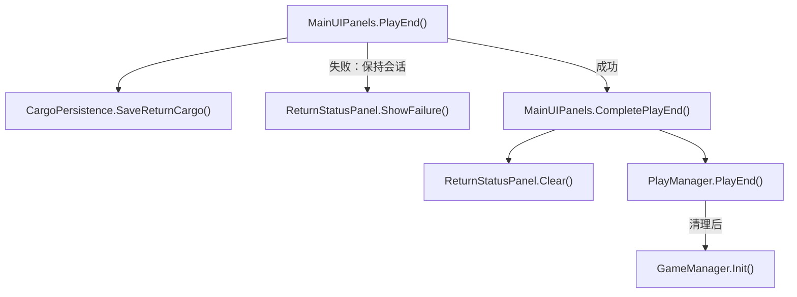

- [MainUIPanels.PlayEnd](../Assets/Scripts/Features/Presentation/MainUIPanels.cs#L278)
<!-- source: Assets/Scripts/Features/Presentation/MainUIPanels.cs|PlayEnd -->
- [CargoPersistence.SaveReturnCargo](../Assets/Scripts/Features/Salvage/CargoPersistence.cs#L11)
<!-- source: Assets/Scripts/Features/Salvage/CargoPersistence.cs|SaveReturnCargo -->
- [ReturnStatusPanel.ShowFailure](../Assets/Scripts/Features/Presentation/ReturnStatusPanel.cs#L20)
<!-- source: Assets/Scripts/Features/Presentation/ReturnStatusPanel.cs|ShowFailure -->
- [MainUIPanels.CompletePlayEnd](../Assets/Scripts/Features/Presentation/MainUIPanels.cs#L294)
<!-- source: Assets/Scripts/Features/Presentation/MainUIPanels.cs|CompletePlayEnd -->
- [ReturnStatusPanel.Clear](../Assets/Scripts/Features/Presentation/ReturnStatusPanel.cs#L37)
<!-- source: Assets/Scripts/Features/Presentation/ReturnStatusPanel.cs|Clear -->
- [PlayManager.PlayEnd](../Assets/Scripts/Features/Simulation/PlayManager.cs#L285)
<!-- source: Assets/Scripts/Features/Simulation/PlayManager.cs|PlayEnd -->
- [GameManager.Init](../Assets/Scripts/Features/Bootstrap/GameManager.cs#L20)
<!-- source: Assets/Scripts/Features/Bootstrap/GameManager.cs|Init -->

## 维修、回收和移动 Home 返航

机器人使用 Home 实时停靠点与刚体点速度；任务与返航均从机体做净空检测，持续绕障并在停滞后脱困。动态 Bot 及其子碰撞体从净空、重叠和速度走廊查询中过滤，墙体等真实障碍仍参与制动。单次同步决策复用碰撞体过滤与净空结果，入口清空过滤缓存；导航同帧复用实时目标距离，不降低紧急制动频率。BotNavigationPolicy 固化导航规则，不接受 Inspector/CSV 速度或寻路参数；任务/返航共用无固定速度上限的加速/到达控制，按距离与净空制动并优先消除危险纵向速度；连续两次净空后恢复直达，退出重叠后立即重选路线；停滞窗口在脱困决策后重置，避免历史最近距离触发重复换向。取消任务释放认领。

```mermaid
flowchart TD
    A["RepairBot.FixedUpdate()"]
    click A "../Assets/Scripts/Features/Bots/RepairBot.cs#L36" "打开源码"
    B["Bot.TickNavigation()"]
    click B "../Assets/Scripts/Features/Bots/Bot.cs#L79" "打开源码"
    C["RepairTargetSearch.Scan()"]
    click C "../Assets/Scripts/Features/Bots/RepairTargetSearch.cs#L15" "打开源码"
    D["Bot.NavigateToTarget()"]
    click D "../Assets/Scripts/Features/Bots/Bot.cs#L168" "打开源码"
    E["BotFlightMotion.NavigateToTarget()"]
    click E "../Assets/Scripts/Features/Bots/BotFlightMotion.cs#L43" "打开源码"
    F["BotObstacleAvoidance.Evaluate()"]
    click F "../Assets/Scripts/Features/Bots/BotObstacleAvoidance.cs#L69" "打开源码"
    G["RepairBot.CheckAndRepair()"]
    click G "../Assets/Scripts/Features/Bots/RepairBot.cs#L110" "打开源码"
    H["RepairBeamView.Update()"]
    click H "../Assets/Scripts/Features/Bots/RepairBeamView.cs#L49" "打开源码"
    I["CollectionBot.FixedUpdate()"]
    click I "../Assets/Scripts/Features/Bots/CollectionBot.cs#L31" "打开源码"
    J["CollectionBot.FindTarget()"]
    click J "../Assets/Scripts/Features/Bots/CollectionBot.cs#L106" "打开源码"
    K["LootDrop.Claim()"]
    click K "../Assets/Scripts/Features/Salvage/LootDrop.cs#L188" "打开源码"
    L["CollectionBot.CollectTarget()"]
    click L "../Assets/Scripts/Features/Bots/CollectionBot.cs#L82" "打开源码"
    M["LootDrop.Carry()"]
    click M "../Assets/Scripts/Features/Salvage/LootDrop.cs#L200" "打开源码"
    N["CollectionBot.ReturnCargo()"]
    click N "../Assets/Scripts/Features/Bots/CollectionBot.cs#L91" "打开源码"
    O["Bot.NavigateHomeSmoothly()"]
    click O "../Assets/Scripts/Features/Bots/Bot.cs#L188" "打开源码"
    P["BotFlightMotion.NavigateHome()"]
    click P "../Assets/Scripts/Features/Bots/BotFlightMotion.cs#L48" "打开源码"
    Q["BotObstacleAvoidance.ConstrainVelocity()"]
    click Q "../Assets/Scripts/Features/Bots/BotObstacleAvoidance.cs#L258" "打开源码"
    R["Bot.ReturnHome()"]
    click R "../Assets/Scripts/Features/Bots/Bot.cs#L231" "打开源码"
    S["LootDrop.Deliver()"]
    click S "../Assets/Scripts/Features/Salvage/LootDrop.cs#L231" "打开源码"
    T["CollectionBot.Abandon()"]
    click T "../Assets/Scripts/Features/Bots/CollectionBot.cs#L143" "打开源码"
    A --> B
    A -->|扫描目标时| C
    A --> D
    D --> E
    E -->|经 SampleGuidance| F
    E -->|每物理帧经 ApplyMovement| Q
    A --> G
    A --> H
    I --> B
    I --> J
    J --> K
    I --> L
    L --> D
    L --> M
    I --> N
    N --> O
    O --> P
    P -->|每物理帧经 ApplyMovement| Q
    P -->|机体净空与脱困| F
    O -->|可停靠| R
    N -->|完成停靠| S
    N --> T
```

- [RepairBot.FixedUpdate](../Assets/Scripts/Features/Bots/RepairBot.cs#L36)
<!-- source: Assets/Scripts/Features/Bots/RepairBot.cs|FixedUpdate -->
- [Bot.TickNavigation](../Assets/Scripts/Features/Bots/Bot.cs#L79)
<!-- source: Assets/Scripts/Features/Bots/Bot.cs|TickNavigation -->
- [RepairTargetSearch.Scan](../Assets/Scripts/Features/Bots/RepairTargetSearch.cs#L15)
<!-- source: Assets/Scripts/Features/Bots/RepairTargetSearch.cs|Scan -->
- [Bot.NavigateToTarget](../Assets/Scripts/Features/Bots/Bot.cs#L168)
<!-- source: Assets/Scripts/Features/Bots/Bot.cs|NavigateToTarget -->
- [BotFlightMotion.NavigateToTarget](../Assets/Scripts/Features/Bots/BotFlightMotion.cs#L43)
<!-- source: Assets/Scripts/Features/Bots/BotFlightMotion.cs|NavigateToTarget -->
- [BotObstacleAvoidance.Evaluate](../Assets/Scripts/Features/Bots/BotObstacleAvoidance.cs#L69)
<!-- source: Assets/Scripts/Features/Bots/BotObstacleAvoidance.cs|Evaluate -->
- [RepairBot.CheckAndRepair](../Assets/Scripts/Features/Bots/RepairBot.cs#L110)
<!-- source: Assets/Scripts/Features/Bots/RepairBot.cs|CheckAndRepair -->
- [RepairBeamView.Update](../Assets/Scripts/Features/Bots/RepairBeamView.cs#L49)
<!-- source: Assets/Scripts/Features/Bots/RepairBeamView.cs|Update -->
- [CollectionBot.FixedUpdate](../Assets/Scripts/Features/Bots/CollectionBot.cs#L31)
<!-- source: Assets/Scripts/Features/Bots/CollectionBot.cs|FixedUpdate -->
- [CollectionBot.FindTarget](../Assets/Scripts/Features/Bots/CollectionBot.cs#L106)
<!-- source: Assets/Scripts/Features/Bots/CollectionBot.cs|FindTarget -->
- [LootDrop.Claim](../Assets/Scripts/Features/Salvage/LootDrop.cs#L188)
<!-- source: Assets/Scripts/Features/Salvage/LootDrop.cs|Claim -->
- [CollectionBot.CollectTarget](../Assets/Scripts/Features/Bots/CollectionBot.cs#L82)
<!-- source: Assets/Scripts/Features/Bots/CollectionBot.cs|CollectTarget -->
- [LootDrop.Carry](../Assets/Scripts/Features/Salvage/LootDrop.cs#L200)
<!-- source: Assets/Scripts/Features/Salvage/LootDrop.cs|Carry -->
- [CollectionBot.ReturnCargo](../Assets/Scripts/Features/Bots/CollectionBot.cs#L91)
<!-- source: Assets/Scripts/Features/Bots/CollectionBot.cs|ReturnCargo -->
- [Bot.NavigateHomeSmoothly](../Assets/Scripts/Features/Bots/Bot.cs#L188)
<!-- source: Assets/Scripts/Features/Bots/Bot.cs|NavigateHomeSmoothly -->
- [BotFlightMotion.NavigateHome](../Assets/Scripts/Features/Bots/BotFlightMotion.cs#L48)
<!-- source: Assets/Scripts/Features/Bots/BotFlightMotion.cs|NavigateHome -->
- [BotObstacleAvoidance.ConstrainVelocity](../Assets/Scripts/Features/Bots/BotObstacleAvoidance.cs#L258)
<!-- source: Assets/Scripts/Features/Bots/BotObstacleAvoidance.cs|ConstrainVelocity -->
- [Bot.ReturnHome](../Assets/Scripts/Features/Bots/Bot.cs#L231)
<!-- source: Assets/Scripts/Features/Bots/Bot.cs|ReturnHome -->
- [LootDrop.Deliver](../Assets/Scripts/Features/Salvage/LootDrop.cs#L231)
<!-- source: Assets/Scripts/Features/Salvage/LootDrop.cs|Deliver -->
- [CollectionBot.Abandon](../Assets/Scripts/Features/Bots/CollectionBot.cs#L143)
<!-- source: Assets/Scripts/Features/Bots/CollectionBot.cs|Abandon -->

## 掉落概率、表现与文字遮挡

敌方残骸先抽稀有部件，再抽金币；货仓存量不受爆率影响。Update散落/吸附，LateUpdate更新表现和与Icon共用的遮挡查询；Carry停止散落并还原显示姿态。

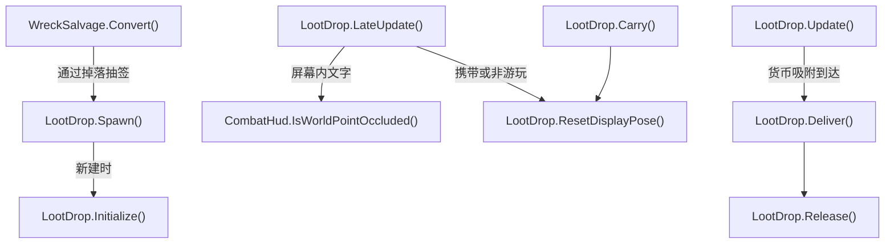

- [WreckSalvage.Convert](../Assets/Scripts/Features/Salvage/WreckSalvage.cs#L10)
<!-- source: Assets/Scripts/Features/Salvage/WreckSalvage.cs|Convert -->
- [LootDrop.Spawn](../Assets/Scripts/Features/Salvage/LootDrop.cs#L83)
<!-- source: Assets/Scripts/Features/Salvage/LootDrop.cs|Spawn -->
- [LootDrop.Initialize](../Assets/Scripts/Features/Salvage/LootDrop.cs#L132)
<!-- source: Assets/Scripts/Features/Salvage/LootDrop.cs|Initialize -->
- [LootDrop.Update](../Assets/Scripts/Features/Salvage/LootDrop.cs#L261)
<!-- source: Assets/Scripts/Features/Salvage/LootDrop.cs|Update -->
- [LootDrop.LateUpdate](../Assets/Scripts/Features/Salvage/LootDrop.cs#L320)
<!-- source: Assets/Scripts/Features/Salvage/LootDrop.cs|LateUpdate -->
- [CombatHud.IsWorldPointOccluded](../Assets/Scripts/Features/Combat/CombatHud.cs#L154)
<!-- source: Assets/Scripts/Features/Combat/CombatHud.cs|IsWorldPointOccluded -->
- [LootDrop.Carry](../Assets/Scripts/Features/Salvage/LootDrop.cs#L200)
<!-- source: Assets/Scripts/Features/Salvage/LootDrop.cs|Carry -->
- [LootDrop.ResetDisplayPose](../Assets/Scripts/Features/Salvage/LootDrop.cs#L364)
<!-- source: Assets/Scripts/Features/Salvage/LootDrop.cs|ResetDisplayPose -->
- [LootDrop.Deliver](../Assets/Scripts/Features/Salvage/LootDrop.cs#L231)
<!-- source: Assets/Scripts/Features/Salvage/LootDrop.cs|Deliver -->
- [LootDrop.Release](../Assets/Scripts/Features/Salvage/LootDrop.cs#L214)
<!-- source: Assets/Scripts/Features/Salvage/LootDrop.cs|Release -->

## 表现、镜头与 UI 生命周期

游戏事件选择效果；新建管理器的逐次毁伤/VFX日志默认关闭。短时光束/点光源按场景复用，闲置有界、活动不裁剪；到期回收，场景卸载释放。GPU突发仍沿原预算释放。镜头取景是计算，输入及协程由 CameraController 持有。

```mermaid
flowchart TD
    A["VisualEffectsManager.TryPlayBlockExplosion()"]
    click A "../Assets/Scripts/Features/Presentation/VisualEffectsManager.cs#L78" "打开源码"
    B["VisualEffectsManager.PlayBlockExplosion()"]
    click B "../Assets/Scripts/Features/Presentation/VisualEffectsManager.cs#L314" "打开源码"
    C["BlockVfxLibrary.Play()"]
    click C "../Assets/Scripts/Features/Presentation/BlockVfxLibrary.cs#L54" "打开源码"
    D["TransientEffects.CreateLightFlash()"]
    click D "../Assets/Scripts/Features/Presentation/TransientEffects.cs#L48" "打开源码"
    E["LightFade.Update()"]
    click E "../Assets/Scripts/Features/Presentation/LightFade.cs#L28" "打开源码"
    F["CameraShake.Play()"]
    click F "../Assets/Scripts/Features/Presentation/CameraShake.cs#L29" "打开源码"
    G["CameraShake.CameraShakeRoutine()"]
    click G "../Assets/Scripts/Features/Presentation/CameraShake.cs#L57" "打开源码"
    H["VisualEffectsManager.OnDisable()"]
    click H "../Assets/Scripts/Features/Presentation/VisualEffectsManager.cs#L206" "打开源码"
    I["CameraShake.Cancel()"]
    click I "../Assets/Scripts/Features/Presentation/CameraShake.cs#L17" "打开源码"
    J["CameraController.SmoothFocusCameraOnBlock()"]
    click J "../Assets/Scripts/Features/Presentation/CameraController.cs#L225" "打开源码"
    K["CameraFraming.TryGetFocusPose()"]
    click K "../Assets/Scripts/Features/Presentation/CameraFraming.cs#L26" "打开源码"
    L["CameraController.SmoothFocusRoutine()"]
    click L "../Assets/Scripts/Features/Presentation/CameraController.cs#L402" "打开源码"
    M["MainUIPanels.ShowCreatePanel()"]
    click M "../Assets/Scripts/Features/Presentation/MainUIPanels.cs#L90" "打开源码"
    N["PanelTransitions.Show()"]
    click N "../Assets/Scripts/Features/Presentation/PanelTransitions.cs#L29" "打开源码"
    O["PanelTransitions.Fade()"]
    click O "../Assets/Scripts/Features/Presentation/PanelTransitions.cs#L53" "打开源码"
    P["MainUIPanels.OnDisable()"]
    click P "../Assets/Scripts/Features/Presentation/MainUIPanels.cs#L76" "打开源码"
    Q["PanelTransitions.CancelAll()"]
    click Q "../Assets/Scripts/Features/Presentation/PanelTransitions.cs#L16" "打开源码"
    R["CameraController.LateUpdate()"]
    click R "../Assets/Scripts/Features/Presentation/CameraController.cs#L63" "打开源码"
    S["CameraController.ResolveThirdPersonCollision()"]
    click S "../Assets/Scripts/Features/Presentation/CameraController.cs#L126" "打开源码"
    T["StatusIcon.UpdateIconScreenPosition()"]
    click T "../Assets/Scripts/Features/Presentation/StatusIcon.cs#L313" "打开源码"
    U["TransientEffectPool.RentLight()"]
    click U "../Assets/Scripts/Features/Presentation/TransientEffectPool.cs#L50" "打开源码"
    V["TransientEffectPool.Return()"]
    click V "../Assets/Scripts/Features/Presentation/TransientEffectPool.cs#L75" "打开源码"
    W["TransientEffects.CreateLineStreak()"]
    click W "../Assets/Scripts/Features/Presentation/TransientEffects.cs#L7" "打开源码"
    X["TransientEffectPool.RentBeam()"]
    click X "../Assets/Scripts/Features/Presentation/TransientEffectPool.cs#L28" "打开源码"
    Y["BeamFade.Update()"]
    click Y "../Assets/Scripts/Features/Presentation/BeamFade.cs#L28" "打开源码"
    Z["TransientEffectPool.OnDestroy()"]
    click Z "../Assets/Scripts/Features/Presentation/TransientEffectPool.cs#L113" "打开源码"
    A --> B
    B --> C
    B -->|成功生成| D
    D -.->|引擎Update| E
    D --> U
    E -->|到期| V
    W --> X
    W -.->|引擎Update| Y
    Y -->|到期| V
    Z -.->|随场景销毁子对象| V
    B --> F
    F -.->|协程| G
    H --> I
    J --> K
    J -.->|协程| L
    M --> N
    N -.->|协程| O
    P --> Q
    R -->|第三人称期望与平滑位置| S
```

- [VisualEffectsManager.TryPlayBlockExplosion](../Assets/Scripts/Features/Presentation/VisualEffectsManager.cs#L78)
<!-- source: Assets/Scripts/Features/Presentation/VisualEffectsManager.cs|TryPlayBlockExplosion -->
- [VisualEffectsManager.PlayBlockExplosion](../Assets/Scripts/Features/Presentation/VisualEffectsManager.cs#L314)
<!-- source: Assets/Scripts/Features/Presentation/VisualEffectsManager.cs|PlayBlockExplosion -->
- [BlockVfxLibrary.Play](../Assets/Scripts/Features/Presentation/BlockVfxLibrary.cs#L54)
<!-- source: Assets/Scripts/Features/Presentation/BlockVfxLibrary.cs|Play -->
- [TransientEffects.CreateLightFlash](../Assets/Scripts/Features/Presentation/TransientEffects.cs#L48)
<!-- source: Assets/Scripts/Features/Presentation/TransientEffects.cs|CreateLightFlash -->
- [LightFade.Update](../Assets/Scripts/Features/Presentation/LightFade.cs#L28)
<!-- source: Assets/Scripts/Features/Presentation/LightFade.cs|Update -->
- [CameraShake.Play](../Assets/Scripts/Features/Presentation/CameraShake.cs#L29)
<!-- source: Assets/Scripts/Features/Presentation/CameraShake.cs|Play -->
- [CameraShake.CameraShakeRoutine](../Assets/Scripts/Features/Presentation/CameraShake.cs#L57)
<!-- source: Assets/Scripts/Features/Presentation/CameraShake.cs|CameraShakeRoutine -->
- [VisualEffectsManager.OnDisable](../Assets/Scripts/Features/Presentation/VisualEffectsManager.cs#L206)
<!-- source: Assets/Scripts/Features/Presentation/VisualEffectsManager.cs|OnDisable -->
- [CameraShake.Cancel](../Assets/Scripts/Features/Presentation/CameraShake.cs#L17)
<!-- source: Assets/Scripts/Features/Presentation/CameraShake.cs|Cancel -->
- [CameraController.SmoothFocusCameraOnBlock](../Assets/Scripts/Features/Presentation/CameraController.cs#L225)
<!-- source: Assets/Scripts/Features/Presentation/CameraController.cs|SmoothFocusCameraOnBlock -->
- [CameraFraming.TryGetFocusPose](../Assets/Scripts/Features/Presentation/CameraFraming.cs#L26)
<!-- source: Assets/Scripts/Features/Presentation/CameraFraming.cs|TryGetFocusPose -->
- [CameraController.SmoothFocusRoutine](../Assets/Scripts/Features/Presentation/CameraController.cs#L402)
<!-- source: Assets/Scripts/Features/Presentation/CameraController.cs|SmoothFocusRoutine -->
- [MainUIPanels.ShowCreatePanel](../Assets/Scripts/Features/Presentation/MainUIPanels.cs#L90)
<!-- source: Assets/Scripts/Features/Presentation/MainUIPanels.cs|ShowCreatePanel -->
- [PanelTransitions.Show](../Assets/Scripts/Features/Presentation/PanelTransitions.cs#L29)
<!-- source: Assets/Scripts/Features/Presentation/PanelTransitions.cs|Show -->
- [PanelTransitions.Fade](../Assets/Scripts/Features/Presentation/PanelTransitions.cs#L53)
<!-- source: Assets/Scripts/Features/Presentation/PanelTransitions.cs|Fade -->
- [MainUIPanels.OnDisable](../Assets/Scripts/Features/Presentation/MainUIPanels.cs#L76)
<!-- source: Assets/Scripts/Features/Presentation/MainUIPanels.cs|OnDisable -->
- [PanelTransitions.CancelAll](../Assets/Scripts/Features/Presentation/PanelTransitions.cs#L16)
<!-- source: Assets/Scripts/Features/Presentation/PanelTransitions.cs|CancelAll -->
- [CameraController.LateUpdate](../Assets/Scripts/Features/Presentation/CameraController.cs#L63)
<!-- source: Assets/Scripts/Features/Presentation/CameraController.cs|LateUpdate -->
- [CameraController.ResolveThirdPersonCollision](../Assets/Scripts/Features/Presentation/CameraController.cs#L126)
<!-- source: Assets/Scripts/Features/Presentation/CameraController.cs|ResolveThirdPersonCollision -->
- [StatusIcon.UpdateIconScreenPosition](../Assets/Scripts/Features/Presentation/StatusIcon.cs#L313)
<!-- source: Assets/Scripts/Features/Presentation/StatusIcon.cs|UpdateIconScreenPosition -->
- [TransientEffectPool.RentLight](../Assets/Scripts/Features/Presentation/TransientEffectPool.cs#L50)
<!-- source: Assets/Scripts/Features/Presentation/TransientEffectPool.cs|RentLight -->
- [TransientEffectPool.Return](../Assets/Scripts/Features/Presentation/TransientEffectPool.cs#L75)
<!-- source: Assets/Scripts/Features/Presentation/TransientEffectPool.cs|Return -->
- [TransientEffects.CreateLineStreak](../Assets/Scripts/Features/Presentation/TransientEffects.cs#L7)
<!-- source: Assets/Scripts/Features/Presentation/TransientEffects.cs|CreateLineStreak -->
- [TransientEffectPool.RentBeam](../Assets/Scripts/Features/Presentation/TransientEffectPool.cs#L28)
<!-- source: Assets/Scripts/Features/Presentation/TransientEffectPool.cs|RentBeam -->
- [BeamFade.Update](../Assets/Scripts/Features/Presentation/BeamFade.cs#L28)
<!-- source: Assets/Scripts/Features/Presentation/BeamFade.cs|Update -->
- [TransientEffectPool.OnDestroy](../Assets/Scripts/Features/Presentation/TransientEffectPool.cs#L113)
<!-- source: Assets/Scripts/Features/Presentation/TransientEffectPool.cs|OnDestroy -->

## Main 大世界会话

源码推导：Main隐藏预热，资源异步读取、建筑按毫秒预算创建。请求游玩可取消；Ready后暂停物理并显示不透明遮罩，下一帧启用根并按预算激活建筑，完成后恢复原timeScale。退出、死亡或激活中断均释放暂停状态并丢弃会话；失败下一Update回到统一退出链。

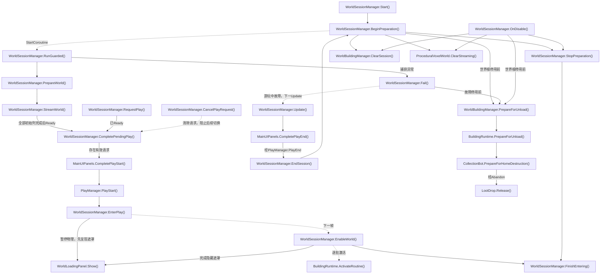

- [WorldSessionManager.Start](../Assets/Scripts/Features/World/WorldSessionManager.cs#L68)
<!-- source: Assets/Scripts/Features/World/WorldSessionManager.cs|Start -->
- [WorldSessionManager.BeginPreparation](../Assets/Scripts/Features/World/WorldSessionManager.cs#L85)
<!-- source: Assets/Scripts/Features/World/WorldSessionManager.cs|BeginPreparation -->
- [WorldSessionManager.StopPreparation](../Assets/Scripts/Features/World/WorldSessionManager.cs#L485)
<!-- source: Assets/Scripts/Features/World/WorldSessionManager.cs|StopPreparation -->
- [WorldSessionManager.RunGuarded](../Assets/Scripts/Features/World/WorldSessionManager.cs#L311)
<!-- source: Assets/Scripts/Features/World/WorldSessionManager.cs|RunGuarded -->
- [WorldSessionManager.StreamWorld](../Assets/Scripts/Features/World/WorldSessionManager.cs#L342)
<!-- source: Assets/Scripts/Features/World/WorldSessionManager.cs|StreamWorld -->
- [WorldSessionManager.CompletePendingPlay](../Assets/Scripts/Features/World/WorldSessionManager.cs#L197)
<!-- source: Assets/Scripts/Features/World/WorldSessionManager.cs|CompletePendingPlay -->
- [WorldSessionManager.RequestPlay](../Assets/Scripts/Features/World/WorldSessionManager.cs#L174)
<!-- source: Assets/Scripts/Features/World/WorldSessionManager.cs|RequestPlay -->
- [WorldSessionManager.CancelPlayRequest](../Assets/Scripts/Features/World/WorldSessionManager.cs#L191)
<!-- source: Assets/Scripts/Features/World/WorldSessionManager.cs|CancelPlayRequest -->
- [MainUIPanels.CompletePlayStart](../Assets/Scripts/Features/Presentation/MainUIPanels.cs#L258)
<!-- source: Assets/Scripts/Features/Presentation/MainUIPanels.cs|CompletePlayStart -->
- [PlayManager.PlayStart](../Assets/Scripts/Features/Simulation/PlayManager.cs#L100)
<!-- source: Assets/Scripts/Features/Simulation/PlayManager.cs|PlayStart -->
- [WorldSessionManager.EnterPlay](../Assets/Scripts/Features/World/WorldSessionManager.cs#L231)
<!-- source: Assets/Scripts/Features/World/WorldSessionManager.cs|EnterPlay -->
- [WorldSessionManager.EnableWorld](../Assets/Scripts/Features/World/WorldSessionManager.cs#L263)
<!-- source: Assets/Scripts/Features/World/WorldSessionManager.cs|EnableWorld -->
- [BuildingRuntime.ActivateRoutine](../Assets/Scripts/Features/World/BuildingRuntime.cs#L138)
<!-- source: Assets/Scripts/Features/World/BuildingRuntime.cs|ActivateRoutine -->
- [WorldSessionManager.EndSession](../Assets/Scripts/Features/World/WorldSessionManager.cs#L306)
<!-- source: Assets/Scripts/Features/World/WorldSessionManager.cs|EndSession -->
- [WorldSessionManager.Fail](../Assets/Scripts/Features/World/WorldSessionManager.cs#L517)
<!-- source: Assets/Scripts/Features/World/WorldSessionManager.cs|Fail -->
- [WorldSessionManager.Update](../Assets/Scripts/Features/World/WorldSessionManager.cs#L415)
<!-- source: Assets/Scripts/Features/World/WorldSessionManager.cs|Update -->
- [MainUIPanels.CompletePlayEnd](../Assets/Scripts/Features/Presentation/MainUIPanels.cs#L294)
<!-- source: Assets/Scripts/Features/Presentation/MainUIPanels.cs|CompletePlayEnd -->
- [WorldSessionManager.OnDisable](../Assets/Scripts/Features/World/WorldSessionManager.cs#L532)
<!-- source: Assets/Scripts/Features/World/WorldSessionManager.cs|OnDisable -->
- [WorldBuildingManager.ClearSession](../Assets/Scripts/Features/World/WorldBuildingManager.cs#L235)
<!-- source: Assets/Scripts/Features/World/WorldBuildingManager.cs|ClearSession -->
- [ProceduralVoxelWorld.ClearStreaming](../Assets/Scripts/Features/World/ProceduralVoxelWorld.cs#L335)
<!-- source: Assets/Scripts/Features/World/ProceduralVoxelWorld.cs|ClearStreaming -->
- [WorldSessionManager.PrepareWorld](../Assets/Scripts/Features/World/WorldSessionManager.cs#L125)
<!-- source: Assets/Scripts/Features/World/WorldSessionManager.cs|PrepareWorld -->
- [WorldSessionManager.FinishEntering](../Assets/Scripts/Features/World/WorldSessionManager.cs#L297)
<!-- source: Assets/Scripts/Features/World/WorldSessionManager.cs|FinishEntering -->
- [WorldLoadingPanel.Show](../Assets/Scripts/Features/World/WorldLoadingPanel.cs#L39)
<!-- source: Assets/Scripts/Features/World/WorldLoadingPanel.cs|Show -->
- [WorldBuildingManager.PrepareForUnload](../Assets/Scripts/Features/World/WorldBuildingManager.cs#L224)
<!-- source: Assets/Scripts/Features/World/WorldBuildingManager.cs|PrepareForUnload -->
- [BuildingRuntime.PrepareForUnload](../Assets/Scripts/Features/World/BuildingRuntime.cs#L181)
<!-- source: Assets/Scripts/Features/World/BuildingRuntime.cs|PrepareForUnload -->
- [CollectionBot.PrepareForHomeDestruction](../Assets/Scripts/Features/Bots/CollectionBot.cs#L166)
<!-- source: Assets/Scripts/Features/Bots/CollectionBot.cs|PrepareForHomeDestruction -->
- [LootDrop.Release](../Assets/Scripts/Features/Salvage/LootDrop.cs#L214)
<!-- source: Assets/Scripts/Features/Salvage/LootDrop.cs|Release -->

## 启动载具与世界加载遮罩

源码推导：Start开始后台世界准备后显示启动遮罩；BlueprintLoader按恢复数量报告0..95%，连接重建完成才到100%。面板Update等权合成载具/世界进度，两者完成才隐藏。用户请求游玩、取消或新会话显式Show会结束启动遮罩所有权，之后使用原来的世界进入遮罩；不改变蓝图加载间隔和动画镜头。

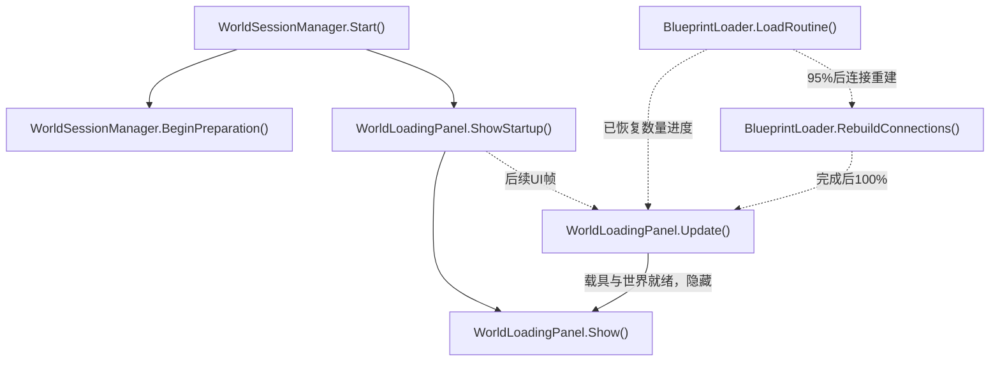

- [WorldSessionManager.Start](../Assets/Scripts/Features/World/WorldSessionManager.cs#L68)
<!-- source: Assets/Scripts/Features/World/WorldSessionManager.cs|Start -->
- [WorldSessionManager.BeginPreparation](../Assets/Scripts/Features/World/WorldSessionManager.cs#L85)
<!-- source: Assets/Scripts/Features/World/WorldSessionManager.cs|BeginPreparation -->
- [WorldLoadingPanel.ShowStartup](../Assets/Scripts/Features/World/WorldLoadingPanel.cs#L63)
<!-- source: Assets/Scripts/Features/World/WorldLoadingPanel.cs|ShowStartup -->
- [WorldLoadingPanel.Update](../Assets/Scripts/Features/World/WorldLoadingPanel.cs#L69)
<!-- source: Assets/Scripts/Features/World/WorldLoadingPanel.cs|Update -->
- [WorldLoadingPanel.Show](../Assets/Scripts/Features/World/WorldLoadingPanel.cs#L39)
<!-- source: Assets/Scripts/Features/World/WorldLoadingPanel.cs|Show -->
- [BlueprintLoader.LoadRoutine](../Assets/Scripts/Features/Building/BlueprintLoading/BlueprintLoader.cs#L107)
<!-- source: Assets/Scripts/Features/Building/BlueprintLoading/BlueprintLoader.cs|LoadRoutine -->
- [BlueprintLoader.RebuildConnections](../Assets/Scripts/Features/Building/BlueprintLoading/BlueprintLoader.cs#L265)
<!-- source: Assets/Scripts/Features/Building/BlueprintLoading/BlueprintLoader.cs|RebuildConnections -->

## 用户建筑库、自然出生和远景

源码推导：每次会话读取persistentDataPath/BuildingBlueprints全部有效JSON，单独报告坏文件并快照每套蓝图实际占地；落点按同一模板索引居中，半格支撑边距外6m接回自然坡面。进入时按载具覆盖范围最高地面加净空抬升。详细地形外分帧缓存无碰撞体素列，保持同样阶梯及草土材质，按列版本隐藏已加载列代理；默认12圈后衔接8m采样远景，空洞与外环原子切换，裙边遮缝、距离雾过渡背景。跨四列重采样，淘汰外环缓存并释放网格；退出恢复相机/雾并销毁自有网格。

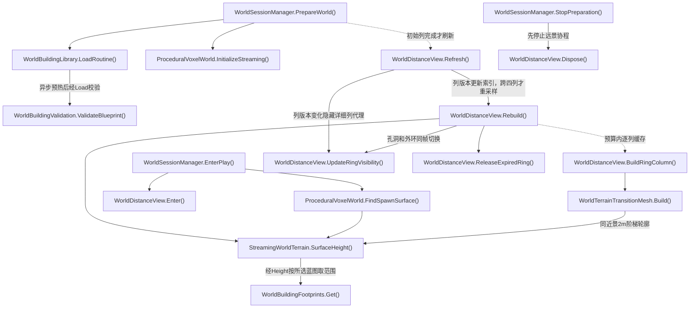

- [WorldSessionManager.PrepareWorld](../Assets/Scripts/Features/World/WorldSessionManager.cs#L125)
<!-- source: Assets/Scripts/Features/World/WorldSessionManager.cs|PrepareWorld -->
- [WorldBuildingLibrary.LoadRoutine](../Assets/Scripts/Features/World/WorldBuildingLibrary.cs#L20)
<!-- source: Assets/Scripts/Features/World/WorldBuildingLibrary.cs|LoadRoutine -->
- [WorldBuildingValidation.ValidateBlueprint](../Assets/Scripts/Features/World/WorldBuildingValidation.cs#L11)
<!-- source: Assets/Scripts/Features/World/WorldBuildingValidation.cs|ValidateBlueprint -->
- [WorldBuildingFootprints.Get](../Assets/Scripts/Features/World/WorldBuildingFootprints.cs#L34)
<!-- source: Assets/Scripts/Features/World/WorldBuildingFootprints.cs|Get -->
- [ProceduralVoxelWorld.InitializeStreaming](../Assets/Scripts/Features/World/ProceduralVoxelWorld.cs#L178)
<!-- source: Assets/Scripts/Features/World/ProceduralVoxelWorld.cs|InitializeStreaming -->
- [WorldDistanceView.Refresh](../Assets/Scripts/Features/World/WorldDistanceView.cs#L67)
<!-- source: Assets/Scripts/Features/World/WorldDistanceView.cs|Refresh -->
- [WorldDistanceView.Rebuild](../Assets/Scripts/Features/World/WorldDistanceView.cs#L93)
<!-- source: Assets/Scripts/Features/World/WorldDistanceView.cs|Rebuild -->
- [StreamingWorldTerrain.SurfaceHeight](../Assets/Scripts/Features/World/StreamingWorldTerrain.cs#L26)
<!-- source: Assets/Scripts/Features/World/StreamingWorldTerrain.cs|SurfaceHeight -->
- [WorldSessionManager.EnterPlay](../Assets/Scripts/Features/World/WorldSessionManager.cs#L231)
<!-- source: Assets/Scripts/Features/World/WorldSessionManager.cs|EnterPlay -->
- [ProceduralVoxelWorld.FindSpawnSurface](../Assets/Scripts/Features/World/ProceduralVoxelWorld.cs#L52)
<!-- source: Assets/Scripts/Features/World/ProceduralVoxelWorld.cs|FindSpawnSurface -->
- [WorldDistanceView.Enter](../Assets/Scripts/Features/World/WorldDistanceView.cs#L323)
<!-- source: Assets/Scripts/Features/World/WorldDistanceView.cs|Enter -->
- [WorldSessionManager.StopPreparation](../Assets/Scripts/Features/World/WorldSessionManager.cs#L485)
<!-- source: Assets/Scripts/Features/World/WorldSessionManager.cs|StopPreparation -->
- [WorldDistanceView.Dispose](../Assets/Scripts/Features/World/WorldDistanceView.cs#L350)
<!-- source: Assets/Scripts/Features/World/WorldDistanceView.cs|Dispose -->
- [WorldDistanceView.BuildRingColumn](../Assets/Scripts/Features/World/WorldDistanceView.cs#L270)
<!-- source: Assets/Scripts/Features/World/WorldDistanceView.cs|BuildRingColumn -->
- [WorldTerrainTransitionMesh.Build](../Assets/Scripts/Features/World/WorldTerrainTransitionMesh.cs#L9)
<!-- source: Assets/Scripts/Features/World/WorldTerrainTransitionMesh.cs|Build -->
- [WorldDistanceView.UpdateRingVisibility](../Assets/Scripts/Features/World/WorldDistanceView.cs#L232)
<!-- source: Assets/Scripts/Features/World/WorldDistanceView.cs|UpdateRingVisibility -->
- [WorldDistanceView.ReleaseExpiredRing](../Assets/Scripts/Features/World/WorldDistanceView.cs#L250)
<!-- source: Assets/Scripts/Features/World/WorldDistanceView.cs|ReleaseExpiredRing -->

## 区块流式与建筑休眠

源码推导：纯种子采样和稀疏体素差量不分配全图。加载按列，一格邻域快照交单个后台任务合并面，主线程提交碰撞，完整列才发布；先快照仓内货物、释放机器人携货/认领，再停用休眠建筑并卸载远处地形；不转换残骸奖励。静止满载时每0.2秒维护，跨列和列版本变化立即唤醒；两圈内先补近身地形再恢复建筑，详细加载6圈、卸载8圈。建筑实例受预算限制，超限快照延期；物理帧按载具尺寸与预测路径冻结等待，完整路径有碰撞后恢复。

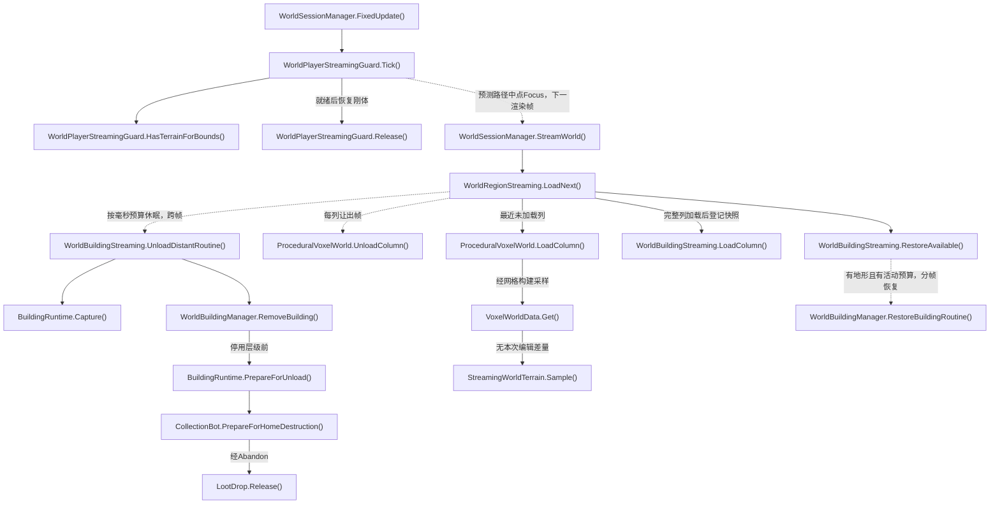

- [WorldSessionManager.StreamWorld](../Assets/Scripts/Features/World/WorldSessionManager.cs#L342)
<!-- source: Assets/Scripts/Features/World/WorldSessionManager.cs|StreamWorld -->
- [WorldRegionStreaming.LoadNext](../Assets/Scripts/Features/World/WorldRegionStreaming.cs#L32)
<!-- source: Assets/Scripts/Features/World/WorldRegionStreaming.cs|LoadNext -->
- [WorldBuildingStreaming.UnloadDistantRoutine](../Assets/Scripts/Features/World/WorldBuildingStreaming.cs#L106)
<!-- source: Assets/Scripts/Features/World/WorldBuildingStreaming.cs|UnloadDistantRoutine -->
- [BuildingRuntime.Capture](../Assets/Scripts/Features/World/BuildingRuntime.cs#L189)
<!-- source: Assets/Scripts/Features/World/BuildingRuntime.cs|Capture -->
- [WorldBuildingManager.RemoveBuilding](../Assets/Scripts/Features/World/WorldBuildingManager.cs#L211)
<!-- source: Assets/Scripts/Features/World/WorldBuildingManager.cs|RemoveBuilding -->
- [ProceduralVoxelWorld.UnloadColumn](../Assets/Scripts/Features/World/ProceduralVoxelWorld.cs#L315)
<!-- source: Assets/Scripts/Features/World/ProceduralVoxelWorld.cs|UnloadColumn -->
- [ProceduralVoxelWorld.LoadColumn](../Assets/Scripts/Features/World/ProceduralVoxelWorld.cs#L234)
<!-- source: Assets/Scripts/Features/World/ProceduralVoxelWorld.cs|LoadColumn -->
- [VoxelWorldData.Get](../Assets/Scripts/Features/World/VoxelWorldData.cs#L32)
<!-- source: Assets/Scripts/Features/World/VoxelWorldData.cs|Get -->
- [StreamingWorldTerrain.Sample](../Assets/Scripts/Features/World/StreamingWorldTerrain.cs#L55)
<!-- source: Assets/Scripts/Features/World/StreamingWorldTerrain.cs|Sample -->
- [WorldBuildingStreaming.LoadColumn](../Assets/Scripts/Features/World/WorldBuildingStreaming.cs#L34)
<!-- source: Assets/Scripts/Features/World/WorldBuildingStreaming.cs|LoadColumn -->
- [WorldBuildingStreaming.RestoreAvailable](../Assets/Scripts/Features/World/WorldBuildingStreaming.cs#L61)
<!-- source: Assets/Scripts/Features/World/WorldBuildingStreaming.cs|RestoreAvailable -->
- [WorldBuildingManager.RestoreBuildingRoutine](../Assets/Scripts/Features/World/WorldBuildingManager.cs#L145)
<!-- source: Assets/Scripts/Features/World/WorldBuildingManager.cs|RestoreBuildingRoutine -->
- [WorldSessionManager.FixedUpdate](../Assets/Scripts/Features/World/WorldSessionManager.cs#L390)
<!-- source: Assets/Scripts/Features/World/WorldSessionManager.cs|FixedUpdate -->
- [WorldPlayerStreamingGuard.Tick](../Assets/Scripts/Features/World/WorldPlayerStreamingGuard.cs#L31)
<!-- source: Assets/Scripts/Features/World/WorldPlayerStreamingGuard.cs|Tick -->
- [WorldPlayerStreamingGuard.HasTerrainForBounds](../Assets/Scripts/Features/World/WorldPlayerStreamingGuard.cs#L99)
<!-- source: Assets/Scripts/Features/World/WorldPlayerStreamingGuard.cs|HasTerrainForBounds -->
- [WorldPlayerStreamingGuard.Release](../Assets/Scripts/Features/World/WorldPlayerStreamingGuard.cs#L158)
<!-- source: Assets/Scripts/Features/World/WorldPlayerStreamingGuard.cs|Release -->
- [BuildingRuntime.PrepareForUnload](../Assets/Scripts/Features/World/BuildingRuntime.cs#L181)
<!-- source: Assets/Scripts/Features/World/BuildingRuntime.cs|PrepareForUnload -->
- [CollectionBot.PrepareForHomeDestruction](../Assets/Scripts/Features/Bots/CollectionBot.cs#L166)
<!-- source: Assets/Scripts/Features/Bots/CollectionBot.cs|PrepareForHomeDestruction -->
- [LootDrop.Release](../Assets/Scripts/Features/Salvage/LootDrop.cs#L214)
<!-- source: Assets/Scripts/Features/Salvage/LootDrop.cs|Release -->

## 体素快照与贪心网格

源码推导：仅主线程读取可变体素/稀疏修改及调用Unity Mesh和PhysX；一格halo消除跨块内部面。后台任务只拥有byte快照和独立结果，合并同方向同材质矩形并保留平铺UV。提交前检查列请求及数据版本，取消结果丢弃，实时编辑变化重新采样。每个列加载器仅一个在途任务；WorldLab和显式FlushDirty保留同步路径，LateUpdate同时受块数/毫秒预算限制。

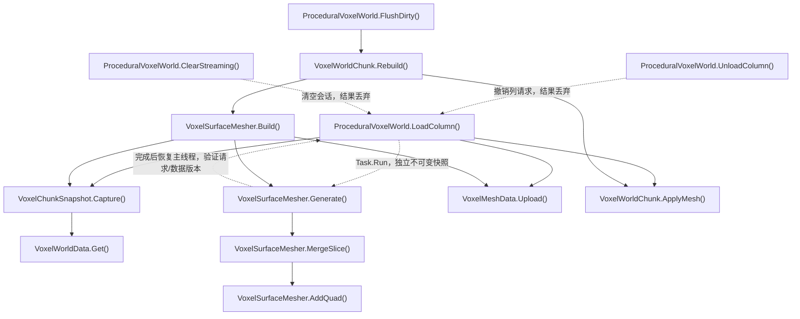

- [ProceduralVoxelWorld.LoadColumn](../Assets/Scripts/Features/World/ProceduralVoxelWorld.cs#L234)
<!-- source: Assets/Scripts/Features/World/ProceduralVoxelWorld.cs|LoadColumn -->
- [VoxelChunkSnapshot.Capture](../Assets/Scripts/Features/World/VoxelMeshData.cs#L56)
<!-- source: Assets/Scripts/Features/World/VoxelMeshData.cs|Capture -->
- [VoxelWorldData.Get](../Assets/Scripts/Features/World/VoxelWorldData.cs#L32)
<!-- source: Assets/Scripts/Features/World/VoxelWorldData.cs|Get -->
- [VoxelSurfaceMesher.Generate](../Assets/Scripts/Features/World/VoxelSurfaceMesher.cs#L67)
<!-- source: Assets/Scripts/Features/World/VoxelSurfaceMesher.cs|Generate -->
- [VoxelSurfaceMesher.MergeSlice](../Assets/Scripts/Features/World/VoxelSurfaceMesher.cs#L113)
<!-- source: Assets/Scripts/Features/World/VoxelSurfaceMesher.cs|MergeSlice -->
- [VoxelSurfaceMesher.AddQuad](../Assets/Scripts/Features/World/VoxelSurfaceMesher.cs#L180)
<!-- source: Assets/Scripts/Features/World/VoxelSurfaceMesher.cs|AddQuad -->
- [VoxelMeshData.Upload](../Assets/Scripts/Features/World/VoxelMeshData.cs#L18)
<!-- source: Assets/Scripts/Features/World/VoxelMeshData.cs|Upload -->
- [VoxelWorldChunk.ApplyMesh](../Assets/Scripts/Features/World/VoxelWorldChunk.cs#L23)
<!-- source: Assets/Scripts/Features/World/VoxelWorldChunk.cs|ApplyMesh -->
- [ProceduralVoxelWorld.UnloadColumn](../Assets/Scripts/Features/World/ProceduralVoxelWorld.cs#L315)
<!-- source: Assets/Scripts/Features/World/ProceduralVoxelWorld.cs|UnloadColumn -->
- [ProceduralVoxelWorld.ClearStreaming](../Assets/Scripts/Features/World/ProceduralVoxelWorld.cs#L335)
<!-- source: Assets/Scripts/Features/World/ProceduralVoxelWorld.cs|ClearStreaming -->
- [VoxelSurfaceMesher.Build](../Assets/Scripts/Features/World/VoxelSurfaceMesher.cs#L61)
<!-- source: Assets/Scripts/Features/World/VoxelSurfaceMesher.cs|Build -->
- [VoxelWorldChunk.Rebuild](../Assets/Scripts/Features/World/VoxelWorldChunk.cs#L18)
<!-- source: Assets/Scripts/Features/World/VoxelWorldChunk.cs|Rebuild -->
- [ProceduralVoxelWorld.FlushDirty](../Assets/Scripts/Features/World/ProceduralVoxelWorld.cs#L538)
<!-- source: Assets/Scripts/Features/World/ProceduralVoxelWorld.cs|FlushDirty -->

## 世界建筑加载与共享渲染

源码推导：流式建筑以可取消枚举分帧建立，完成才发布；部分实例取消即回滚。模块按毫秒预算创建和启用。同父刚性装饰网格按材质合并，同资源/尺寸/层级共享Mesh；炮塔轴、后坐炮管、机械动画与发光Renderer保持身份，方块碰撞/耐久仍独立。会话退出释放缓存。载具蓝图末尾连接重建也按2ms批次让出帧。

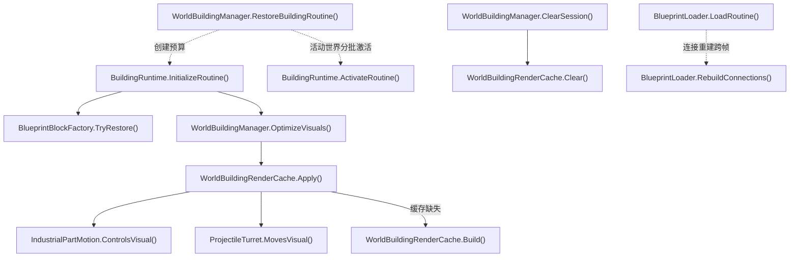

- [WorldBuildingManager.RestoreBuildingRoutine](../Assets/Scripts/Features/World/WorldBuildingManager.cs#L145)
<!-- source: Assets/Scripts/Features/World/WorldBuildingManager.cs|RestoreBuildingRoutine -->
- [BuildingRuntime.InitializeRoutine](../Assets/Scripts/Features/World/BuildingRuntime.cs#L82)
<!-- source: Assets/Scripts/Features/World/BuildingRuntime.cs|InitializeRoutine -->
- [BlueprintBlockFactory.TryRestore](../Assets/Scripts/Features/Building/BlueprintLoading/BlueprintBlockFactory.cs#L7)
<!-- source: Assets/Scripts/Features/Building/BlueprintLoading/BlueprintBlockFactory.cs|TryRestore -->
- [WorldBuildingManager.OptimizeVisuals](../Assets/Scripts/Features/World/WorldBuildingManager.cs#L192)
<!-- source: Assets/Scripts/Features/World/WorldBuildingManager.cs|OptimizeVisuals -->
- [WorldBuildingRenderCache.Apply](../Assets/Scripts/Features/World/WorldBuildingRenderCache.cs#L10)
<!-- source: Assets/Scripts/Features/World/WorldBuildingRenderCache.cs|Apply -->
- [WorldBuildingRenderCache.Build](../Assets/Scripts/Features/World/WorldBuildingRenderCache.cs#L109)
<!-- source: Assets/Scripts/Features/World/WorldBuildingRenderCache.cs|Build -->
- [BuildingRuntime.ActivateRoutine](../Assets/Scripts/Features/World/BuildingRuntime.cs#L138)
<!-- source: Assets/Scripts/Features/World/BuildingRuntime.cs|ActivateRoutine -->
- [IndustrialPartMotion.ControlsVisual](../Assets/Scripts/Features/Presentation/IndustrialPartMotion.cs#L30)
<!-- source: Assets/Scripts/Features/Presentation/IndustrialPartMotion.cs|ControlsVisual -->
- [ProjectileTurret.MovesVisual](../Assets/Scripts/Features/Combat/ProjectileTurret.cs#L34)
<!-- source: Assets/Scripts/Features/Combat/ProjectileTurret.cs|MovesVisual -->
- [WorldBuildingManager.ClearSession](../Assets/Scripts/Features/World/WorldBuildingManager.cs#L235)
<!-- source: Assets/Scripts/Features/World/WorldBuildingManager.cs|ClearSession -->
- [WorldBuildingRenderCache.Clear](../Assets/Scripts/Features/World/WorldBuildingRenderCache.cs#L189)
<!-- source: Assets/Scripts/Features/World/WorldBuildingRenderCache.cs|Clear -->
- [BlueprintLoader.LoadRoutine](../Assets/Scripts/Features/Building/BlueprintLoading/BlueprintLoader.cs#L107)
<!-- source: Assets/Scripts/Features/Building/BlueprintLoading/BlueprintLoader.cs|LoadRoutine -->
- [BlueprintLoader.RebuildConnections](../Assets/Scripts/Features/Building/BlueprintLoading/BlueprintLoader.cs#L265)
<!-- source: Assets/Scripts/Features/Building/BlueprintLoading/BlueprintLoader.cs|RebuildConnections -->

## 耐久调试标签与炮塔搜索预算

源码推导：DebugManager只装配一个耐久标签绘制器；各Durability的启用/禁用只维护活动注册，关闭标签时不扫描模块，不再为每个方块注册OnGUI/LateUpdate。炮塔目标失效时立即重搜，空目标沿用targetRefreshInterval，先按阵营排除不相关单位。

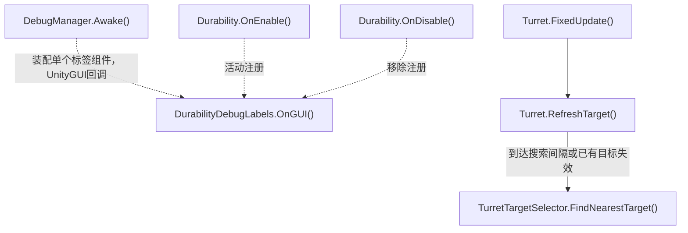

- [DebugManager.Awake](../Assets/Scripts/Features/Diagnostics/DebugManager.cs#L43)
<!-- source: Assets/Scripts/Features/Diagnostics/DebugManager.cs|Awake -->
- [Durability.OnEnable](../Assets/Scripts/Features/Combat/Durability.cs#L53)
<!-- source: Assets/Scripts/Features/Combat/Durability.cs|OnEnable -->
- [Durability.OnDisable](../Assets/Scripts/Features/Combat/Durability.cs#L63)
<!-- source: Assets/Scripts/Features/Combat/Durability.cs|OnDisable -->
- [DurabilityDebugLabels.OnGUI](../Assets/Scripts/Features/Diagnostics/DurabilityDebugLabels.cs#L9)
<!-- source: Assets/Scripts/Features/Diagnostics/DurabilityDebugLabels.cs|OnGUI -->
- [Turret.FixedUpdate](../Assets/Scripts/Features/Combat/Turret.cs#L71)
<!-- source: Assets/Scripts/Features/Combat/Turret.cs|FixedUpdate -->
- [Turret.RefreshTarget](../Assets/Scripts/Features/Combat/Turret.cs#L107)
<!-- source: Assets/Scripts/Features/Combat/Turret.cs|RefreshTarget -->
- [TurretTargetSelector.FindNearestTarget](../Assets/Scripts/Features/Combat/TurretTargetSelector.cs#L17)
<!-- source: Assets/Scripts/Features/Combat/TurretTargetSelector.cs|FindNearestTarget -->

## WorldLab 程序化世界与破坏

源码推导：独立场景不初始化Main存档；固定种子和序列化单元是数据源。采掘/炮塔命中积累伤害，破坏只标记相邻受影响分块；LateUpdate按预算更新渲染和真实MeshCollider。装配建筑组件后F5/F9走下一图的完整快照；纯地形配置仍可保存旧差量。Inspector显式Bake保存网格资产。无无限流式加载。

```mermaid
flowchart TD
    A["WorldLabAuthoring.CreateOrOpen()"]
    click A "../Assets/Editor/World/WorldLabAuthoring.cs#L13" "打开源码"
    B["ProceduralVoxelWorld.Generate()"]
    click B "../Assets/Scripts/Features/World/ProceduralVoxelWorld.cs#L99" "打开源码"
    C["VoxelWorldData.Generate()"]
    click C "../Assets/Scripts/Features/World/VoxelWorldData.cs#L119" "打开源码"
    D["VoxelWorldChunk.Rebuild()"]
    click D "../Assets/Scripts/Features/World/VoxelWorldChunk.cs#L18" "打开源码"
    E["VoxelSurfaceMesher.Build()"]
    click E "../Assets/Scripts/Features/World/VoxelSurfaceMesher.cs#L61" "打开源码"
    F["WorldLabAuthoring.BakeMeshes()"]
    click F "../Assets/Editor/World/WorldLabAuthoring.cs#L99" "打开源码"
    G["WorldLabController.Update()"]
    click G "../Assets/Scripts/Features/World/WorldLabController.cs#L57" "打开源码"
    H["ProceduralVoxelWorld.DamageSphere()"]
    click H "../Assets/Scripts/Features/World/ProceduralVoxelWorld.cs#L446" "打开源码"
    I["ProceduralVoxelWorld.SetCell()"]
    click I "../Assets/Scripts/Features/World/ProceduralVoxelWorld.cs#L395" "打开源码"
    J["ProceduralVoxelWorld.QueueCell()"]
    click J "../Assets/Scripts/Features/World/ProceduralVoxelWorld.cs#L505" "打开源码"
    K["ProceduralVoxelWorld.LateUpdate()"]
    click K "../Assets/Scripts/Features/World/ProceduralVoxelWorld.cs#L533" "打开源码"
    L["ProceduralVoxelWorld.FlushDirty()"]
    click L "../Assets/Scripts/Features/World/ProceduralVoxelWorld.cs#L538" "打开源码"
    M["TurretHitResolver.Apply()"]
    click M "../Assets/Scripts/Features/Combat/TurretHitResolver.cs#L7" "打开源码"
    N["VoxelWorldChunk.OnDestroy()"]
    click N "../Assets/Scripts/Features/World/VoxelWorldChunk.cs#L46" "打开源码"
    O["VoxelWorldChunk.ReleaseMesh()"]
    click O "../Assets/Scripts/Features/World/VoxelWorldChunk.cs#L66" "打开源码"
    P["WorldLabController.TransferEdits()"]
    click P "../Assets/Scripts/Features/World/WorldLabController.cs#L183" "打开源码"
    Q["WorldLabPersistence.Save()"]
    click Q "../Assets/Scripts/Features/World/WorldLabPersistence.cs#L10" "打开源码"
    R["WorldLabPersistence.Load()"]
    click R "../Assets/Scripts/Features/World/WorldLabPersistence.cs#L57" "打开源码"
    S["ProceduralVoxelWorld.RestoreEdits()"]
    click S "../Assets/Scripts/Features/World/ProceduralVoxelWorld.cs#L418" "打开源码"
    T["VoxelWorldEdits.Restore()"]
    click T "../Assets/Scripts/Features/World/VoxelWorldEdits.cs#L52" "打开源码"
    A --> B
    B --> C
    B --> D
    D --> E
    A --> F
    G -->|采掘与爆破| H
    G -->|填补| I
    M -->|命中WorldChunk| H
    H -->|达到材质硬度| I
    I --> J
    J -.->|排队，不立即烘焙碰撞| K
    K --> L
    L -->|仅脏块，预算2块每帧| D
    N --> O
    G -->|F5或F9| P
    P -->|无建筑组件时F5| Q
    P -->|无建筑组件时F9| R
    P -->|纯地形加载后| S
    S -->|先校验独立数据| T
    S -.->|提交数据后排队全部分块| K
```

- [WorldLabAuthoring.CreateOrOpen](../Assets/Editor/World/WorldLabAuthoring.cs#L13)
<!-- source: Assets/Editor/World/WorldLabAuthoring.cs|CreateOrOpen -->
- [ProceduralVoxelWorld.Generate](../Assets/Scripts/Features/World/ProceduralVoxelWorld.cs#L99)
<!-- source: Assets/Scripts/Features/World/ProceduralVoxelWorld.cs|Generate -->
- [VoxelWorldData.Generate](../Assets/Scripts/Features/World/VoxelWorldData.cs#L119)
<!-- source: Assets/Scripts/Features/World/VoxelWorldData.cs|Generate -->
- [VoxelWorldChunk.Rebuild](../Assets/Scripts/Features/World/VoxelWorldChunk.cs#L18)
<!-- source: Assets/Scripts/Features/World/VoxelWorldChunk.cs|Rebuild -->
- [VoxelSurfaceMesher.Build](../Assets/Scripts/Features/World/VoxelSurfaceMesher.cs#L61)
<!-- source: Assets/Scripts/Features/World/VoxelSurfaceMesher.cs|Build -->
- [WorldLabAuthoring.BakeMeshes](../Assets/Editor/World/WorldLabAuthoring.cs#L99)
<!-- source: Assets/Editor/World/WorldLabAuthoring.cs|BakeMeshes -->
- [WorldLabController.Update](../Assets/Scripts/Features/World/WorldLabController.cs#L57)
<!-- source: Assets/Scripts/Features/World/WorldLabController.cs|Update -->
- [ProceduralVoxelWorld.DamageSphere](../Assets/Scripts/Features/World/ProceduralVoxelWorld.cs#L446)
<!-- source: Assets/Scripts/Features/World/ProceduralVoxelWorld.cs|DamageSphere -->
- [ProceduralVoxelWorld.SetCell](../Assets/Scripts/Features/World/ProceduralVoxelWorld.cs#L395)
<!-- source: Assets/Scripts/Features/World/ProceduralVoxelWorld.cs|SetCell -->
- [ProceduralVoxelWorld.QueueCell](../Assets/Scripts/Features/World/ProceduralVoxelWorld.cs#L505)
<!-- source: Assets/Scripts/Features/World/ProceduralVoxelWorld.cs|QueueCell -->
- [ProceduralVoxelWorld.LateUpdate](../Assets/Scripts/Features/World/ProceduralVoxelWorld.cs#L533)
<!-- source: Assets/Scripts/Features/World/ProceduralVoxelWorld.cs|LateUpdate -->
- [ProceduralVoxelWorld.FlushDirty](../Assets/Scripts/Features/World/ProceduralVoxelWorld.cs#L538)
<!-- source: Assets/Scripts/Features/World/ProceduralVoxelWorld.cs|FlushDirty -->
- [TurretHitResolver.Apply](../Assets/Scripts/Features/Combat/TurretHitResolver.cs#L7)
<!-- source: Assets/Scripts/Features/Combat/TurretHitResolver.cs|Apply -->
- [VoxelWorldChunk.OnDestroy](../Assets/Scripts/Features/World/VoxelWorldChunk.cs#L46)
<!-- source: Assets/Scripts/Features/World/VoxelWorldChunk.cs|OnDestroy -->
- [VoxelWorldChunk.ReleaseMesh](../Assets/Scripts/Features/World/VoxelWorldChunk.cs#L66)
<!-- source: Assets/Scripts/Features/World/VoxelWorldChunk.cs|ReleaseMesh -->
- [WorldLabController.TransferEdits](../Assets/Scripts/Features/World/WorldLabController.cs#L183)
<!-- source: Assets/Scripts/Features/World/WorldLabController.cs|TransferEdits -->
- [WorldLabPersistence.Save](../Assets/Scripts/Features/World/WorldLabPersistence.cs#L10)
<!-- source: Assets/Scripts/Features/World/WorldLabPersistence.cs|Save -->
- [WorldLabPersistence.Load](../Assets/Scripts/Features/World/WorldLabPersistence.cs#L57)
<!-- source: Assets/Scripts/Features/World/WorldLabPersistence.cs|Load -->
- [ProceduralVoxelWorld.RestoreEdits](../Assets/Scripts/Features/World/ProceduralVoxelWorld.cs#L418)
<!-- source: Assets/Scripts/Features/World/ProceduralVoxelWorld.cs|RestoreEdits -->
- [VoxelWorldEdits.Restore](../Assets/Scripts/Features/World/VoxelWorldEdits.cs#L52)
<!-- source: Assets/Scripts/Features/World/VoxelWorldEdits.cs|Restore -->

## WorldLab 建筑放置与快照

源码推导：可编辑目录和BuildingBlueprints用户文件只提供模板。预览只复制Mesh，B/Q/T/左键触发放置，所有实例使用底座局部坐标、独立身份和ControlUnit战斗注册。F5保存体素差量与当前建筑快照；F9校验资源、身份、耐久和地形后暂存禁用层级，成功才替换活动世界。旧差量迁移为空建筑列表。

```mermaid
flowchart TD
    A["WorldBuildingAuthoring.Install()"]
    click A "../Assets/Editor/World/WorldBuildingAuthoring.cs#L12" "打开源码"
    B["WorldBuildingPalette.RefreshCatalog()"]
    click B "../Assets/Scripts/Features/World/WorldBuildingPalette.cs#L43" "打开源码"
    C["WorldBuildingPalette.Update()"]
    click C "../Assets/Scripts/Features/World/WorldBuildingPalette.cs#L99" "打开源码"
    D["WorldBuildingPalette.BeginPlacement()"]
    click D "../Assets/Scripts/Features/World/WorldBuildingPalette.cs#L174" "打开源码"
    E["WorldBuildingManager.CanPlace()"]
    click E "../Assets/Scripts/Features/World/WorldBuildingManager.cs#L76" "打开源码"
    F["WorldBuildingPlacement.Check()"]
    click F "../Assets/Scripts/Features/World/WorldBuildingPlacement.cs#L15" "打开源码"
    G["WorldBuildingManager.Place()"]
    click G "../Assets/Scripts/Features/World/WorldBuildingManager.cs#L96" "打开源码"
    H["WorldBuildingManager.Stage()"]
    click H "../Assets/Scripts/Features/World/WorldBuildingManager.cs#L247" "打开源码"
    I["BuildingRuntime.Initialize()"]
    click I "../Assets/Scripts/Features/World/BuildingRuntime.cs#L74" "打开源码"
    J["BuildingRuntime.Activate()"]
    click J "../Assets/Scripts/Features/World/BuildingRuntime.cs#L130" "打开源码"
    K["WorldLabController.TransferEdits()"]
    click K "../Assets/Scripts/Features/World/WorldLabController.cs#L183" "打开源码"
    L["WorldBuildingManager.Capture()"]
    click L "../Assets/Scripts/Features/World/WorldBuildingManager.cs#L265" "打开源码"
    M["BuildingRuntime.Capture()"]
    click M "../Assets/Scripts/Features/World/BuildingRuntime.cs#L189" "打开源码"
    N["WorldLabPersistence.SaveSnapshot()"]
    click N "../Assets/Scripts/Features/World/WorldLabPersistence.cs#L15" "打开源码"
    O["WorldLabPersistence.LoadSnapshot()"]
    click O "../Assets/Scripts/Features/World/WorldLabPersistence.cs#L68" "打开源码"
    P["WorldBuildingManager.Restore()"]
    click P "../Assets/Scripts/Features/World/WorldBuildingManager.cs#L285" "打开源码"
    Q["WorldBuildingValidation.ValidateState()"]
    click Q "../Assets/Scripts/Features/World/WorldBuildingValidation.cs#L71" "打开源码"
    R["VoxelWorldEdits.Restore()"]
    click R "../Assets/Scripts/Features/World/VoxelWorldEdits.cs#L52" "打开源码"
    S["ProceduralVoxelWorld.RestoreEdits()"]
    click S "../Assets/Scripts/Features/World/ProceduralVoxelWorld.cs#L418" "打开源码"
    T["WorldBuildingManager.ClearBuildings()"]
    click T "../Assets/Scripts/Features/World/WorldBuildingManager.cs#L372" "打开源码"
    U["WorldBuildingManager.RestoreBuilding()"]
    click U "../Assets/Scripts/Features/World/WorldBuildingManager.cs#L126" "打开源码"
    A -.->|保存场景/目录供Start读取| B
    C -->|B键| D
    C --> E
    E --> F
    C -->|有效预览左键| G
    G --> U
    U --> H
    H --> I
    U -->|活动根下| J
    K -->|F5| L
    L --> M
    K -->|原子写盘| N
    K -->|F9| O
    K -->|完整快照| P
    P --> R
    P -->|全部实例| Q
    P -->|校验后暂存禁用层级，失败销毁暂存| H
    P -->|暂存全部成功| S
    P --> T
    P -->|启用后恢复尺寸与耐久| J
```

- [WorldBuildingAuthoring.Install](../Assets/Editor/World/WorldBuildingAuthoring.cs#L12)
<!-- source: Assets/Editor/World/WorldBuildingAuthoring.cs|Install -->
- [WorldBuildingPalette.RefreshCatalog](../Assets/Scripts/Features/World/WorldBuildingPalette.cs#L43)
<!-- source: Assets/Scripts/Features/World/WorldBuildingPalette.cs|RefreshCatalog -->
- [WorldBuildingPalette.Update](../Assets/Scripts/Features/World/WorldBuildingPalette.cs#L99)
<!-- source: Assets/Scripts/Features/World/WorldBuildingPalette.cs|Update -->
- [WorldBuildingPalette.BeginPlacement](../Assets/Scripts/Features/World/WorldBuildingPalette.cs#L174)
<!-- source: Assets/Scripts/Features/World/WorldBuildingPalette.cs|BeginPlacement -->
- [WorldBuildingManager.CanPlace](../Assets/Scripts/Features/World/WorldBuildingManager.cs#L76)
<!-- source: Assets/Scripts/Features/World/WorldBuildingManager.cs|CanPlace -->
- [WorldBuildingPlacement.Check](../Assets/Scripts/Features/World/WorldBuildingPlacement.cs#L15)
<!-- source: Assets/Scripts/Features/World/WorldBuildingPlacement.cs|Check -->
- [WorldBuildingManager.Place](../Assets/Scripts/Features/World/WorldBuildingManager.cs#L96)
<!-- source: Assets/Scripts/Features/World/WorldBuildingManager.cs|Place -->
- [WorldBuildingManager.Stage](../Assets/Scripts/Features/World/WorldBuildingManager.cs#L247)
<!-- source: Assets/Scripts/Features/World/WorldBuildingManager.cs|Stage -->
- [BuildingRuntime.Initialize](../Assets/Scripts/Features/World/BuildingRuntime.cs#L74)
<!-- source: Assets/Scripts/Features/World/BuildingRuntime.cs|Initialize -->
- [BuildingRuntime.Activate](../Assets/Scripts/Features/World/BuildingRuntime.cs#L130)
<!-- source: Assets/Scripts/Features/World/BuildingRuntime.cs|Activate -->
- [WorldLabController.TransferEdits](../Assets/Scripts/Features/World/WorldLabController.cs#L183)
<!-- source: Assets/Scripts/Features/World/WorldLabController.cs|TransferEdits -->
- [WorldBuildingManager.Capture](../Assets/Scripts/Features/World/WorldBuildingManager.cs#L265)
<!-- source: Assets/Scripts/Features/World/WorldBuildingManager.cs|Capture -->
- [BuildingRuntime.Capture](../Assets/Scripts/Features/World/BuildingRuntime.cs#L189)
<!-- source: Assets/Scripts/Features/World/BuildingRuntime.cs|Capture -->
- [WorldLabPersistence.SaveSnapshot](../Assets/Scripts/Features/World/WorldLabPersistence.cs#L15)
<!-- source: Assets/Scripts/Features/World/WorldLabPersistence.cs|SaveSnapshot -->
- [WorldLabPersistence.LoadSnapshot](../Assets/Scripts/Features/World/WorldLabPersistence.cs#L68)
<!-- source: Assets/Scripts/Features/World/WorldLabPersistence.cs|LoadSnapshot -->
- [WorldBuildingManager.Restore](../Assets/Scripts/Features/World/WorldBuildingManager.cs#L285)
<!-- source: Assets/Scripts/Features/World/WorldBuildingManager.cs|Restore -->
- [WorldBuildingValidation.ValidateState](../Assets/Scripts/Features/World/WorldBuildingValidation.cs#L71)
<!-- source: Assets/Scripts/Features/World/WorldBuildingValidation.cs|ValidateState -->
- [VoxelWorldEdits.Restore](../Assets/Scripts/Features/World/VoxelWorldEdits.cs#L52)
<!-- source: Assets/Scripts/Features/World/VoxelWorldEdits.cs|Restore -->
- [ProceduralVoxelWorld.RestoreEdits](../Assets/Scripts/Features/World/ProceduralVoxelWorld.cs#L418)
<!-- source: Assets/Scripts/Features/World/ProceduralVoxelWorld.cs|RestoreEdits -->
- [WorldBuildingManager.ClearBuildings](../Assets/Scripts/Features/World/WorldBuildingManager.cs#L372)
<!-- source: Assets/Scripts/Features/World/WorldBuildingManager.cs|ClearBuildings -->
- [WorldBuildingManager.RestoreBuilding](../Assets/Scripts/Features/World/WorldBuildingManager.cs#L126)
<!-- source: Assets/Scripts/Features/World/WorldBuildingManager.cs|RestoreBuilding -->

## WorldLab 建筑支撑与损坏

源码推导：地形修改通知只标记附近固定建筑，FixedUpdate读取体素数据计算虚拟范围的地形支撑比例（不生成地基实体）；默认低于50%脱锚，先刷新源碰撞再启用刚体。方块死亡从虚拟地面连接点开始，用Connector真实几何缓存检查模块连通，局部删除重探附近、配置失效重建、复杂层级实时回退；虚拟底座判定复用已验证邻接节点，节点重建或底座尺寸变化失效；断裂组最多32块、12片、12秒寿命，超预算移除；Main游玩态先按原阵营释放货仓/运输物并转换掉落，再判定残骸预算。普通卸载/会话清理不转换。爆炸连锁排队结算，同轮命中先完成伤害，按脏建筑各执行一次支撑刷新，避免先脱落禁用导致漏伤；单块直接死亡仍同步完成支撑，残骸不写快照，R重生成恢复初始布局。

```mermaid
flowchart TD
    A["ProceduralVoxelWorld.SetCell()"]
    click A "../Assets/Scripts/Features/World/ProceduralVoxelWorld.cs#L395" "打开源码"
    B["WorldBuildingManager.TerrainChanged()"]
    click B "../Assets/Scripts/Features/World/WorldBuildingManager.cs#L388" "打开源码"
    C["WorldBuildingManager.FixedUpdate()"]
    click C "../Assets/Scripts/Features/World/WorldBuildingManager.cs#L399" "打开源码"
    D["WorldBuildingPlacement.Support()"]
    click D "../Assets/Scripts/Features/World/WorldBuildingPlacement.cs#L111" "打开源码"
    E["BuildingRuntime.ReleaseAnchor()"]
    click E "../Assets/Scripts/Features/World/BuildingRuntime.cs#L408" "打开源码"
    F["ProceduralVoxelWorld.FlushDirty()"]
    click F "../Assets/Scripts/Features/World/ProceduralVoxelWorld.cs#L538" "打开源码"
    G["Durability.ApplyDamage()"]
    click G "../Assets/Scripts/Features/Combat/Durability.cs#L68" "打开源码"
    H["BuildingRuntime.DestroyBlock()"]
    click H "../Assets/Scripts/Features/World/BuildingRuntime.cs#L242" "打开源码"
    I["BuildingRuntime.SplitDisconnected()"]
    click I "../Assets/Scripts/Features/World/BuildingRuntime.cs#L288" "打开源码"
    J["Block.CollectNeighbors()"]
    click J "../Assets/Scripts/Features/Simulation/Block.cs#L378" "打开源码"
    K["WorldBuildingManager.CreateDebris()"]
    click K "../Assets/Scripts/Features/World/WorldBuildingManager.cs#L421" "打开源码"
    L["WorldBuildingManager.DamageSphere()"]
    click L "../Assets/Scripts/Features/World/WorldBuildingManager.cs#L416" "打开源码"
    M["WorldBuildingDamage.Apply()"]
    click M "../Assets/Scripts/Features/World/WorldBuildingDamage.cs#L18" "打开源码"
    W["BuildingRuntime.EndDamageBatch()"]
    click W "../Assets/Scripts/Features/World/BuildingRuntime.cs#L64" "打开源码"
    X["BuildingConnectionGraph.Prepare()"]
    click X "../Assets/Scripts/Features/World/BuildingConnectionGraph.cs#L15" "打开源码"
    Y["BuildingConnectionGraph.CollectNeighbors()"]
    click Y "../Assets/Scripts/Features/World/BuildingConnectionGraph.cs#L109" "打开源码"
    N["ProceduralVoxelWorld.Generate()"]
    click N "../Assets/Scripts/Features/World/ProceduralVoxelWorld.cs#L99" "打开源码"
    O["WorldBuildingManager.ResetBuildings()"]
    click O "../Assets/Scripts/Features/World/WorldBuildingManager.cs#L338" "打开源码"
    P["WorldBuildingManager.ClearDebris()"]
    click P "../Assets/Scripts/Features/World/WorldBuildingManager.cs#L464" "打开源码"
    Q["WorldBuildingManager.Place()"]
    click Q "../Assets/Scripts/Features/World/WorldBuildingManager.cs#L96" "打开源码"
    R["BuildingRuntime.HasGroundConnector()"]
    click R "../Assets/Scripts/Features/World/BuildingRuntime.cs#L387" "打开源码"
    S["WreckSalvage.Convert()"]
    click S "../Assets/Scripts/Features/Salvage/WreckSalvage.cs#L10" "打开源码"
    T["CargoHold.ReleaseContents()"]
    click T "../Assets/Scripts/Features/Salvage/CargoHold.cs#L206" "打开源码"
    U["Bot.PrepareForHomeDestruction()"]
    click U "../Assets/Scripts/Features/Bots/Bot.cs#L131" "打开源码"
    V["LootDrop.Spawn()"]
    click V "../Assets/Scripts/Features/Salvage/LootDrop.cs#L83" "打开源码"
    Z["BuildingRuntime.HasPreparedGroundConnector()"]
    click Z "../Assets/Scripts/Features/World/BuildingRuntime.cs#L374" "打开源码"
    AA["BuildingConnectionGraph.TryGetGroundSupport()"]
    click AA "../Assets/Scripts/Features/World/BuildingConnectionGraph.cs#L126" "打开源码"
    AB["BuildingConnectionGraph.StoreGroundSupport()"]
    click AB "../Assets/Scripts/Features/World/BuildingConnectionGraph.cs#L138" "打开源码"
    A -.->|TerrainChanged事件| B
    B -.->|待检查集合| C
    C --> D
    C -->|支撑低于阈值| E
    E --> F
    G -->|建筑耐久为0| H
    H -->|标记脏结构| W
    W -->|最外层批次结束| I
    I -->|虚拟地面连接点| Z
    Z --> AA
    Z -->|缓存缺失| R
    Z --> AB
    I -->|校验或增量刷新邻接| X
    X -->|失效或删除附近探测| J
    I -->|BFS读取建筑缓存| Y
    I -->|断裂组| K
    H -->|爆炸方块| L
    L --> M
    M -->|顺序结算，连锁入队| G
    K -->|禁用/重挂接及预算判断前| S
    S --> U
    S --> T
    S -->|敌方残骸概率| V
    T -->|建筑既有存量或载具阵营配置| V
    N -.->|Regenerated事件| O
    O --> P
    O -->|有效初始布局| Q
```

- [ProceduralVoxelWorld.SetCell](../Assets/Scripts/Features/World/ProceduralVoxelWorld.cs#L395)
<!-- source: Assets/Scripts/Features/World/ProceduralVoxelWorld.cs|SetCell -->
- [WorldBuildingManager.TerrainChanged](../Assets/Scripts/Features/World/WorldBuildingManager.cs#L388)
<!-- source: Assets/Scripts/Features/World/WorldBuildingManager.cs|TerrainChanged -->
- [WorldBuildingManager.FixedUpdate](../Assets/Scripts/Features/World/WorldBuildingManager.cs#L399)
<!-- source: Assets/Scripts/Features/World/WorldBuildingManager.cs|FixedUpdate -->
- [WorldBuildingPlacement.Support](../Assets/Scripts/Features/World/WorldBuildingPlacement.cs#L111)
<!-- source: Assets/Scripts/Features/World/WorldBuildingPlacement.cs|Support -->
- [BuildingRuntime.ReleaseAnchor](../Assets/Scripts/Features/World/BuildingRuntime.cs#L408)
<!-- source: Assets/Scripts/Features/World/BuildingRuntime.cs|ReleaseAnchor -->
- [ProceduralVoxelWorld.FlushDirty](../Assets/Scripts/Features/World/ProceduralVoxelWorld.cs#L538)
<!-- source: Assets/Scripts/Features/World/ProceduralVoxelWorld.cs|FlushDirty -->
- [Durability.ApplyDamage](../Assets/Scripts/Features/Combat/Durability.cs#L68)
<!-- source: Assets/Scripts/Features/Combat/Durability.cs|ApplyDamage -->
- [BuildingRuntime.DestroyBlock](../Assets/Scripts/Features/World/BuildingRuntime.cs#L242)
<!-- source: Assets/Scripts/Features/World/BuildingRuntime.cs|DestroyBlock -->
- [BuildingRuntime.SplitDisconnected](../Assets/Scripts/Features/World/BuildingRuntime.cs#L288)
<!-- source: Assets/Scripts/Features/World/BuildingRuntime.cs|SplitDisconnected -->
- [Block.CollectNeighbors](../Assets/Scripts/Features/Simulation/Block.cs#L378)
<!-- source: Assets/Scripts/Features/Simulation/Block.cs|CollectNeighbors -->
- [WorldBuildingManager.CreateDebris](../Assets/Scripts/Features/World/WorldBuildingManager.cs#L421)
<!-- source: Assets/Scripts/Features/World/WorldBuildingManager.cs|CreateDebris -->
- [WorldBuildingManager.DamageSphere](../Assets/Scripts/Features/World/WorldBuildingManager.cs#L416)
<!-- source: Assets/Scripts/Features/World/WorldBuildingManager.cs|DamageSphere -->
- [WorldBuildingDamage.Apply](../Assets/Scripts/Features/World/WorldBuildingDamage.cs#L18)
<!-- source: Assets/Scripts/Features/World/WorldBuildingDamage.cs|Apply -->
- [BuildingRuntime.EndDamageBatch](../Assets/Scripts/Features/World/BuildingRuntime.cs#L64)
<!-- source: Assets/Scripts/Features/World/BuildingRuntime.cs|EndDamageBatch -->
- [BuildingConnectionGraph.Prepare](../Assets/Scripts/Features/World/BuildingConnectionGraph.cs#L15)
<!-- source: Assets/Scripts/Features/World/BuildingConnectionGraph.cs|Prepare -->
- [BuildingConnectionGraph.CollectNeighbors](../Assets/Scripts/Features/World/BuildingConnectionGraph.cs#L109)
<!-- source: Assets/Scripts/Features/World/BuildingConnectionGraph.cs|CollectNeighbors -->
- [ProceduralVoxelWorld.Generate](../Assets/Scripts/Features/World/ProceduralVoxelWorld.cs#L99)
<!-- source: Assets/Scripts/Features/World/ProceduralVoxelWorld.cs|Generate -->
- [WorldBuildingManager.ResetBuildings](../Assets/Scripts/Features/World/WorldBuildingManager.cs#L338)
<!-- source: Assets/Scripts/Features/World/WorldBuildingManager.cs|ResetBuildings -->
- [WorldBuildingManager.ClearDebris](../Assets/Scripts/Features/World/WorldBuildingManager.cs#L464)
<!-- source: Assets/Scripts/Features/World/WorldBuildingManager.cs|ClearDebris -->
- [WorldBuildingManager.Place](../Assets/Scripts/Features/World/WorldBuildingManager.cs#L96)
<!-- source: Assets/Scripts/Features/World/WorldBuildingManager.cs|Place -->
- [BuildingRuntime.HasGroundConnector](../Assets/Scripts/Features/World/BuildingRuntime.cs#L387)
<!-- source: Assets/Scripts/Features/World/BuildingRuntime.cs|HasGroundConnector -->
- [WreckSalvage.Convert](../Assets/Scripts/Features/Salvage/WreckSalvage.cs#L10)
<!-- source: Assets/Scripts/Features/Salvage/WreckSalvage.cs|Convert -->
- [CargoHold.ReleaseContents](../Assets/Scripts/Features/Salvage/CargoHold.cs#L206)
<!-- source: Assets/Scripts/Features/Salvage/CargoHold.cs|ReleaseContents -->
- [Bot.PrepareForHomeDestruction](../Assets/Scripts/Features/Bots/Bot.cs#L131)
<!-- source: Assets/Scripts/Features/Bots/Bot.cs|PrepareForHomeDestruction -->
- [LootDrop.Spawn](../Assets/Scripts/Features/Salvage/LootDrop.cs#L83)
<!-- source: Assets/Scripts/Features/Salvage/LootDrop.cs|Spawn -->
- [BuildingRuntime.HasPreparedGroundConnector](../Assets/Scripts/Features/World/BuildingRuntime.cs#L374)
<!-- source: Assets/Scripts/Features/World/BuildingRuntime.cs|HasPreparedGroundConnector -->
- [BuildingConnectionGraph.TryGetGroundSupport](../Assets/Scripts/Features/World/BuildingConnectionGraph.cs#L126)
<!-- source: Assets/Scripts/Features/World/BuildingConnectionGraph.cs|TryGetGroundSupport -->
- [BuildingConnectionGraph.StoreGroundSupport](../Assets/Scripts/Features/World/BuildingConnectionGraph.cs#L138)
<!-- source: Assets/Scripts/Features/World/BuildingConnectionGraph.cs|StoreGroundSupport -->

## WorldLab 金属支撑与碎片

源码推导：成功破坏后请求六邻接支撑检查，等待脏块刷新。土/岩邻接或世界底层视为支撑；仅32格以内金属孤岛变为刚体，最多12个、12秒寿命。大结构保留静态。分离后立即刷新源碰撞；重生成/恢复清除碎片。不是全地形结构力学。

```mermaid
flowchart TD
    A["ProceduralVoxelWorld.DamageSphere()"]
    click A "../Assets/Scripts/Features/World/ProceduralVoxelWorld.cs#L446" "打开源码"
    B["VoxelStructureCollapse.RequestCheck()"]
    click B "../Assets/Scripts/Features/World/VoxelStructureCollapse.cs#L33" "打开源码"
    C["VoxelStructureCollapse.LateUpdate()"]
    click C "../Assets/Scripts/Features/World/VoxelStructureCollapse.cs#L38" "打开源码"
    D["VoxelStructureCollapse.ResolveDetached()"]
    click D "../Assets/Scripts/Features/World/VoxelStructureCollapse.cs#L51" "打开源码"
    E["VoxelStructureSupport.FindDetached()"]
    click E "../Assets/Scripts/Features/World/VoxelStructureSupport.cs#L17" "打开源码"
    F["VoxelDebrisPiece.Initialize()"]
    click F "../Assets/Scripts/Features/World/VoxelDebrisPiece.cs#L11" "打开源码"
    G["ProceduralVoxelWorld.SetCell()"]
    click G "../Assets/Scripts/Features/World/ProceduralVoxelWorld.cs#L395" "打开源码"
    H["ProceduralVoxelWorld.FlushDirty()"]
    click H "../Assets/Scripts/Features/World/ProceduralVoxelWorld.cs#L538" "打开源码"
    I["VoxelDebrisPiece.Update()"]
    click I "../Assets/Scripts/Features/World/VoxelDebrisPiece.cs#L49" "打开源码"
    J["VoxelDebrisPiece.OnDestroy()"]
    click J "../Assets/Scripts/Features/World/VoxelDebrisPiece.cs#L57" "打开源码"
    K["ProceduralVoxelWorld.Generate()"]
    click K "../Assets/Scripts/Features/World/ProceduralVoxelWorld.cs#L99" "打开源码"
    L["VoxelStructureCollapse.ClearDebris()"]
    click L "../Assets/Scripts/Features/World/VoxelStructureCollapse.cs#L85" "打开源码"
    M["ProceduralVoxelWorld.RestoreEdits()"]
    click M "../Assets/Scripts/Features/World/ProceduralVoxelWorld.cs#L418" "打开源码"
    A -->|移除单元后| B
    B -.->|请求标记| C
    C -->|队列空且到间隔| D
    D --> E
    D -->|每片| F
    D -->|清除源单元| G
    D --> H
    I -.->|寿命到销毁| J
    K --> L
    M -->|校验成功后| L
```

- [ProceduralVoxelWorld.DamageSphere](../Assets/Scripts/Features/World/ProceduralVoxelWorld.cs#L446)
<!-- source: Assets/Scripts/Features/World/ProceduralVoxelWorld.cs|DamageSphere -->
- [VoxelStructureCollapse.RequestCheck](../Assets/Scripts/Features/World/VoxelStructureCollapse.cs#L33)
<!-- source: Assets/Scripts/Features/World/VoxelStructureCollapse.cs|RequestCheck -->
- [VoxelStructureCollapse.LateUpdate](../Assets/Scripts/Features/World/VoxelStructureCollapse.cs#L38)
<!-- source: Assets/Scripts/Features/World/VoxelStructureCollapse.cs|LateUpdate -->
- [VoxelStructureCollapse.ResolveDetached](../Assets/Scripts/Features/World/VoxelStructureCollapse.cs#L51)
<!-- source: Assets/Scripts/Features/World/VoxelStructureCollapse.cs|ResolveDetached -->
- [VoxelStructureSupport.FindDetached](../Assets/Scripts/Features/World/VoxelStructureSupport.cs#L17)
<!-- source: Assets/Scripts/Features/World/VoxelStructureSupport.cs|FindDetached -->
- [VoxelDebrisPiece.Initialize](../Assets/Scripts/Features/World/VoxelDebrisPiece.cs#L11)
<!-- source: Assets/Scripts/Features/World/VoxelDebrisPiece.cs|Initialize -->
- [ProceduralVoxelWorld.SetCell](../Assets/Scripts/Features/World/ProceduralVoxelWorld.cs#L395)
<!-- source: Assets/Scripts/Features/World/ProceduralVoxelWorld.cs|SetCell -->
- [ProceduralVoxelWorld.FlushDirty](../Assets/Scripts/Features/World/ProceduralVoxelWorld.cs#L538)
<!-- source: Assets/Scripts/Features/World/ProceduralVoxelWorld.cs|FlushDirty -->
- [VoxelDebrisPiece.Update](../Assets/Scripts/Features/World/VoxelDebrisPiece.cs#L49)
<!-- source: Assets/Scripts/Features/World/VoxelDebrisPiece.cs|Update -->
- [VoxelDebrisPiece.OnDestroy](../Assets/Scripts/Features/World/VoxelDebrisPiece.cs#L57)
<!-- source: Assets/Scripts/Features/World/VoxelDebrisPiece.cs|OnDestroy -->
- [ProceduralVoxelWorld.Generate](../Assets/Scripts/Features/World/ProceduralVoxelWorld.cs#L99)
<!-- source: Assets/Scripts/Features/World/ProceduralVoxelWorld.cs|Generate -->
- [VoxelStructureCollapse.ClearDebris](../Assets/Scripts/Features/World/VoxelStructureCollapse.cs#L85)
<!-- source: Assets/Scripts/Features/World/VoxelStructureCollapse.cs|ClearDebris -->
- [ProceduralVoxelWorld.RestoreEdits](../Assets/Scripts/Features/World/ProceduralVoxelWorld.cs#L418)
<!-- source: Assets/Scripts/Features/World/ProceduralVoxelWorld.cs|RestoreEdits -->

## 据点编辑与有限驻军会话

源码推导：建筑可选outpost数据，嵌入敌机快照与本地部署点；不写永久击败状态。每次探索拥有独立Director，区块卸载不清除击败集合，远处活敌保留模块/耐久/货物休眠；显式驾驶舱死亡才标记击败。退出探索清空整次会话。

```mermaid
flowchart TD
    A["BuildingOutpostEditor.SetOutpost()"]
    click A "../Assets/Scripts/Features/Building/BuildingOutpostEditor.cs#L163" "打开源码"
    B["BuildingOutpostEditor.AddDefender()"]
    click B "../Assets/Scripts/Features/Building/BuildingOutpostEditor.cs#L180" "打开源码"
    C["BuildingOutpostEditor.SavePose()"]
    click C "../Assets/Scripts/Features/Building/BuildingOutpostEditor.cs#L233" "打开源码"
    D["SaveManager.SaveBuildingOutpost()"]
    click D "../Assets/Scripts/Features/Building/SaveManager.cs#L147" "打开源码"
    E["EnemyOutpostData.Validate()"]
    click E "../Assets/Scripts/Features/World/EnemyOutpostData.cs#L13" "打开源码"
    F["WorldBuildingLibrary.Load()"]
    click F "../Assets/Scripts/Features/World/WorldBuildingLibrary.cs#L115" "打开源码"
    G["WorldBuildingStreaming.LoadColumn()"]
    click G "../Assets/Scripts/Features/World/WorldBuildingStreaming.cs#L34" "打开源码"
    H["BuildingRuntime.InitializeRoutine()"]
    click H "../Assets/Scripts/Features/World/BuildingRuntime.cs#L82" "打开源码"
    I["WorldSessionManager.Update()"]
    click I "../Assets/Scripts/Features/World/WorldSessionManager.cs#L415" "打开源码"
    J["OutpostEncounterDirector.Tick()"]
    click J "../Assets/Scripts/Features/World/OutpostEncounterDirector.cs#L51" "打开源码"
    K["OutpostEncounterDirector.Spawn()"]
    click K "../Assets/Scripts/Features/World/OutpostEncounterDirector.cs#L170" "打开源码"
    L["EnemyBlueprintFactory.Spawn()"]
    click L "../Assets/Scripts/Features/Combat/EnemyBlueprintFactory.cs#L12" "打开源码"
    M["OutpostEncounterDirector.Hibernate()"]
    click M "../Assets/Scripts/Features/World/OutpostEncounterDirector.cs#L293" "打开源码"
    N["DestroyManager.DestroyGameObject()"]
    click N "../Assets/Scripts/Features/Combat/DestroyManager.cs#L32" "打开源码"
    O["EnemyIdentity.ReportDefeated()"]
    click O "../Assets/Scripts/Features/Combat/EnemyIdentity.cs#L9" "打开源码"
    P["OutpostEncounterDirector.Clear()"]
    click P "../Assets/Scripts/Features/World/OutpostEncounterDirector.cs#L339" "打开源码"
    Q["WorldSessionManager.BeginPreparation()"]
    click Q "../Assets/Scripts/Features/World/WorldSessionManager.cs#L85" "打开源码"
    R["OutpostHud.Update()"]
    click R "../Assets/Scripts/Features/World/OutpostHud.cs#L14" "打开源码"
    S["OutpostHud.Format()"]
    click S "../Assets/Scripts/Features/World/OutpostHud.cs#L26" "打开源码"
    T["OutpostHud.FitName()"]
    click T "../Assets/Scripts/Features/World/OutpostHud.cs#L41" "打开源码"
    A --> B
    B --> D
    C --> D
    D --> E
    F --> E
    G -.->|分帧建筑恢复| H
    I --> J
    J -->|未击败且近距离| K
    K --> L
    J -->|远离或地形卸载| M
    N -->|敌方驾驶舱死亡| O
    O -.->|Defeated事件修改该驻军记录| J
    Q --> P
    R -.->|只读状态| J
    R --> S
    S -->|按字形宽度缩短名称| T
```

- [BuildingOutpostEditor.SetOutpost](../Assets/Scripts/Features/Building/BuildingOutpostEditor.cs#L163)
<!-- source: Assets/Scripts/Features/Building/BuildingOutpostEditor.cs|SetOutpost -->
- [BuildingOutpostEditor.AddDefender](../Assets/Scripts/Features/Building/BuildingOutpostEditor.cs#L180)
<!-- source: Assets/Scripts/Features/Building/BuildingOutpostEditor.cs|AddDefender -->
- [BuildingOutpostEditor.SavePose](../Assets/Scripts/Features/Building/BuildingOutpostEditor.cs#L233)
<!-- source: Assets/Scripts/Features/Building/BuildingOutpostEditor.cs|SavePose -->
- [SaveManager.SaveBuildingOutpost](../Assets/Scripts/Features/Building/SaveManager.cs#L147)
<!-- source: Assets/Scripts/Features/Building/SaveManager.cs|SaveBuildingOutpost -->
- [EnemyOutpostData.Validate](../Assets/Scripts/Features/World/EnemyOutpostData.cs#L13)
<!-- source: Assets/Scripts/Features/World/EnemyOutpostData.cs|Validate -->
- [WorldBuildingLibrary.Load](../Assets/Scripts/Features/World/WorldBuildingLibrary.cs#L115)
<!-- source: Assets/Scripts/Features/World/WorldBuildingLibrary.cs|Load -->
- [WorldBuildingStreaming.LoadColumn](../Assets/Scripts/Features/World/WorldBuildingStreaming.cs#L34)
<!-- source: Assets/Scripts/Features/World/WorldBuildingStreaming.cs|LoadColumn -->
- [BuildingRuntime.InitializeRoutine](../Assets/Scripts/Features/World/BuildingRuntime.cs#L82)
<!-- source: Assets/Scripts/Features/World/BuildingRuntime.cs|InitializeRoutine -->
- [WorldSessionManager.Update](../Assets/Scripts/Features/World/WorldSessionManager.cs#L415)
<!-- source: Assets/Scripts/Features/World/WorldSessionManager.cs|Update -->
- [OutpostEncounterDirector.Tick](../Assets/Scripts/Features/World/OutpostEncounterDirector.cs#L51)
<!-- source: Assets/Scripts/Features/World/OutpostEncounterDirector.cs|Tick -->
- [OutpostEncounterDirector.Spawn](../Assets/Scripts/Features/World/OutpostEncounterDirector.cs#L170)
<!-- source: Assets/Scripts/Features/World/OutpostEncounterDirector.cs|Spawn -->
- [EnemyBlueprintFactory.Spawn](../Assets/Scripts/Features/Combat/EnemyBlueprintFactory.cs#L12)
<!-- source: Assets/Scripts/Features/Combat/EnemyBlueprintFactory.cs|Spawn -->
- [OutpostEncounterDirector.Hibernate](../Assets/Scripts/Features/World/OutpostEncounterDirector.cs#L293)
<!-- source: Assets/Scripts/Features/World/OutpostEncounterDirector.cs|Hibernate -->
- [DestroyManager.DestroyGameObject](../Assets/Scripts/Features/Combat/DestroyManager.cs#L32)
<!-- source: Assets/Scripts/Features/Combat/DestroyManager.cs|DestroyGameObject -->
- [EnemyIdentity.ReportDefeated](../Assets/Scripts/Features/Combat/EnemyIdentity.cs#L9)
<!-- source: Assets/Scripts/Features/Combat/EnemyIdentity.cs|ReportDefeated -->
- [OutpostEncounterDirector.Clear](../Assets/Scripts/Features/World/OutpostEncounterDirector.cs#L339)
<!-- source: Assets/Scripts/Features/World/OutpostEncounterDirector.cs|Clear -->
- [WorldSessionManager.BeginPreparation](../Assets/Scripts/Features/World/WorldSessionManager.cs#L85)
<!-- source: Assets/Scripts/Features/World/WorldSessionManager.cs|BeginPreparation -->
- [OutpostHud.Update](../Assets/Scripts/Features/World/OutpostHud.cs#L14)
<!-- source: Assets/Scripts/Features/World/OutpostHud.cs|Update -->
- [OutpostHud.Format](../Assets/Scripts/Features/World/OutpostHud.cs#L26)
<!-- source: Assets/Scripts/Features/World/OutpostHud.cs|Format -->
- [OutpostHud.FitName](../Assets/Scripts/Features/World/OutpostHud.cs#L41)
<!-- source: Assets/Scripts/Features/World/OutpostHud.cs|FitName -->

## 据点驻军部署范围预览

源码推导：保存位置或切换驻军后，按建筑制作世界坐标同时显示底座和完整敌机模型；忽略父Prefab偏移。模块级AABB检查净空，合计范围只用作选择框。预览复制Mesh/Material引用，没有战斗/物理组件；退出面板释放显示对象和临时线框。

```mermaid
flowchart TD
    A["BuildingOutpostEditor.SelectDefender()"]
    click A "../Assets/Scripts/Features/Building/BuildingOutpostEditor.cs#L210" "打开源码"
    B["BuildingOutpostEditor.ShowPreview()"]
    click B "../Assets/Scripts/Features/Building/BuildingOutpostEditor.cs#L290" "打开源码"
    C["OutpostDeploymentPreview.CalculateBounds()"]
    click C "../Assets/Scripts/Features/Building/OutpostDeploymentPreview.cs#L164" "打开源码"
    D["OutpostDeploymentPreview.DrawGuard()"]
    click D "../Assets/Scripts/Features/Building/OutpostDeploymentPreview.cs#L91" "打开源码"
    E["BuildingOutpostEditor.SavePose()"]
    click E "../Assets/Scripts/Features/Building/BuildingOutpostEditor.cs#L233" "打开源码"
    F["BuildingOutpostEditor.LateUpdate()"]
    click F "../Assets/Scripts/Features/Building/BuildingOutpostEditor.cs#L314" "打开源码"
    G["OutpostDeploymentPreview.FaceLabels()"]
    click G "../Assets/Scripts/Features/Building/OutpostDeploymentPreview.cs#L136" "打开源码"
    H["BuildingOutpostEditor.OnDisable()"]
    click H "../Assets/Scripts/Features/Building/BuildingOutpostEditor.cs#L309" "打开源码"
    I["BuildingOutpostEditor.ClearPreview()"]
    click I "../Assets/Scripts/Features/Building/BuildingOutpostEditor.cs#L300" "打开源码"
    J["OutpostDeploymentPreview.Dispose()"]
    click J "../Assets/Scripts/Features/Building/OutpostDeploymentPreview.cs#L224" "打开源码"
    K["BlueprintModelPreview.Create()"]
    click K "../Assets/Scripts/Features/Building/BlueprintModelPreview.cs#L8" "打开源码"
    L["OutpostDeploymentPreview.OverlapsBuilding()"]
    click L "../Assets/Scripts/Features/Building/OutpostDeploymentPreview.cs#L144" "打开源码"
    A --> B
    E -->|经Save与SelectDefender| B
    B --> I
    B -->|经预览构造器| C
    B -->|经预览构造器| D
    F --> G
    H --> I
    I --> J
    B -->|经预览构造器| K
    B -->|经预览构造器| L
```

- [BuildingOutpostEditor.SelectDefender](../Assets/Scripts/Features/Building/BuildingOutpostEditor.cs#L210)
<!-- source: Assets/Scripts/Features/Building/BuildingOutpostEditor.cs|SelectDefender -->
- [BuildingOutpostEditor.ShowPreview](../Assets/Scripts/Features/Building/BuildingOutpostEditor.cs#L290)
<!-- source: Assets/Scripts/Features/Building/BuildingOutpostEditor.cs|ShowPreview -->
- [OutpostDeploymentPreview.CalculateBounds](../Assets/Scripts/Features/Building/OutpostDeploymentPreview.cs#L164)
<!-- source: Assets/Scripts/Features/Building/OutpostDeploymentPreview.cs|CalculateBounds -->
- [OutpostDeploymentPreview.DrawGuard](../Assets/Scripts/Features/Building/OutpostDeploymentPreview.cs#L91)
<!-- source: Assets/Scripts/Features/Building/OutpostDeploymentPreview.cs|DrawGuard -->
- [BuildingOutpostEditor.SavePose](../Assets/Scripts/Features/Building/BuildingOutpostEditor.cs#L233)
<!-- source: Assets/Scripts/Features/Building/BuildingOutpostEditor.cs|SavePose -->
- [BuildingOutpostEditor.LateUpdate](../Assets/Scripts/Features/Building/BuildingOutpostEditor.cs#L314)
<!-- source: Assets/Scripts/Features/Building/BuildingOutpostEditor.cs|LateUpdate -->
- [OutpostDeploymentPreview.FaceLabels](../Assets/Scripts/Features/Building/OutpostDeploymentPreview.cs#L136)
<!-- source: Assets/Scripts/Features/Building/OutpostDeploymentPreview.cs|FaceLabels -->
- [BuildingOutpostEditor.OnDisable](../Assets/Scripts/Features/Building/BuildingOutpostEditor.cs#L309)
<!-- source: Assets/Scripts/Features/Building/BuildingOutpostEditor.cs|OnDisable -->
- [BuildingOutpostEditor.ClearPreview](../Assets/Scripts/Features/Building/BuildingOutpostEditor.cs#L300)
<!-- source: Assets/Scripts/Features/Building/BuildingOutpostEditor.cs|ClearPreview -->
- [OutpostDeploymentPreview.Dispose](../Assets/Scripts/Features/Building/OutpostDeploymentPreview.cs#L224)
<!-- source: Assets/Scripts/Features/Building/OutpostDeploymentPreview.cs|Dispose -->
- [BlueprintModelPreview.Create](../Assets/Scripts/Features/Building/BlueprintModelPreview.cs#L8)
<!-- source: Assets/Scripts/Features/Building/BlueprintModelPreview.cs|Create -->
- [OutpostDeploymentPreview.OverlapsBuilding](../Assets/Scripts/Features/Building/OutpostDeploymentPreview.cs#L144)
<!-- source: Assets/Scripts/Features/Building/OutpostDeploymentPreview.cs|OverlapsBuilding -->

## 匹配底座与世界停机显示

源码推导：用户选择敌机后生成轮廓平台与服务设施，独立保存组合JSON；已有用户文件不覆盖。世界据点未激活时显示同姿态的完整模型，接近后替换为真实敌机；卸载、击败与会话退出清理显示。

```mermaid
flowchart TD
    A["BuildingOutpostEditor.CreateMatchingBase()"]
    click A "../Assets/Scripts/Features/Building/BuildingOutpostEditor.cs#L96" "打开源码"
    B["OutpostBaseDesigner.Create()"]
    click B "../Assets/Scripts/Features/Building/OutpostBaseDesigner.cs#L37" "打开源码"
    C["OutpostBaseDesigner.BoundsOf()"]
    click C "../Assets/Scripts/Features/Building/OutpostBaseDesigner.cs#L9" "打开源码"
    D["SaveManager.SaveNewBuilding()"]
    click D "../Assets/Scripts/Features/Building/SaveManager.cs#L189" "打开源码"
    E["BuildManager.EnterBuildingBlueprintBuildMode()"]
    click E "../Assets/Scripts/Features/Building/BuildManager.cs#L259" "打开源码"
    F["OutpostContentAuthoring.ExportMatchingBases()"]
    click F "../Assets/Editor/World/OutpostContentAuthoring.cs#L60" "打开源码"
    G["OutpostEncounterDirector.Tick()"]
    click G "../Assets/Scripts/Features/World/OutpostEncounterDirector.cs#L51" "打开源码"
    H["OutpostEncounterDirector.UpdateParkedModel()"]
    click H "../Assets/Scripts/Features/World/OutpostEncounterDirector.cs#L242" "打开源码"
    I["BlueprintModelPreview.Create()"]
    click I "../Assets/Scripts/Features/Building/BlueprintModelPreview.cs#L8" "打开源码"
    J["OutpostEncounterDirector.Spawn()"]
    click J "../Assets/Scripts/Features/World/OutpostEncounterDirector.cs#L170" "打开源码"
    K["OutpostEncounterDirector.ClearParkedModel()"]
    click K "../Assets/Scripts/Features/World/OutpostEncounterDirector.cs#L263" "打开源码"
    L["OutpostEncounterDirector.Clear()"]
    click L "../Assets/Scripts/Features/World/OutpostEncounterDirector.cs#L339" "打开源码"
    A --> B
    B --> C
    A --> E
    H -->|经Height按所选蓝图取范围| D
    F --> B
    G --> H
    H --> I
    G -->|有底座且近距离| J
    H -->|活动或击败或卸载| K
    L --> K
```

- [BuildingOutpostEditor.CreateMatchingBase](../Assets/Scripts/Features/Building/BuildingOutpostEditor.cs#L96)
<!-- source: Assets/Scripts/Features/Building/BuildingOutpostEditor.cs|CreateMatchingBase -->
- [OutpostBaseDesigner.Create](../Assets/Scripts/Features/Building/OutpostBaseDesigner.cs#L37)
<!-- source: Assets/Scripts/Features/Building/OutpostBaseDesigner.cs|Create -->
- [OutpostBaseDesigner.BoundsOf](../Assets/Scripts/Features/Building/OutpostBaseDesigner.cs#L9)
<!-- source: Assets/Scripts/Features/Building/OutpostBaseDesigner.cs|BoundsOf -->
- [SaveManager.SaveNewBuilding](../Assets/Scripts/Features/Building/SaveManager.cs#L189)
<!-- source: Assets/Scripts/Features/Building/SaveManager.cs|SaveNewBuilding -->
- [BuildManager.EnterBuildingBlueprintBuildMode](../Assets/Scripts/Features/Building/BuildManager.cs#L259)
<!-- source: Assets/Scripts/Features/Building/BuildManager.cs|EnterBuildingBlueprintBuildMode -->
- [OutpostContentAuthoring.ExportMatchingBases](../Assets/Editor/World/OutpostContentAuthoring.cs#L60)
<!-- source: Assets/Editor/World/OutpostContentAuthoring.cs|ExportMatchingBases -->
- [OutpostEncounterDirector.Tick](../Assets/Scripts/Features/World/OutpostEncounterDirector.cs#L51)
<!-- source: Assets/Scripts/Features/World/OutpostEncounterDirector.cs|Tick -->
- [OutpostEncounterDirector.UpdateParkedModel](../Assets/Scripts/Features/World/OutpostEncounterDirector.cs#L242)
<!-- source: Assets/Scripts/Features/World/OutpostEncounterDirector.cs|UpdateParkedModel -->
- [BlueprintModelPreview.Create](../Assets/Scripts/Features/Building/BlueprintModelPreview.cs#L8)
<!-- source: Assets/Scripts/Features/Building/BlueprintModelPreview.cs|Create -->
- [OutpostEncounterDirector.Spawn](../Assets/Scripts/Features/World/OutpostEncounterDirector.cs#L170)
<!-- source: Assets/Scripts/Features/World/OutpostEncounterDirector.cs|Spawn -->
- [OutpostEncounterDirector.ClearParkedModel](../Assets/Scripts/Features/World/OutpostEncounterDirector.cs#L263)
<!-- source: Assets/Scripts/Features/World/OutpostEncounterDirector.cs|ClearParkedModel -->
- [OutpostEncounterDirector.Clear](../Assets/Scripts/Features/World/OutpostEncounterDirector.cs#L339)
<!-- source: Assets/Scripts/Features/World/OutpostEncounterDirector.cs|Clear -->

## 敌方蓝图完整恢复

源码推导：普通建造游玩由PlayManager进入EnemySpawner的按间隔调度；WorldSession存在时由模式门控抑制全局刷怪，探索据点调用EnemyBlueprintFactory生成。生成前检查每个模块资源和恰好一个驾驶舱，缺失或空模块整份拒绝。模块Awake应用CSV后恢复实例尺寸并刷新真实碰撞/连接点/质量，再累加刚体质量、设置敌方身份和运行归属；不以跳过模块生成残缺敌机。

```mermaid
flowchart TD
    A["PlayManager.PlayStart()"]
    click A "../Assets/Scripts/Features/Simulation/PlayManager.cs#L100" "打开源码"
    B["EnemySpawner.BeginPlayMode()"]
    click B "../Assets/Scripts/Features/Combat/EnemySpawner.cs#L41" "打开源码"
    C["EnemySpawner.Update()"]
    click C "../Assets/Scripts/Features/Combat/EnemySpawner.cs#L26" "打开源码"
    D["EnemySpawner.SpawnRandomEnemy()"]
    click D "../Assets/Scripts/Features/Combat/EnemySpawner.cs#L110" "打开源码"
    E["WorldSessionManager.Update()"]
    click E "../Assets/Scripts/Features/World/WorldSessionManager.cs#L415" "打开源码"
    F["OutpostEncounterDirector.Tick()"]
    click F "../Assets/Scripts/Features/World/OutpostEncounterDirector.cs#L51" "打开源码"
    G["OutpostEncounterDirector.Spawn()"]
    click G "../Assets/Scripts/Features/World/OutpostEncounterDirector.cs#L170" "打开源码"
    H["ModularUnitFactory.IsValidBlueprint()"]
    click H "../Assets/Scripts/Features/Simulation/ModularUnitFactory.cs#L8" "打开源码"
    I["EnemyBlueprintFactory.Spawn()"]
    click I "../Assets/Scripts/Features/Combat/EnemyBlueprintFactory.cs#L12" "打开源码"
    J["BlueprintBlockFactory.TryRestore()"]
    click J "../Assets/Scripts/Features/Building/BlueprintLoading/BlueprintBlockFactory.cs#L7" "打开源码"
    K["Block.RefreshRuntimeData()"]
    click K "../Assets/Scripts/Features/Simulation/Block.cs#L150" "打开源码"
    L["ModularUnitFactory.Spawn()"]
    click L "../Assets/Scripts/Features/Simulation/ModularUnitFactory.cs#L41" "打开源码"
    M["ControlUnit.RefreshChildren()"]
    click M "../Assets/Scripts/Features/Simulation/ControlUnit.cs#L160" "打开源码"
    N["ControlUnit.AssignRuntimeOwnershipToBlocks()"]
    click N "../Assets/Scripts/Features/Simulation/ControlUnit.cs#L210" "打开源码"
    O["EnemyIdentity.SetSpawnMaxHealth()"]
    click O "../Assets/Scripts/Features/Combat/EnemyIdentity.cs#L31" "打开源码"
    P["OutpostEncounterDirector.Hibernate()"]
    click P "../Assets/Scripts/Features/World/OutpostEncounterDirector.cs#L293" "打开源码"
    Q["PlayManager.PlayEnd()"]
    click Q "../Assets/Scripts/Features/Simulation/PlayManager.cs#L285" "打开源码"
    R["EnemySpawner.EndPlayMode()"]
    click R "../Assets/Scripts/Features/Combat/EnemySpawner.cs#L57" "打开源码"
    A -->|普通模式| B
    B -.->|引擎Update| C
    C -->|间隔到期| D
    D --> I
    E --> F
    F -->|未击败、近距离且预算允许| G
    F -->|远离或地形卸载| P
    G --> I
    I --> L
    L -->|生成任何实体前| H
    L --> J
    J -->|恢复尺寸后| K
    L -->|完整构造后| O
    L --> M
    L --> N
    Q --> R
```

- [PlayManager.PlayStart](../Assets/Scripts/Features/Simulation/PlayManager.cs#L100)
<!-- source: Assets/Scripts/Features/Simulation/PlayManager.cs|PlayStart -->
- [EnemySpawner.BeginPlayMode](../Assets/Scripts/Features/Combat/EnemySpawner.cs#L41)
<!-- source: Assets/Scripts/Features/Combat/EnemySpawner.cs|BeginPlayMode -->
- [EnemySpawner.Update](../Assets/Scripts/Features/Combat/EnemySpawner.cs#L26)
<!-- source: Assets/Scripts/Features/Combat/EnemySpawner.cs|Update -->
- [EnemySpawner.SpawnRandomEnemy](../Assets/Scripts/Features/Combat/EnemySpawner.cs#L110)
<!-- source: Assets/Scripts/Features/Combat/EnemySpawner.cs|SpawnRandomEnemy -->
- [WorldSessionManager.Update](../Assets/Scripts/Features/World/WorldSessionManager.cs#L415)
<!-- source: Assets/Scripts/Features/World/WorldSessionManager.cs|Update -->
- [OutpostEncounterDirector.Tick](../Assets/Scripts/Features/World/OutpostEncounterDirector.cs#L51)
<!-- source: Assets/Scripts/Features/World/OutpostEncounterDirector.cs|Tick -->
- [OutpostEncounterDirector.Spawn](../Assets/Scripts/Features/World/OutpostEncounterDirector.cs#L170)
<!-- source: Assets/Scripts/Features/World/OutpostEncounterDirector.cs|Spawn -->
- [ModularUnitFactory.IsValidBlueprint](../Assets/Scripts/Features/Simulation/ModularUnitFactory.cs#L8)
<!-- source: Assets/Scripts/Features/Simulation/ModularUnitFactory.cs|IsValidBlueprint -->
- [EnemyBlueprintFactory.Spawn](../Assets/Scripts/Features/Combat/EnemyBlueprintFactory.cs#L12)
<!-- source: Assets/Scripts/Features/Combat/EnemyBlueprintFactory.cs|Spawn -->
- [BlueprintBlockFactory.TryRestore](../Assets/Scripts/Features/Building/BlueprintLoading/BlueprintBlockFactory.cs#L7)
<!-- source: Assets/Scripts/Features/Building/BlueprintLoading/BlueprintBlockFactory.cs|TryRestore -->
- [Block.RefreshRuntimeData](../Assets/Scripts/Features/Simulation/Block.cs#L150)
<!-- source: Assets/Scripts/Features/Simulation/Block.cs|RefreshRuntimeData -->
- [ModularUnitFactory.Spawn](../Assets/Scripts/Features/Simulation/ModularUnitFactory.cs#L41)
<!-- source: Assets/Scripts/Features/Simulation/ModularUnitFactory.cs|Spawn -->
- [ControlUnit.RefreshChildren](../Assets/Scripts/Features/Simulation/ControlUnit.cs#L160)
<!-- source: Assets/Scripts/Features/Simulation/ControlUnit.cs|RefreshChildren -->
- [ControlUnit.AssignRuntimeOwnershipToBlocks](../Assets/Scripts/Features/Simulation/ControlUnit.cs#L210)
<!-- source: Assets/Scripts/Features/Simulation/ControlUnit.cs|AssignRuntimeOwnershipToBlocks -->
- [EnemyIdentity.SetSpawnMaxHealth](../Assets/Scripts/Features/Combat/EnemyIdentity.cs#L31)
<!-- source: Assets/Scripts/Features/Combat/EnemyIdentity.cs|SetSpawnMaxHealth -->
- [OutpostEncounterDirector.Hibernate](../Assets/Scripts/Features/World/OutpostEncounterDirector.cs#L293)
<!-- source: Assets/Scripts/Features/World/OutpostEncounterDirector.cs|Hibernate -->
- [PlayManager.PlayEnd](../Assets/Scripts/Features/Simulation/PlayManager.cs#L285)
<!-- source: Assets/Scripts/Features/Simulation/PlayManager.cs|PlayEnd -->
- [EnemySpawner.EndPlayMode](../Assets/Scripts/Features/Combat/EnemySpawner.cs#L57)
<!-- source: Assets/Scripts/Features/Combat/EnemySpawner.cs|EndPlayMode -->

## 显式 Player 世界验证

源码推导：仅-world-smoke-report显式启用；可指定固定种子和1–10次会话。临时单驾驶舱载具沿200m脚本路线跨区块，通过正式退出链清空会话并等待世界与原载具恢复后重复；一般循环不经过返航货仓保存入口。可选-world-smoke-enemies只在临时运行对象中验证敌机尺寸/质量和非法模块拒绝，不保存蓝图。可选-world-smoke-combat注入Input System键盘、验证真实推进后固定战斗平台，等待炮弹击毁和机器人回收入仓；不包含人工驾驶或返航文件保存。可选-world-smoke-enemy-flight保留指定既有敌机的动态刚体、AI和全部参数，等待自然追踪/悬浮/武器伤害；玩家仍为固定烟测目标。可选-world-smoke-return在一般循环结束后隔离缓存目录文件仓，真实UI返航写盘/重载、驾驶舱销毁/重生清货与再次出发；最后只读恢复原载具。仅测试进程内改变配置，阶段报告包含P99、尖峰及每轮内存采样，不代表真实驾驶或长期战斗。

```mermaid
flowchart TD
    A["WorldPlayerSmokeChecks.Initialize()"]
    click A "../Assets/Scripts/Features/World/WorldPlayerSmokeChecks.cs#L69" "打开源码"
    B["WorldPlayerSmokeChecks.ReadInteger()"]
    click B "../Assets/Scripts/Features/World/WorldPlayerSmokeChecks.cs#L135" "打开源码"
    C["WorldPlayerSmokeChecks.Start()"]
    click C "../Assets/Scripts/Features/World/WorldPlayerSmokeChecks.cs#L145" "打开源码"
    D["WorldPlayerSmokeChecks.Update()"]
    click D "../Assets/Scripts/Features/World/WorldPlayerSmokeChecks.cs#L162" "打开源码"
    E["WorldPlayerSmokeChecks.Scenario()"]
    click E "../Assets/Scripts/Features/World/WorldPlayerSmokeChecks.cs#L191" "打开源码"
    F["MainUIPanels.PlayStart()"]
    click F "../Assets/Scripts/Features/Presentation/MainUIPanels.cs#L230" "打开源码"
    G["MainUIPanels.CompletePlayEnd()"]
    click G "../Assets/Scripts/Features/Presentation/MainUIPanels.cs#L294" "打开源码"
    H["WorldPlayerSmokeChecks.Next()"]
    click H "../Assets/Scripts/Features/World/WorldPlayerSmokeChecks.cs#L572" "打开源码"
    I["WorldPlayerSmokeChecks.Save()"]
    click I "../Assets/Scripts/Features/World/WorldPlayerSmokeChecks.cs#L593" "打开源码"
    J["WorldPlayerSmokeChecks.Finish()"]
    click J "../Assets/Scripts/Features/World/WorldPlayerSmokeChecks.cs#L598" "打开源码"
    K["WorldPlayerSmokeChecks.CaptureError()"]
    click K "../Assets/Scripts/Features/World/WorldPlayerSmokeChecks.cs#L585" "打开源码"
    L["WorldPlayerSmokeChecks.ValidateEnemyBlueprints()"]
    click L "../Assets/Scripts/Features/World/WorldPlayerSmokeChecks.cs#L499" "打开源码"
    M["WorldPlayerSmokeChecks.EnemyFixture()"]
    click M "../Assets/Scripts/Features/World/WorldPlayerSmokeChecks.cs#L463" "打开源码"
    N["EnemySpawner.SpawnBlockData()"]
    click N "../Assets/Scripts/Features/Combat/EnemySpawner.cs#L144" "打开源码"
    O["WorldCombatPlayerChecks.Run()"]
    click O "../Assets/Scripts/Features/World/WorldCombatPlayerChecks.cs#L14" "打开源码"
    P["EnemyFlightPlayerChecks.Run()"]
    click P "../Assets/Scripts/Features/World/EnemyFlightPlayerChecks.cs#L12" "打开源码"
    Q["WorldReturnPlayerChecks.Run()"]
    click Q "../Assets/Scripts/Features/World/WorldReturnPlayerChecks.cs#L13" "打开源码"
    R["OutpostPlayerChecks.Run()"]
    click R "../Assets/Scripts/Features/World/OutpostPlayerChecks.cs#L12" "打开源码"
    S["OutpostEditorPlayerChecks.Run()"]
    click S "../Assets/Scripts/Features/World/OutpostEditorPlayerChecks.cs#L17" "打开源码"
    T["OutpostPursuitPlayerChecks.Run()"]
    click T "../Assets/Scripts/Features/World/OutpostPursuitPlayerChecks.cs#L10" "打开源码"
    A -->|显式参数校验| B
    A -.->|创建组件后引擎Start| C
    C -.->|后续引擎Update| D
    D -->|推进枚举器| E
    E --> F
    E -->|显式-world-smoke-enemies| L
    L --> M
    L -->|实例尺寸与拒绝非法模块| N
    E -->|显式-world-smoke-combat| O
    E -->|显式-world-smoke-enemy-flight指定既有蓝图| P
    E -->|循环完成后显式-world-smoke-return| Q
    E -->|显式据点参数| R
    E -->|仅Development制作验证参数| S
    E -->|显式据点移动目标参数| T
    E -->|跨区块后正式退出| G
    E -->|阶段结束| H
    H --> I
    E -.->|等待Ready与载具恢复后重复| D
    K -.->|记录错误| J
    D -->|完成或超时异常| J
    J --> H
    J -->|最终状态及正常退出| I
```

- [WorldPlayerSmokeChecks.Initialize](../Assets/Scripts/Features/World/WorldPlayerSmokeChecks.cs#L69)
<!-- source: Assets/Scripts/Features/World/WorldPlayerSmokeChecks.cs|Initialize -->
- [WorldPlayerSmokeChecks.ReadInteger](../Assets/Scripts/Features/World/WorldPlayerSmokeChecks.cs#L135)
<!-- source: Assets/Scripts/Features/World/WorldPlayerSmokeChecks.cs|ReadInteger -->
- [WorldPlayerSmokeChecks.Start](../Assets/Scripts/Features/World/WorldPlayerSmokeChecks.cs#L145)
<!-- source: Assets/Scripts/Features/World/WorldPlayerSmokeChecks.cs|Start -->
- [WorldPlayerSmokeChecks.Update](../Assets/Scripts/Features/World/WorldPlayerSmokeChecks.cs#L162)
<!-- source: Assets/Scripts/Features/World/WorldPlayerSmokeChecks.cs|Update -->
- [WorldPlayerSmokeChecks.Scenario](../Assets/Scripts/Features/World/WorldPlayerSmokeChecks.cs#L191)
<!-- source: Assets/Scripts/Features/World/WorldPlayerSmokeChecks.cs|Scenario -->
- [MainUIPanels.PlayStart](../Assets/Scripts/Features/Presentation/MainUIPanels.cs#L230)
<!-- source: Assets/Scripts/Features/Presentation/MainUIPanels.cs|PlayStart -->
- [MainUIPanels.CompletePlayEnd](../Assets/Scripts/Features/Presentation/MainUIPanels.cs#L294)
<!-- source: Assets/Scripts/Features/Presentation/MainUIPanels.cs|CompletePlayEnd -->
- [WorldPlayerSmokeChecks.Next](../Assets/Scripts/Features/World/WorldPlayerSmokeChecks.cs#L572)
<!-- source: Assets/Scripts/Features/World/WorldPlayerSmokeChecks.cs|Next -->
- [WorldPlayerSmokeChecks.Save](../Assets/Scripts/Features/World/WorldPlayerSmokeChecks.cs#L593)
<!-- source: Assets/Scripts/Features/World/WorldPlayerSmokeChecks.cs|Save -->
- [WorldPlayerSmokeChecks.Finish](../Assets/Scripts/Features/World/WorldPlayerSmokeChecks.cs#L598)
<!-- source: Assets/Scripts/Features/World/WorldPlayerSmokeChecks.cs|Finish -->
- [WorldPlayerSmokeChecks.CaptureError](../Assets/Scripts/Features/World/WorldPlayerSmokeChecks.cs#L585)
<!-- source: Assets/Scripts/Features/World/WorldPlayerSmokeChecks.cs|CaptureError -->
- [WorldPlayerSmokeChecks.ValidateEnemyBlueprints](../Assets/Scripts/Features/World/WorldPlayerSmokeChecks.cs#L499)
<!-- source: Assets/Scripts/Features/World/WorldPlayerSmokeChecks.cs|ValidateEnemyBlueprints -->
- [WorldPlayerSmokeChecks.EnemyFixture](../Assets/Scripts/Features/World/WorldPlayerSmokeChecks.cs#L463)
<!-- source: Assets/Scripts/Features/World/WorldPlayerSmokeChecks.cs|EnemyFixture -->
- [EnemySpawner.SpawnBlockData](../Assets/Scripts/Features/Combat/EnemySpawner.cs#L144)
<!-- source: Assets/Scripts/Features/Combat/EnemySpawner.cs|SpawnBlockData -->
- [WorldCombatPlayerChecks.Run](../Assets/Scripts/Features/World/WorldCombatPlayerChecks.cs#L14)
<!-- source: Assets/Scripts/Features/World/WorldCombatPlayerChecks.cs|Run -->
- [EnemyFlightPlayerChecks.Run](../Assets/Scripts/Features/World/EnemyFlightPlayerChecks.cs#L12)
<!-- source: Assets/Scripts/Features/World/EnemyFlightPlayerChecks.cs|Run -->
- [WorldReturnPlayerChecks.Run](../Assets/Scripts/Features/World/WorldReturnPlayerChecks.cs#L13)
<!-- source: Assets/Scripts/Features/World/WorldReturnPlayerChecks.cs|Run -->
- [OutpostPlayerChecks.Run](../Assets/Scripts/Features/World/OutpostPlayerChecks.cs#L12)
<!-- source: Assets/Scripts/Features/World/OutpostPlayerChecks.cs|Run -->
- [OutpostEditorPlayerChecks.Run](../Assets/Scripts/Features/World/OutpostEditorPlayerChecks.cs#L17)
<!-- source: Assets/Scripts/Features/World/OutpostEditorPlayerChecks.cs|Run -->
- [OutpostPursuitPlayerChecks.Run](../Assets/Scripts/Features/World/OutpostPursuitPlayerChecks.cs#L10)
<!-- source: Assets/Scripts/Features/World/OutpostPursuitPlayerChecks.cs|Run -->

## Player 输入交战回收入仓验证

源码推导：显式测试专用临时模块与内存蓝图；W键设备事件经过生产ControlUnit.Update与推进器/电网/PhysX后产生位移。随后固定平台，炮塔自然索敌、发射、击毁敌舱，等待生产残骸转换与CollectionBot真实拾取返航入仓；不手动提供功率，不保存玩家蓝图。敌方AI关闭、固定平台不代表完整驾驶交战巡航。

```mermaid
flowchart TD
    A["WorldCombatPlayerChecks.Run()"]
    click A "../Assets/Scripts/Features/World/WorldCombatPlayerChecks.cs#L14" "打开源码"
    B["WorldCombatPlayerChecks.Spawn()"]
    click B "../Assets/Scripts/Features/World/WorldCombatPlayerChecks.cs#L135" "打开源码"
    C["ControlUnit.Update()"]
    click C "../Assets/Scripts/Features/Simulation/ControlUnit.cs#L113" "打开源码"
    D["MainThruster.FixedUpdate()"]
    click D "../Assets/Scripts/Features/Flight/MainThruster.cs#L10" "打开源码"
    E["PowerTransmissionDevice.Update()"]
    click E "../Assets/Scripts/Features/Power/PowerTransmissionDevice.cs#L61" "打开源码"
    F["WorldCombatPlayerChecks.EnemyCargoFixture()"]
    click F "../Assets/Scripts/Features/World/WorldCombatPlayerChecks.cs#L144" "打开源码"
    G["EnemySpawner.SpawnBlockData()"]
    click G "../Assets/Scripts/Features/Combat/EnemySpawner.cs#L144" "打开源码"
    H["Turret.FixedUpdate()"]
    click H "../Assets/Scripts/Features/Combat/Turret.cs#L71" "打开源码"
    I["ProjectileTurret.Fire()"]
    click I "../Assets/Scripts/Features/Combat/ProjectileTurret.cs#L131" "打开源码"
    J["TurretHitResolver.Apply()"]
    click J "../Assets/Scripts/Features/Combat/TurretHitResolver.cs#L7" "打开源码"
    K["Durability.ApplyDamage()"]
    click K "../Assets/Scripts/Features/Combat/Durability.cs#L68" "打开源码"
    L["DestroyManager.DestroyGameObject()"]
    click L "../Assets/Scripts/Features/Combat/DestroyManager.cs#L32" "打开源码"
    M["WreckSalvage.Convert()"]
    click M "../Assets/Scripts/Features/Salvage/WreckSalvage.cs#L10" "打开源码"
    N["CollectionBot.FixedUpdate()"]
    click N "../Assets/Scripts/Features/Bots/CollectionBot.cs#L31" "打开源码"
    O["CollectionBot.ReturnCargo()"]
    click O "../Assets/Scripts/Features/Bots/CollectionBot.cs#L91" "打开源码"
    P["CargoHold.Store()"]
    click P "../Assets/Scripts/Features/Salvage/CargoHold.cs#L128" "打开源码"
    A --> B
    A -.->|键盘事件由引擎消费| C
    C -.->|输入意图| D
    E -.->|每帧真实分配供电| D
    A --> F
    A --> G
    A -.->|自然物理帧| H
    H --> I
    I -.->|实体炮弹跨帧命中| J
    J --> K
    K --> L
    L -.->|清理会话延迟转换| M
    M -.->|释放货物后机器人扫描| N
    N --> O
    O -.->|Deliver入库| P
```

- [WorldCombatPlayerChecks.Run](../Assets/Scripts/Features/World/WorldCombatPlayerChecks.cs#L14)
<!-- source: Assets/Scripts/Features/World/WorldCombatPlayerChecks.cs|Run -->
- [WorldCombatPlayerChecks.Spawn](../Assets/Scripts/Features/World/WorldCombatPlayerChecks.cs#L135)
<!-- source: Assets/Scripts/Features/World/WorldCombatPlayerChecks.cs|Spawn -->
- [ControlUnit.Update](../Assets/Scripts/Features/Simulation/ControlUnit.cs#L113)
<!-- source: Assets/Scripts/Features/Simulation/ControlUnit.cs|Update -->
- [MainThruster.FixedUpdate](../Assets/Scripts/Features/Flight/MainThruster.cs#L10)
<!-- source: Assets/Scripts/Features/Flight/MainThruster.cs|FixedUpdate -->
- [PowerTransmissionDevice.Update](../Assets/Scripts/Features/Power/PowerTransmissionDevice.cs#L61)
<!-- source: Assets/Scripts/Features/Power/PowerTransmissionDevice.cs|Update -->
- [WorldCombatPlayerChecks.EnemyCargoFixture](../Assets/Scripts/Features/World/WorldCombatPlayerChecks.cs#L144)
<!-- source: Assets/Scripts/Features/World/WorldCombatPlayerChecks.cs|EnemyCargoFixture -->
- [EnemySpawner.SpawnBlockData](../Assets/Scripts/Features/Combat/EnemySpawner.cs#L144)
<!-- source: Assets/Scripts/Features/Combat/EnemySpawner.cs|SpawnBlockData -->
- [Turret.FixedUpdate](../Assets/Scripts/Features/Combat/Turret.cs#L71)
<!-- source: Assets/Scripts/Features/Combat/Turret.cs|FixedUpdate -->
- [ProjectileTurret.Fire](../Assets/Scripts/Features/Combat/ProjectileTurret.cs#L131)
<!-- source: Assets/Scripts/Features/Combat/ProjectileTurret.cs|Fire -->
- [TurretHitResolver.Apply](../Assets/Scripts/Features/Combat/TurretHitResolver.cs#L7)
<!-- source: Assets/Scripts/Features/Combat/TurretHitResolver.cs|Apply -->
- [Durability.ApplyDamage](../Assets/Scripts/Features/Combat/Durability.cs#L68)
<!-- source: Assets/Scripts/Features/Combat/Durability.cs|ApplyDamage -->
- [DestroyManager.DestroyGameObject](../Assets/Scripts/Features/Combat/DestroyManager.cs#L32)
<!-- source: Assets/Scripts/Features/Combat/DestroyManager.cs|DestroyGameObject -->
- [WreckSalvage.Convert](../Assets/Scripts/Features/Salvage/WreckSalvage.cs#L10)
<!-- source: Assets/Scripts/Features/Salvage/WreckSalvage.cs|Convert -->
- [CollectionBot.FixedUpdate](../Assets/Scripts/Features/Bots/CollectionBot.cs#L31)
<!-- source: Assets/Scripts/Features/Bots/CollectionBot.cs|FixedUpdate -->
- [CollectionBot.ReturnCargo](../Assets/Scripts/Features/Bots/CollectionBot.cs#L91)
<!-- source: Assets/Scripts/Features/Bots/CollectionBot.cs|ReturnCargo -->
- [CargoHold.Store](../Assets/Scripts/Features/Salvage/CargoHold.cs#L128)
<!-- source: Assets/Scripts/Features/Salvage/CargoHold.cs|Store -->

## Player 正式据点资源回收验证

源码推导：显式-world-smoke-outpost-salvage或-world-smoke-outpost-salvage-all启用。正式生成据点完成驻军/炮塔生命周期验证后，临时玩家平台提供真实电网、分类货仓和机器人；直接施加伤害击毁实际据点货仓，按释放前后物品总量验证包含合并包的掉落，再观察自然吸附/携带/停靠。普通路线至少运回一个原始模块；all路线给出300秒运输上限，要求每个原始模块都观察到机器人携带并全部入仓。每轮退出后另检查包含隐藏对象的敌机/掉落实体清理，记录Ready阶段对象数量和分配内存。不是玩家输入自然攻破据点的完整路线，不写永久进度。

```mermaid
flowchart TD
    A["OutpostPlayerChecks.Scenario()"]
    click A "../Assets/Scripts/Features/World/OutpostPlayerChecks.cs#L63" "打开源码"
    B["OutpostSalvagePlayerChecks.Run()"]
    click B "../Assets/Scripts/Features/World/OutpostSalvagePlayerChecks.cs#L12" "打开源码"
    C["Durability.ApplyDamage()"]
    click C "../Assets/Scripts/Features/Combat/Durability.cs#L68" "打开源码"
    D["BuildingRuntime.DestroyBlock()"]
    click D "../Assets/Scripts/Features/World/BuildingRuntime.cs#L242" "打开源码"
    E["CargoHold.ReleaseContents()"]
    click E "../Assets/Scripts/Features/Salvage/CargoHold.cs#L206" "打开源码"
    F["LootDrop.Spawn()"]
    click F "../Assets/Scripts/Features/Salvage/LootDrop.cs#L83" "打开源码"
    G["LootDrop.Update()"]
    click G "../Assets/Scripts/Features/Salvage/LootDrop.cs#L261" "打开源码"
    H["CollectionBot.FixedUpdate()"]
    click H "../Assets/Scripts/Features/Bots/CollectionBot.cs#L31" "打开源码"
    I["CollectionBot.ReturnCargo()"]
    click I "../Assets/Scripts/Features/Bots/CollectionBot.cs#L91" "打开源码"
    J["LootDrop.Deliver()"]
    click J "../Assets/Scripts/Features/Salvage/LootDrop.cs#L231" "打开源码"
    K["CargoHold.Store()"]
    click K "../Assets/Scripts/Features/Salvage/CargoHold.cs#L128" "打开源码"
    A -->|显式回收验证| B
    B --> C
    C --> D
    D --> E
    E --> F
    F -.->|货币逐帧吸附| G
    G -->|到达货仓| J
    F -.->|模块由机器人扫描和拾取| H
    H --> I
    I -->|实际停靠后| J
    J --> K
```

- [OutpostPlayerChecks.Scenario](../Assets/Scripts/Features/World/OutpostPlayerChecks.cs#L63)
<!-- source: Assets/Scripts/Features/World/OutpostPlayerChecks.cs|Scenario -->
- [OutpostSalvagePlayerChecks.Run](../Assets/Scripts/Features/World/OutpostSalvagePlayerChecks.cs#L12)
<!-- source: Assets/Scripts/Features/World/OutpostSalvagePlayerChecks.cs|Run -->
- [Durability.ApplyDamage](../Assets/Scripts/Features/Combat/Durability.cs#L68)
<!-- source: Assets/Scripts/Features/Combat/Durability.cs|ApplyDamage -->
- [BuildingRuntime.DestroyBlock](../Assets/Scripts/Features/World/BuildingRuntime.cs#L242)
<!-- source: Assets/Scripts/Features/World/BuildingRuntime.cs|DestroyBlock -->
- [CargoHold.ReleaseContents](../Assets/Scripts/Features/Salvage/CargoHold.cs#L206)
<!-- source: Assets/Scripts/Features/Salvage/CargoHold.cs|ReleaseContents -->
- [LootDrop.Spawn](../Assets/Scripts/Features/Salvage/LootDrop.cs#L83)
<!-- source: Assets/Scripts/Features/Salvage/LootDrop.cs|Spawn -->
- [LootDrop.Update](../Assets/Scripts/Features/Salvage/LootDrop.cs#L261)
<!-- source: Assets/Scripts/Features/Salvage/LootDrop.cs|Update -->
- [CollectionBot.FixedUpdate](../Assets/Scripts/Features/Bots/CollectionBot.cs#L31)
<!-- source: Assets/Scripts/Features/Bots/CollectionBot.cs|FixedUpdate -->
- [CollectionBot.ReturnCargo](../Assets/Scripts/Features/Bots/CollectionBot.cs#L91)
<!-- source: Assets/Scripts/Features/Bots/CollectionBot.cs|ReturnCargo -->
- [LootDrop.Deliver](../Assets/Scripts/Features/Salvage/LootDrop.cs#L231)
<!-- source: Assets/Scripts/Features/Salvage/LootDrop.cs|Deliver -->
- [CargoHold.Store](../Assets/Scripts/Features/Salvage/CargoHold.cs#L128)
<!-- source: Assets/Scripts/Features/Salvage/CargoHold.cs|Store -->

## 阵地战阶段与经济规则

源码推导：独立规则核心仅在部署和整备阶段允许支出。实际生成成功才登记敌机并消耗名额；登记ID去重，敌机结算一次，最后一个名额完成后发放整波奖励。基地失败清除名额并封锁后续操作。场景执行与驾驶链见后续阵地战图。

```mermaid
flowchart TD
    A["SiegeMatch.BeginNextWave()"]
    click A "../Assets/Scripts/Features/Siege/SiegeMatch.cs#L101" "打开源码"
    B["SiegeMatch.CanSpawn()"]
    click B "../Assets/Scripts/Features/Siege/SiegeMatch.cs#L117" "打开源码"
    C["SiegeMatch.RegisterAttacker()"]
    click C "../Assets/Scripts/Features/Siege/SiegeMatch.cs#L122" "打开源码"
    D["SiegeMatch.ResolveAttacker()"]
    click D "../Assets/Scripts/Features/Siege/SiegeMatch.cs#L134" "打开源码"
    E["SiegeMatch.TrySpend()"]
    click E "../Assets/Scripts/Features/Siege/SiegeMatch.cs#L173" "打开源码"
    F["SiegeMatch.LoseBase()"]
    click F "../Assets/Scripts/Features/Siege/SiegeMatch.cs#L184" "打开源码"
    G["SiegeRulesChecks.Run()"]
    click G "../Assets/Editor/Siege/SiegeRulesChecks.cs#L17" "打开源码"
    A -.->|等待场景生成器| B
    C --> B
    C -.->|等待死亡或移除结算| D
    D -.->|整备后可开始下一波| A
    E -.->|仅部署或整备| A
    F -.->|失败后拒绝| A
    G -->|规则检查| A
    G --> E
    G --> F
```

- [SiegeMatch.BeginNextWave](../Assets/Scripts/Features/Siege/SiegeMatch.cs#L101)
<!-- source: Assets/Scripts/Features/Siege/SiegeMatch.cs|BeginNextWave -->
- [SiegeMatch.CanSpawn](../Assets/Scripts/Features/Siege/SiegeMatch.cs#L117)
<!-- source: Assets/Scripts/Features/Siege/SiegeMatch.cs|CanSpawn -->
- [SiegeMatch.RegisterAttacker](../Assets/Scripts/Features/Siege/SiegeMatch.cs#L122)
<!-- source: Assets/Scripts/Features/Siege/SiegeMatch.cs|RegisterAttacker -->
- [SiegeMatch.ResolveAttacker](../Assets/Scripts/Features/Siege/SiegeMatch.cs#L134)
<!-- source: Assets/Scripts/Features/Siege/SiegeMatch.cs|ResolveAttacker -->
- [SiegeMatch.TrySpend](../Assets/Scripts/Features/Siege/SiegeMatch.cs#L173)
<!-- source: Assets/Scripts/Features/Siege/SiegeMatch.cs|TrySpend -->
- [SiegeMatch.LoseBase](../Assets/Scripts/Features/Siege/SiegeMatch.cs#L184)
<!-- source: Assets/Scripts/Features/Siege/SiegeMatch.cs|LoseBase -->
- [SiegeRulesChecks.Run](../Assets/Editor/Siege/SiegeRulesChecks.cs#L17)
<!-- source: Assets/Editor/Siege/SiegeRulesChecks.cs|Run -->

## 阵地战部署、驾驶与修缮

源码推导：独立Siege场景Start以大型建筑蓝图创建基地，HUD按钮调用舰船部署和接管。建筑核心由蓝图模块ID指定，无驾驶舱；建筑由WorldBuildingManager管理。舰船部署清空货仓快照并赋予部署ID，成功生成才扣费；驾驶权保存在舰船Cockpit。整备修缮先验证净空和报价，基地复用建筑模块并补件，舰船复用同源断裂件并恢复泊位姿态；成功后扣费。不写用户蓝图。

```mermaid
flowchart TD
    A["SiegeSession.Start()"]
    click A "../Assets/Scripts/Features/Siege/SiegeSession.cs#L171" "打开源码"
    B["SiegeSession.Begin()"]
    click B "../Assets/Scripts/Features/Siege/SiegeSession.cs#L181" "打开源码"
    C["SiegeFleet.CreateBase()"]
    click C "../Assets/Scripts/Features/Siege/SiegeFleet.cs#L30" "打开源码"
    D["SiegeSession.TryDeploy()"]
    click D "../Assets/Scripts/Features/Siege/SiegeSession.cs#L229" "打开源码"
    E["SiegeFleet.Deploy()"]
    click E "../Assets/Scripts/Features/Siege/SiegeFleet.cs#L37" "打开源码"
    F["ModularUnitFactory.Spawn()"]
    click F "../Assets/Scripts/Features/Simulation/ModularUnitFactory.cs#L41" "打开源码"
    G["SiegeFleet.TakeControl()"]
    click G "../Assets/Scripts/Features/Siege/SiegeFleet.cs#L111" "打开源码"
    H["Cockpit.SetControlMode()"]
    click H "../Assets/Scripts/Features/Simulation/Cockpit.cs#L20" "打开源码"
    I["ControlUnit.Update()"]
    click I "../Assets/Scripts/Features/Simulation/ControlUnit.cs#L113" "打开源码"
    J["EnemyController.FixedUpdate()"]
    click J "../Assets/Scripts/Features/Combat/EnemyController.cs#L40" "打开源码"
    K["SiegeFleet.RefreshBindings()"]
    click K "../Assets/Scripts/Features/Siege/SiegeFleet.cs#L220" "打开源码"
    L["SiegeSession.TryRepair()"]
    click L "../Assets/Scripts/Features/Siege/SiegeSession.cs#L242" "打开源码"
    M["SiegeRefit.Repair()"]
    click M "../Assets/Scripts/Features/Siege/SiegeRefit.cs#L115" "打开源码"
    N["SiegeRefit.IsClear()"]
    click N "../Assets/Scripts/Features/Siege/SiegeRefit.cs#L9" "打开源码"
    O["SiegeMatch.TrySpend()"]
    click O "../Assets/Scripts/Features/Siege/SiegeMatch.cs#L173" "打开源码"
    P["SiegeHud.OnEnable()"]
    click P "../Assets/Scripts/Features/Siege/SiegeHud.cs#L108" "打开源码"
    Q["SiegeBase.Create()"]
    click Q "../Assets/Scripts/Features/Siege/SiegeBase.cs#L35" "打开源码"
    R["WorldBuildingManager.RestoreBuilding()"]
    click R "../Assets/Scripts/Features/World/WorldBuildingManager.cs#L126" "打开源码"
    S["SiegeBase.Repair()"]
    click S "../Assets/Scripts/Features/Siege/SiegeBase.cs#L98" "打开源码"
    T["BuildingRuntime.TryRefit()"]
    click T "../Assets/Scripts/Features/World/BuildingRuntime.cs#L37" "打开源码"
    U["BuildingRefit.Apply()"]
    click U "../Assets/Scripts/Features/World/BuildingRefit.cs#L9" "打开源码"
    V["SiegeSession.RefreshBlueprints()"]
    click V "../Assets/Scripts/Features/Siege/SiegeSession.cs#L100" "打开源码"
    W["SiegeBlueprintCatalog.Load()"]
    click W "../Assets/Scripts/Features/Siege/SiegeBlueprintCatalog.cs#L10" "打开源码"
    X["SiegeHud.RefreshOptions()"]
    click X "../Assets/Scripts/Features/Siege/SiegeHud.cs#L558" "打开源码"
    Y["SiegeHud.SelectAttacker()"]
    click Y "../Assets/Scripts/Features/Siege/SiegeHud.cs#L597" "打开源码"
    Z["SiegeSession.SelectAttacker()"]
    click Z "../Assets/Scripts/Features/Siege/SiegeSession.cs#L84" "打开源码"
    AA["SiegeHud.SelectDefender()"]
    click AA "../Assets/Scripts/Features/Siege/SiegeHud.cs#L602" "打开源码"
    AB["SiegeSession.SelectDefender()"]
    click AB "../Assets/Scripts/Features/Siege/SiegeSession.cs#L92" "打开源码"
    AC["SiegeSession.FindOption()"]
    click AC "../Assets/Scripts/Features/Siege/SiegeSession.cs#L134" "打开源码"
    A --> B
    B --> C
    C --> Q
    Q --> R
    P -.->|按钮监听| D
    D --> E
    B -->|启动时只读快照| V
    V -->|双方独立目录| W
    P -.->|下拉选项事件| Y
    Y --> Z
    P -.->|守方选项事件| AA
    AA --> AB
    V -->|按名称恢复或回退| AC
    E -->|依次检查空泊位| N
    E -->|净空成功经Spawn| F
    E --> O
    P -.->|接管按钮| G
    G --> H
    H -.->|门控玩家输入| I
    H -.->|门控自主驾驶| J
    K -.->|新组的AI与镜头| J
    P -.->|修缮按钮经RepairCore/Ship| L
    L --> M
    M --> N
    M --> O
    L -->|建筑基地| S
    S --> T
    T --> U
    S --> O
```

- [SiegeSession.Start](../Assets/Scripts/Features/Siege/SiegeSession.cs#L171)
<!-- source: Assets/Scripts/Features/Siege/SiegeSession.cs|Start -->
- [SiegeSession.Begin](../Assets/Scripts/Features/Siege/SiegeSession.cs#L181)
<!-- source: Assets/Scripts/Features/Siege/SiegeSession.cs|Begin -->
- [SiegeFleet.CreateBase](../Assets/Scripts/Features/Siege/SiegeFleet.cs#L30)
<!-- source: Assets/Scripts/Features/Siege/SiegeFleet.cs|CreateBase -->
- [SiegeSession.TryDeploy](../Assets/Scripts/Features/Siege/SiegeSession.cs#L229)
<!-- source: Assets/Scripts/Features/Siege/SiegeSession.cs|TryDeploy -->
- [SiegeFleet.Deploy](../Assets/Scripts/Features/Siege/SiegeFleet.cs#L37)
<!-- source: Assets/Scripts/Features/Siege/SiegeFleet.cs|Deploy -->
- [ModularUnitFactory.Spawn](../Assets/Scripts/Features/Simulation/ModularUnitFactory.cs#L41)
<!-- source: Assets/Scripts/Features/Simulation/ModularUnitFactory.cs|Spawn -->
- [SiegeFleet.TakeControl](../Assets/Scripts/Features/Siege/SiegeFleet.cs#L111)
<!-- source: Assets/Scripts/Features/Siege/SiegeFleet.cs|TakeControl -->
- [Cockpit.SetControlMode](../Assets/Scripts/Features/Simulation/Cockpit.cs#L20)
<!-- source: Assets/Scripts/Features/Simulation/Cockpit.cs|SetControlMode -->
- [ControlUnit.Update](../Assets/Scripts/Features/Simulation/ControlUnit.cs#L113)
<!-- source: Assets/Scripts/Features/Simulation/ControlUnit.cs|Update -->
- [EnemyController.FixedUpdate](../Assets/Scripts/Features/Combat/EnemyController.cs#L40)
<!-- source: Assets/Scripts/Features/Combat/EnemyController.cs|FixedUpdate -->
- [SiegeFleet.RefreshBindings](../Assets/Scripts/Features/Siege/SiegeFleet.cs#L220)
<!-- source: Assets/Scripts/Features/Siege/SiegeFleet.cs|RefreshBindings -->
- [SiegeSession.TryRepair](../Assets/Scripts/Features/Siege/SiegeSession.cs#L242)
<!-- source: Assets/Scripts/Features/Siege/SiegeSession.cs|TryRepair -->
- [SiegeRefit.Repair](../Assets/Scripts/Features/Siege/SiegeRefit.cs#L115)
<!-- source: Assets/Scripts/Features/Siege/SiegeRefit.cs|Repair -->
- [SiegeRefit.IsClear](../Assets/Scripts/Features/Siege/SiegeRefit.cs#L9)
<!-- source: Assets/Scripts/Features/Siege/SiegeRefit.cs|IsClear -->
- [SiegeMatch.TrySpend](../Assets/Scripts/Features/Siege/SiegeMatch.cs#L173)
<!-- source: Assets/Scripts/Features/Siege/SiegeMatch.cs|TrySpend -->
- [SiegeHud.OnEnable](../Assets/Scripts/Features/Siege/SiegeHud.cs#L108)
<!-- source: Assets/Scripts/Features/Siege/SiegeHud.cs|OnEnable -->
- [SiegeBase.Create](../Assets/Scripts/Features/Siege/SiegeBase.cs#L35)
<!-- source: Assets/Scripts/Features/Siege/SiegeBase.cs|Create -->
- [WorldBuildingManager.RestoreBuilding](../Assets/Scripts/Features/World/WorldBuildingManager.cs#L126)
<!-- source: Assets/Scripts/Features/World/WorldBuildingManager.cs|RestoreBuilding -->
- [SiegeBase.Repair](../Assets/Scripts/Features/Siege/SiegeBase.cs#L98)
<!-- source: Assets/Scripts/Features/Siege/SiegeBase.cs|Repair -->
- [BuildingRuntime.TryRefit](../Assets/Scripts/Features/World/BuildingRuntime.cs#L37)
<!-- source: Assets/Scripts/Features/World/BuildingRuntime.cs|TryRefit -->
- [BuildingRefit.Apply](../Assets/Scripts/Features/World/BuildingRefit.cs#L9)
<!-- source: Assets/Scripts/Features/World/BuildingRefit.cs|Apply -->
- [SiegeSession.RefreshBlueprints](../Assets/Scripts/Features/Siege/SiegeSession.cs#L100)
<!-- source: Assets/Scripts/Features/Siege/SiegeSession.cs|RefreshBlueprints -->
- [SiegeBlueprintCatalog.Load](../Assets/Scripts/Features/Siege/SiegeBlueprintCatalog.cs#L10)
<!-- source: Assets/Scripts/Features/Siege/SiegeBlueprintCatalog.cs|Load -->
- [SiegeHud.RefreshOptions](../Assets/Scripts/Features/Siege/SiegeHud.cs#L558)
<!-- source: Assets/Scripts/Features/Siege/SiegeHud.cs|RefreshOptions -->
- [SiegeHud.SelectAttacker](../Assets/Scripts/Features/Siege/SiegeHud.cs#L597)
<!-- source: Assets/Scripts/Features/Siege/SiegeHud.cs|SelectAttacker -->
- [SiegeSession.SelectAttacker](../Assets/Scripts/Features/Siege/SiegeSession.cs#L84)
<!-- source: Assets/Scripts/Features/Siege/SiegeSession.cs|SelectAttacker -->
- [SiegeHud.SelectDefender](../Assets/Scripts/Features/Siege/SiegeHud.cs#L602)
<!-- source: Assets/Scripts/Features/Siege/SiegeHud.cs|SelectDefender -->
- [SiegeSession.SelectDefender](../Assets/Scripts/Features/Siege/SiegeSession.cs#L92)
<!-- source: Assets/Scripts/Features/Siege/SiegeSession.cs|SelectDefender -->
- [SiegeSession.FindOption](../Assets/Scripts/Features/Siege/SiegeSession.cs#L134)
<!-- source: Assets/Scripts/Features/Siege/SiegeSession.cs|FindOption -->

## 阵地战精英波次与连击奖励

源码推导：波次总监在精英波次挑出目录里模块数最多的敌方蓝图；规则核心按倍数放大击毁与清波奖励，并拒绝部署阶段与失败后的额外奖励。会话每帧比较公开击毁计数，在连击窗口内按实际击毁数累加并发放金币；HUD只读Combo/LastComboBonus显示战果，核心受击时驱动告警条与一次镜头抖动。不改蓝图、不生成额外敌舰、不新增物理查询。

```mermaid
flowchart TD
    A["SiegeWaveDirector.Tick()"]
    click A "../Assets/Scripts/Features/Siege/SiegeWaveDirector.cs#L19" "打开源码"
    B["SiegeWaveDirector.PickBlueprint()"]
    click B "../Assets/Scripts/Features/Siege/SiegeWaveDirector.cs#L79" "打开源码"
    C["SiegeMatch.ResolveAttacker()"]
    click C "../Assets/Scripts/Features/Siege/SiegeMatch.cs#L134" "打开源码"
    D["SiegeMatch.GrantBonus()"]
    click D "../Assets/Scripts/Features/Siege/SiegeMatch.cs#L157" "打开源码"
    E["SiegeSession.TickKillStreak()"]
    click E "../Assets/Scripts/Features/Siege/SiegeSession.cs#L319" "打开源码"
    F["SiegeSession.Update()"]
    click F "../Assets/Scripts/Features/Siege/SiegeSession.cs#L285" "打开源码"
    G["SiegeHud.UpdatePhase()"]
    click G "../Assets/Scripts/Features/Siege/SiegeHud.cs#L314" "打开源码"
    H["SiegeSettings.CreateMatch()"]
    click H "../Assets/Scripts/Features/Siege/SiegeSettings.cs#L105" "打开源码"
    A -->|精英波次| B
    A --> C
    F --> E
    E --> D
    H -->|传入间隔与倍数| C
    G -->|读取连击| E
```

- [SiegeWaveDirector.Tick](../Assets/Scripts/Features/Siege/SiegeWaveDirector.cs#L19)
<!-- source: Assets/Scripts/Features/Siege/SiegeWaveDirector.cs|Tick -->
- [SiegeWaveDirector.PickBlueprint](../Assets/Scripts/Features/Siege/SiegeWaveDirector.cs#L79)
<!-- source: Assets/Scripts/Features/Siege/SiegeWaveDirector.cs|PickBlueprint -->
- [SiegeMatch.ResolveAttacker](../Assets/Scripts/Features/Siege/SiegeMatch.cs#L134)
<!-- source: Assets/Scripts/Features/Siege/SiegeMatch.cs|ResolveAttacker -->
- [SiegeMatch.GrantBonus](../Assets/Scripts/Features/Siege/SiegeMatch.cs#L157)
<!-- source: Assets/Scripts/Features/Siege/SiegeMatch.cs|GrantBonus -->
- [SiegeSession.TickKillStreak](../Assets/Scripts/Features/Siege/SiegeSession.cs#L319)
<!-- source: Assets/Scripts/Features/Siege/SiegeSession.cs|TickKillStreak -->
- [SiegeSession.Update](../Assets/Scripts/Features/Siege/SiegeSession.cs#L285)
<!-- source: Assets/Scripts/Features/Siege/SiegeSession.cs|Update -->
- [SiegeHud.UpdatePhase](../Assets/Scripts/Features/Siege/SiegeHud.cs#L314)
<!-- source: Assets/Scripts/Features/Siege/SiegeHud.cs|UpdatePhase -->
- [SiegeSettings.CreateMatch](../Assets/Scripts/Features/Siege/SiegeSettings.cs#L105)
<!-- source: Assets/Scripts/Features/Siege/SiegeSettings.cs|CreateMatch -->

## 阵地战HUD指挥栏与阶段切换

源码推导：HUD只读取SiegeSession/SiegeMatch的公开状态，0.25秒节流刷新文字，每帧只推进横幅与击杀提示的CanvasGroup透明度。制作者通过Editor菜单重排指挥栏、舰队坞与动作行，并把Main遗留的世界准备、推进器窗口与物理遥测隐藏。整备阶段显示部署组与修订按钮；战斗阶段收起部署组、压缩舰队坞、显示坐舰耐久与波次进度；波次进入/清空/失败各弹一次横幅。HUD不参与规则、结算或物理。

```mermaid
flowchart TD
    A["SiegeHud.Update()"]
    click A "../Assets/Scripts/Features/Siege/SiegeHud.cs#L165" "打开源码"
    B["SiegeHud.UpdateTransient()"]
    click B "../Assets/Scripts/Features/Siege/SiegeHud.cs#L281" "打开源码"
    C["SiegeHud.UpdatePhase()"]
    click C "../Assets/Scripts/Features/Siege/SiegeHud.cs#L314" "打开源码"
    D["SiegeHud.ApplyDockLayout()"]
    click D "../Assets/Scripts/Features/Siege/SiegeHud.cs#L412" "打开源码"
    E["SiegeHud.ShowBanner()"]
    click E "../Assets/Scripts/Features/Siege/SiegeHud.cs#L502" "打开源码"
    F["SiegeHud.RefreshShipStatus()"]
    click F "../Assets/Scripts/Features/Siege/SiegeHud.cs#L453" "打开源码"
    G["SiegeHud.SetBar()"]
    click G "../Assets/Scripts/Features/Siege/SiegeHud.cs#L486" "打开源码"
    H["SiegeHud.ToggleHelp()"]
    click H "../Assets/Scripts/Features/Siege/SiegeHud.cs#L530" "打开源码"
    I["SiegeHud.StartWave()"]
    click I "../Assets/Scripts/Features/Siege/SiegeHud.cs#L607" "打开源码"
    J["SiegeSession.BeginNextWave()"]
    click J "../Assets/Scripts/Features/Siege/SiegeSession.cs#L204" "打开源码"
    O["SiegeHud.RefreshOptions()"]
    click O "../Assets/Scripts/Features/Siege/SiegeHud.cs#L558" "打开源码"
    P["SiegeThreatMarkers.Update()"]
    click P "../Assets/Scripts/Features/Siege/SiegeThreatMarkers.cs#L99" "打开源码"
    A --> B
    A --> C
    A --> H
    A -->|选项列表变化| O
    C -->|阶段变化| D
    C -->|进入波次/清空/失败| E
    C -->|战斗中| F
    F --> G
    A -->|敌人不在视野| P
    I --> J
```

- [SiegeHud.Update](../Assets/Scripts/Features/Siege/SiegeHud.cs#L165)
<!-- source: Assets/Scripts/Features/Siege/SiegeHud.cs|Update -->
- [SiegeHud.UpdateTransient](../Assets/Scripts/Features/Siege/SiegeHud.cs#L281)
<!-- source: Assets/Scripts/Features/Siege/SiegeHud.cs|UpdateTransient -->
- [SiegeHud.UpdatePhase](../Assets/Scripts/Features/Siege/SiegeHud.cs#L314)
<!-- source: Assets/Scripts/Features/Siege/SiegeHud.cs|UpdatePhase -->
- [SiegeHud.ApplyDockLayout](../Assets/Scripts/Features/Siege/SiegeHud.cs#L412)
<!-- source: Assets/Scripts/Features/Siege/SiegeHud.cs|ApplyDockLayout -->
- [SiegeHud.ShowBanner](../Assets/Scripts/Features/Siege/SiegeHud.cs#L502)
<!-- source: Assets/Scripts/Features/Siege/SiegeHud.cs|ShowBanner -->
- [SiegeHud.RefreshShipStatus](../Assets/Scripts/Features/Siege/SiegeHud.cs#L453)
<!-- source: Assets/Scripts/Features/Siege/SiegeHud.cs|RefreshShipStatus -->
- [SiegeHud.SetBar](../Assets/Scripts/Features/Siege/SiegeHud.cs#L486)
<!-- source: Assets/Scripts/Features/Siege/SiegeHud.cs|SetBar -->
- [SiegeHud.ToggleHelp](../Assets/Scripts/Features/Siege/SiegeHud.cs#L530)
<!-- source: Assets/Scripts/Features/Siege/SiegeHud.cs|ToggleHelp -->
- [SiegeHud.StartWave](../Assets/Scripts/Features/Siege/SiegeHud.cs#L607)
<!-- source: Assets/Scripts/Features/Siege/SiegeHud.cs|StartWave -->
- [SiegeSession.BeginNextWave](../Assets/Scripts/Features/Siege/SiegeSession.cs#L204)
<!-- source: Assets/Scripts/Features/Siege/SiegeSession.cs|BeginNextWave -->
- [SiegeHud.RefreshOptions](../Assets/Scripts/Features/Siege/SiegeHud.cs#L558)
<!-- source: Assets/Scripts/Features/Siege/SiegeHud.cs|RefreshOptions -->
- [SiegeThreatMarkers.Update](../Assets/Scripts/Features/Siege/SiegeThreatMarkers.cs#L99)
<!-- source: Assets/Scripts/Features/Siege/SiegeThreatMarkers.cs|Update -->

## 阵地战Main工作台与输入边界

源码推导：Siege保存Main真实UI与建造依赖，禁用Main自动开档和世界加载。整备B或工作台按钮进入独立存档预览，仅隐藏战场Renderer/Collider，不反复激活Durability；Session跳过战场刷新并拒绝部署、修缮、接管与开波。SaveManager不再全局删除Siege载具，异步BlueprintLoader仅替换预览。P经MainUIPanels返回，取消加载与撤销历史、销毁预览、恢复原显示/碰撞及驾驶视图、刷新蓝图目录；编辑不会免费更新已部署机体。战斗中Alt/F1沿用Main鼠标与推进器窗口操作。

```mermaid
flowchart TD
    A["InputManager.Update()"]
    click A "../Assets/Scripts/Features/Player/InputManager.cs#L40" "打开源码"
    B["InputManager.PollSiege()"]
    click B "../Assets/Scripts/Features/Player/InputManager.cs#L179" "打开源码"
    C["SiegeWorkshop.Open()"]
    click C "../Assets/Scripts/Features/Siege/SiegeWorkshop.cs#L49" "打开源码"
    D["SaveManager.LoadSave()"]
    click D "../Assets/Scripts/Features/Building/SaveManager.cs#L256" "打开源码"
    E["BuildManager.LoadAllBlocks()"]
    click E "../Assets/Scripts/Features/Building/BuildManager.cs#L563" "打开源码"
    F["BlueprintLoader.Load()"]
    click F "../Assets/Scripts/Features/Building/BlueprintLoading/BlueprintLoader.cs#L43" "打开源码"
    G["BuildManager.CreateBlock()"]
    click G "../Assets/Scripts/Features/Building/BuildManager.cs#L473" "打开源码"
    H["BuildManager.SaveBlock()"]
    click H "../Assets/Scripts/Features/Building/BuildManager.cs#L537" "打开源码"
    I["MainUIPanels.PlayStart()"]
    click I "../Assets/Scripts/Features/Presentation/MainUIPanels.cs#L230" "打开源码"
    J["SiegeWorkshop.Close()"]
    click J "../Assets/Scripts/Features/Siege/SiegeWorkshop.cs#L103" "打开源码"
    K["BuildManager.CancelBlueprintLoad()"]
    click K "../Assets/Scripts/Features/Building/BuildManager.cs#L752" "打开源码"
    L["BlueprintLoader.Cancel()"]
    click L "../Assets/Scripts/Features/Building/BlueprintLoading/BlueprintLoader.cs#L94" "打开源码"
    M["SiegeFleet.RestoreView()"]
    click M "../Assets/Scripts/Features/Siege/SiegeFleet.cs#L344" "打开源码"
    N["SiegeSession.RefreshBlueprints()"]
    click N "../Assets/Scripts/Features/Siege/SiegeSession.cs#L100" "打开源码"
    O["SiegeSession.Update()"]
    click O "../Assets/Scripts/Features/Siege/SiegeSession.cs#L285" "打开源码"
    P["ThrusterInfoPanel.Toggle()"]
    click P "../Assets/Scripts/Features/Flight/ThrusterInfoPanel.cs#L62" "打开源码"
    Q["SiegeWorkshop.Start()"]
    click Q "../Assets/Scripts/Features/Siege/SiegeWorkshop.cs#L30" "打开源码"
    R["SiegeWorkshop.OpenSelected()"]
    click R "../Assets/Scripts/Features/Siege/SiegeWorkshop.cs#L44" "打开源码"
    A --> B
    B -->|整备B| C
    Q -.->|按钮监听| R
    R --> C
    C --> D
    D --> E
    E --> F
    G --> H
    A -->|工作台P| I
    I --> J
    J --> K
    K --> L
    J --> M
    J --> N
    C -.->|编辑状态门控| O
    B -->|战斗F1| P
```

- [InputManager.Update](../Assets/Scripts/Features/Player/InputManager.cs#L40)
<!-- source: Assets/Scripts/Features/Player/InputManager.cs|Update -->
- [InputManager.PollSiege](../Assets/Scripts/Features/Player/InputManager.cs#L179)
<!-- source: Assets/Scripts/Features/Player/InputManager.cs|PollSiege -->
- [SiegeWorkshop.Open](../Assets/Scripts/Features/Siege/SiegeWorkshop.cs#L49)
<!-- source: Assets/Scripts/Features/Siege/SiegeWorkshop.cs|Open -->
- [SaveManager.LoadSave](../Assets/Scripts/Features/Building/SaveManager.cs#L256)
<!-- source: Assets/Scripts/Features/Building/SaveManager.cs|LoadSave -->
- [BuildManager.LoadAllBlocks](../Assets/Scripts/Features/Building/BuildManager.cs#L563)
<!-- source: Assets/Scripts/Features/Building/BuildManager.cs|LoadAllBlocks -->
- [BlueprintLoader.Load](../Assets/Scripts/Features/Building/BlueprintLoading/BlueprintLoader.cs#L43)
<!-- source: Assets/Scripts/Features/Building/BlueprintLoading/BlueprintLoader.cs|Load -->
- [BuildManager.CreateBlock](../Assets/Scripts/Features/Building/BuildManager.cs#L473)
<!-- source: Assets/Scripts/Features/Building/BuildManager.cs|CreateBlock -->
- [BuildManager.SaveBlock](../Assets/Scripts/Features/Building/BuildManager.cs#L537)
<!-- source: Assets/Scripts/Features/Building/BuildManager.cs|SaveBlock -->
- [MainUIPanels.PlayStart](../Assets/Scripts/Features/Presentation/MainUIPanels.cs#L230)
<!-- source: Assets/Scripts/Features/Presentation/MainUIPanels.cs|PlayStart -->
- [SiegeWorkshop.Close](../Assets/Scripts/Features/Siege/SiegeWorkshop.cs#L103)
<!-- source: Assets/Scripts/Features/Siege/SiegeWorkshop.cs|Close -->
- [BuildManager.CancelBlueprintLoad](../Assets/Scripts/Features/Building/BuildManager.cs#L752)
<!-- source: Assets/Scripts/Features/Building/BuildManager.cs|CancelBlueprintLoad -->
- [BlueprintLoader.Cancel](../Assets/Scripts/Features/Building/BlueprintLoading/BlueprintLoader.cs#L94)
<!-- source: Assets/Scripts/Features/Building/BlueprintLoading/BlueprintLoader.cs|Cancel -->
- [SiegeFleet.RestoreView](../Assets/Scripts/Features/Siege/SiegeFleet.cs#L344)
<!-- source: Assets/Scripts/Features/Siege/SiegeFleet.cs|RestoreView -->
- [SiegeSession.RefreshBlueprints](../Assets/Scripts/Features/Siege/SiegeSession.cs#L100)
<!-- source: Assets/Scripts/Features/Siege/SiegeSession.cs|RefreshBlueprints -->
- [SiegeSession.Update](../Assets/Scripts/Features/Siege/SiegeSession.cs#L285)
<!-- source: Assets/Scripts/Features/Siege/SiegeSession.cs|Update -->
- [ThrusterInfoPanel.Toggle](../Assets/Scripts/Features/Flight/ThrusterInfoPanel.cs#L62)
<!-- source: Assets/Scripts/Features/Flight/ThrusterInfoPanel.cs|Toggle -->
- [SiegeWorkshop.Start](../Assets/Scripts/Features/Siege/SiegeWorkshop.cs#L30)
<!-- source: Assets/Scripts/Features/Siege/SiegeWorkshop.cs|Start -->
- [SiegeWorkshop.OpenSelected](../Assets/Scripts/Features/Siege/SiegeWorkshop.cs#L44)
<!-- source: Assets/Scripts/Features/Siege/SiegeWorkshop.cs|OpenSelected -->

## 阵地战波次、伤害与失败

源码推导：波次开始启用物理；会话Update串行处理生成预算和真实死亡事件。敌舰Defeated只记事实，后续Tick一次性结算。最后一敌舰结算进入整备并冻结模拟；非战斗阶段拒绝伤害。过渡只发生一次：基地先按建筑蓝图报价检查净空并自动原位修缮，再从驾驶舰开始轮询存活友舰，沿用身份/货舱保护、泊位净空和报价支付；余额不足/占位不扣费并汇报舰队统计，选项可独立关闭。驾驶舰死亡接管其他舰艇，无舰则观察基地；核心丢失终止波次。销毁会话解绑敌舰事件并恢复后台设置，重开通过实际SceneManager重载。

```mermaid
flowchart TD
    A["SiegeSession.BeginNextWave()"]
    click A "../Assets/Scripts/Features/Siege/SiegeSession.cs#L204" "打开源码"
    B["SiegeMatch.BeginNextWave()"]
    click B "../Assets/Scripts/Features/Siege/SiegeMatch.cs#L101" "打开源码"
    C["SiegeSession.SetSimulationActive()"]
    click C "../Assets/Scripts/Features/Siege/SiegeSession.cs#L385" "打开源码"
    D["SiegeSession.Update()"]
    click D "../Assets/Scripts/Features/Siege/SiegeSession.cs#L285" "打开源码"
    E["SiegeWaveDirector.Tick()"]
    click E "../Assets/Scripts/Features/Siege/SiegeWaveDirector.cs#L19" "打开源码"
    F["EnemyBlueprintFactory.Spawn()"]
    click F "../Assets/Scripts/Features/Combat/EnemyBlueprintFactory.cs#L12" "打开源码"
    G["EnemyIdentity.ReportDefeated()"]
    click G "../Assets/Scripts/Features/Combat/EnemyIdentity.cs#L9" "打开源码"
    H["SiegeMatch.ResolveAttacker()"]
    click H "../Assets/Scripts/Features/Siege/SiegeMatch.cs#L134" "打开源码"
    I["Durability.ChangeDurability()"]
    click I "../Assets/Scripts/Features/Combat/Durability.cs#L128" "打开源码"
    J["DestroyManager.DestroyGameObject()"]
    click J "../Assets/Scripts/Features/Combat/DestroyManager.cs#L32" "打开源码"
    K["SiegeSession.NotifyCockpitDestroyed()"]
    click K "../Assets/Scripts/Features/Siege/SiegeSession.cs#L280" "打开源码"
    L["SiegeFleet.NotifyLost()"]
    click L "../Assets/Scripts/Features/Siege/SiegeFleet.cs#L246" "打开源码"
    M["SiegeSession.LoseBase()"]
    click M "../Assets/Scripts/Features/Siege/SiegeSession.cs#L261" "打开源码"
    N["SiegeSession.OnDestroy()"]
    click N "../Assets/Scripts/Features/Siege/SiegeSession.cs#L378" "打开源码"
    O["SiegeWaveDirector.Stop()"]
    click O "../Assets/Scripts/Features/Siege/SiegeWaveDirector.cs#L99" "打开源码"
    P["SiegeHud.Restart()"]
    click P "../Assets/Scripts/Features/Siege/SiegeHud.cs#L648" "打开源码"
    Q["BuildingRuntime.DestroyBlock()"]
    click Q "../Assets/Scripts/Features/World/BuildingRuntime.cs#L242" "打开源码"
    R["SiegeBase.OnBlockDestroyed()"]
    click R "../Assets/Scripts/Features/Siege/SiegeBase.cs#L123" "打开源码"
    S["SiegeBase.Dispose()"]
    click S "../Assets/Scripts/Features/Siege/SiegeBase.cs#L131" "打开源码"
    T["SiegeSession.RepairBaseBetweenWaves()"]
    click T "../Assets/Scripts/Features/Siege/SiegeSession.cs#L344" "打开源码"
    U["SiegeBase.Quote()"]
    click U "../Assets/Scripts/Features/Siege/SiegeBase.cs#L70" "打开源码"
    V["SiegeBase.Repair()"]
    click V "../Assets/Scripts/Features/Siege/SiegeBase.cs#L98" "打开源码"
    W["SiegeFleet.RepairBetweenWaves()"]
    click W "../Assets/Scripts/Features/Siege/SiegeFleet.cs#L180" "打开源码"
    X["SiegeRefit.Quote()"]
    click X "../Assets/Scripts/Features/Siege/SiegeRefit.cs#L83" "打开源码"
    Y["SiegeRefit.Repair()"]
    click Y "../Assets/Scripts/Features/Siege/SiegeRefit.cs#L115" "打开源码"
    A --> B
    A --> C
    D --> E
    E --> F
    E --> H
    G -.->|Attacker事件标记后由Tick读取| E
    D -->|波次结束| C
    D -->|进入波次间隔后仅一次| T
    T -->|基地有损伤| U
    T -->|基地成功后扣费| V
    T -->|基地完成/失败后| W
    W -->|每艘存活舰先报价| X
    X -->|损伤且余额足够| Y
    I -->|舰船| J
    J --> G
    J --> K
    K --> L
    I -->|建筑| Q
    Q -.->|BlockDestroyed事件| R
    R -->|指定核心被摧毁| M
    D -->|核心失活或离开建筑主体| M
    N --> S
    M --> C
    M --> O
    N --> O
    P -.->|场景重载销毁旧会话| N
```

- [SiegeSession.BeginNextWave](../Assets/Scripts/Features/Siege/SiegeSession.cs#L204)
<!-- source: Assets/Scripts/Features/Siege/SiegeSession.cs|BeginNextWave -->
- [SiegeMatch.BeginNextWave](../Assets/Scripts/Features/Siege/SiegeMatch.cs#L101)
<!-- source: Assets/Scripts/Features/Siege/SiegeMatch.cs|BeginNextWave -->
- [SiegeSession.SetSimulationActive](../Assets/Scripts/Features/Siege/SiegeSession.cs#L385)
<!-- source: Assets/Scripts/Features/Siege/SiegeSession.cs|SetSimulationActive -->
- [SiegeSession.Update](../Assets/Scripts/Features/Siege/SiegeSession.cs#L285)
<!-- source: Assets/Scripts/Features/Siege/SiegeSession.cs|Update -->
- [SiegeWaveDirector.Tick](../Assets/Scripts/Features/Siege/SiegeWaveDirector.cs#L19)
<!-- source: Assets/Scripts/Features/Siege/SiegeWaveDirector.cs|Tick -->
- [EnemyBlueprintFactory.Spawn](../Assets/Scripts/Features/Combat/EnemyBlueprintFactory.cs#L12)
<!-- source: Assets/Scripts/Features/Combat/EnemyBlueprintFactory.cs|Spawn -->
- [EnemyIdentity.ReportDefeated](../Assets/Scripts/Features/Combat/EnemyIdentity.cs#L9)
<!-- source: Assets/Scripts/Features/Combat/EnemyIdentity.cs|ReportDefeated -->
- [SiegeMatch.ResolveAttacker](../Assets/Scripts/Features/Siege/SiegeMatch.cs#L134)
<!-- source: Assets/Scripts/Features/Siege/SiegeMatch.cs|ResolveAttacker -->
- [Durability.ChangeDurability](../Assets/Scripts/Features/Combat/Durability.cs#L128)
<!-- source: Assets/Scripts/Features/Combat/Durability.cs|ChangeDurability -->
- [DestroyManager.DestroyGameObject](../Assets/Scripts/Features/Combat/DestroyManager.cs#L32)
<!-- source: Assets/Scripts/Features/Combat/DestroyManager.cs|DestroyGameObject -->
- [SiegeSession.NotifyCockpitDestroyed](../Assets/Scripts/Features/Siege/SiegeSession.cs#L280)
<!-- source: Assets/Scripts/Features/Siege/SiegeSession.cs|NotifyCockpitDestroyed -->
- [SiegeFleet.NotifyLost](../Assets/Scripts/Features/Siege/SiegeFleet.cs#L246)
<!-- source: Assets/Scripts/Features/Siege/SiegeFleet.cs|NotifyLost -->
- [SiegeSession.LoseBase](../Assets/Scripts/Features/Siege/SiegeSession.cs#L261)
<!-- source: Assets/Scripts/Features/Siege/SiegeSession.cs|LoseBase -->
- [SiegeSession.OnDestroy](../Assets/Scripts/Features/Siege/SiegeSession.cs#L378)
<!-- source: Assets/Scripts/Features/Siege/SiegeSession.cs|OnDestroy -->
- [SiegeWaveDirector.Stop](../Assets/Scripts/Features/Siege/SiegeWaveDirector.cs#L99)
<!-- source: Assets/Scripts/Features/Siege/SiegeWaveDirector.cs|Stop -->
- [SiegeHud.Restart](../Assets/Scripts/Features/Siege/SiegeHud.cs#L648)
<!-- source: Assets/Scripts/Features/Siege/SiegeHud.cs|Restart -->
- [BuildingRuntime.DestroyBlock](../Assets/Scripts/Features/World/BuildingRuntime.cs#L242)
<!-- source: Assets/Scripts/Features/World/BuildingRuntime.cs|DestroyBlock -->
- [SiegeBase.OnBlockDestroyed](../Assets/Scripts/Features/Siege/SiegeBase.cs#L123)
<!-- source: Assets/Scripts/Features/Siege/SiegeBase.cs|OnBlockDestroyed -->
- [SiegeBase.Dispose](../Assets/Scripts/Features/Siege/SiegeBase.cs#L131)
<!-- source: Assets/Scripts/Features/Siege/SiegeBase.cs|Dispose -->
- [SiegeSession.RepairBaseBetweenWaves](../Assets/Scripts/Features/Siege/SiegeSession.cs#L344)
<!-- source: Assets/Scripts/Features/Siege/SiegeSession.cs|RepairBaseBetweenWaves -->
- [SiegeBase.Quote](../Assets/Scripts/Features/Siege/SiegeBase.cs#L70)
<!-- source: Assets/Scripts/Features/Siege/SiegeBase.cs|Quote -->
- [SiegeBase.Repair](../Assets/Scripts/Features/Siege/SiegeBase.cs#L98)
<!-- source: Assets/Scripts/Features/Siege/SiegeBase.cs|Repair -->
- [SiegeFleet.RepairBetweenWaves](../Assets/Scripts/Features/Siege/SiegeFleet.cs#L180)
<!-- source: Assets/Scripts/Features/Siege/SiegeFleet.cs|RepairBetweenWaves -->
- [SiegeRefit.Quote](../Assets/Scripts/Features/Siege/SiegeRefit.cs#L83)
<!-- source: Assets/Scripts/Features/Siege/SiegeRefit.cs|Quote -->
- [SiegeRefit.Repair](../Assets/Scripts/Features/Siege/SiegeRefit.cs#L115)
<!-- source: Assets/Scripts/Features/Siege/SiegeRefit.cs|Repair -->

## 阵地战独立Player验证

源码推导：制作工具只构建Siege入口到独立验证目录，不改默认BuildSettings。Player仅显式命令行参数启动；受控smoke使用真实伤害刺激验证闭环，自然soak只执行整备维修和下一波，两者分开报告。LateUpdate记录帧间隔，每秒普查按刚体根组件分类并测量自身开销，保留有限慢帧及前一观察窗口的嵌套工作量；显式profile才启用计时并读取可用引擎已完成样本并保留线程覆盖限制，缺失或空样本不冒充零耗时；Development分析包与发布包独立，完成、异常或销毁释放记录器并恢复开关。

```mermaid
flowchart TD
    A["SiegePlayerBuild.Build()"]
    click A "../Assets/Editor/Siege/SiegePlayerBuild.cs#L16" "打开源码"
    B["SiegePlayerBuild.BuildNow()"]
    click B "../Assets/Editor/Siege/SiegePlayerBuild.cs#L83" "打开源码"
    C["SiegePlayerChecks.Initialize()"]
    click C "../Assets/Scripts/Features/Siege/SiegePlayerChecks.cs#L30" "打开源码"
    D["SiegePlayerChecks.Update()"]
    click D "../Assets/Scripts/Features/Siege/SiegePlayerChecks.cs#L93" "打开源码"
    E["SiegePlayerChecks.Run()"]
    click E "../Assets/Scripts/Features/Siege/SiegePlayerChecks.cs#L140" "打开源码"
    F["SiegePlayerChecks.LateUpdate()"]
    click F "../Assets/Scripts/Features/Siege/SiegePlayerChecks.cs#L114" "打开源码"
    G["SiegePlayerChecks.Finish()"]
    click G "../Assets/Scripts/Features/Siege/SiegePlayerChecks.cs#L451" "打开源码"
    H["SiegeSession.TryRepair()"]
    click H "../Assets/Scripts/Features/Siege/SiegeSession.cs#L242" "打开源码"
    I["SiegeSession.BeginNextWave()"]
    click I "../Assets/Scripts/Features/Siege/SiegeSession.cs#L204" "打开源码"
    J["SiegeSession.TryDeploy()"]
    click J "../Assets/Scripts/Features/Siege/SiegeSession.cs#L229" "打开源码"
    K["SiegePlayerChecks.CaptureError()"]
    click K "../Assets/Scripts/Features/Siege/SiegePlayerChecks.cs#L443" "打开源码"
    L["SiegePlayerBuild.BuildStress()"]
    click L "../Assets/Editor/Siege/SiegePlayerBuild.cs#L22" "打开源码"
    M["SiegeStressAuthoring.Create()"]
    click M "../Assets/Editor/Siege/SiegeStressAuthoring.cs#L18" "打开源码"
    N["SiegePlayerBuild.Schedule()"]
    click N "../Assets/Editor/Siege/SiegePlayerBuild.cs#L63" "打开源码"
    O["SiegePlayerSurvey.Observe()"]
    click O "../Assets/Scripts/Features/Siege/SiegePlayerSurvey.cs#L39" "打开源码"
    P["SiegePlayerSurvey.Classify()"]
    click P "../Assets/Scripts/Features/Siege/SiegePlayerSurvey.cs#L75" "打开源码"
    Q["SiegePlayerSurvey.Dispose()"]
    click Q "../Assets/Scripts/Features/Siege/SiegePlayerSurvey.cs#L210" "打开源码"
    R["SiegePlayerChecks.OnDestroy()"]
    click R "../Assets/Scripts/Features/Siege/SiegePlayerChecks.cs#L132" "打开源码"
    S["SiegePlayerSurvey.TakeCensus()"]
    click S "../Assets/Scripts/Features/Siege/SiegePlayerSurvey.cs#L128" "打开源码"
    T["SiegePlayerSurvey.KeepSlowFrame()"]
    click T "../Assets/Scripts/Features/Siege/SiegePlayerSurvey.cs#L156" "打开源码"
    U["SiegeEngineCounters.Read()"]
    click U "../Assets/Scripts/Features/Siege/SiegeEngineCounters.cs#L60" "打开源码"
    V["SiegeEngineCounters.ReadCounter()"]
    click V "../Assets/Scripts/Features/Siege/SiegeEngineCounters.cs#L81" "打开源码"
    W["SiegeEngineCounters.Dispose()"]
    click W "../Assets/Scripts/Features/Siege/SiegeEngineCounters.cs#L122" "打开源码"
    X["SiegePlayerBuild.BuildLargeProfiling()"]
    click X "../Assets/Editor/Siege/SiegePlayerBuild.cs#L42" "打开源码"
    Y["SiegeDrivingPlayerChecks.Run()"]
    click Y "../Assets/Scripts/Features/Siege/SiegeDrivingPlayerChecks.cs#L15" "打开源码"
    Z["SiegeSession.TryTakeControl()"]
    click Z "../Assets/Scripts/Features/Siege/SiegeSession.cs#L237" "打开源码"
    A --> N
    L --> M
    L --> N
    N -.->|一次性Editor update| B
    C -.->|MonoBehaviour Update| D
    D -->|推进显式迭代器| E
    E --> H
    E --> I
    E --> J
    C -.->|真实帧 LateUpdate| F
    C -.->|日志事件| K
    D -->|结束或异常| G
    F --> O
    O --> S
    S --> P
    O --> T
    G --> Q
    R --> Q
    O --> U
    U --> V
    Q --> W
    X --> N
    E -.->|显式驾驶迭代器，finally恢复虚拟设备| Y
    Y -.->|真实HUD指针点击| Z
```

- [SiegePlayerBuild.Build](../Assets/Editor/Siege/SiegePlayerBuild.cs#L16)
<!-- source: Assets/Editor/Siege/SiegePlayerBuild.cs|Build -->
- [SiegePlayerBuild.BuildNow](../Assets/Editor/Siege/SiegePlayerBuild.cs#L83)
<!-- source: Assets/Editor/Siege/SiegePlayerBuild.cs|BuildNow -->
- [SiegePlayerChecks.Initialize](../Assets/Scripts/Features/Siege/SiegePlayerChecks.cs#L30)
<!-- source: Assets/Scripts/Features/Siege/SiegePlayerChecks.cs|Initialize -->
- [SiegePlayerChecks.Update](../Assets/Scripts/Features/Siege/SiegePlayerChecks.cs#L93)
<!-- source: Assets/Scripts/Features/Siege/SiegePlayerChecks.cs|Update -->
- [SiegePlayerChecks.Run](../Assets/Scripts/Features/Siege/SiegePlayerChecks.cs#L140)
<!-- source: Assets/Scripts/Features/Siege/SiegePlayerChecks.cs|Run -->
- [SiegePlayerChecks.LateUpdate](../Assets/Scripts/Features/Siege/SiegePlayerChecks.cs#L114)
<!-- source: Assets/Scripts/Features/Siege/SiegePlayerChecks.cs|LateUpdate -->
- [SiegePlayerChecks.Finish](../Assets/Scripts/Features/Siege/SiegePlayerChecks.cs#L451)
<!-- source: Assets/Scripts/Features/Siege/SiegePlayerChecks.cs|Finish -->
- [SiegeSession.TryRepair](../Assets/Scripts/Features/Siege/SiegeSession.cs#L242)
<!-- source: Assets/Scripts/Features/Siege/SiegeSession.cs|TryRepair -->
- [SiegeSession.BeginNextWave](../Assets/Scripts/Features/Siege/SiegeSession.cs#L204)
<!-- source: Assets/Scripts/Features/Siege/SiegeSession.cs|BeginNextWave -->
- [SiegeSession.TryDeploy](../Assets/Scripts/Features/Siege/SiegeSession.cs#L229)
<!-- source: Assets/Scripts/Features/Siege/SiegeSession.cs|TryDeploy -->
- [SiegePlayerChecks.CaptureError](../Assets/Scripts/Features/Siege/SiegePlayerChecks.cs#L443)
<!-- source: Assets/Scripts/Features/Siege/SiegePlayerChecks.cs|CaptureError -->
- [SiegePlayerBuild.BuildStress](../Assets/Editor/Siege/SiegePlayerBuild.cs#L22)
<!-- source: Assets/Editor/Siege/SiegePlayerBuild.cs|BuildStress -->
- [SiegeStressAuthoring.Create](../Assets/Editor/Siege/SiegeStressAuthoring.cs#L18)
<!-- source: Assets/Editor/Siege/SiegeStressAuthoring.cs|Create -->
- [SiegePlayerBuild.Schedule](../Assets/Editor/Siege/SiegePlayerBuild.cs#L63)
<!-- source: Assets/Editor/Siege/SiegePlayerBuild.cs|Schedule -->
- [SiegePlayerSurvey.Observe](../Assets/Scripts/Features/Siege/SiegePlayerSurvey.cs#L39)
<!-- source: Assets/Scripts/Features/Siege/SiegePlayerSurvey.cs|Observe -->
- [SiegePlayerSurvey.Classify](../Assets/Scripts/Features/Siege/SiegePlayerSurvey.cs#L75)
<!-- source: Assets/Scripts/Features/Siege/SiegePlayerSurvey.cs|Classify -->
- [SiegePlayerSurvey.Dispose](../Assets/Scripts/Features/Siege/SiegePlayerSurvey.cs#L210)
<!-- source: Assets/Scripts/Features/Siege/SiegePlayerSurvey.cs|Dispose -->
- [SiegePlayerChecks.OnDestroy](../Assets/Scripts/Features/Siege/SiegePlayerChecks.cs#L132)
<!-- source: Assets/Scripts/Features/Siege/SiegePlayerChecks.cs|OnDestroy -->
- [SiegePlayerSurvey.TakeCensus](../Assets/Scripts/Features/Siege/SiegePlayerSurvey.cs#L128)
<!-- source: Assets/Scripts/Features/Siege/SiegePlayerSurvey.cs|TakeCensus -->
- [SiegePlayerSurvey.KeepSlowFrame](../Assets/Scripts/Features/Siege/SiegePlayerSurvey.cs#L156)
<!-- source: Assets/Scripts/Features/Siege/SiegePlayerSurvey.cs|KeepSlowFrame -->
- [SiegeEngineCounters.Read](../Assets/Scripts/Features/Siege/SiegeEngineCounters.cs#L60)
<!-- source: Assets/Scripts/Features/Siege/SiegeEngineCounters.cs|Read -->
- [SiegeEngineCounters.ReadCounter](../Assets/Scripts/Features/Siege/SiegeEngineCounters.cs#L81)
<!-- source: Assets/Scripts/Features/Siege/SiegeEngineCounters.cs|ReadCounter -->
- [SiegeEngineCounters.Dispose](../Assets/Scripts/Features/Siege/SiegeEngineCounters.cs#L122)
<!-- source: Assets/Scripts/Features/Siege/SiegeEngineCounters.cs|Dispose -->
- [SiegePlayerBuild.BuildLargeProfiling](../Assets/Editor/Siege/SiegePlayerBuild.cs#L42)
<!-- source: Assets/Editor/Siege/SiegePlayerBuild.cs|BuildLargeProfiling -->
- [SiegeDrivingPlayerChecks.Run](../Assets/Scripts/Features/Siege/SiegeDrivingPlayerChecks.cs#L15)
<!-- source: Assets/Scripts/Features/Siege/SiegeDrivingPlayerChecks.cs|Run -->
- [SiegeSession.TryTakeControl](../Assets/Scripts/Features/Siege/SiegeSession.cs#L237)
<!-- source: Assets/Scripts/Features/Siege/SiegeSession.cs|TryTakeControl -->

## 阵地战性能观察与分项计时

源码推导：采样器仅在Siege真实Play显式启动；Editor update观察推进的游戏帧，保留跳帧及游戏delta。连接遍历、物理组重建和完整刷新是嵌套累计CPU计时，不可相加。每秒一次场景查询本身有分配；停止Play或脚本重载会保存已取得的样本并解绑，报告不代表Player/GPU性能。

```mermaid
flowchart TD
    A["SiegePerformanceCapture.StartCapture()"]
    click A "../Assets/Editor/Siege/SiegePerformanceCapture.cs#L31" "打开源码"
    B["SiegePerformanceCapture.Tick()"]
    click B "../Assets/Editor/Siege/SiegePerformanceCapture.cs#L72" "打开源码"
    C["SiegePerformanceCapture.TakeCensus()"]
    click C "../Assets/Editor/Siege/SiegePerformanceCapture.cs#L101" "打开源码"
    D["SiegePerformanceCapture.Finish()"]
    click D "../Assets/Editor/Siege/SiegePerformanceCapture.cs#L133" "打开源码"
    E["SimulationWorkMetrics.Measure()"]
    click E "../Assets/Scripts/Features/Simulation/SimulationWorkMetrics.cs#L60" "打开源码"
    F["SimulationWorkMetrics.Read()"]
    click F "../Assets/Scripts/Features/Simulation/SimulationWorkMetrics.cs#L65" "打开源码"
    G["BlockGroupManager.GroupBlocks()"]
    click G "../Assets/Scripts/Features/Simulation/BlockGroupManager.cs#L9" "打开源码"
    H["RuntimeGroupBuilder.Rebuild()"]
    click H "../Assets/Scripts/Features/Simulation/RuntimeGroupBuilder.cs#L15" "打开源码"
    I["PlayManager.RefreshGroup()"]
    click I "../Assets/Scripts/Features/Simulation/PlayManager.cs#L183" "打开源码"
    J["SiegePerformanceCapture.BeforeReload()"]
    click J "../Assets/Editor/Siege/SiegePerformanceCapture.cs#L184" "打开源码"
    K["SiegeTopologyBaseline.Run()"]
    click K "../Assets/Editor/Siege/SiegeTopologyBaseline.cs#L13" "打开源码"
    A -.->|Editor update| B
    B --> C
    B --> F
    B -->|超时或停止| D
    J --> D
    I --> E
    I -->|经AssignBlocksToParentGroups| H
    H --> E
    H --> G
    G --> E
    K -->|隔离夹具重复同步调用| G
```

- [SiegePerformanceCapture.StartCapture](../Assets/Editor/Siege/SiegePerformanceCapture.cs#L31)
<!-- source: Assets/Editor/Siege/SiegePerformanceCapture.cs|StartCapture -->
- [SiegePerformanceCapture.Tick](../Assets/Editor/Siege/SiegePerformanceCapture.cs#L72)
<!-- source: Assets/Editor/Siege/SiegePerformanceCapture.cs|Tick -->
- [SiegePerformanceCapture.TakeCensus](../Assets/Editor/Siege/SiegePerformanceCapture.cs#L101)
<!-- source: Assets/Editor/Siege/SiegePerformanceCapture.cs|TakeCensus -->
- [SiegePerformanceCapture.Finish](../Assets/Editor/Siege/SiegePerformanceCapture.cs#L133)
<!-- source: Assets/Editor/Siege/SiegePerformanceCapture.cs|Finish -->
- [SimulationWorkMetrics.Measure](../Assets/Scripts/Features/Simulation/SimulationWorkMetrics.cs#L60)
<!-- source: Assets/Scripts/Features/Simulation/SimulationWorkMetrics.cs|Measure -->
- [SimulationWorkMetrics.Read](../Assets/Scripts/Features/Simulation/SimulationWorkMetrics.cs#L65)
<!-- source: Assets/Scripts/Features/Simulation/SimulationWorkMetrics.cs|Read -->
- [BlockGroupManager.GroupBlocks](../Assets/Scripts/Features/Simulation/BlockGroupManager.cs#L9)
<!-- source: Assets/Scripts/Features/Simulation/BlockGroupManager.cs|GroupBlocks -->
- [RuntimeGroupBuilder.Rebuild](../Assets/Scripts/Features/Simulation/RuntimeGroupBuilder.cs#L15)
<!-- source: Assets/Scripts/Features/Simulation/RuntimeGroupBuilder.cs|Rebuild -->
- [PlayManager.RefreshGroup](../Assets/Scripts/Features/Simulation/PlayManager.cs#L183)
<!-- source: Assets/Scripts/Features/Simulation/PlayManager.cs|RefreshGroup -->
- [SiegePerformanceCapture.BeforeReload](../Assets/Editor/Siege/SiegePerformanceCapture.cs#L184)
<!-- source: Assets/Editor/Siege/SiegePerformanceCapture.cs|BeforeReload -->
- [SiegeTopologyBaseline.Run](../Assets/Editor/Siege/SiegeTopologyBaseline.cs#L13)
<!-- source: Assets/Editor/Siege/SiegeTopologyBaseline.cs|Run -->

## 阵地战压力资产制作

源码推导：首次创建独立压力Scene/配置，已有资产不覆盖；2048布局细分237块2m装甲并加一块受支撑顶层块，保留核心与炮塔，但独立耐久和损毁分量不同，不能作为等价战况。Editor API保存后恢复原活动场景；独立构建不改变全局构建列表，Player按配置核对完整模块数。

```mermaid
flowchart TD
    A["SiegeStressAuthoring.Create()"]
    click A "../Assets/Editor/Siege/SiegeStressAuthoring.cs#L18" "打开源码"
    B["SiegeStressAuthoring.CreateLarge()"]
    click B "../Assets/Editor/Siege/SiegeStressAuthoring.cs#L24" "打开源码"
    C["SiegeStressAuthoring.CreateProfile()"]
    click C "../Assets/Editor/Siege/SiegeStressAuthoring.cs#L31" "打开源码"
    D["SiegeStressAuthoring.GenerateLargeBlueprint()"]
    click D "../Assets/Editor/Siege/SiegeStressAuthoring.cs#L124" "打开源码"
    E["WorldBuildingValidation.ValidateBlueprint()"]
    click E "../Assets/Scripts/Features/World/WorldBuildingValidation.cs#L11" "打开源码"
    F["SiegePlayerBuild.BuildLargeStress()"]
    click F "../Assets/Editor/Siege/SiegePlayerBuild.cs#L32" "打开源码"
    G["SiegePlayerBuild.Schedule()"]
    click G "../Assets/Editor/Siege/SiegePlayerBuild.cs#L63" "打开源码"
    H["SiegePlayerBuild.BuildNow()"]
    click H "../Assets/Editor/Siege/SiegePlayerBuild.cs#L83" "打开源码"
    A --> C
    B --> A
    B --> C
    C -->|首次创建大基地配置| D
    D --> E
    F --> B
    F --> G
    G -.->|一次性Editor update| H
```

- [SiegeStressAuthoring.Create](../Assets/Editor/Siege/SiegeStressAuthoring.cs#L18)
<!-- source: Assets/Editor/Siege/SiegeStressAuthoring.cs|Create -->
- [SiegeStressAuthoring.CreateLarge](../Assets/Editor/Siege/SiegeStressAuthoring.cs#L24)
<!-- source: Assets/Editor/Siege/SiegeStressAuthoring.cs|CreateLarge -->
- [SiegeStressAuthoring.CreateProfile](../Assets/Editor/Siege/SiegeStressAuthoring.cs#L31)
<!-- source: Assets/Editor/Siege/SiegeStressAuthoring.cs|CreateProfile -->
- [SiegeStressAuthoring.GenerateLargeBlueprint](../Assets/Editor/Siege/SiegeStressAuthoring.cs#L124)
<!-- source: Assets/Editor/Siege/SiegeStressAuthoring.cs|GenerateLargeBlueprint -->
- [WorldBuildingValidation.ValidateBlueprint](../Assets/Scripts/Features/World/WorldBuildingValidation.cs#L11)
<!-- source: Assets/Scripts/Features/World/WorldBuildingValidation.cs|ValidateBlueprint -->
- [SiegePlayerBuild.BuildLargeStress](../Assets/Editor/Siege/SiegePlayerBuild.cs#L32)
<!-- source: Assets/Editor/Siege/SiegePlayerBuild.cs|BuildLargeStress -->
- [SiegePlayerBuild.Schedule](../Assets/Editor/Siege/SiegePlayerBuild.cs#L63)
<!-- source: Assets/Editor/Siege/SiegePlayerBuild.cs|Schedule -->
- [SiegePlayerBuild.BuildNow](../Assets/Editor/Siege/SiegePlayerBuild.cs#L83)
<!-- source: Assets/Editor/Siege/SiegePlayerBuild.cs|BuildNow -->

## 阵地战混合规模压力场

源码推导：独立Scene包含三个可编辑建筑锚点，分帧沿生产恢复链加载6144附加模块，与主基地合计8192建筑预算；六舰和十二敌舰另计，是否超过万模块以实际普查为准，不代表万动态刚体。加载时暂停HUD，成功/失败/销毁恢复交互；主基地核心仍是唯一失败目标。

```mermaid
flowchart TD
    A["SiegeMixedStressAuthoring.Create()"]
    click A "../Assets/Editor/Siege/SiegeMixedStressAuthoring.cs#L15" "打开源码"
    B["SiegePlayerBuild.BuildMixedStress()"]
    click B "../Assets/Editor/Siege/SiegePlayerBuild.cs#L53" "打开源码"
    C["SiegeStressPopulation.Start()"]
    click C "../Assets/Scripts/Features/Siege/SiegeStressPopulation.cs#L40" "打开源码"
    D["WorldBuildingManager.RestoreBuildingRoutine()"]
    click D "../Assets/Scripts/Features/World/WorldBuildingManager.cs#L145" "打开源码"
    E["WorldBuildingManager.HasCapacity()"]
    click E "../Assets/Scripts/Features/World/WorldBuildingManager.cs#L200" "打开源码"
    F["SiegeStressPopulation.RestoreHud()"]
    click F "../Assets/Scripts/Features/Siege/SiegeStressPopulation.cs#L154" "打开源码"
    G["SiegeStressPopulation.OnDestroy()"]
    click G "../Assets/Scripts/Features/Siege/SiegeStressPopulation.cs#L138" "打开源码"
    H["WorldBuildingManager.RemoveBuilding()"]
    click H "../Assets/Scripts/Features/World/WorldBuildingManager.cs#L211" "打开源码"
    B --> A
    C --> E
    C -.->|显式推进分帧迭代器| D
    C -->|finally| F
    G --> F
    G -->|仅拥有的卫星| H
```

- [SiegeMixedStressAuthoring.Create](../Assets/Editor/Siege/SiegeMixedStressAuthoring.cs#L15)
<!-- source: Assets/Editor/Siege/SiegeMixedStressAuthoring.cs|Create -->
- [SiegePlayerBuild.BuildMixedStress](../Assets/Editor/Siege/SiegePlayerBuild.cs#L53)
<!-- source: Assets/Editor/Siege/SiegePlayerBuild.cs|BuildMixedStress -->
- [SiegeStressPopulation.Start](../Assets/Scripts/Features/Siege/SiegeStressPopulation.cs#L40)
<!-- source: Assets/Scripts/Features/Siege/SiegeStressPopulation.cs|Start -->
- [WorldBuildingManager.RestoreBuildingRoutine](../Assets/Scripts/Features/World/WorldBuildingManager.cs#L145)
<!-- source: Assets/Scripts/Features/World/WorldBuildingManager.cs|RestoreBuildingRoutine -->
- [WorldBuildingManager.HasCapacity](../Assets/Scripts/Features/World/WorldBuildingManager.cs#L200)
<!-- source: Assets/Scripts/Features/World/WorldBuildingManager.cs|HasCapacity -->
- [SiegeStressPopulation.RestoreHud](../Assets/Scripts/Features/Siege/SiegeStressPopulation.cs#L154)
<!-- source: Assets/Scripts/Features/Siege/SiegeStressPopulation.cs|RestoreHud -->
- [SiegeStressPopulation.OnDestroy](../Assets/Scripts/Features/Siege/SiegeStressPopulation.cs#L138)
<!-- source: Assets/Scripts/Features/Siege/SiegeStressPopulation.cs|OnDestroy -->
- [WorldBuildingManager.RemoveBuilding](../Assets/Scripts/Features/World/WorldBuildingManager.cs#L211)
<!-- source: Assets/Scripts/Features/World/WorldBuildingManager.cs|RemoveBuilding -->

## 阵地战敌方碎片预算

源码推导：会话每半秒检查同场景敌方无驾驶舱组及每个模块归属；按首次观察时间优先退场，超过组数/模块软预算或寿命时每次最多回收配置组数。复用既有幂等掉落转换，先停用再延迟销毁。友舰维修件、建筑、存活驾驶舱和其他场景不参与。

```mermaid
flowchart TD
    A["SiegeSession.Update()"]
    click A "../Assets/Scripts/Features/Siege/SiegeSession.cs#L285" "打开源码"
    B["SiegeWreckBudget.Tick()"]
    click B "../Assets/Scripts/Features/Siege/SiegeWreckBudget.cs#L34" "打开源码"
    C["SiegeWreckBudget.Eligible()"]
    click C "../Assets/Scripts/Features/Siege/SiegeWreckBudget.cs#L106" "打开源码"
    D["WreckSalvage.ConvertGroup()"]
    click D "../Assets/Scripts/Features/Salvage/WreckSalvage.cs#L62" "打开源码"
    E["WreckSalvage.Convert()"]
    click E "../Assets/Scripts/Features/Salvage/WreckSalvage.cs#L10" "打开源码"
    A --> B
    B --> C
    B -->|预算或寿命到期| D
    D --> E
```

- [SiegeSession.Update](../Assets/Scripts/Features/Siege/SiegeSession.cs#L285)
<!-- source: Assets/Scripts/Features/Siege/SiegeSession.cs|Update -->
- [SiegeWreckBudget.Tick](../Assets/Scripts/Features/Siege/SiegeWreckBudget.cs#L34)
<!-- source: Assets/Scripts/Features/Siege/SiegeWreckBudget.cs|Tick -->
- [SiegeWreckBudget.Eligible](../Assets/Scripts/Features/Siege/SiegeWreckBudget.cs#L106)
<!-- source: Assets/Scripts/Features/Siege/SiegeWreckBudget.cs|Eligible -->
- [WreckSalvage.ConvertGroup](../Assets/Scripts/Features/Salvage/WreckSalvage.cs#L62)
<!-- source: Assets/Scripts/Features/Salvage/WreckSalvage.cs|ConvertGroup -->
- [WreckSalvage.Convert](../Assets/Scripts/Features/Salvage/WreckSalvage.cs#L10)
<!-- source: Assets/Scripts/Features/Salvage/WreckSalvage.cs|Convert -->

## 阵地战任务目标与自主索敌

源码推导：波次明确指派的有效基地任务目标不受自主索敌半径限制，远程任务也生成接近输入；未指定任务仍只发现半径内敌对单位。所有目标继续校验启用、阵营、运行/模拟状态、场景和守卫范围。FixedUpdate只提交平滑意图，实际施力仍由推进器和电网负责。

```mermaid
flowchart TD
    A["SiegeWaveDirector.Tick()"]
    click A "../Assets/Scripts/Features/Siege/SiegeWaveDirector.cs#L19" "打开源码"
    B["EnemyController.SetPriorityTarget()"]
    click B "../Assets/Scripts/Features/Combat/EnemyController.cs#L120" "打开源码"
    C["EnemyController.FixedUpdate()"]
    click C "../Assets/Scripts/Features/Combat/EnemyController.cs#L40" "打开源码"
    D["EnemyController.FindNearestOpponent()"]
    click D "../Assets/Scripts/Features/Combat/EnemyController.cs#L126" "打开源码"
    E["EnemyController.IsValidOpponent()"]
    click E "../Assets/Scripts/Features/Combat/EnemyController.cs#L166" "打开源码"
    F["EnemyController.CalculateDesiredMovement()"]
    click F "../Assets/Scripts/Features/Combat/EnemyController.cs#L88" "打开源码"
    G["ControlUnit.SetMovementInput()"]
    click G "../Assets/Scripts/Features/Simulation/ControlUnit.cs#L249" "打开源码"
    A -->|生成或经Attacker.RefreshTarget重新绑定| B
    C -->|目标更新周期| D
    D --> E
    C -->|有目标且到移动周期| F
    C -->|每物理步平滑| G
```

- [SiegeWaveDirector.Tick](../Assets/Scripts/Features/Siege/SiegeWaveDirector.cs#L19)
<!-- source: Assets/Scripts/Features/Siege/SiegeWaveDirector.cs|Tick -->
- [EnemyController.SetPriorityTarget](../Assets/Scripts/Features/Combat/EnemyController.cs#L120)
<!-- source: Assets/Scripts/Features/Combat/EnemyController.cs|SetPriorityTarget -->
- [EnemyController.FixedUpdate](../Assets/Scripts/Features/Combat/EnemyController.cs#L40)
<!-- source: Assets/Scripts/Features/Combat/EnemyController.cs|FixedUpdate -->
- [EnemyController.FindNearestOpponent](../Assets/Scripts/Features/Combat/EnemyController.cs#L126)
<!-- source: Assets/Scripts/Features/Combat/EnemyController.cs|FindNearestOpponent -->
- [EnemyController.IsValidOpponent](../Assets/Scripts/Features/Combat/EnemyController.cs#L166)
<!-- source: Assets/Scripts/Features/Combat/EnemyController.cs|IsValidOpponent -->
- [EnemyController.CalculateDesiredMovement](../Assets/Scripts/Features/Combat/EnemyController.cs#L88)
<!-- source: Assets/Scripts/Features/Combat/EnemyController.cs|CalculateDesiredMovement -->
- [ControlUnit.SetMovementInput](../Assets/Scripts/Features/Simulation/ControlUnit.cs#L249)
<!-- source: Assets/Scripts/Features/Simulation/ControlUnit.cs|SetMovementInput -->
