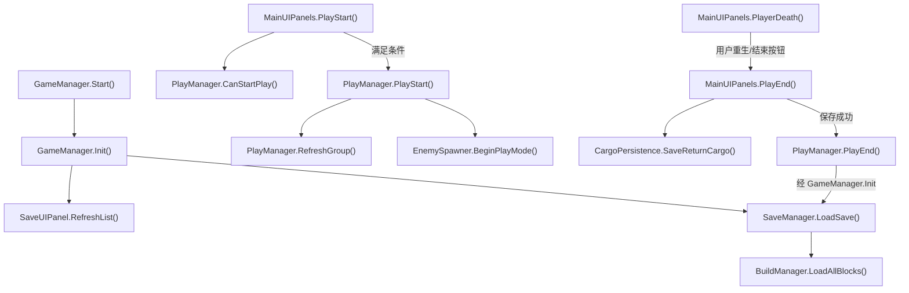
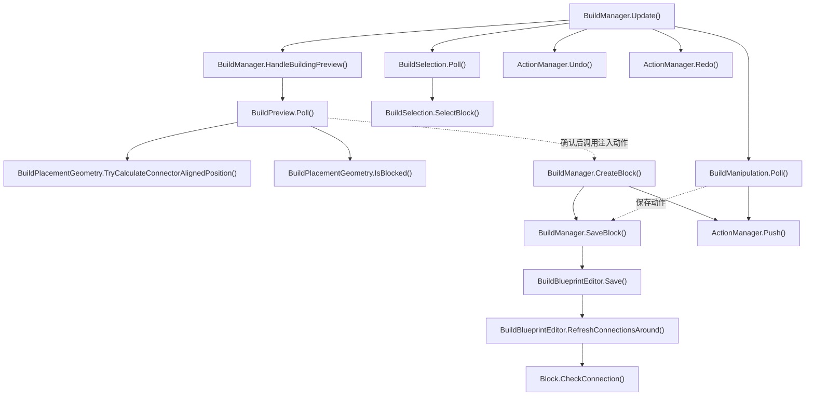
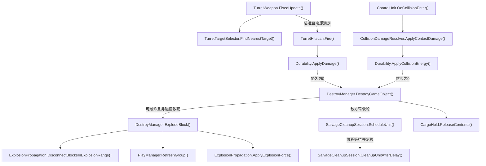
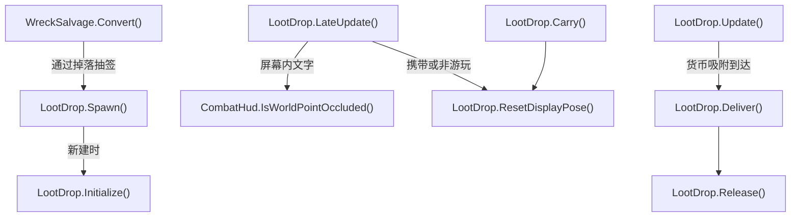

# HY-Sandbox 运行时函数图

    这些图根据当前源码和调用者整理，用于寻找功能入口，不是采样得到的实际执行轨迹。实线表示直接调用（标注“经”时包含明确中间函数）；虚线标出协程、事件或注入动作。Unity Update/FixedUpdate 的独立入口不代表脚本执行顺序。

    每个图节点可点击对应源码；渲染器禁用 click 时使用图下链接。导航由 Roslyn 校验文件与方法存在，语义顺序由修改者审查。过载函数链接到第一个声明，完整过载见 CodeIndex。

    维护：业务变化更新受影响图和 DEVELOPMENT；纯格式变化重新生成行号。`dotnet run --project Tools/CodeReadability -- --check .` 会拒绝失效符号。

    ## 启动与建造/游玩会话

引擎自动调用入口独立；按按钮进入业务主链。返回建造前先保存货仓。选择方块资源进入 BuildType.Build；InputManager 切换 lockView 仅取消交互并保留当前 BuildType 与资源。

- [GameManager.Start](../Assets/Scripts/Features/Bootstrap/GameManager.cs#L15)
<!-- source: Assets/Scripts/Features/Bootstrap/GameManager.cs|Start -->
- [GameManager.Init](../Assets/Scripts/Features/Bootstrap/GameManager.cs#L20)
<!-- source: Assets/Scripts/Features/Bootstrap/GameManager.cs|Init -->
- [SaveUIPanel.RefreshList](../Assets/Scripts/Features/Building/SaveUIPanel.cs#L17)
<!-- source: Assets/Scripts/Features/Building/SaveUIPanel.cs|RefreshList -->
- [SaveManager.LoadSave](../Assets/Scripts/Features/Building/SaveManager.cs#L111)
<!-- source: Assets/Scripts/Features/Building/SaveManager.cs|LoadSave -->
- [BuildManager.LoadAllBlocks](../Assets/Scripts/Features/Building/BuildManager.cs#L427)
<!-- source: Assets/Scripts/Features/Building/BuildManager.cs|LoadAllBlocks -->
- [MainUIPanels.PlayStart](../Assets/Scripts/Features/Presentation/MainUIPanels.cs#L216)
<!-- source: Assets/Scripts/Features/Presentation/MainUIPanels.cs|PlayStart -->
- [PlayManager.CanStartPlay](../Assets/Scripts/Features/Simulation/PlayManager.cs#L113)
<!-- source: Assets/Scripts/Features/Simulation/PlayManager.cs|CanStartPlay -->
- [PlayManager.PlayStart](../Assets/Scripts/Features/Simulation/PlayManager.cs#L84)
<!-- source: Assets/Scripts/Features/Simulation/PlayManager.cs|PlayStart -->
- [PlayManager.RefreshGroup](../Assets/Scripts/Features/Simulation/PlayManager.cs#L148)
<!-- source: Assets/Scripts/Features/Simulation/PlayManager.cs|RefreshGroup -->
- [EnemySpawner.BeginPlayMode](../Assets/Scripts/Features/Combat/EnemySpawner.cs#L43)
<!-- source: Assets/Scripts/Features/Combat/EnemySpawner.cs|BeginPlayMode -->
- [MainUIPanels.PlayEnd](../Assets/Scripts/Features/Presentation/MainUIPanels.cs#L231)
<!-- source: Assets/Scripts/Features/Presentation/MainUIPanels.cs|PlayEnd -->
- [CargoPersistence.SaveReturnCargo](../Assets/Scripts/Features/Salvage/CargoPersistence.cs#L11)
<!-- source: Assets/Scripts/Features/Salvage/CargoPersistence.cs|SaveReturnCargo -->
- [PlayManager.PlayEnd](../Assets/Scripts/Features/Simulation/PlayManager.cs#L246)
<!-- source: Assets/Scripts/Features/Simulation/PlayManager.cs|PlayEnd -->
- [MainUIPanels.PlayerDeath](../Assets/Scripts/Features/Presentation/MainUIPanels.cs#L245)
<!-- source: Assets/Scripts/Features/Presentation/MainUIPanels.cs|PlayerDeath -->

## 蓝图恢复、统计和取消

Load 先验证文件，再替换父对象；协程按请求版本检查所有权。统计事件指向显示。取消使旧版本失效；缺资源移出缓存和JSON。

```mermaid
flowchart TD
    A["BuildManager.LoadAllBlocks()"]
    click A "../Assets/Scripts/Features/Building/BuildManager.cs#L427" "打开源码"
    B["BlueprintLoader.Load()"]
    click B "../Assets/Scripts/Features/Building/BlueprintLoading/BlueprintLoader.cs#L39" "打开源码"
    C["BlueprintLoader.TryRead()"]
    click C "../Assets/Scripts/Features/Building/BlueprintLoading/BlueprintLoader.cs#L167" "打开源码"
    D["BlueprintLoader.ReplaceParent()"]
    click D "../Assets/Scripts/Features/Building/BlueprintLoading/BlueprintLoader.cs#L206" "打开源码"
    E["BlueprintLoadCamera.Begin()"]
    click E "../Assets/Scripts/Features/Building/BlueprintLoading/BlueprintLoadCamera.cs#L15" "打开源码"
    F["BlueprintLoader.LoadRoutine()"]
    click F "../Assets/Scripts/Features/Building/BlueprintLoading/BlueprintLoader.cs#L100" "打开源码"
    G["BlueprintLoader.OwnsParent()"]
    click G "../Assets/Scripts/Features/Building/BlueprintLoading/BlueprintLoader.cs#L222" "打开源码"
    H["BlueprintBlockFactory.TryRestore()"]
    click H "../Assets/Scripts/Features/Building/BlueprintLoading/BlueprintBlockFactory.cs#L7" "打开源码"
    I["BlueprintStatistics.Accumulate()"]
    click I "../Assets/Scripts/Features/Building/BlueprintLoading/BlueprintStatistics.cs#L26" "打开源码"
    J["BlueprintUIPanel.DisplayStatistics()"]
    click J "../Assets/Scripts/Features/Building/BlueprintUIPanel.cs#L44" "打开源码"
    K["BlueprintLoader.RemoveMissingData()"]
    click K "../Assets/Scripts/Features/Building/BlueprintLoading/BlueprintLoader.cs#L227" "打开源码"
    L["BlueprintLoader.RebuildConnections()"]
    click L "../Assets/Scripts/Features/Building/BlueprintLoading/BlueprintLoader.cs#L238" "打开源码"
    M["BlueprintLoader.FinishSession()"]
    click M "../Assets/Scripts/Features/Building/BlueprintLoading/BlueprintLoader.cs#L270" "打开源码"
    N["BlueprintLoader.Cancel()"]
    click N "../Assets/Scripts/Features/Building/BlueprintLoading/BlueprintLoader.cs#L87" "打开源码"
    O["BlueprintLoadCamera.Stop()"]
    click O "../Assets/Scripts/Features/Building/BlueprintLoading/BlueprintLoadCamera.cs#L26" "打开源码"
    A --> B
    B --> C
    B -->|文件有效| D
    B --> E
    B -.->|StartCoroutine| F
    F --> G
    F --> H
    F -->|恢复成功| I
    F -.->|StatisticsChanged| J
    F -->|完成| K
    F --> L
    F -->|finally| M
    N -->|版本递增 / 停协程| M
    M --> O
```

- [BuildManager.LoadAllBlocks](../Assets/Scripts/Features/Building/BuildManager.cs#L427)
<!-- source: Assets/Scripts/Features/Building/BuildManager.cs|LoadAllBlocks -->
- [BlueprintLoader.Load](../Assets/Scripts/Features/Building/BlueprintLoading/BlueprintLoader.cs#L39)
<!-- source: Assets/Scripts/Features/Building/BlueprintLoading/BlueprintLoader.cs|Load -->
- [BlueprintLoader.TryRead](../Assets/Scripts/Features/Building/BlueprintLoading/BlueprintLoader.cs#L167)
<!-- source: Assets/Scripts/Features/Building/BlueprintLoading/BlueprintLoader.cs|TryRead -->
- [BlueprintLoader.ReplaceParent](../Assets/Scripts/Features/Building/BlueprintLoading/BlueprintLoader.cs#L206)
<!-- source: Assets/Scripts/Features/Building/BlueprintLoading/BlueprintLoader.cs|ReplaceParent -->
- [BlueprintLoadCamera.Begin](../Assets/Scripts/Features/Building/BlueprintLoading/BlueprintLoadCamera.cs#L15)
<!-- source: Assets/Scripts/Features/Building/BlueprintLoading/BlueprintLoadCamera.cs|Begin -->
- [BlueprintLoader.LoadRoutine](../Assets/Scripts/Features/Building/BlueprintLoading/BlueprintLoader.cs#L100)
<!-- source: Assets/Scripts/Features/Building/BlueprintLoading/BlueprintLoader.cs|LoadRoutine -->
- [BlueprintLoader.OwnsParent](../Assets/Scripts/Features/Building/BlueprintLoading/BlueprintLoader.cs#L222)
<!-- source: Assets/Scripts/Features/Building/BlueprintLoading/BlueprintLoader.cs|OwnsParent -->
- [BlueprintBlockFactory.TryRestore](../Assets/Scripts/Features/Building/BlueprintLoading/BlueprintBlockFactory.cs#L7)
<!-- source: Assets/Scripts/Features/Building/BlueprintLoading/BlueprintBlockFactory.cs|TryRestore -->
- [BlueprintStatistics.Accumulate](../Assets/Scripts/Features/Building/BlueprintLoading/BlueprintStatistics.cs#L26)
<!-- source: Assets/Scripts/Features/Building/BlueprintLoading/BlueprintStatistics.cs|Accumulate -->
- [BlueprintUIPanel.DisplayStatistics](../Assets/Scripts/Features/Building/BlueprintUIPanel.cs#L44)
<!-- source: Assets/Scripts/Features/Building/BlueprintUIPanel.cs|DisplayStatistics -->
- [BlueprintLoader.RemoveMissingData](../Assets/Scripts/Features/Building/BlueprintLoading/BlueprintLoader.cs#L227)
<!-- source: Assets/Scripts/Features/Building/BlueprintLoading/BlueprintLoader.cs|RemoveMissingData -->
- [BlueprintLoader.RebuildConnections](../Assets/Scripts/Features/Building/BlueprintLoading/BlueprintLoader.cs#L238)
<!-- source: Assets/Scripts/Features/Building/BlueprintLoading/BlueprintLoader.cs|RebuildConnections -->
- [BlueprintLoader.FinishSession](../Assets/Scripts/Features/Building/BlueprintLoading/BlueprintLoader.cs#L270)
<!-- source: Assets/Scripts/Features/Building/BlueprintLoading/BlueprintLoader.cs|FinishSession -->
- [BlueprintLoader.Cancel](../Assets/Scripts/Features/Building/BlueprintLoading/BlueprintLoader.cs#L87)
<!-- source: Assets/Scripts/Features/Building/BlueprintLoading/BlueprintLoader.cs|Cancel -->
- [BlueprintLoadCamera.Stop](../Assets/Scripts/Features/Building/BlueprintLoading/BlueprintLoadCamera.cs#L26)
<!-- source: Assets/Scripts/Features/Building/BlueprintLoading/BlueprintLoadCamera.cs|Stop -->

## 放置、选中、操作和持久化

Update 按输入模式调用预览或选择；预览确认放置调用显式注入的创建动作。输入/Undo、几何规则和JSON各有审查位置。

- [BuildManager.Update](../Assets/Scripts/Features/Building/BuildManager.cs#L96)
<!-- source: Assets/Scripts/Features/Building/BuildManager.cs|Update -->
- [BuildManager.HandleBuildingPreview](../Assets/Scripts/Features/Building/BuildManager.cs#L308)
<!-- source: Assets/Scripts/Features/Building/BuildManager.cs|HandleBuildingPreview -->
- [BuildPreview.Poll](../Assets/Scripts/Features/Building/Interaction/BuildPreview.cs#L41)
<!-- source: Assets/Scripts/Features/Building/Interaction/BuildPreview.cs|Poll -->
- [BuildPlacementGeometry.TryCalculateConnectorAlignedPosition](../Assets/Scripts/Features/Building/Interaction/BuildPlacementGeometry.cs#L31)
<!-- source: Assets/Scripts/Features/Building/Interaction/BuildPlacementGeometry.cs|TryCalculateConnectorAlignedPosition -->
- [BuildPlacementGeometry.IsBlocked](../Assets/Scripts/Features/Building/Interaction/BuildPlacementGeometry.cs#L121)
<!-- source: Assets/Scripts/Features/Building/Interaction/BuildPlacementGeometry.cs|IsBlocked -->
- [BuildManager.CreateBlock](../Assets/Scripts/Features/Building/BuildManager.cs#L342)
<!-- source: Assets/Scripts/Features/Building/BuildManager.cs|CreateBlock -->
- [BuildManager.SaveBlock](../Assets/Scripts/Features/Building/BuildManager.cs#L406)
<!-- source: Assets/Scripts/Features/Building/BuildManager.cs|SaveBlock -->
- [BuildBlueprintEditor.Save](../Assets/Scripts/Features/Building/Interaction/BuildBlueprintEditor.cs#L17)
<!-- source: Assets/Scripts/Features/Building/Interaction/BuildBlueprintEditor.cs|Save -->
- [BuildBlueprintEditor.RefreshConnectionsAround](../Assets/Scripts/Features/Building/Interaction/BuildBlueprintEditor.cs#L68)
<!-- source: Assets/Scripts/Features/Building/Interaction/BuildBlueprintEditor.cs|RefreshConnectionsAround -->
- [BuildSelection.Poll](../Assets/Scripts/Features/Building/Interaction/BuildSelection.cs#L41)
<!-- source: Assets/Scripts/Features/Building/Interaction/BuildSelection.cs|Poll -->
- [BuildSelection.SelectBlock](../Assets/Scripts/Features/Building/Interaction/BuildSelection.cs#L79)
<!-- source: Assets/Scripts/Features/Building/Interaction/BuildSelection.cs|SelectBlock -->
- [BuildManipulation.Poll](../Assets/Scripts/Features/Building/Interaction/BuildManipulation.cs#L59)
<!-- source: Assets/Scripts/Features/Building/Interaction/BuildManipulation.cs|Poll -->
- [ActionManager.Push](../Assets/Scripts/Features/Building/ActionManager.cs#L26)
<!-- source: Assets/Scripts/Features/Building/ActionManager.cs|Push -->
- [ActionManager.Undo](../Assets/Scripts/Features/Building/ActionManager.cs#L37)
<!-- source: Assets/Scripts/Features/Building/ActionManager.cs|Undo -->
- [ActionManager.Redo](../Assets/Scripts/Features/Building/ActionManager.cs#L50)
<!-- source: Assets/Scripts/Features/Building/ActionManager.cs|Redo -->
- [Block.CheckConnection](../Assets/Scripts/Features/Simulation/Block.cs#L261)
<!-- source: Assets/Scripts/Features/Simulation/Block.cs|CheckConnection -->

## 供电网络与可视范围

每帧仅一个中继重建共享网络；先清零再提交本帧汇总。DebugManager 的范围表现与网络规则分开。

```mermaid
flowchart TD
    A["PowerTransmissionDevice.Update()"]
    click A "../Assets/Scripts/Features/Power/PowerTransmissionDevice.cs#L61" "打开源码"
    B["PowerNetwork.Rebuild()"]
    click B "../Assets/Scripts/Features/Power/PowerNetwork.cs#L21" "打开源码"
    C["PowerNetwork.ResetConnectionsAndPower()"]
    click C "../Assets/Scripts/Features/Power/PowerNetwork.cs#L88" "打开源码"
    D["PowerNetwork.BuildConnections()"]
    click D "../Assets/Scripts/Features/Power/PowerNetwork.cs#L108" "打开源码"
    E["PowerNetwork.DistributeNetworkPower()"]
    click E "../Assets/Scripts/Features/Power/PowerNetwork.cs#L140" "打开源码"
    F["PowerNetwork.CollectConnectedComponent()"]
    click F "../Assets/Scripts/Features/Power/PowerNetwork.cs#L153" "打开源码"
    G["PowerNetwork.SupplyConnectedComponent()"]
    click G "../Assets/Scripts/Features/Power/PowerNetwork.cs#L200" "打开源码"
    H["PowerNetwork.CommitPowerStatuses()"]
    click H "../Assets/Scripts/Features/Power/PowerNetwork.cs#L226" "打开源码"
    I["Power.CommitPowerStatus()"]
    click I "../Assets/Scripts/Features/Power/Power.cs#L46" "打开源码"
    J["PowerConnectionVisuals.Refresh()"]
    click J "../Assets/Scripts/Features/Power/PowerConnectionVisuals.cs#L19" "打开源码"
    K["PowerTransmissionDevice.OnDisable()"]
    click K "../Assets/Scripts/Features/Power/PowerTransmissionDevice.cs#L74" "打开源码"
    L["PowerNetwork.Clear()"]
    click L "../Assets/Scripts/Features/Power/PowerNetwork.cs#L34" "打开源码"
    M["DebugManager.RefreshPowerRangeMesh()"]
    click M "../Assets/Scripts/Features/Diagnostics/DebugManager.cs#L132" "打开源码"
    N["PowerRangeUnionView.Refresh()"]
    click N "../Assets/Scripts/Features/Power/PowerRangeUnionView.cs#L36" "打开源码"
    O["DebugManager.TogglePowerRange()"]
    click O "../Assets/Scripts/Features/Diagnostics/DebugManager.cs#L74" "打开源码"
    P["PowerRangeUnionView.Hide()"]
    click P "../Assets/Scripts/Features/Power/PowerRangeUnionView.cs#L66" "打开源码"
    Q["DebugManager.OnDestroy()"]
    click Q "../Assets/Scripts/Features/Diagnostics/DebugManager.cs#L50" "打开源码"
    R["PowerRangeUnionView.Dispose()"]
    click R "../Assets/Scripts/Features/Power/PowerRangeUnionView.cs#L79" "打开源码"
    A -->|首个本帧中继| B
    B --> C
    B --> D
    B --> E
    E --> F
    E --> G
    B --> H
    H --> I
    A --> J
    K -->|最后中继| L
    A -->|完成网络后| M
    M --> N
    O -->|关闭范围显示| P
    Q --> R
```

- [PowerTransmissionDevice.Update](../Assets/Scripts/Features/Power/PowerTransmissionDevice.cs#L61)
<!-- source: Assets/Scripts/Features/Power/PowerTransmissionDevice.cs|Update -->
- [PowerNetwork.Rebuild](../Assets/Scripts/Features/Power/PowerNetwork.cs#L21)
<!-- source: Assets/Scripts/Features/Power/PowerNetwork.cs|Rebuild -->
- [PowerNetwork.ResetConnectionsAndPower](../Assets/Scripts/Features/Power/PowerNetwork.cs#L88)
<!-- source: Assets/Scripts/Features/Power/PowerNetwork.cs|ResetConnectionsAndPower -->
- [PowerNetwork.BuildConnections](../Assets/Scripts/Features/Power/PowerNetwork.cs#L108)
<!-- source: Assets/Scripts/Features/Power/PowerNetwork.cs|BuildConnections -->
- [PowerNetwork.DistributeNetworkPower](../Assets/Scripts/Features/Power/PowerNetwork.cs#L140)
<!-- source: Assets/Scripts/Features/Power/PowerNetwork.cs|DistributeNetworkPower -->
- [PowerNetwork.CollectConnectedComponent](../Assets/Scripts/Features/Power/PowerNetwork.cs#L153)
<!-- source: Assets/Scripts/Features/Power/PowerNetwork.cs|CollectConnectedComponent -->
- [PowerNetwork.SupplyConnectedComponent](../Assets/Scripts/Features/Power/PowerNetwork.cs#L200)
<!-- source: Assets/Scripts/Features/Power/PowerNetwork.cs|SupplyConnectedComponent -->
- [PowerNetwork.CommitPowerStatuses](../Assets/Scripts/Features/Power/PowerNetwork.cs#L226)
<!-- source: Assets/Scripts/Features/Power/PowerNetwork.cs|CommitPowerStatuses -->
- [Power.CommitPowerStatus](../Assets/Scripts/Features/Power/Power.cs#L46)
<!-- source: Assets/Scripts/Features/Power/Power.cs|CommitPowerStatus -->
- [PowerConnectionVisuals.Refresh](../Assets/Scripts/Features/Power/PowerConnectionVisuals.cs#L19)
<!-- source: Assets/Scripts/Features/Power/PowerConnectionVisuals.cs|Refresh -->
- [PowerTransmissionDevice.OnDisable](../Assets/Scripts/Features/Power/PowerTransmissionDevice.cs#L74)
<!-- source: Assets/Scripts/Features/Power/PowerTransmissionDevice.cs|OnDisable -->
- [PowerNetwork.Clear](../Assets/Scripts/Features/Power/PowerNetwork.cs#L34)
<!-- source: Assets/Scripts/Features/Power/PowerNetwork.cs|Clear -->
- [DebugManager.RefreshPowerRangeMesh](../Assets/Scripts/Features/Diagnostics/DebugManager.cs#L132)
<!-- source: Assets/Scripts/Features/Diagnostics/DebugManager.cs|RefreshPowerRangeMesh -->
- [PowerRangeUnionView.Refresh](../Assets/Scripts/Features/Power/PowerRangeUnionView.cs#L36)
<!-- source: Assets/Scripts/Features/Power/PowerRangeUnionView.cs|Refresh -->
- [DebugManager.TogglePowerRange](../Assets/Scripts/Features/Diagnostics/DebugManager.cs#L74)
<!-- source: Assets/Scripts/Features/Diagnostics/DebugManager.cs|TogglePowerRange -->
- [PowerRangeUnionView.Hide](../Assets/Scripts/Features/Power/PowerRangeUnionView.cs#L66)
<!-- source: Assets/Scripts/Features/Power/PowerRangeUnionView.cs|Hide -->
- [DebugManager.OnDestroy](../Assets/Scripts/Features/Diagnostics/DebugManager.cs#L50)
<!-- source: Assets/Scripts/Features/Diagnostics/DebugManager.cs|OnDestroy -->
- [PowerRangeUnionView.Dispose](../Assets/Scripts/Features/Power/PowerRangeUnionView.cs#L79)
<!-- source: Assets/Scripts/Features/Power/PowerRangeUnionView.cs|Dispose -->

## 物理分组、连接与推进

连接图是组重建输入；重组先捕获刚体速度，再转移方块与运行归属。三个 FixedUpdate 由引擎调度，图中无先后承诺。

```mermaid
flowchart TD
    A["PlayManager.RefreshGroup()"]
    click A "../Assets/Scripts/Features/Simulation/PlayManager.cs#L148" "打开源码"
    B["PlayManager.AssignBlocksToParentGroups()"]
    click B "../Assets/Scripts/Features/Simulation/PlayManager.cs#L270" "打开源码"
    C["RuntimeGroupBuilder.Rebuild()"]
    click C "../Assets/Scripts/Features/Simulation/RuntimeGroupBuilder.cs#L15" "打开源码"
    D["BlockGroupManager.GroupBlocks()"]
    click D "../Assets/Scripts/Features/Simulation/BlockGroupManager.cs#L9" "打开源码"
    E["BlockConnections.CollectNeighbors()"]
    click E "../Assets/Scripts/Features/Simulation/BlockConnections.cs#L232" "打开源码"
    F["RuntimeGroupBuilder.RestoreGroupPhysics()"]
    click F "../Assets/Scripts/Features/Simulation/RuntimeGroupBuilder.cs#L84" "打开源码"
    G["ControlUnit.RefreshChildren()"]
    click G "../Assets/Scripts/Features/Simulation/ControlUnit.cs#L117" "打开源码"
    H["PlayManager.FixedUpdate()"]
    click H "../Assets/Scripts/Features/Simulation/PlayManager.cs#L56" "打开源码"
    I["RuntimeGroupCleanup.EnforceDistance()"]
    click I "../Assets/Scripts/Features/Simulation/RuntimeGroupCleanup.cs#L51" "打开源码"
    J["HoverFlightController.FixedUpdate()"]
    click J "../Assets/Scripts/Features/Flight/HoverFlightController.cs#L102" "打开源码"
    K["HoverFlightController.DistributeThrust()"]
    click K "../Assets/Scripts/Features/Flight/HoverFlightController.cs#L339" "打开源码"
    L["MainThruster.FixedUpdate()"]
    click L "../Assets/Scripts/Features/Flight/MainThruster.cs#L10" "打开源码"
    M["Thruster.ApplyThrustChangeRateLimit()"]
    click M "../Assets/Scripts/Features/Flight/Thruster.cs#L113" "打开源码"
    N["HoverControlSolver.StepHeight()"]
    click N "../Assets/Scripts/Features/Flight/HoverControlSolver.cs#L29" "打开源码"
    O["HoverControlSolver.CalculateTilt()"]
    click O "../Assets/Scripts/Features/Flight/HoverControlSolver.cs#L55" "打开源码"
    P["HoverFlightController.StopControlOutput()"]
    click P "../Assets/Scripts/Features/Flight/HoverFlightController.cs#L160" "打开源码"
    Q["HoverControlSolver.Reset()"]
    click Q "../Assets/Scripts/Features/Flight/HoverControlSolver.cs#L23" "打开源码"
    R["HoverFlightController.ClearHoverThrust()"]
    click R "../Assets/Scripts/Features/Flight/HoverFlightController.cs#L167" "打开源码"
    S["HoverFlightController.OnDisable()"]
    click S "../Assets/Scripts/Features/Flight/HoverFlightController.cs#L91" "打开源码"
    A --> B
    B --> C
    C --> D
    D -->|BFS 经 Block.CollectNeighbors| E
    C --> F
    C --> G
    H --> I
    J -->|有效游玩/供电/归属| N
    J --> O
    J --> K
    K --> M
    L --> M
    J -->|停止或失效| P
    S --> P
    P --> Q
    P --> R
```

- [PlayManager.RefreshGroup](../Assets/Scripts/Features/Simulation/PlayManager.cs#L148)
<!-- source: Assets/Scripts/Features/Simulation/PlayManager.cs|RefreshGroup -->
- [PlayManager.AssignBlocksToParentGroups](../Assets/Scripts/Features/Simulation/PlayManager.cs#L270)
<!-- source: Assets/Scripts/Features/Simulation/PlayManager.cs|AssignBlocksToParentGroups -->
- [RuntimeGroupBuilder.Rebuild](../Assets/Scripts/Features/Simulation/RuntimeGroupBuilder.cs#L15)
<!-- source: Assets/Scripts/Features/Simulation/RuntimeGroupBuilder.cs|Rebuild -->
- [BlockGroupManager.GroupBlocks](../Assets/Scripts/Features/Simulation/BlockGroupManager.cs#L9)
<!-- source: Assets/Scripts/Features/Simulation/BlockGroupManager.cs|GroupBlocks -->
- [BlockConnections.CollectNeighbors](../Assets/Scripts/Features/Simulation/BlockConnections.cs#L232)
<!-- source: Assets/Scripts/Features/Simulation/BlockConnections.cs|CollectNeighbors -->
- [RuntimeGroupBuilder.RestoreGroupPhysics](../Assets/Scripts/Features/Simulation/RuntimeGroupBuilder.cs#L84)
<!-- source: Assets/Scripts/Features/Simulation/RuntimeGroupBuilder.cs|RestoreGroupPhysics -->
- [ControlUnit.RefreshChildren](../Assets/Scripts/Features/Simulation/ControlUnit.cs#L117)
<!-- source: Assets/Scripts/Features/Simulation/ControlUnit.cs|RefreshChildren -->
- [PlayManager.FixedUpdate](../Assets/Scripts/Features/Simulation/PlayManager.cs#L56)
<!-- source: Assets/Scripts/Features/Simulation/PlayManager.cs|FixedUpdate -->
- [RuntimeGroupCleanup.EnforceDistance](../Assets/Scripts/Features/Simulation/RuntimeGroupCleanup.cs#L51)
<!-- source: Assets/Scripts/Features/Simulation/RuntimeGroupCleanup.cs|EnforceDistance -->
- [HoverFlightController.FixedUpdate](../Assets/Scripts/Features/Flight/HoverFlightController.cs#L102)
<!-- source: Assets/Scripts/Features/Flight/HoverFlightController.cs|FixedUpdate -->
- [HoverFlightController.DistributeThrust](../Assets/Scripts/Features/Flight/HoverFlightController.cs#L339)
<!-- source: Assets/Scripts/Features/Flight/HoverFlightController.cs|DistributeThrust -->
- [MainThruster.FixedUpdate](../Assets/Scripts/Features/Flight/MainThruster.cs#L10)
<!-- source: Assets/Scripts/Features/Flight/MainThruster.cs|FixedUpdate -->
- [Thruster.ApplyThrustChangeRateLimit](../Assets/Scripts/Features/Flight/Thruster.cs#L113)
<!-- source: Assets/Scripts/Features/Flight/Thruster.cs|ApplyThrustChangeRateLimit -->
- [HoverControlSolver.StepHeight](../Assets/Scripts/Features/Flight/HoverControlSolver.cs#L29)
<!-- source: Assets/Scripts/Features/Flight/HoverControlSolver.cs|StepHeight -->
- [HoverControlSolver.CalculateTilt](../Assets/Scripts/Features/Flight/HoverControlSolver.cs#L55)
<!-- source: Assets/Scripts/Features/Flight/HoverControlSolver.cs|CalculateTilt -->
- [HoverFlightController.StopControlOutput](../Assets/Scripts/Features/Flight/HoverFlightController.cs#L160)
<!-- source: Assets/Scripts/Features/Flight/HoverFlightController.cs|StopControlOutput -->
- [HoverControlSolver.Reset](../Assets/Scripts/Features/Flight/HoverControlSolver.cs#L23)
<!-- source: Assets/Scripts/Features/Flight/HoverControlSolver.cs|Reset -->
- [HoverFlightController.ClearHoverThrust](../Assets/Scripts/Features/Flight/HoverFlightController.cs#L167)
<!-- source: Assets/Scripts/Features/Flight/HoverFlightController.cs|ClearHoverThrust -->
- [HoverFlightController.OnDisable](../Assets/Scripts/Features/Flight/HoverFlightController.cs#L91)
<!-- source: Assets/Scripts/Features/Flight/HoverFlightController.cs|OnDisable -->

## 战斗、损伤、爆炸与残骸清理

射击冲量先于伤害；爆炸断链后重组再施加受限冲量。延迟清理在真正删除前再次检查身份与驾驶舱。

- [TurretWeapon.FixedUpdate](../Assets/Scripts/Features/Combat/TurretWeapon.cs#L110)
<!-- source: Assets/Scripts/Features/Combat/TurretWeapon.cs|FixedUpdate -->
- [TurretTargetSelector.FindNearestTarget](../Assets/Scripts/Features/Combat/TurretTargetSelector.cs#L16)
<!-- source: Assets/Scripts/Features/Combat/TurretTargetSelector.cs|FindNearestTarget -->
- [TurretHitscan.Fire](../Assets/Scripts/Features/Combat/TurretHitscan.cs#L10)
<!-- source: Assets/Scripts/Features/Combat/TurretHitscan.cs|Fire -->
- [Durability.ApplyDamage](../Assets/Scripts/Features/Combat/Durability.cs#L63)
<!-- source: Assets/Scripts/Features/Combat/Durability.cs|ApplyDamage -->
- [ControlUnit.OnCollisionEnter](../Assets/Scripts/Features/Simulation/ControlUnit.cs#L254)
<!-- source: Assets/Scripts/Features/Simulation/ControlUnit.cs|OnCollisionEnter -->
- [CollisionDamageResolver.ApplyContactDamage](../Assets/Scripts/Features/Combat/CollisionDamageResolver.cs#L10)
<!-- source: Assets/Scripts/Features/Combat/CollisionDamageResolver.cs|ApplyContactDamage -->
- [Durability.ApplyCollisionEnergy](../Assets/Scripts/Features/Combat/Durability.cs#L74)
<!-- source: Assets/Scripts/Features/Combat/Durability.cs|ApplyCollisionEnergy -->
- [DestroyManager.DestroyGameObject](../Assets/Scripts/Features/Combat/DestroyManager.cs#L30)
<!-- source: Assets/Scripts/Features/Combat/DestroyManager.cs|DestroyGameObject -->
- [DestroyManager.ExplodeBlock](../Assets/Scripts/Features/Combat/DestroyManager.cs#L131)
<!-- source: Assets/Scripts/Features/Combat/DestroyManager.cs|ExplodeBlock -->
- [ExplosionPropagation.DisconnectBlocksInExplosionRange](../Assets/Scripts/Features/Combat/ExplosionPropagation.cs#L9)
<!-- source: Assets/Scripts/Features/Combat/ExplosionPropagation.cs|DisconnectBlocksInExplosionRange -->
- [PlayManager.RefreshGroup](../Assets/Scripts/Features/Simulation/PlayManager.cs#L148)
<!-- source: Assets/Scripts/Features/Simulation/PlayManager.cs|RefreshGroup -->
- [ExplosionPropagation.ApplyExplosionForce](../Assets/Scripts/Features/Combat/ExplosionPropagation.cs#L53)
<!-- source: Assets/Scripts/Features/Combat/ExplosionPropagation.cs|ApplyExplosionForce -->
- [SalvageCleanupSession.ScheduleUnit](../Assets/Scripts/Features/Combat/SalvageCleanupSession.cs#L17)
<!-- source: Assets/Scripts/Features/Combat/SalvageCleanupSession.cs|ScheduleUnit -->
- [SalvageCleanupSession.CleanupUnitAfterDelay](../Assets/Scripts/Features/Combat/SalvageCleanupSession.cs#L106)
<!-- source: Assets/Scripts/Features/Combat/SalvageCleanupSession.cs|CleanupUnitAfterDelay -->
- [CargoHold.ReleaseContents](../Assets/Scripts/Features/Salvage/CargoHold.cs#L188)
<!-- source: Assets/Scripts/Features/Salvage/CargoHold.cs|ReleaseContents -->

## 维修、回收和移动 Home 返航

机器人使用 Home 实时停靠点与刚体点速度；任务与返航均从机体做净空检测，持续绕障并在停滞后脱困。取消任务释放认领。

```mermaid
flowchart TD
    A["RepairBot.FixedUpdate()"]
    click A "../Assets/Scripts/Features/Bots/RepairBot.cs#L34" "打开源码"
    B["Bot.TickNavigation()"]
    click B "../Assets/Scripts/Features/Bots/Bot.cs#L157" "打开源码"
    C["RepairTargetSearch.Scan()"]
    click C "../Assets/Scripts/Features/Bots/RepairTargetSearch.cs#L15" "打开源码"
    D["Bot.NavigateToTarget()"]
    click D "../Assets/Scripts/Features/Bots/Bot.cs#L229" "打开源码"
    E["BotFlightMotion.NavigateToTarget()"]
    click E "../Assets/Scripts/Features/Bots/BotFlightMotion.cs#L58" "打开源码"
    F["BotObstacleAvoidance.Evaluate()"]
    click F "../Assets/Scripts/Features/Bots/BotObstacleAvoidance.cs#L63" "打开源码"
    G["RepairBot.CheckAndRepair()"]
    click G "../Assets/Scripts/Features/Bots/RepairBot.cs#L85" "打开源码"
    H["RepairBeamView.Update()"]
    click H "../Assets/Scripts/Features/Bots/RepairBeamView.cs#L49" "打开源码"
    I["CollectionBot.FixedUpdate()"]
    click I "../Assets/Scripts/Features/Bots/CollectionBot.cs#L31" "打开源码"
    J["CollectionBot.FindTarget()"]
    click J "../Assets/Scripts/Features/Bots/CollectionBot.cs#L94" "打开源码"
    K["LootDrop.Claim()"]
    click K "../Assets/Scripts/Features/Salvage/LootDrop.cs#L188" "打开源码"
    L["CollectionBot.CollectTarget()"]
    click L "../Assets/Scripts/Features/Bots/CollectionBot.cs#L73" "打开源码"
    M["LootDrop.Carry()"]
    click M "../Assets/Scripts/Features/Salvage/LootDrop.cs#L200" "打开源码"
    N["CollectionBot.ReturnCargo()"]
    click N "../Assets/Scripts/Features/Bots/CollectionBot.cs#L82" "打开源码"
    O["Bot.NavigateHomeSmoothly()"]
    click O "../Assets/Scripts/Features/Bots/Bot.cs#L249" "打开源码"
    P["BotFlightMotion.NavigateHome()"]
    click P "../Assets/Scripts/Features/Bots/BotFlightMotion.cs#L69" "打开源码"
    Q["BotObstacleAvoidance.ConstrainVelocity()"]
    click Q "../Assets/Scripts/Features/Bots/BotObstacleAvoidance.cs#L223" "打开源码"
    R["Bot.ReturnHome()"]
    click R "../Assets/Scripts/Features/Bots/Bot.cs#L292" "打开源码"
    S["LootDrop.Deliver()"]
    click S "../Assets/Scripts/Features/Salvage/LootDrop.cs#L231" "打开源码"
    T["CollectionBot.Abandon()"]
    click T "../Assets/Scripts/Features/Bots/CollectionBot.cs#L131" "打开源码"
    A --> B
    A -->|扫描目标时| C
    A --> D
    D --> E
    E -->|经 SampleGuidance| F
    E -->|每物理帧经 ApplyMovement| Q
    A --> G
    A --> H
    I --> B
    I --> J
    J --> K
    I --> L
    L --> D
    L --> M
    I --> N
    N --> O
    O --> P
    P -->|每物理帧经 ApplyReturnHomeMovement| Q
    P -->|机体净空与脱困| F
    O -->|可停靠| R
    N -->|完成停靠| S
    N --> T
```

- [RepairBot.FixedUpdate](../Assets/Scripts/Features/Bots/RepairBot.cs#L34)
<!-- source: Assets/Scripts/Features/Bots/RepairBot.cs|FixedUpdate -->
- [Bot.TickNavigation](../Assets/Scripts/Features/Bots/Bot.cs#L157)
<!-- source: Assets/Scripts/Features/Bots/Bot.cs|TickNavigation -->
- [RepairTargetSearch.Scan](../Assets/Scripts/Features/Bots/RepairTargetSearch.cs#L15)
<!-- source: Assets/Scripts/Features/Bots/RepairTargetSearch.cs|Scan -->
- [Bot.NavigateToTarget](../Assets/Scripts/Features/Bots/Bot.cs#L229)
<!-- source: Assets/Scripts/Features/Bots/Bot.cs|NavigateToTarget -->
- [BotFlightMotion.NavigateToTarget](../Assets/Scripts/Features/Bots/BotFlightMotion.cs#L58)
<!-- source: Assets/Scripts/Features/Bots/BotFlightMotion.cs|NavigateToTarget -->
- [BotObstacleAvoidance.Evaluate](../Assets/Scripts/Features/Bots/BotObstacleAvoidance.cs#L63)
<!-- source: Assets/Scripts/Features/Bots/BotObstacleAvoidance.cs|Evaluate -->
- [RepairBot.CheckAndRepair](../Assets/Scripts/Features/Bots/RepairBot.cs#L85)
<!-- source: Assets/Scripts/Features/Bots/RepairBot.cs|CheckAndRepair -->
- [RepairBeamView.Update](../Assets/Scripts/Features/Bots/RepairBeamView.cs#L49)
<!-- source: Assets/Scripts/Features/Bots/RepairBeamView.cs|Update -->
- [CollectionBot.FixedUpdate](../Assets/Scripts/Features/Bots/CollectionBot.cs#L31)
<!-- source: Assets/Scripts/Features/Bots/CollectionBot.cs|FixedUpdate -->
- [CollectionBot.FindTarget](../Assets/Scripts/Features/Bots/CollectionBot.cs#L94)
<!-- source: Assets/Scripts/Features/Bots/CollectionBot.cs|FindTarget -->
- [LootDrop.Claim](../Assets/Scripts/Features/Salvage/LootDrop.cs#L188)
<!-- source: Assets/Scripts/Features/Salvage/LootDrop.cs|Claim -->
- [CollectionBot.CollectTarget](../Assets/Scripts/Features/Bots/CollectionBot.cs#L73)
<!-- source: Assets/Scripts/Features/Bots/CollectionBot.cs|CollectTarget -->
- [LootDrop.Carry](../Assets/Scripts/Features/Salvage/LootDrop.cs#L200)
<!-- source: Assets/Scripts/Features/Salvage/LootDrop.cs|Carry -->
- [CollectionBot.ReturnCargo](../Assets/Scripts/Features/Bots/CollectionBot.cs#L82)
<!-- source: Assets/Scripts/Features/Bots/CollectionBot.cs|ReturnCargo -->
- [Bot.NavigateHomeSmoothly](../Assets/Scripts/Features/Bots/Bot.cs#L249)
<!-- source: Assets/Scripts/Features/Bots/Bot.cs|NavigateHomeSmoothly -->
- [BotFlightMotion.NavigateHome](../Assets/Scripts/Features/Bots/BotFlightMotion.cs#L69)
<!-- source: Assets/Scripts/Features/Bots/BotFlightMotion.cs|NavigateHome -->
- [BotObstacleAvoidance.ConstrainVelocity](../Assets/Scripts/Features/Bots/BotObstacleAvoidance.cs#L223)
<!-- source: Assets/Scripts/Features/Bots/BotObstacleAvoidance.cs|ConstrainVelocity -->
- [Bot.ReturnHome](../Assets/Scripts/Features/Bots/Bot.cs#L292)
<!-- source: Assets/Scripts/Features/Bots/Bot.cs|ReturnHome -->
- [LootDrop.Deliver](../Assets/Scripts/Features/Salvage/LootDrop.cs#L231)
<!-- source: Assets/Scripts/Features/Salvage/LootDrop.cs|Deliver -->
- [CollectionBot.Abandon](../Assets/Scripts/Features/Bots/CollectionBot.cs#L131)
<!-- source: Assets/Scripts/Features/Bots/CollectionBot.cs|Abandon -->

## 掉落概率、表现与文字遮挡

敌方残骸先抽稀有部件，再抽金币；货仓存量不受爆率影响。Update散落/吸附，LateUpdate更新表现和与Icon共用的遮挡查询；Carry停止散落并还原显示姿态。

- [WreckSalvage.Convert](../Assets/Scripts/Features/Salvage/WreckSalvage.cs#L10)
<!-- source: Assets/Scripts/Features/Salvage/WreckSalvage.cs|Convert -->
- [LootDrop.Spawn](../Assets/Scripts/Features/Salvage/LootDrop.cs#L83)
<!-- source: Assets/Scripts/Features/Salvage/LootDrop.cs|Spawn -->
- [LootDrop.Initialize](../Assets/Scripts/Features/Salvage/LootDrop.cs#L132)
<!-- source: Assets/Scripts/Features/Salvage/LootDrop.cs|Initialize -->
- [LootDrop.Update](../Assets/Scripts/Features/Salvage/LootDrop.cs#L261)
<!-- source: Assets/Scripts/Features/Salvage/LootDrop.cs|Update -->
- [LootDrop.LateUpdate](../Assets/Scripts/Features/Salvage/LootDrop.cs#L320)
<!-- source: Assets/Scripts/Features/Salvage/LootDrop.cs|LateUpdate -->
- [CombatHud.IsWorldPointOccluded](../Assets/Scripts/Features/Combat/CombatHud.cs#L154)
<!-- source: Assets/Scripts/Features/Combat/CombatHud.cs|IsWorldPointOccluded -->
- [LootDrop.Carry](../Assets/Scripts/Features/Salvage/LootDrop.cs#L200)
<!-- source: Assets/Scripts/Features/Salvage/LootDrop.cs|Carry -->
- [LootDrop.ResetDisplayPose](../Assets/Scripts/Features/Salvage/LootDrop.cs#L364)
<!-- source: Assets/Scripts/Features/Salvage/LootDrop.cs|ResetDisplayPose -->
- [LootDrop.Deliver](../Assets/Scripts/Features/Salvage/LootDrop.cs#L231)
<!-- source: Assets/Scripts/Features/Salvage/LootDrop.cs|Deliver -->
- [LootDrop.Release](../Assets/Scripts/Features/Salvage/LootDrop.cs#L214)
<!-- source: Assets/Scripts/Features/Salvage/LootDrop.cs|Release -->

## 表现、镜头与 UI 生命周期

游戏事件选择效果；临时表现自行按寿命释放。镜头取景是计算，输入及协程由 CameraController 持有。

```mermaid
flowchart TD
    A["VisualEffectsManager.TryPlayBlockExplosion()"]
    click A "../Assets/Scripts/Features/Presentation/VisualEffectsManager.cs#L66" "打开源码"
    B["VisualEffectsManager.PlayBlockExplosion()"]
    click B "../Assets/Scripts/Features/Presentation/VisualEffectsManager.cs#L274" "打开源码"
    C["BlockVfxLibrary.Play()"]
    click C "../Assets/Scripts/Features/Presentation/BlockVfxLibrary.cs#L54" "打开源码"
    D["TransientEffects.CreateLightFlash()"]
    click D "../Assets/Scripts/Features/Presentation/TransientEffects.cs#L47" "打开源码"
    E["LightFade.Update()"]
    click E "../Assets/Scripts/Features/Presentation/LightFade.cs#L17" "打开源码"
    F["CameraShake.Play()"]
    click F "../Assets/Scripts/Features/Presentation/CameraShake.cs#L29" "打开源码"
    G["CameraShake.CameraShakeRoutine()"]
    click G "../Assets/Scripts/Features/Presentation/CameraShake.cs#L57" "打开源码"
    H["VisualEffectsManager.OnDisable()"]
    click H "../Assets/Scripts/Features/Presentation/VisualEffectsManager.cs#L194" "打开源码"
    I["CameraShake.Cancel()"]
    click I "../Assets/Scripts/Features/Presentation/CameraShake.cs#L17" "打开源码"
    J["CameraController.SmoothFocusCameraOnBlock()"]
    click J "../Assets/Scripts/Features/Presentation/CameraController.cs#L152" "打开源码"
    K["CameraFraming.TryGetFocusPose()"]
    click K "../Assets/Scripts/Features/Presentation/CameraFraming.cs#L26" "打开源码"
    L["CameraController.SmoothFocusRoutine()"]
    click L "../Assets/Scripts/Features/Presentation/CameraController.cs#L329" "打开源码"
    M["MainUIPanels.ShowCreatePanel()"]
    click M "../Assets/Scripts/Features/Presentation/MainUIPanels.cs#L85" "打开源码"
    N["PanelTransitions.Show()"]
    click N "../Assets/Scripts/Features/Presentation/PanelTransitions.cs#L29" "打开源码"
    O["PanelTransitions.Fade()"]
    click O "../Assets/Scripts/Features/Presentation/PanelTransitions.cs#L53" "打开源码"
    P["MainUIPanels.OnDisable()"]
    click P "../Assets/Scripts/Features/Presentation/MainUIPanels.cs#L71" "打开源码"
    Q["PanelTransitions.CancelAll()"]
    click Q "../Assets/Scripts/Features/Presentation/PanelTransitions.cs#L16" "打开源码"
    A --> B
    B --> C
    B -->|成功生成| D
    D -.->|引擎Update| E
    B --> F
    F -.->|协程| G
    H --> I
    J --> K
    J -.->|协程| L
    M --> N
    N -.->|协程| O
    P --> Q
```

- [VisualEffectsManager.TryPlayBlockExplosion](../Assets/Scripts/Features/Presentation/VisualEffectsManager.cs#L66)
<!-- source: Assets/Scripts/Features/Presentation/VisualEffectsManager.cs|TryPlayBlockExplosion -->
- [VisualEffectsManager.PlayBlockExplosion](../Assets/Scripts/Features/Presentation/VisualEffectsManager.cs#L274)
<!-- source: Assets/Scripts/Features/Presentation/VisualEffectsManager.cs|PlayBlockExplosion -->
- [BlockVfxLibrary.Play](../Assets/Scripts/Features/Presentation/BlockVfxLibrary.cs#L54)
<!-- source: Assets/Scripts/Features/Presentation/BlockVfxLibrary.cs|Play -->
- [TransientEffects.CreateLightFlash](../Assets/Scripts/Features/Presentation/TransientEffects.cs#L47)
<!-- source: Assets/Scripts/Features/Presentation/TransientEffects.cs|CreateLightFlash -->
- [LightFade.Update](../Assets/Scripts/Features/Presentation/LightFade.cs#L17)
<!-- source: Assets/Scripts/Features/Presentation/LightFade.cs|Update -->
- [CameraShake.Play](../Assets/Scripts/Features/Presentation/CameraShake.cs#L29)
<!-- source: Assets/Scripts/Features/Presentation/CameraShake.cs|Play -->
- [CameraShake.CameraShakeRoutine](../Assets/Scripts/Features/Presentation/CameraShake.cs#L57)
<!-- source: Assets/Scripts/Features/Presentation/CameraShake.cs|CameraShakeRoutine -->
- [VisualEffectsManager.OnDisable](../Assets/Scripts/Features/Presentation/VisualEffectsManager.cs#L194)
<!-- source: Assets/Scripts/Features/Presentation/VisualEffectsManager.cs|OnDisable -->
- [CameraShake.Cancel](../Assets/Scripts/Features/Presentation/CameraShake.cs#L17)
<!-- source: Assets/Scripts/Features/Presentation/CameraShake.cs|Cancel -->
- [CameraController.SmoothFocusCameraOnBlock](../Assets/Scripts/Features/Presentation/CameraController.cs#L152)
<!-- source: Assets/Scripts/Features/Presentation/CameraController.cs|SmoothFocusCameraOnBlock -->
- [CameraFraming.TryGetFocusPose](../Assets/Scripts/Features/Presentation/CameraFraming.cs#L26)
<!-- source: Assets/Scripts/Features/Presentation/CameraFraming.cs|TryGetFocusPose -->
- [CameraController.SmoothFocusRoutine](../Assets/Scripts/Features/Presentation/CameraController.cs#L329)
<!-- source: Assets/Scripts/Features/Presentation/CameraController.cs|SmoothFocusRoutine -->
- [MainUIPanels.ShowCreatePanel](../Assets/Scripts/Features/Presentation/MainUIPanels.cs#L85)
<!-- source: Assets/Scripts/Features/Presentation/MainUIPanels.cs|ShowCreatePanel -->
- [PanelTransitions.Show](../Assets/Scripts/Features/Presentation/PanelTransitions.cs#L29)
<!-- source: Assets/Scripts/Features/Presentation/PanelTransitions.cs|Show -->
- [PanelTransitions.Fade](../Assets/Scripts/Features/Presentation/PanelTransitions.cs#L53)
<!-- source: Assets/Scripts/Features/Presentation/PanelTransitions.cs|Fade -->
- [MainUIPanels.OnDisable](../Assets/Scripts/Features/Presentation/MainUIPanels.cs#L71)
<!-- source: Assets/Scripts/Features/Presentation/MainUIPanels.cs|OnDisable -->
- [PanelTransitions.CancelAll](../Assets/Scripts/Features/Presentation/PanelTransitions.cs#L16)
<!-- source: Assets/Scripts/Features/Presentation/PanelTransitions.cs|CancelAll -->
