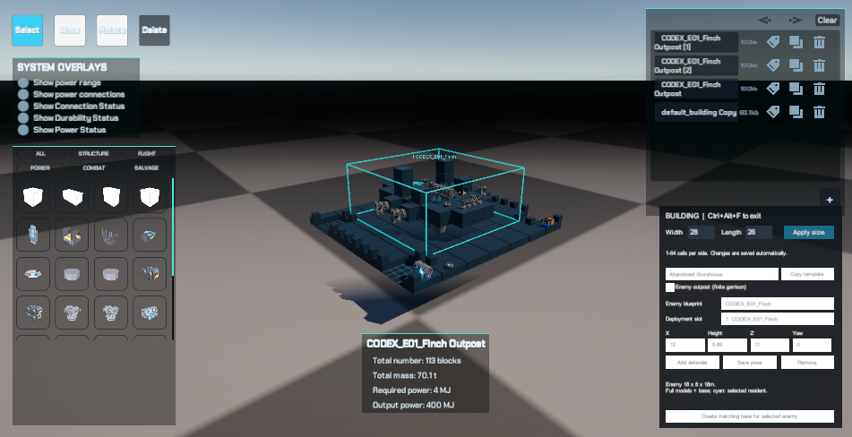

# 敌机与匹配底座组合验证

## 成品与数据保护

2026-10-16，Unity 6000.3.11f1、Main、Windows/D3D11。三套组合蓝图已实际写入 `C:\Users\12046\AppData\LocalLow\DefaultCompany\HY-Sandbox\BuildingBlueprints`：Finch、Pike、Manta Outpost。敌机模块快照与姿态嵌入建筑JSON，建筑尺寸分别28×26、28×30、36×22m，建筑模块数113/133/125，敌机模块数95/120/116。

改动前备份 `C:\Users\12046\AppData\Local\Codex\backups\outpost-bases-20261016-103723` 保留起始diff、原建筑目录和28份用户JSON哈希清单。原JSON逐份SHA256保持不变；仅补入三份新据点文件。原六份工程/设置/布局差异不纳入提交。旧三套内置外围据点通过AssetDatabase移动保留GUID；普通建筑和敌机源保持。

## Editor实际验证

- `BuildingEditorPlayProbe.Run()`：61项通过，errors为空，见[原始报告](2026-10-16-matching-outpost-editor.json)。包括实际MatchingBase按钮生成独立文件、完整敌机网格与建筑预览、原子保存/重载、模式切换清理、真实流式地形上远处停机显示、原位激活、击败重访不复活、退出后新会话恢复、卸载不产生孤儿敌机。
- `OutpostContentChecks.Run()`：六套建筑恢复和连接通过，三套底座逐模块净空、尺寸及完整无玩法组件模型通过，见[检查明细](2026-10-16-matching-outpost-content.txt)。早期中继位于发电机顶部时未连接，移至服务角平台后全部通过。
- 已查看真实建筑编辑器Finch组合画面与Manta组合渲染。下图为实际Editor画面，不是示意图；展示底座、实体敌机、尺寸框和制作按钮。

## 独立Player验证及失败记录

Development验证包输出 `Builds/OutpostAuthoringValidation/HY-Sandbox.exe`，构建成功，0错误/1警告。请求窗口1280×720，D3D11，隐藏启动；不以隐藏窗口截图或Development阶段时间证明画质、GPU性能或发布帧率。

复现参数：`-world-smoke-report <绝对JSON路径> -world-smoke-outpost-editor -world-smoke-outpost-pursuit -world-smoke-seed 14723`。制作测试使用唯一缓存文件仓，finally恢复，随后只读载入原玩家载具。

保留并说明调试中的失败，不将其写成通过：

1. 最初快捷键测试早于InputManager实际处理便释放输入；测试现等待实际模式切换，并临时允许后台虚拟输入，finally恢复设置。没有修改生产快捷键。
2. seed14721旧路线未找到据点。按新底座的平台半径18体素和当前9个建筑模板计算，出生附近四个候选均为用户普通建筑；改用算法确认含Finch据点的14723，不改变生产10%候选概率。
3. 14723第一次组合验证已通过40项，包括完整编辑保存及Finch起飞、索敌、自然伤害、移动追击，但脱离索敌断言失败。为排除横向瞬移跨入未加载列的干扰，测试改为同一已加载列上移120m并记录距离，仍失败。诊断显示玩家距离123.1m、索敌半径80m，但当前目标是已隐藏的原载具AirKing：EnemyController遍历注册表时没有排除禁用对象。生产索敌现在跳过非isActiveAndEnabled单元；保留注册表契约，流式保护不改动。组合路线中隐藏原载具继续作为回归条件。

修复后同seed14723组合路线68类检查全部通过，completedCycles=1，errors为空，Player正常退出，见[最终原始报告](2026-10-16-matching-outpost-player.json)。Finch实测自然起飞、索敌、悬浮供电、武器归属伤害、移动目标追击（位移27.86m）、脱离（距离119.8m/半径80m/目标为空）及重新接敌；之后受损重组、休眠恢复、击败后重访不复活、退出及重新准备均通过。完整Manta制作/保存/重载在同一Player内先行完成；Pike/Manta的物理飞行没有在本轮独立Player中逐一重跑，不将Finch结果泛化为三机全部飞行验收。

## 验证边界

远处停机显示仅含静态网格，无伤害碰撞，未激活时不支持远射命中；近距离以相同姿态启用真实战斗实体。当前会话击败不复活，新出征重置，不写永久击败状态。三个底座共用轮廓适配生成器，用户可以继续手工修改结构和部署位置；不是三套独立美术资产包。

源码函数图与导航已更新。静态编译0错误/4个既有警告；可读性检查256脚本、30图、0错误，`git diff --check`通过。静态通过不替代上述运行验证。
