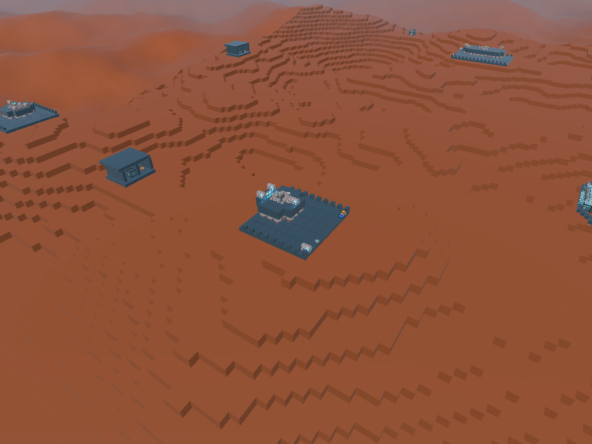
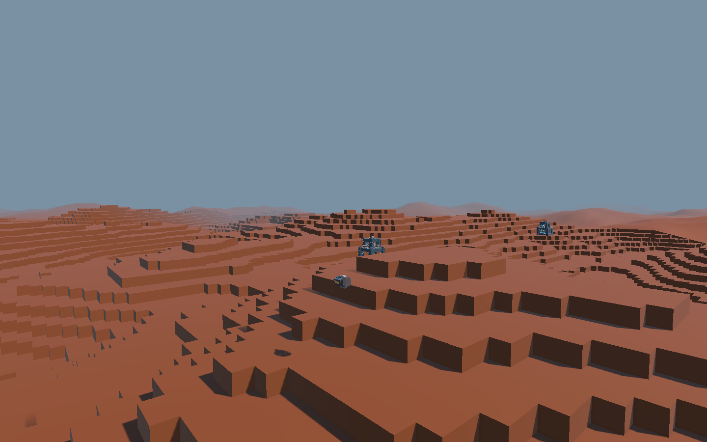
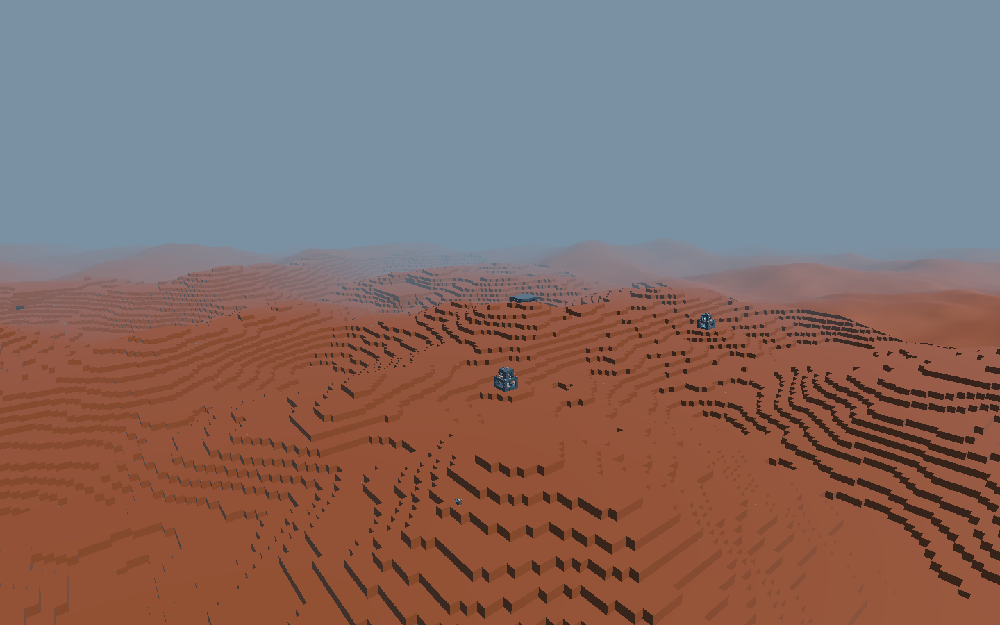

# 建筑地形融合与流式范围

## 建筑落地

原实现按整个建筑库最大半径生成对称正方形平台，同时蓝图原点在基础网格一角。例如上一轮最大半边长18体素（36m），每栋建筑周围都可能生成约72×72m的平台。小建筑继承大平台，且平台与实际占地中心错开。

现在每次会话快照各蓝图的基础尺寸与模块包围范围，地形和建筑共用模板选择函数。候选落点代表实际占地中心；根据90度朝向移动蓝图原点并交换长宽。只有实际范围及半个体素的支撑余量强制平整，外侧6m使用SmoothStep混合回原自然高度。最大全局尺寸仅用于安全落点间距，不再决定每栋建筑的平坦面积。空建筑库不产生人造平台。

同时修复模板选择哈希的低位偏差：偶数间距网格原来会只选择部分奇数索引模板；增加位混合后全部模板均能出现。这会改变相同种子的新世界布局，当前世界本来按出征重建，不迁移用户蓝图或写入永久世界。

## 范围与密度

`Assets/World/WorldGeneration.asset`通过Editor保存：加载半径4→6（初始81→169列），卸载半径5→8（保留两圈滞后），建筑候选概率10%→20%。32m列宽下详细地形加载区域由约288m宽增至416m宽；具体离玩家边界距离随列内位置变化。近身两圈先补碰撞地形，再恢复建筑，避免大蓝图阻塞近处地形准备。建筑和模块总预算保持。

原`buildingPadHalfSize`/`FitBuildingPlatforms`配置与调用已移除，新增可编辑`buildingBlendWidth`，当前6m。项目唯一WorldGeneration资产已迁移。源代码导航和函数图同步更新，玩家路径和世界资产GUID保留。

## 已完成的验证

- `WorldTerrainIntegrationChecks.Run()`：78个落点、6套内置模板、四种朝向，每个基础网格采样都由同高度地形支撑；局部过渡带外逐格与自然地形相同；重复采样确定性通过。固定seed14723全图，同一占地条件下10%候选产生431点，20%产生875点。见[原始结果](2026-10-16-terrain-integration.txt)。这是候选点统计，不代表同时加载875栋。
- 第一阶段Editor实测：169列，14建筑/909模块，短程移动中位7.14ms、P95 12.48ms、最大28.18ms；启动准备有951ms峰值，包含Editor与载具恢复，不作为发布性能。见[记录](2026-10-16-terrain-editor-performance.txt)。首次诊断因编译重载中断，没有报告，未计为通过；正式串行重跑完成。
- 第一阶段普通D3D11 Windows Player（非Development），1280×720请求窗口，seed14723，`-world-smoke-outpost-pursuit`：53类检查通过、errors为空、正常退出；自然交战、追击/脱离、受损重组/休眠/击败重访、跨列、退出重建覆盖。移动中位8.35ms、P95 9.46ms、最大32.08ms；交战有90.27ms峰值，退出52.11ms。移动结束分配内存134,722,431字节，重建Ready137,321,039字节。见[原始JSON](2026-10-16-terrain-player.json)。目标120Hz限帧；隐藏窗口不能作为GPU或人工驾驶验收。
- 实际Editor相机渲染检查了用户4×4小建筑和20×18据点的接地；未改用户作品。初次画面仍显示阶梯近景与平滑远景明显分界，用户也指出此问题，因此继续进行外环美化，最终结果另记于下。

## 视觉外环与边界美化

原来的8m平滑远景直接接在2m体素近景外，阶梯与平面轮廓差异沿加载范围形成明显方形分界。新增`WorldTerrainTransitionMesh`生成无碰撞视觉列：与详细地形使用同一高度采样、上两层草/下层土材质、阶梯侧壁；同高顶面按行合并并释放Mesh的CPU副本。默认过渡外环半径12列（初始625份缓存），考虑四列中心量化后，最近的精度切换移至约288m外、进入270m起始雾区。

`WorldDistanceView`按加载毫秒预算创建缓存列；新环和粗远景空洞就绪后同帧切换。详细地形列一加载即隐藏同位置代理，避免覆盖玩家挖掘区域；外环额外保留两列缓存，淘汰和退出释放Mesh。视觉列不参与碰撞、建筑或敌人生成。WorldDistanceView保留约355个有效代码行用于协程/缓存/相机生命周期协调，独立网格算法拆出，避免把网格制作与生命周期继续挤在一个类里。

Editor真实Play、seed -324150475，1440×900相机渲染分别检查高位俯视与低位远望。低视角近景到外环轮廓连续，高视角仍能辨认更远处阶梯到平滑轮廓的变化；本次是弱化可见加载边界，并非保证任意飞行高度完全无缝。第一次截图处于Ready（世界未启用），已排除；正式截图在Playing并确认182详细列、675缓存视觉列。截图临时相机/RT均销毁，不保存场景。

## 当前游玩体验评价

最终验证还包括259脚本/30函数图可读性检查、dotnet build（0错误/4既有警告）、Unity Player构建（0错误/1警告）与git diff检查。独立Player新增验证外环存在、没有碰撞、详细列代理隐藏、上一会话Mesh全部释放。初始启动前段与静态编译短暂重叠，启动时间不作性能对比；后续移动阶段在静态工具完成后单独运行。相对第一阶段，移动P95从9.46ms至9.53–9.64ms，Ready分配内存约增加2MB，移动结束约增加6.5–6.8MB；这是短时路线结果，不是长时间稳定性保证。

这版更适合持续探索：建筑接地范围与体量一致，小建筑不会带着巨大方形平原；候选概率提高后更容易遇到建筑/据点；视野内维持一致体素轮廓，低空移动时加载区域不再那么突兀。已有敌机、底座、有限驻军、战斗回收和返航链条，使它成为可试玩的建造探索战斗原型。

主要短板仍是内容辨识度和节奏：实际画面地表颜色/地貌较单一，远处不同目标缺少更强的视觉地标；2m台阶对驾驶的影响需要人工载具路线打磨，增密也可能缩短据点之间的喘息距离。高空仍有精度切换，遭遇创建和退出有帧尖峰，尚不能称为成熟发布体验。本次评价基于实际画面与受控运行路线，不冒称长时间人工驾驶、主观战斗手感或GPU性能验收。

## 数据保护

原36份用户JSON逐份SHA256保持；未保存战斗、返航货物或验证场景。主场景保留用户提交b950895。Editor脏状态在保存副本比对无差异后重载。构建生成的csproj及无语义配置变化不纳入任务提交。

地形仍是2m体素，坡面量化会产生自然阶梯和平坦片；本次保证的是不再因其他大建筑扩大某一建筑平台，并不把整片自然地形改成连续曲面。短时受控路线不能证明长期无泄漏，也不能代替完整载具驾驶与人工战斗平衡评估。

独立D3D11 Player两轮回归（seed14723，-world-smoke-outpost-pursuit -world-smoke-cycles 2）57类/轮通过，errors为空并正常退出；两轮移动P95为9.53/9.64ms、最大33.94/34.38ms，移动阶段均无>50ms帧。Ready内存139.32/139.64MB，移动结束141.26/141.53MB，对象数16652保持；首次遭遇仍出现84.98ms尖峰，退出55.96–61.37ms，见[外环Player原始JSON](2026-10-16-terrain-transition-player.json)。
