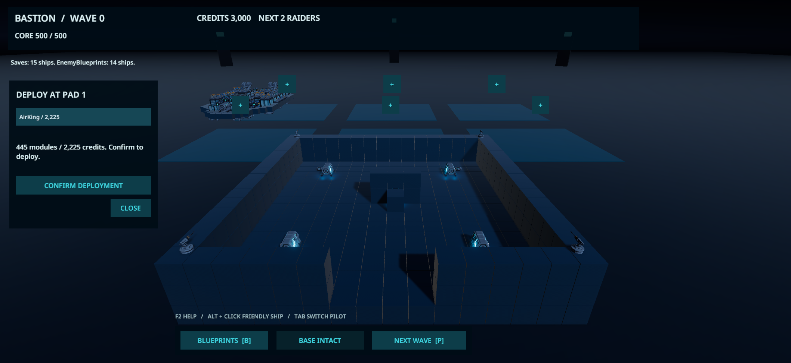
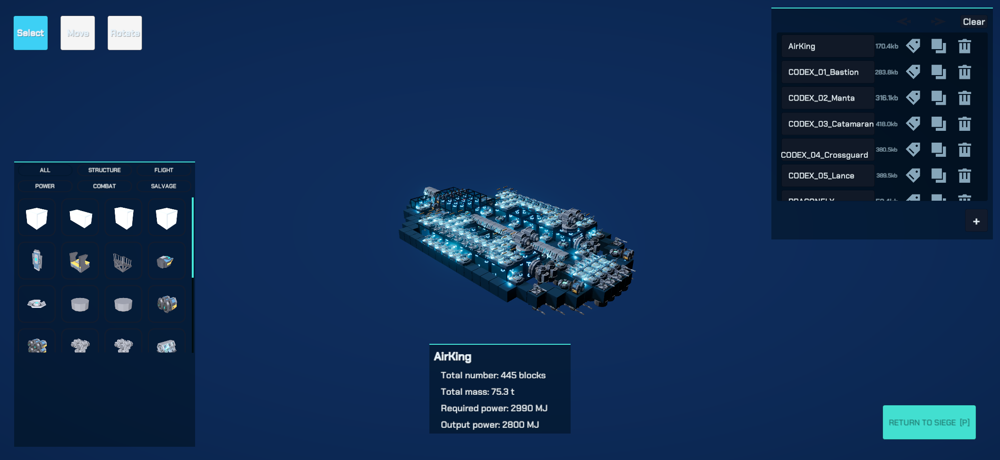

# Siege 三轮精简与验证（2026-10-31）

## 交付范围

按“先交互、再职责、最后隔离与采样”完成三轮。原方案文档作为讨论输入，不作为自动执行指令；没有按文档的类名、行数或估时机械拆分，也没有迁移到 UI Toolkit。

1. 移除常驻 Bays 清单。点击场景泊位或其 + 标记，选择蓝图、显示纯模型预览，确认后才生成并扣款。指定位置被占用或阻挡时拒绝，不悄悄换位。点击友舰显示接管/维修卡片，Tab 切换驾驶。F2 帮助，F3 攻方选择/刷新调试页。整备、战斗、失败分别显示必要动作。
2. HUD、场景操作和战斗反馈分别由 SiegeHud、SiegeDeploymentView、SiegeBattleFeedback 负责。Session 协调命令并发布 RefitChanged；报价在选择/明确操作时刷新，交易前重新验证。Fleet 保留舰船身份/生命周期，镜头与物理操作分到 FleetView / FleetPhysics。自动选位入口仅用于兼容既有调用者，与指定位置共享实现。
3. WorkshopStage 将战场移到不模拟的 LocalPhysicsScene，编辑蓝图位于独立预览场景；暂时剔除战场所在层并恢复原层和相机掩码。保留真实选块、移动、旋转、存档和撤销工具。关闭时取消加载、恢复场景/父节点并卸载临时场景。编辑不会免费修好或替换已部署舰船。新增阶段切换、舰队物理、波间修缮与工坊的可选计时。

四个 Siege 场景由 Editor API 迁移并保存，保留竞技场/部署位置、原脚本 GUID、经济和蓝图存档契约。改造前恢复点：`codex/pre-siege-streamline-20261031`（`da3460c`）。用户原始 `Siege_Refactoring_Proposals.md` 未修改、未提交。

## 实际运行验证

Unity 6000.3.11f1，Windows，连接目标为本仓库。受控损伤和输入夹具验证功能契约，不代表自然通关或人工体验评审。

| 检查 | 结果 | 范围 |
| --- | --- | --- |
| SiegeRulesChecks | 19 通过 | 阶段、经济、波次规则 |
| SiegeCombatFeedbackChecks | 25 通过 | 精英/蜂群、连击、记录恢复 |
| SiegePlayChecks | 28 通过 | 实际部署/维修、货物与身份、失舰与失败 |
| SiegeWorkshopChecks | 22 通过 | 实际 B/P 与指针入口、编辑/撤销/重做、加载取消、伤势与原组件状态 |
| SiegeUsabilityChecks | 10 + 9 通过 | 目录选择保持、空目录、自动部署兼容入口 |
| SiegeSceneInteractionChecks | 22 通过 | 实际指针选择/确认/取消、指定位置扣款、非驾驶舰维修、独立场景往返 |

逐项结果：[Editor 记录](2026-10-31-siege-streamline-editor-checks.json)。指针夹具需要 Game View 聚焦且指针未锁定；第一次未聚焦失败，聚焦后完整重跑通过。一次脚本重载期间的 Play 尝试发生单例空引用；停止、等待编译结束并重新进入 Play 后完成回归，不将热重载恢复能力列为已验收。

压力场景仅完成启动与引用检查，没有重新跑长时压力性能：SiegeStress 基地 388 模块；SiegeLargeStress 基地 2048 模块；SiegeMixedStress 主基地 2048 + 附加建筑 6144 模块，加载就绪且无错误。三个场景缺失脚本均为 0，泊位组件随场景迁移。

### 发现并修复的问题

跨 PhysicsScene 移动会使 Durability 再次 OnEnable，旧初始化会把受损模块恢复满血。迁移范围显式保留耐久、伤害归因和碰撞保护，其余正常生成/池化初始化不变。Editor 往返断言验证伤势、金币、驾驶权、已禁用 Renderer/Collider 均保持。

旧驾驶验证也从固定 Pilot Bay 按钮迁移到选中舰船的操作卡，保留真实指针接管断言。首次驾驶夹具未按 Alt，锁定指针导致断言失败；随后将夹具改为按游戏控制约定先释放指针。第二次已通过实际接管，但旧夹具又假设最便宜的两艘都配置悬浮控制器，切换后访问缺失组件；修正为先筛选具备悬浮控制、悬浮推进和方向推进器且预算足够的蓝图，显式驾驶模式购买两艘同型舰，普通冒烟的选择方式不变。

独立 Player 检查原先要求文字顶点数 > 4，会误判只有一个 + 字符的合法标记；改为至少一个四边形，并调整标记标签到其真实尺寸。

## 独立 Player 与静态检查

Windows D3D11 非 Development 验证包构建成功，最后一次 9.64 秒，0 errors / 1 warning。警告为既有 Pipeline 缺少 RuntimePipelineConfig，连接组件不在 Player 启用；不影响本轮玩法验证，不为消除警告擅自开启运行时远程连接。

- 1920×1080：67 项通过、0 错误，见 [Player 1080p](2026-10-31-siege-streamline-player-1080.json)。
- 1280×720：67 项通过、0 错误，见 [Player 720p](2026-10-31-siege-streamline-player-720.json)。
- 显式驾驶模式（1080p）：83 项通过、0 错误，见 [Player 驾驶输入](2026-10-31-siege-streamline-player-driving.json)，实际键盘推进、悬浮切换、Alt 释放后操作卡指针接管、镜头绑定与失舰重绑。
- 除 UI 几何、经济、失舰、波次、失败重开外，补测了 Player 的工坊物理/渲染隔离、可编辑预览加载、返回后的相机/场景/耐久/金币。后台隐藏运行，几何断言不等于已在这两个分辨率完成肉眼视觉验收。
- `dotnet build HY-Sandbox.sln --no-restore`：0 错误 / 4 项既有警告（依赖冲突和过时 Profiler API）；因锁定 SDK 9.0.318 本机缺失，从外部目录使用已装 9.0.320 运行绝对路径工程，没有改 global.json。
- CodeReadability `--check`：335 个脚本，0 格式差异 / 0 错误。源码导航与 43 张函数图已刷新。
- `git diff --check`：通过；Unity 生成场景的尾空白仅做格式规范化，不改序列化值。

最后一次补测构建曾使长时间运行的 Editor 在 AssetDatabase 资产扫描时发生原生 OutOfMemory 崩溃。没有直接认定为玩法脚本问题或已修复的引擎问题。保存的场景和代码未丢失；保留本机崩溃前日志，重启并确认可用内存约 20GB 后串行重建成功，随后两个 Player 检查全部通过。该失败也不能记为成功构建。

## 性能证据与边界

原始采样保留在本机 `Temp/Siege/Performance/`；仓库提交 [带原始文件 SHA256 的精简摘要](2026-10-31-siege-streamline-performance-summary.json)。计时默认关闭，嵌套阶段不能相加，观测区间跨多帧时不能当作单帧 CPU。

- 自然首波、6 艘最便宜蓝图、固定种子 14741：90.008 秒，7805 次 Editor 观测，无跳帧观测；观测间隔中位 10.117ms、P95 20.033ms、P99 20.388ms。只到第 1 波，未自然清波，未覆盖后期或自动修缮。
- 受控工坊往返：6 次范围调用合计 94.686ms，单次最大 30.989ms。仅统计 Stage 的同步移动/恢复部分，不包含异步蓝图加载、卸载与 GPU 渲染。
- 受控波次边界：4 次模拟切换合计 0.172ms、4 次舰队切换合计 0.245ms；1 次波间修缮 32.731ms。夹具人为触发损伤和死亡，不是自然战斗样本，不能代表后期成本上限。

本轮没有同负载旧版 A/B，也没有后期自然多波次 Player 性能结果；不声称 FPS 提升或此前 272ms 长帧已解决。现有数据的价值是阶段归因和可重复采样入口。

## 视觉核对

下图为 Editor 实际屏幕捕获，已查看部署卡片、场景标记与工坊隔离效果。最后将 + 标记字号放大，其他布局相同。后台隐藏运行的 Player 截图为黑图，不作为视觉证据；Player 的几何断言与 Editor 视觉检查分别报告。

## 重现入口

- 保存的 `Assets/Scenes/Siege.unity` → Play；整备点击平台 → 选蓝图 → Confirm。Alt 释放战斗指针，Tab 切舰，B 编辑、P 返回/下一波。
- 编辑器菜单 `HY-Sandbox/Siege/Apply Scene Deployment Interface` 可重新保存真实可编辑 UGUI。旧三个制作菜单委托同一入口。
- 新鲜 Play 调用 `SiegeSceneInteractionChecks.Run()`；其他测试需各自约定的新鲜会话。测试结束恢复原始记录 5/22/2，测试蓝图由既有夹具清理。
- `SiegePerformanceCapture.StartCapture(label, seconds)` 采集 Editor；Player 显式 `-siege-checks-report` 启用检查，附加 `-siege-checks-soak -siege-checks-profile` 才采自然战斗与阶段差量。
