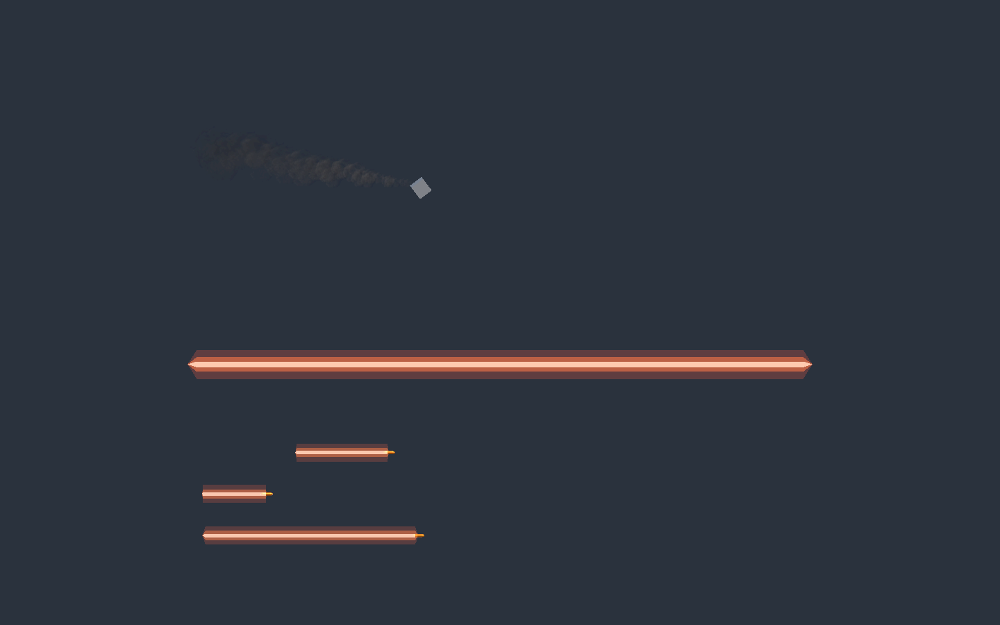
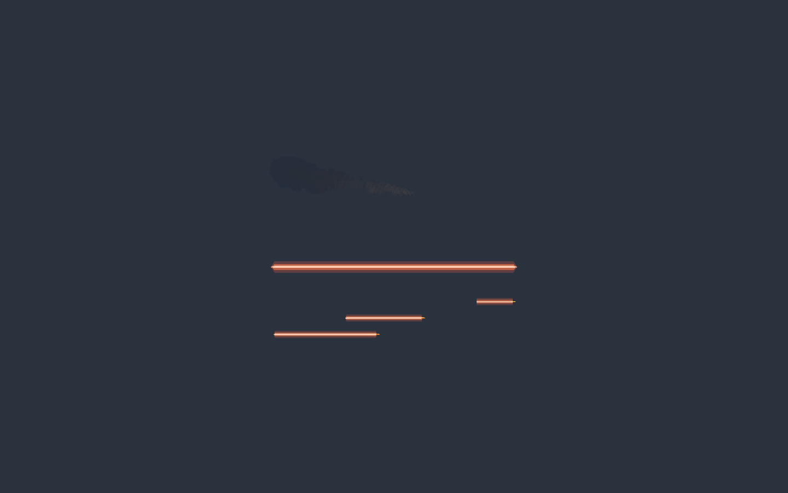

# 残骸尾烟与战斗射线表现

## 结果与调参

- 残骸烟迹：`DetachedPartSmokeTrail` 根据刚体点速度和局部锚点跟随，烟粒在世界空间留下历史轨迹；独立效果对象不会随残骸删除，禁用/销毁时停止发射并允许自然淡出。
- 激光：`LaserTurret` 使用独立 LaserBeam 库项，宽度参数 0.035→0.16m，可见时间 0.085→0.2s，增加亮芯和橙红外晕。参数已保存到实际 Turret.prefab。
- 炮弹：`ProjectileTracer` 读取真实位置历史，0.1m 宽、0.09s 长度、最多 7m；不同速度产生不同长度。发射和对象池复用重置历史，物理/命中逻辑不变。
- 资源库：DebrisSmoke、LaserBeam、ProjectileTracer 可集中替换。维修等继续使用原 EnergyBeam，不沿用战斗光束的加粗。
- 源文件、预算、图集来源、可重复制作入口见 [规格卡](../../ArtSource/VfxGraph/CombatVfx.md)。恢复分支 `codex/combat-vfx-baseline-20261106`。两个用户已有 ProjectileTurret Prefab 的 predictiveAim 改动未纳入任务提交。

## 实际验证

Unity 6000.6.8f1 / VFX Graph 17.6.0，目标 Editor 导入并编译；新资源均由 Unity API 创建/保存。修复新图的 FlipBook 结构类型写入错误后重新导入，最终 Console 增量检查无新错误。历史 Console 中既有 Pipeline 超时、CSV 共享冲突和 LootDrop 重设父级错误未作为本任务失败或成功的依据。

`CombatVfxCapture.StartCapture` 在隔离 Play 场景中自动摄影，结束恢复原 Siege 场景。上方为移动残骸烟迹，中间为 12m 长的激光，下方依次为 20/42/85m/s 移动的炮弹表现夹具；后两帧扩大到正交高度 24m。截图使用自动相机已完成帧，不用静态 Inspector 预览代替运行效果。截图中的激光持续显示以便比较宽度，生产开火仍按 0.2s 时间窗淡出。

最终[生命周期记录](CombatVfx/lifecycle.json)：残骸约 2.2s 销毁，2.40s / 3.41s 仍可见烟粒，5.40s 读回为 0。GPU 计数为异步读回，不将每个相邻帧计数当作严格单调序列。

`CombatVfxChecks.RunPlay` 在实际 TurretProjectilePool 上通过：同实例复用、旧轨迹清空、重新发射位置更新、速度/碰撞体正常。视觉夹具另禁用了物理驱动，以确定性速度横向移动，用于对比曳光长度；不将此画面测试称为完整炮塔交战测试。

静态检查：CodeReadability 361 脚本；50 张源码关联图；显式 SDK 9.0.320 编译 0 错误、22 个既有程序集引用警告（项目锁定的 9.0.318 本机未安装，未改锁定配置）；`git diff --check`。

## 限制

本次已验证实际 Play 视觉、残骸销毁后尾烟与炮弹池复用，未进行自然大规模交战帧率对比、Player 构建、所有地图光照与镜头距离验收。较宽外晕增加少量透明重叠，应在最大舰队压力下继续观察；未添加额外动态灯。
