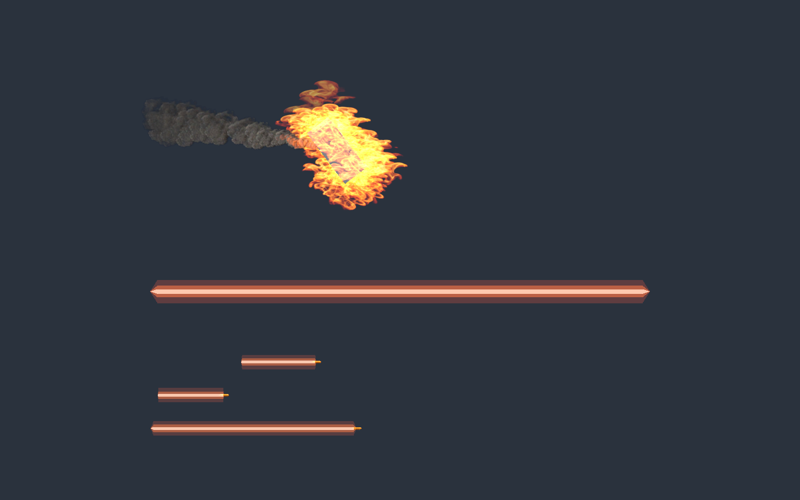
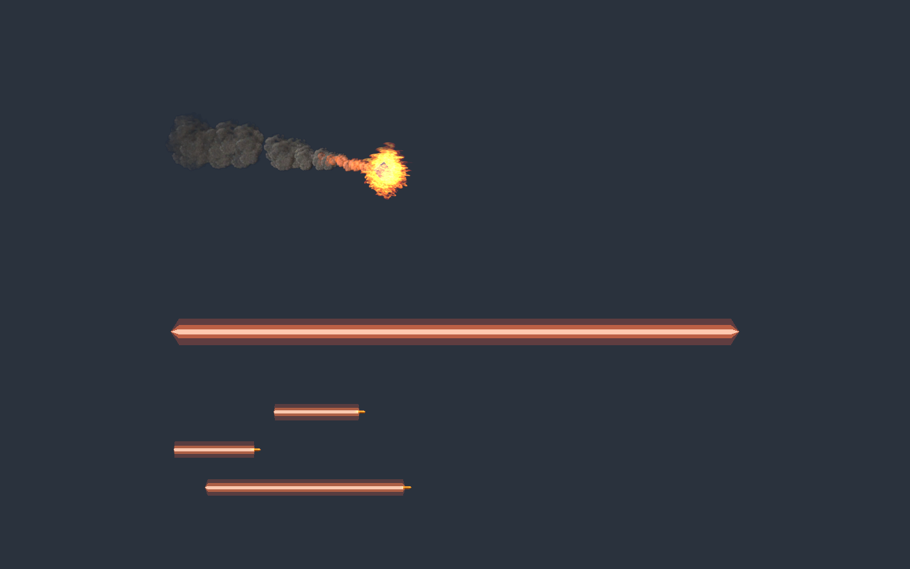

# 残骸包裹火焰

2026-11-06。按参考图的“明亮燃烧头部 + 灰黑尾烟”关系制作，火焰覆盖模型前后，不再仅是身后的细线。使用项目已有 UNI 火焰图集，没有导入参考图作为游戏贴图。

## 实现与编辑

- 集中库 `DebrisSmoke.prefab` 新增局部空间 `DebrisEnvelope.vfx`。现有世界空间烟迹和短促余火保留，形成过渡。
- `DetachedPartSmokeTrail.ConfigureEnvelope` 合并同刚体的 MeshRenderer / SkinnedMeshRenderer 包围盒；`UpdateEnvelope` 跟随中心与旋转，并适配缩放。排除特效 Renderer 和其他刚体模型。
- Inspector 的 `Flame Envelope Scale` 默认 1.65，`Flame Coverage` 默认 3；颜色、寿命、发射量与图集帧序保存在真实 Graph 内。
- `DebrisFireBaker.BakeMissing` 接入战斗特效制作入口，只补缺失图和子节点。90 粒子/s、寿命 0.45s、容量 64，新增一个透明输出，无动态灯。来源及规格见 [规格卡](../../ArtSource/VfxGraph/CombatVfx.md)。

## 验证

Unity 6000.6.8f1 / VFX Graph 17.6.0 完成导入、保存和实际 Play 预览：

- `StartEnvelopeCapture`：1.4×0.65×0.8m 旋转残骸，火焰中心误差小于 0.000001m、旋转误差 0°，尺寸参数约 1.95m。
- `StartCapture`：0.28m 小残骸，尺寸参数约 0.84m，火焰随模型缩小。
- 两次均在约 2.2s 删除残骸，3.4s 火焰粒子归零而烟迹仍存活，5.4s 烟迹归零；GPU 数量异步回读。结束恢复 Siege 场景。
- 炮弹池原回归通过。CodeReadability 362 脚本、0 差异、0 错误；刷新 50 张源码函数图。SDK 9.0.320 构建 0 错误、22 个已有引用警告；diff 检查通过。
- 最终 Editor 实时 Console 错误 0、编译失败 false。测试前的 Siege Play 历史存在 `InputManager.Update:77` 空引用，未计为本轮通过项，也未在本次特效修改中处理。

原始证据：[大残骸](CombatVfx/envelope-lifecycle.json)、[小残骸](CombatVfx/envelope-small-lifecycle.json)、[远景](CombatVfx/envelope-far.png)。

## 边界

这是按模型包围盒的体积包裹，不是精确网格表面采样。极细长、中空、运行时大幅变形的模型尚未逐项验证；未进行全部地图光照、大规模交战性能或 Player 验证。新增透明粒子会增加 overdraw。两个用户已修改的炮塔 Prefab 保持原样，不包含在提交中。
