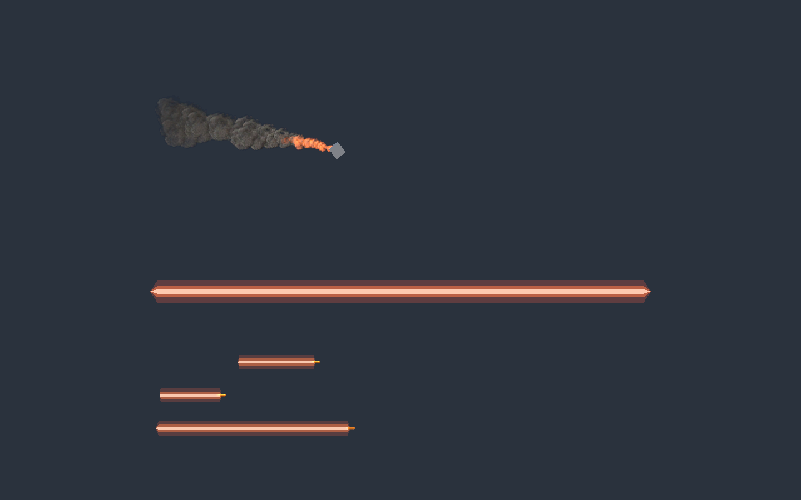
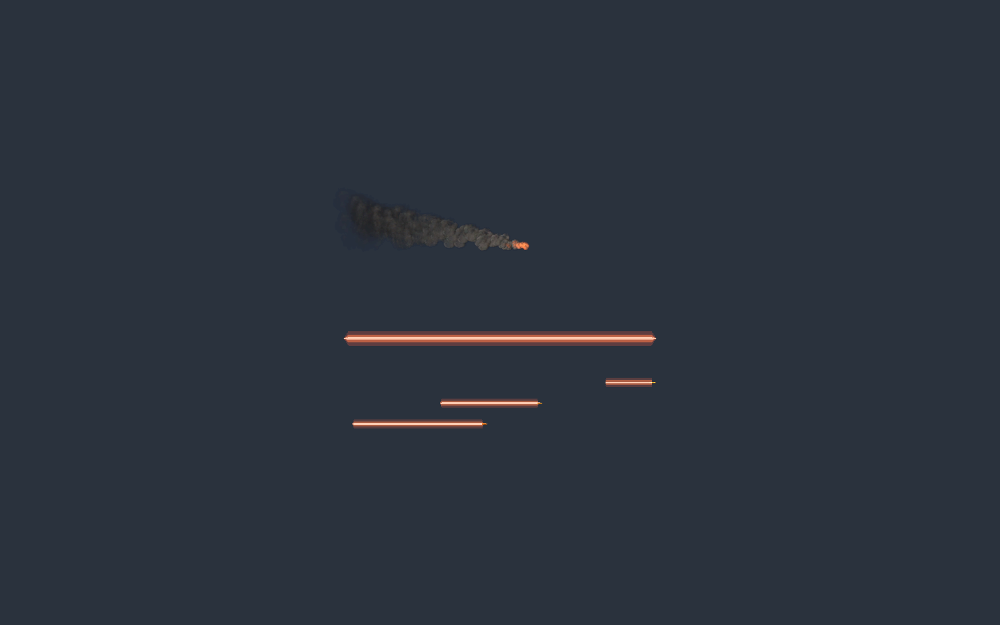

# 残骸尾烟可见性

2026-11-06，接续战斗特效验证；将“降低透明度”落实为烟团更不透明，并加入贴近残骸的橙色余火。

- `DebrisSmoke.vfx` 烟雾 alpha 峰值 0.48→0.92，中段 0.28→0.68，适当提高灰烟色乘数。
- `DetachedPartSmokeTrail` 设置最低强度 0.85，避免中低速把整段烟迹变淡；保持原发射门槛和世界空间生命周期。
- 新增共用烟粒的 Additive Output，单粒出生约 0.5 秒内呈橙色火光，随后只剩烟；不增加粒子数量或动态灯，但增加一个透明绘制输出。
- 已同步 `CombatVfxBaker` 再生参数，现有 Graph 通过 Editor API 保存并保留 GUID。集中库引用不变，仍可在 Graph 编辑颜色、曲线和大小。

## 实际验证

Unity 6000.6.8f1 / VFX Graph 17.6.0：真实导入、编译及隔离 Play 拍摄完成。近景可见较实灰烟及橙色尾焰，远景仍可辨认轨迹；自动恢复 Siege 场景。当前 Console 编译失败标记为 false、实时错误数 0，历史错误未清除或计为本轮错误。

[本轮生命周期记录](CombatVfx/smoke-fire-lifecycle.json)：约 2.2s 销毁残骸，2.40s / 3.40s 仍有 75 / 76 个烟粒，5.41s 为 0；GPU 计数为异步回读。原炮弹池复用检查仍通过。

CodeReadability：361 脚本、0 差异、0 错误；导航刷新 50 张图。显式 SDK 9.0.320 构建：0 错误、22 个既有 MSB3277 警告；未改项目 SDK 锁定。`git diff --check` 通过。

本轮没有验证全部地形光照、自然大规模战斗性能或 Player 构建。两个用户已改的 ProjectileTurret Prefab 保持原样，未纳入提交。
