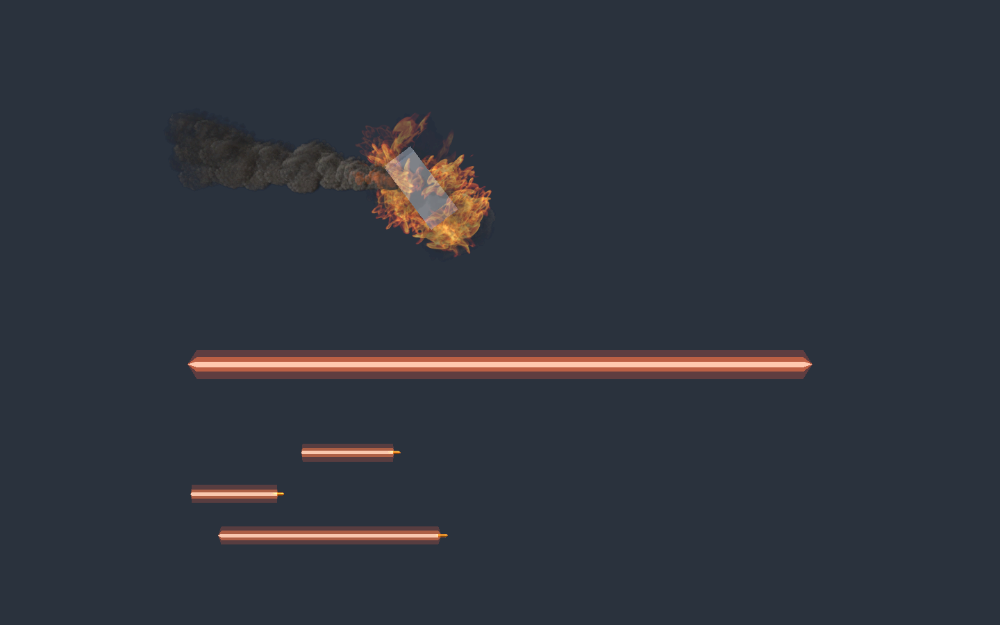
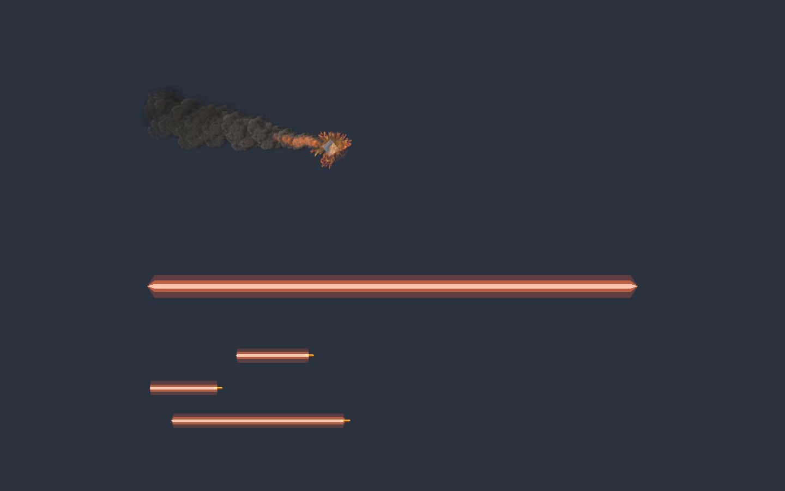

# 残骸烟火平衡调整

2026-11-06，按用户要求减弱火光，并继续参考燃烧头部、浓烟尾迹的层次。保留模型包裹和世界空间尾烟，未修改战斗光束或炮弹表现。

- 包裹火焰发射量 90→60/s；颜色乘数由 (2,1.3,0.7) 降至 (1.1,0.8,0.45)，alpha 峰值 0.8→0.65、中段 0.65→0.4。
- 单粒覆盖系数 3→2.5，体积扩张保留 1.65；随机滚转 ±180°，打散整齐的同向火舌。
- 头部加入共用现有粒子的灰黑烟输出，峰值 alpha 0.32，让烟雾遮叠火光。无新增模拟粒子或动态灯，但增加一个透明绘制输出。
- 世界尾烟颜色加深，尺寸曲线由 0.35→1→2.2m 改为 0.65→1.35→2.4m；过渡余火降低亮度。
- 实际 Graph 与制作源参数同步，所有已有 GUID、库引用和生命周期保持。

## 验证

Unity 6000.6.8f1 完成导入、编译及两轮最终 Play 验证：1.4×0.65×0.8m 旋转残骸、0.28m 小残骸。检查火光收敛、深烟可见、模型包裹及跟随。残骸约 2.2s 销毁，3.4s 头部粒子归零且尾烟仍存活，5.4s 所有粒子归零。GPU 计数为异步读回。场景恢复 Siege；实时 Console 错误 0，历史 InputManager 空引用无新增。

[大残骸记录](CombatVfx/balanced-lifecycle.json)、[小残骸记录](CombatVfx/balanced-small-lifecycle.json)、[远景](CombatVfx/balanced-far.png)。

CodeReadability 362 脚本通过，50 张源码导航图刷新；SDK 9.0.320 构建 0 错误、22 个已有引用警告；diff 检查通过。未验证全部光照背景、完整自然交战和 Player 性能；包裹仍为模型包围盒近似，非精确表面采样。
