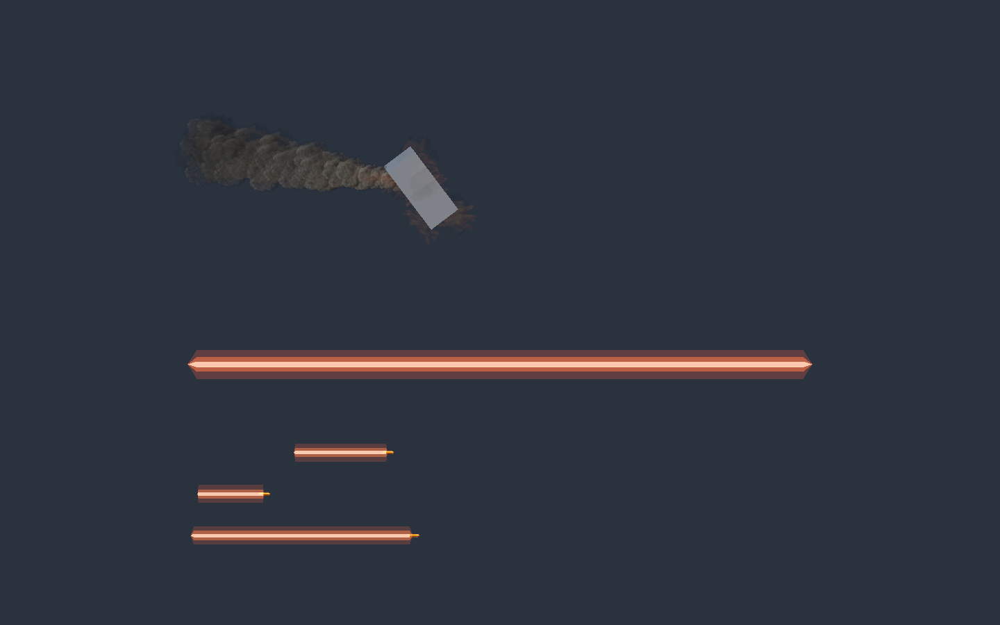

# GPU 特效对象池与活动上限

## 原因与实现

旧路径的 GPU 粒子模拟已由 VFX Graph 完成，但 CPU 创建层用 64 个全局一次性名额、24 条残骸尾烟门槛拒绝请求。尾烟进入销毁等待后还会占据一次性名额。旧代码每次 Instantiate、延迟 Destroy，未真正复用这些图对象。

现在 `VfxEffectPool` 按场景和模板复用实例，活动数量没有硬上限，不抢占正在播放的特效。爆炸、撞击等一次性效果及残骸、陨石尾迹接入同一池；光束和点光源原有 `TransientEffectPool` 已是按需扩容，未改其外观或策略。单个 VFX Graph 的容量仍是 GPU 缓冲预算，并非无限粒子容量。

集中库 Inspector 新增 `Max Idle Per Template=32`、`Max Idle Effects=128`，仅限制每场景闲置缓存，超出的对象在播放结束后销毁。场景卸载随池释放活动和闲置子对象；没有 DontDestroyOnLoad 全局残留。库引用仍按模板区分，替换模板不会租到旧模板缓存。

`VfxEffect.ReleaseAfterPlayback` 使用到期回调归池，复用前取消旧回调，清空粒子、恢复根缩放及 Graph 子变换、恢复运行中可变的 float/Vector3 参数，禁用旧陨石跟随器。陨石重新初始化时重新启用跟随。停止发射仍保留 authored 尾烟等待时间，避免截断尾迹。旧 BurstLimit 枚举值为保留数值契约而保留，不再由 Play 返回。

## 验证

Unity 6000.6.8f1 / VFX Graph 17.6.0，`VfxPoolChecks.RunPlay` 在隔离 Play 场景验证：

- 同时申请 96 个撞击、80 个爆炸和40条残骸尾迹，216 个活动实例均保留，无拒绝或抢占。
- 测试推进到期回调，验证活动清空、闲置缓存有界、相同实例复用，缩放、子节点位置、FlameSize 和旧计时不污染新租用。
- 陨石跟随器切换到残骸时禁用，重新用于陨石时启用；显式销毁场景池后活动子对象消失，再次申请得到新池。
- 另以真实时间运行移动/旋转残骸：销毁后保留烟迹，约5.4s粒子归零，7s活动数0、闲置数1，证明自然到期归池。结束恢复 Siege 场景。

[并发与复位结果](CombatVfx/pool-checks.txt) · [自然生命周期记录](CombatVfx/pool-lifecycle.json)

静态检查：364脚本无格式差异，51张源码函数图刷新；SDK9.0.320构建0错误、22个既有引用警告；diff检查通过。Unity导入中遇到SceneHandle隐式int转换报错，已改为Scene键并重新编译验证。

并发检查用于验证分配和回收，并非216效果持续GPU压力测试。取消活动上限并不消除GPU显存、透明叠加或CPU对象创建成本；尚未测自然大规模战斗帧率、长期显存和Player。外观参数未修改。两个已有炮塔Prefab修改未纳入提交。恢复点：`codex/vfx-pool-baseline-20261106`。
