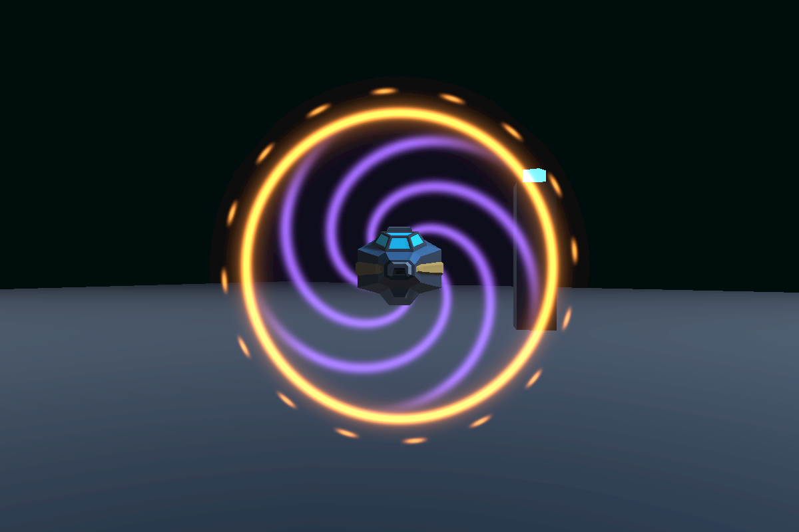
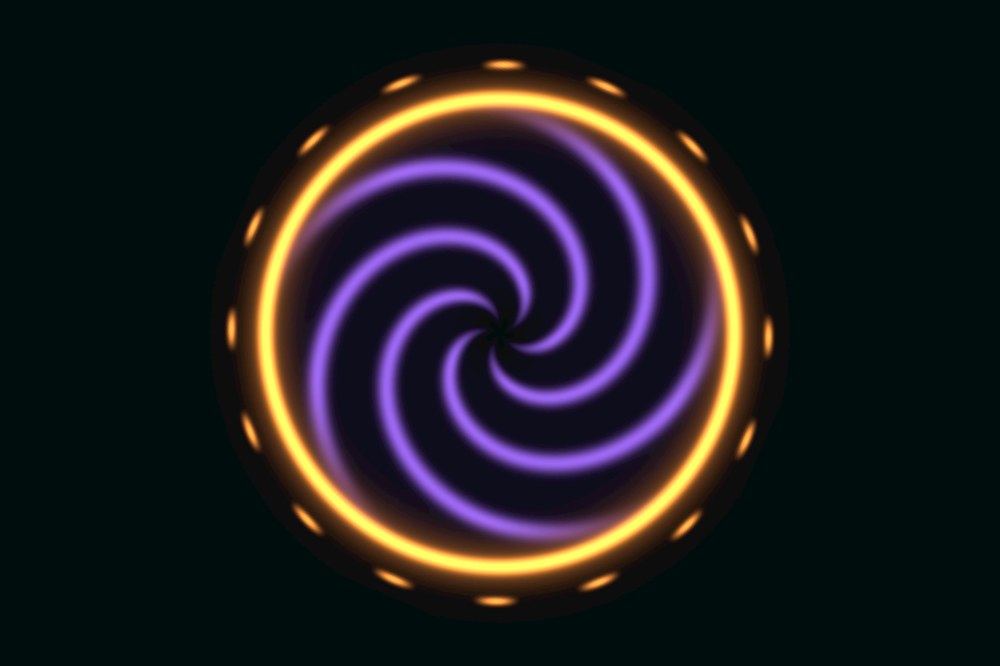

# 敌机出生传送门验证（2026-11-07）

## 改动与编辑入口

`EnemySpawner.SpawnRandomEnemy` / `SpawnEnemy` 经 `SpawnBlockData` 成功生成后播放；`SiegeWaveDirector.Tick` 在注册攻击者成功后播放。两者共用 `VisualEffectsManager.TryPlayEnemySpawnPortal`，不把效果直接塞入所有阵营共用的模块工厂。Siege 原有信标已被替换，生成节奏、AI、伤害及据点驻军策略不变。

资源为原生 VFX Graph + Prefab + 确定性程序纹理。集中库的 `EnemySpawnPortal` 引用支持替换，现有一次性槽位没有重排。管理器 Inspector 可调尺寸；生命周期、制作菜单、来源和预算见[资产规格](../../ArtSource/VfxGraph/EnemySpawnPortal.md)。源码函数图由 `Tools/CodeReadability/generate_navigation.py` 维护。

## 实际 Unity 验证

目标 Editor：本仓库 Unity 6000.6.8f1，URP / VFX Graph 17.6。通过连接的 Editor API 生成并保存资产，重复 BakeMissing 后引用仍正确；退出 Play 后恢复 `Assets/Scenes/Siege.unity`，场景未脏、未保存运行夹具。

真实 Siege 场景 Play，使用临时单驾驶舱蓝图作为可控夹具，调用生产生成逻辑。普通生成器的缓存仅在运行中注入一份夹具，调用公开的随机/批量入口；Siege 临时替换内存候选列表，调用真实 BeginNextWave 和当前会话的 SiegeWaveDirector.Tick，然后恢复列表。为隔离视觉采样，暂停会话调度并固定测试敌机；不将其称为自然战斗压力测试。11 项断言通过：

1. 无效蓝图返回空且不播放。
2. EnemySpawner 随机入口每艘播放一次。
3. EnemySpawner 批量入口每艘播放一次。
4. 敌机移动、销毁后传送门仍固定在原位置。
5. enableRuntimeVfx 关闭时正常生成敌机但不播放。
6. Siege 成功进入实际波次。
7. Siege 登记一名攻击者并播放一次。
8. 同时刻重复 Tick 不额外生成或播放。
9. 传送门尺寸处于 Inspector 配置范围。
10. Siege 传送门实际产生一个存活 GPU 粒子。
11. 两条路径的传送门均在播放后归还池。

另在空场景实际 Play 采样：约 0.50 / 1.16 / 2.10 秒时一个活动效果、一个 GPU 粒子；3.51 秒时活动数 0、闲置数 1、粒子数 0。再次播放复用原实例，直径从 12m 正确恢复为 6m，无缩放累乘。查看过展开、保持、收拢和消失截图；初版旋涡方形边缘已修正并重新采样。

## 回收缺陷与回归

首次 Siege 检查发现三个效果播放后仍活动，`_oneShot=true`、截止时间已过、`IsInvoking=false`。原因是 `FinishPlayback` 在 Invoke 略早于 Time.time 截止值时直接返回，丢失下一次调度。现在保留新租期的截止保护，并在未到期时按剩余时间重新调度。

`VfxPoolChecks.RunPlay` 新增“模拟提前消费回调后必须重新预约”的断言；完整既有检查（176 次爆发 + 40 条尾烟、无拒绝/驱逐、闲置上限、模板缩放/参数/计时器/陨石跟随复位及池销毁）通过。修复后重新执行上述两条生产路径，11 项全部通过。

## 静态与边界

- 项目 global.json 严格锁定 SDK 9.0.318，本机只有 9.0.320。未修改该配置；从仓库父目录使用 9.0.320，给 --project / solution / 检查根目录传绝对路径。
- CodeReadability：365 个脚本，0 格式差异、0 错误。解决方案 `--no-restore` 编译：0 错误、22 警告（MSB3274 / MSB3275 框架版本引用及 MSB3277 程序集版本冲突）；未修改相关依赖。全工作区 `git diff --check` 被原已修改的 `UserSettings/Layouts/default-6000.dwlt` 空白行阻断，该用户布局不在本次提交范围；本次文件的 `git diff --cached --check` 通过。最后 Unity Console 无编译错误、修复后回归阶段无新增异常。
- 本次没有做独立 Player 构建、全尺寸舰队自然战斗或长时间性能采样。每门一个 GPU 粒子降低模拟量，但大面积透明覆盖仍有 GPU 成本。
- 本地原始日志/脚本：`Logs/EnemySpawnPortal`、`Temp/portal-preview.cs`、`Temp/portal-path-checks.cs`；这些临时文件不提交。稳定回收回归保存在 `Assets/Editor/Presentation/Validation/VfxPoolChecks.cs`。
