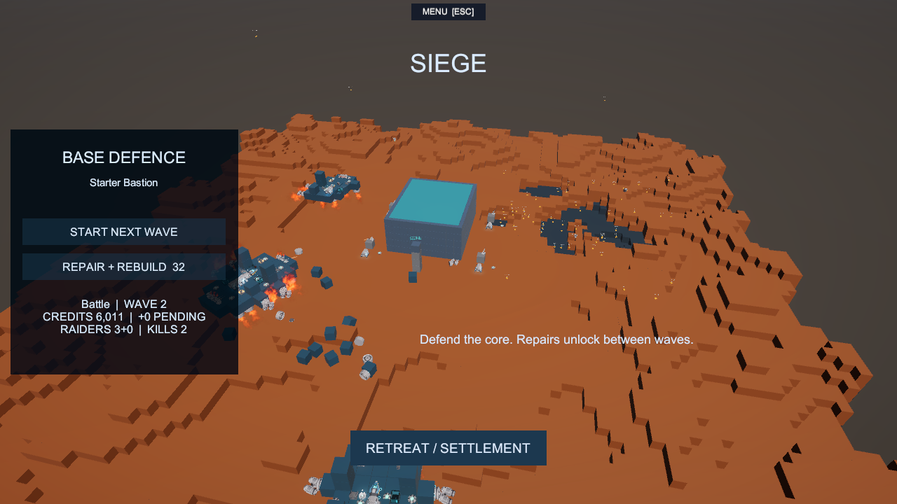

# 新版 Siege 独立 Player 验证 · 2026-11-16

## 范围与实际构建

Unity 6000.6.8f1，Windows x64 / Direct3D11 / 1280×720。使用注册 CLI `build` 命令构建全部启用场景，输出 `Builds/GameplayValidation/HY-Sandbox.exe`；修复后构建 `build_8b1828ab1fa0` 成功，0错误、3警告，11.605秒。Builds、Temp日志和图片不提交，以下为本次实测摘要。五次完成运行的检查列表、outcome和采样摘要已归档至[结构化结果](2026-11-16-siege-player-results.json)，不依赖Temp日志长期保留。

新增 `SiegeGameplayPlayerChecks` 仅在显式 `-siege-gameplay-report <绝对路径>` 下启动：真实菜单选择官方example，进入生产Additive Siege宿主，付费部署已知Finch、真实供电起飞、生成真实敌舰、死亡/返航/收益结算、返回工坊和菜单。隔离个人舰船目录，夹具在该进程内替换攻击/防御候选；顶门开关只改内存中的示例，不创建或改写个人蓝图。普通启动无夹具对象。

## 真实结果与证据边界

| 项目 | 结果 | 边界 |
| --- | --- | --- |
| 前门脚本伤害闭环 | 22项通过，29.61秒 | 实际起降/敌舰死亡/停靠结算；敌驾驶舱由夹具施加伤害 |
| 顶门脚本伤害闭环 | 22项通过，24.31秒 | 同上，真实顶门及模块碰撞 |
| 专门非凸地形接触 | `ConcaveTerrainChecks.Run()` 5项通过 | 非凸MeshCollider、生产避障和池化炮弹重叠，无不支持API日志 |
| 共用导航回归 | `SharedNavigationPlayChecks.Run()` 10项通过 | 受影响共用避障路径 |
| 修复前自然观察 | 180秒基地存活，未清首波 | 原生ClosestPoint消息19,951条；旧捕获遗漏，不能将报告passed解释为无错 |
| 修复后顶门自然观察 | 181.83秒，20条流程检查，完成1波并进入第2波 | 不施加夹具伤害；第2波仍在交战，不代表完整多波通关 |
| 修复后前门自然观察 | 原定600秒，128.04秒因核心摧毁结束；20条流程检查通过 | 完成第1波后第2波失败，正常回工坊/菜单；并非10分钟存活通过 |
| 延长顶门自然观察 | 原定600秒，248.90秒因核心摧毁结束；20条流程检查通过 | 完成第1波后第2波失败，正常回工坊/菜单；并非10分钟存活通过 |

修复后报告 `Temp/GameplayPlayer/roof-natural-fixed.json`：errors为空，日志中ClosestPoint消息0；结束前第二波有3个敌驾驶舱、基地330模块、25个单位。前门 `front-natural-600.json` 的outcome为natural-base-defeated，错误与ClosestPoint消息均为0，Player自行正常退出，最终可见截图已查看。没有以观察时长内基地存活作为战斗平衡保证，natural-base-defeated也是合法观察结果；两个600秒目标样例均未能持续600秒：顶门 `roof-natural-600.json` 于248.90秒第二波核心摧毁，错误与ClosestPoint消息也是0。它们不固定随机种子且战况不同，不能以存活时长直接判定门方向优劣。

夹具记录18,085帧，p95约10.86ms、p99约14.20ms。该段混合隐藏窗口与可见窗口，使用120fps目标且未做统一GPU条件测量，**不是正式性能基准**。首次隐藏窗口的截图全黑，不计视觉证据；复跑显示窗口后 `roof-natural-fixed-intermission-1.png` 已查看，岛屿、顶门机库、战斗HUD及清场展示可见，未见明显重叠。阶段切换捕获发生于UI刷新前，截图仍可显示上一帧Returning文案；最终阶段/结算以状态断言与报告为准。

可见窗口实测画面：顶门自然第一波完成后第二波交战，显示真实模块机库、被破坏的有限地形与战斗HUD。此图只证明该时刻表现。

## 实际修复

`NavigationObstacleQuery` 的初始重叠与脱困，以及 `TurretProjectile` 的重叠/触发命中，原直接调用 `Collider.ClosestPoint`。Unity不支持其用于非凸MeshCollider，浮岛正使用该碰撞类型。四处现统一调用既有 `ImpactPhysics.ClosestPoint`：受支持形状沿用精确API，非凸网格使用bounds保守回退。没有实现精确网格三角面最近点，也不将包围盒回退称为精确接触几何。

原生Physics.ClosestPoint消息即使没有标为Error也纳入新夹具失败捕获，避免再次出现日志污染但报告绿色的情况。自动截图和测试JSON保存在显式输出目录；正常生产菜单/战斗不写此数据。

## 验证与运行事故

Unity重编译0错误；`dotnet build HY-Sandbox.sln --no-restore` 0错误、37个既有警告。格式检查、导航刷新及差异检查见提交Validation；不以静态检查替代上述Player证据。

约16:24原Editor在Pipeline Roslyn eval发射阶段崩溃，NightDesk同时记录OutOfMemoryException并退出、防睡眠请求已释放。系统提交内存约90%，但尚不能确认单一根因。资产和本地提交仍在；已恢复Editor连接，后续采用注册构建命令并串行执行重型操作。未关闭其他用户程序，未修改系统电源或内存配置，未恢复用户已接管的遮罩。

仍需：真实个人舰型、六机库拥挤/堵门、长期自然多波、小屏和人工鼠标完整UI、固定硬件与可见窗口的性能采样。独立Player门方向编辑尚未覆盖；本轮Player仅验证加载后的前/顶门流程。
